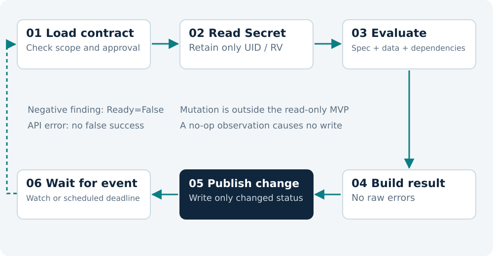

# 8. The Reconcile Loop and Reliable Status

## 8.1 Reconcile Does Not Process Individual Events

A controller must not assume it will receive every intermediate step between two changes. Reconcile works with the currently observed state and must be idempotent. Two identical evaluations should produce the same result and no additional workload changes.

A practical flow is: load the contract; check authorization and specification; read dependencies; calculate the result; calculate the next check time; publish only actual changes. Only the optional mutation module, when explicitly permitted, inserts a change plan before the final status.



## 8.2 Distinguishing NotFound from Forbidden

If the contract no longer exists, reconcile finishes without error and cleans up its own metric series. If the Secret does not exist, set `SecretExists=False`; do not turn this into a panic or an unlimited retry. A watch for Secret creation will trigger another check later.

If the API returns `Forbidden`, do not report “Secret does not exist.” That would conceal an installation or authorization problem. Use the separate reason `SecretAccessDenied` without publishing the raw server response.

If a read fails because of a timeout, do not present an old positive finding as a new successful observation. `observedSecret` retains the identity of the previous actual observation or is cleared according to a documented policy; the current required condition remains unconfirmed.

## 8.3 Conditions and observedGeneration

Every result must refer to the specification generation that the controller checked. If the contract changes between reading and writing, the newer generation must not receive an old positive result as though it had been processed.

The status subresource separates controller reporting from the user-managed specification. CRDs support it, and the generated schema must explicitly enable it. [S13](https://kubernetes.io/docs/tasks/extend-kubernetes/custom-resources/custom-resource-definitions/)

```go
// Reference snippet; integrate into the existing status builder.
meta.SetStatusCondition(&next.Conditions, metav1.Condition{
    Type:               "KeysValid",
    Status:             metav1.ConditionTrue,
    ObservedGeneration: contract.Generation,
    Reason:             "RulesSatisfied",
    Message:            "All declared key rules are satisfied.",
    LastTransitionTime:  metav1.NewTime(now),
})
```

`lastTransitionTime` changes when a condition's status changes, not as a heartbeat. The helper and status builder must preserve the previous transition time when the status is unchanged. A change in `reason` or observed generation can matter without being a transition from `False` to `True`.

## 8.4 A Semantic No-op

A common loop occurs when reconcile always sets `lastCheckedTime=now`, writes status, and receives another event from its own write. A predicate that ignores status changes can help, but does not justify unnecessary API writes.

Build a status builder that sorts findings consistently, removes obsolete errors, and preserves timestamps. Compare semantic content before adding a new time, and do so only when a new input or scheduled time boundary was actually processed.

The test should count status writes. After the initial reconciliation, another reconcile without dependency changes must make zero status patch calls.

## 8.5 Optimistic Locking

```go
// Reference snippet: recalculate after a conflict.
base := current.DeepCopy()
current.Status = desiredStatus
patch := client.MergeFromWithOptions(
    base,
    client.MergeFromWithOptimisticLock{},
)
if err := r.Status().Patch(ctx, current, patch); err != nil {
    return ctrl.Result{}, err
}
```

controller-runtime supports merge patches with an optimistic locking option. This permits rejection of a stale write instead of silently overwriting a concurrent change. Check the signature and behavior against the pinned library version. [S06](https://pkg.go.dev/sigs.k8s.io/controller-runtime/pkg/client)

Returning an error controls retries through the work queue. Do not add a parallel infinite loop that repeats the same old patch. On the next reconcile, read the data again and recalculate status.

## 8.6 Requeue and Time

For invalid content, rely on dependency events. For maximum-age checks, schedule the next relevant deadline. For optional ESO-status polling, use a moderate interval with jitter. For transient API errors, use the existing backoff mechanism without an additional aggressive timer.

The shortest required positive interval becomes `RequeueAfter`. A calculated negative interval means the boundary has already passed: update the finding immediately and schedule the next check with a small defined minimum, rather than creating an endless loop with no wait.

## 8.7 Deletion and Ownership

The MVP owns no external objects requiring cleanup, so it needs no finalizer. Deleting a contract does not delete its Secret, Deployment, grant, or ESO object. The operator does not take over their owner references.

If a later mutation version leaves an annotation or environment reference, its removal policy must be explicit. A safe initial choice is for contract deletion to stop further management without automatically removing application configuration. Removing it could bring down the service.

**Checkpoint.** Three consecutive reconciles without changes should leave identical status and workload metadata. This is a basic controller quality test.
