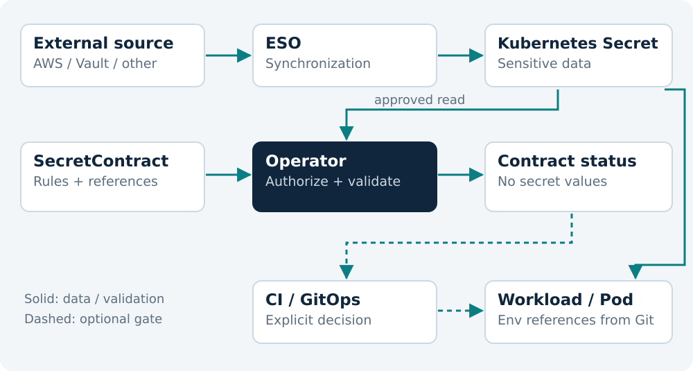
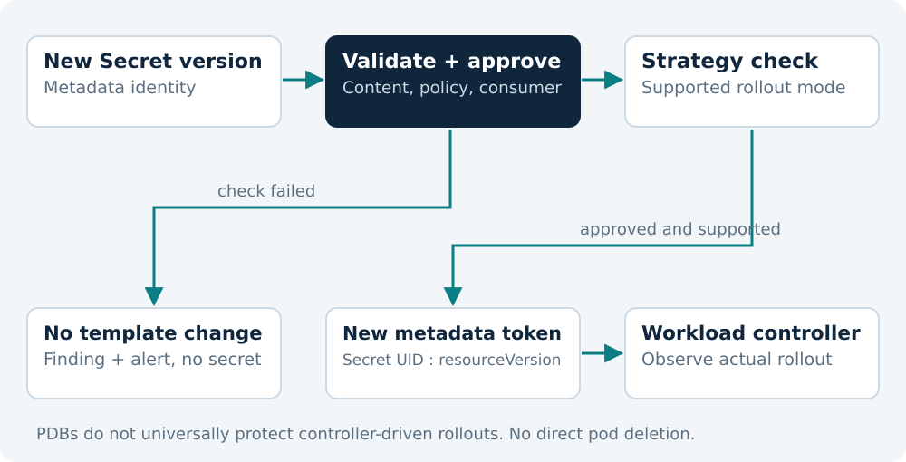

# Secret Contract Operator

Designing a Safe Kubernetes Operator

Prepared for Codepop · English edition 1.0

# Preface: How to Use This Book

**Secret Contract Operator** is a Kubernetes operator design that checks whether an application receives the secrets it expects, in a form it can use. The book follows the path from the initial problem through API design, safe implementation, testing, packaging, and maintenance of a public open-source project.

This is not a conversation repackaged as a PDF. The earlier operator proposal and development prompts are consolidated into one technical specification. Ambiguous behaviors receive explicit decisions: what `Ready` means, who may create a contract, what happens during an invalid rotation, how to avoid a status-update loop, and why automatic variable injection is not part of the default mode.

## Who This Book Is For

The primary audience is DevOps and platform engineers familiar with Deployments, Secrets, namespaces, and basic RBAC. Implementation requires practical Go knowledge, but complexity is introduced gradually: a pure validator without Kubernetes dependencies, then a controller, followed by integrations and optional mechanisms that modify workloads.

Readers building the first public MVP should follow Chapters 1–11, 15–20, and Lab A. Chapters on injection, automatic restarts, and admission control describe a later phase. Cluster maintainers may prefer to begin with the security model, installation, observability, and operating procedures.

## Publication Status and Verification Limits

This book is a **design specification and development guide, edition 1.0**, prepared on October 10, 2026. It does not claim that the entire operator has been implemented, released, or security-certified. The proposed GitHub path, image repository, and API group are project configuration choices, not confirmation that public releases exist.

Three kinds of examples are distinguished. An **executable laboratory example** is a small standalone program in the companion `examples/contractlab` directory. A **reference snippet** illustrates a pattern to integrate into a real scaffold. A **future feature specification** describes a requirement that is implemented and accepted only after testing. YAML for a new CRD becomes applicable only after the corresponding schema is implemented and installed.

Book verification covers the generated formats, consistency of examples, and local tests of the isolated Go validator. Envtest, kind, a real ESO installation, Helm installation, and production-cluster operation remain development checks: the book prescribes them without claiming they have run.

## Conventions

The term **secret** refers to a sensitive value; `Secret` refers to a Kubernetes object. A **contract** is a `SecretContract` instance. A **consumer** is a selected container within a workload. A **reconcile** is one attempt to bring observed and desired state into agreement. Code identifiers use English naming for compatibility with Go and the Kubernetes ecosystem.

All password-like values in the labs are synthetic. They must not be reused in production. Commands that modify a cluster run only in a dedicated test environment until the release checklist has been completed.

References such as `[S01](https://kubernetes.io/docs/concepts/configuration/secret/)` and `[S02](https://external-secrets.io/latest/api/externalsecret/)` point to primary sources in the bibliography. They support the behavior of Kubernetes and the tools used. This operator's API, product boundaries, proposed tests, and security decisions are **design decisions made in this book**, not an official Kubernetes specification.

## Key Corrections to the Initial Idea

`Ready=True` neither blocks deployment nor proves that the application connected to its database. A changed `resourceVersion` does not prove that a password was rotated. A rotation-time annotation is not cryptographic evidence of credential age. Prohibiting value logging does not, by itself, prevent information extraction through validation rules.

The first operator version is therefore deliberately small: it reads approved Secret objects, checks the contract, and publishes safe, clearly bounded state. Anything that changes application execution receives additional authorization, a separate RBAC profile, and specific acceptance criteria.


# 1. The Problem We Are Solving

## 1.1 From an Available Secret to Usable Configuration

A typical platform successfully transfers a secret from AWS Secrets Manager, Vault, or another system into Kubernetes, yet the application still fails to start. A key name changed, a value is empty, JSON is invalid, or a Deployment references an old Secret. Synchronization technically succeeded; the contract between configuration and the application did not.

Kubernetes supports consuming Secret data through `envFrom`, `secretKeyRef`, and volumes. A required but unavailable Secret, or an individual required key, can prevent a container from starting. However, `envFrom` does not know that the application expects an additional key absent from the Secret object. Another layer must check semantic correctness. [S01](https://kubernetes.io/docs/concepts/configuration/secret/)

Secret Contract Operator makes that rule explicit. Instead of tribal knowledge and manual comparisons of `.env.example` files, the team gets a versioned declaration: the application expects `DB_USERNAME`, a nonempty `DB_PASSWORD`, and valid JSON in `PROVIDER_CONFIG`.

## 1.2 The Product's Precise Value

The operator's main result is not another copy of a secret, but **explainable contract state**. Users see which requirement was not met and which contract generation the controller checked. A pipeline can inspect that state before changing a workload. A platform team can alert on regressions after rotation without adding an SDK to every application.

A good first user is a team already using ESO and GitOps whose incidents occur at the boundary between secrets and applications. A poor initial target is a platform seeking a central password generator, database credential issuance, token revocation, and complete control over application restarts. That is a different product.

## 1.3 What the Operator Guarantees

For an approved reference and a successfully read Secret snapshot, the operator checks the declared rules and records the result with the identity of that observation. It does not write actual values, fragments of values, deterministic hashes of values, or parser errors that may contain data into status, events, or metrics.

This guarantee concerns outputs controlled by the implementation. It cannot remove a secret from kube-apiserver memory, TLS-protected transport, the Go heap, or a previously configured audit system. A safe operator must constrain these surfaces rather than claim they do not exist.

## 1.4 What the Operator Does Not Guarantee

A contract does not prove that a remote database accepts the password. `minLength: 32` does not prove entropy. JSON validation does not establish that the provider recognizes an API key. PEM decoding does not establish that a certificate is trusted, currently valid, or paired with a private key.

A contract does not control an already running process. Even after a successful rollout, the application may have its own cache, an incorrect variable name, or a misconfigured connection pool. Application readiness remains an independent signal.

## 1.5 Boundaries of the First Release

The proposed `v0.1` includes one local Secret per contract, key rules, stable status, an optional read-only ESO check, reference checks for Deployments, StatefulSets, and DaemonSets, metrics, and a namespace-scoped installation. It does not create Secrets, copy them between namespaces, use a mutation webhook, perform network credential tests, or automatically delete pods.

The proposed `v0.2` adds strictly authorized PodTemplate modification and a restart signal. Admission-based deployment blocking, aggregation of multiple contracts, and support for complex rollout controllers may follow. These version labels describe a development plan, not existing releases.

| User Need | MVP Response | Not Promised |
|---|---|---|
| Missing key | `KeysValid=False` and the key name | Filling in the secret |
| Invalid JSON | Stable `InvalidJSON` code | Repairing the content |
| ESO not ready | Optional blocking of `Ready` | Repairing cloud access |
| Deployment does not use the Secret | `WorkloadsConfigured=False` | Workload changes in v0.1 |
| Secret changed | A new observation and validation | Updating a running process's environment |

## 1.6 Success Criteria

The first release is useful when a new user can install the operator with understandable permissions, apply three small manifests, and receive an accurate diagnosis without reading the implementation. A demonstration with one valid Secret is not enough.

A public project also needs negative evidence: an unauthorized reference was not read, an invalid secret did not cause a restart, an unchanged contract did not produce endless status writes, and uninstalling the operator did not delete application data.

**Checkpoint.** Before implementation, write one sentence that distinguishes secret transfer, contract validation, and application health. If the product describes them as one thing, its scope is not yet precise enough.


# 2. Its Place in the Kubernetes Ecosystem

## 2.1 Compose Rather Than Duplicate

External Secrets Operator translates declarations such as `ExternalSecret` into Kubernetes Secret objects. Its `Ready` condition describes the state of the synchronized target Secret, while refresh policies determine when external values are fetched. This is the boundary at which our operator takes over application-contract validation. [S02](https://external-secrets.io/latest/api/externalsecret/)

Secret Contract Operator receives no AWS keys, Vault tokens, or access to external APIs. Its minimum network requirement is the Kubernetes API, with an optional protected metrics endpoint. Separate responsibilities reduce the range of incident causes that one component must understand.

## 2.2 An Operator, Admission Control, or a CI Script

The Kubernetes operator pattern combines a custom resource with a controller that reconciles state. It is suitable when rules must be rechecked after initial deployment, such as when a dependency changes. [S03](https://kubernetes.io/docs/concepts/extend-kubernetes/operator/)

A CI script is simpler for a one-time staging-configuration check, but it does not automatically react to a later rotation. An admission webhook can reject an object write before the API accepts it, but becomes part of that write's critical path. An operator that publishes status stays outside that path, at the cost of its result not automatically blocking the write.

The design decision is therefore: the operator maintains contract state; CI/GitOps uses that state as an explicit checkpoint; synchronous blocking remains a separate, optional layer. The MVP consequently does not depend on another webhook server's availability.

## 2.3 Go and Kubebuilder

Kubebuilder scaffolds Kubernetes API types, controllers, CRD generation, and supporting development artifacts. controller-runtime provides a client, manager, cache, event handling, and reconciliation machinery. Their versions must align with the scaffold and Kubernetes libraries. [S04](https://book.kubebuilder.io/)

Do not manually combine the newest individual `k8s.io` library with an older controller-runtime minor version merely because the import resolves. The version selected for the project is pinned in `go.mod` and accepted only after passing the local and CI test matrix.

## 2.4 Proposed Project Identity

| Element | This Book's Canonical Value |
|---|---|
| Name | Secret Contract Operator |
| Repository | `secret-contract-operator` |
| Proposed Go module | `github.com/CodepopTech/secret-contract-operator` |
| Proposed API group | `secrets.codepop.tech` |
| Initial API version | `v1alpha1` |
| Kind / plural | `SecretContract` / `secretcontracts` |
| Short name | `scn` |
| Annotation prefix | `secrets.codepop.tech/` |

The `secrets.platform.io` group in an earlier draft was an example. A published project should use DNS space controlled by its maintainer. This book consistently uses the proposed Codepop namespace; that is not an automatic migration of an existing cluster. If a CRD is already installed under another group, changing the group creates another API and requires an object-copying and validation plan.

## 2.5 Decisions That Avoid Early Technical Debt

One contract references one Secret in the same namespace. An ESO reference is not an arbitrary GVK: it is an `ExternalSecret` restricted to supported API versions. Workload references contain an explicit consumer list. The operator does not modify `ownerReferences` on Secrets or workloads owned by others.

The default installation has no workload write permissions. Validation-only operation is expressed through a real RBAC profile, not merely an `if` statement. There is no automatic takeover of application ownership and no finalizer that turns contract deletion into an availability problem.

## 2.6 Alternatives

If an application already performs reliable startup validation, the operator should provide earlier diagnostics rather than replace it. If secrets are consumed exclusively as files through CSI, this MVP cannot claim to validate those values because it does not read the pod's filesystem. If an organization mandates policy-engine controls, a contract can provide an additional signal without bypassing existing authorization boundaries.

It has not been established that no similar project exists. This design's value depends on a carefully bounded API, honest guarantees, and reliable behavior under load, rather than a claim of complete originality.

**Checkpoint.** Before the first commit, adopt the API group, minimum supported profile, and explicit list of features outside the MVP. These are architecture decisions, not README details.


# 3. Architecture and Data Flow

## 3.1 The Control Plane

The architecture separates observation, a deterministic evaluator, and result publication. The observation layer reads approved objects. The evaluator knows nothing about Kubernetes networking and does not log. The publication layer translates findings into bounded status, metrics, and events.



The MVP has no Secret-data flow into Git, CI output, or a separate database. Data exists in the Kubernetes Secret and temporarily in operator memory. Status contains observation metadata and finding codes. Types must express this distinction too: the validator result has no `Value`, `Actual`, `Input`, or `Snippet` field.

## 3.2 Components

`api/v1alpha1` defines the public API. `internal/contract` implements data validation. `internal/controller` manages reconciliation. `internal/status` constructs a stable result. `internal/dependencies` reads ESO and workload state. `internal/authorization` checks installation-level scope and approvals. `internal/telemetry` works only with safe results.

In a later phase, `internal/mutation` receives a separate interface. It accepts a change plan containing references and metadata, but no Secret content. This boundary reduces the risk of accidentally turning values into inline `env.value` entries.

## 3.3 One Reconcile as an Observation Transaction

The controller loads the contract and checks whether its namespace is allowed. It then checks that the reference is authorized before reading content. Only then does it load the Secret and record its `UID` and `resourceVersion` pair. Pure validation, optional dependency checks, and condition calculation follow.

This operator treats `resourceVersion` as an equality-check identifier without numeric arithmetic. Current Kubernetes documentation permits certain ordering comparisons for the same API resource type under specified conditions; our algorithm does not need them. Versions from different resource types are not compared as a shared transaction. The API supports optimistic concurrency, but does not provide an atomic update of an arbitrary Secret and Deployment. [S05](https://kubernetes.io/docs/reference/using-api/api-concepts/)

Compare the result with existing semantic status. If there is no difference, do not write. If a difference exists, use a status patch with an appropriate conflict check. On conflict, reread and recalculate rather than repeatedly writing the previously calculated status.

## 3.4 Event Sources

The main events are a `SecretContract` generation change, a referenced Secret change or deletion, a relevant workload change, and changes to the optional ESO object. A timer is needed for rotation age and any polling integration. Without a timer, a contract can remain green after its maximum age expires if no object changes.

Indexes map dependency names to contracts within the same namespace. An event from one namespace must not wake a contract using the same name in another. Mapping uses namespace and name; observations distinguish object recreation through the UID.

## 3.5 Cache as a Deliberate Decision

The controller-runtime client may use a cache for reads while sending writes directly to the API server. The library provides cache-behavior options and a separate uncached reader. Verify configuration against the project's version. [S06](https://pkg.go.dev/sigs.k8s.io/controller-runtime/pkg/client)

A simple namespaced MVP may use a standard Secret informer, but its cache then stores Secret content from the watched scope. This is not “metadata only.” Restricting namespaces reduces scope without removing the process's sensitivity.

A stricter profile can watch metadata and individually fetch approved Secrets through a direct reader. This reduces persistent cache retention, but increases API calls and watch-implementation complexity. Adding a label selector to a cache is not itself a security boundary: RBAC still determines actual permissions.

## 3.6 Error Handling

Invalid content is an expected negative result, not an infrastructure error. Set `Ready=False` without aggressive retries. A Secret `NotFound` is also a dependency state. `Forbidden`, an unavailable API, and discovery failure are different infrastructure findings.

Do not automatically copy an external error into public status. Some parsers and clients include input in their messages. Instead, use a stable code such as `DependencyAccessDenied` with a locally written message that excludes the original payload.

**Architecture invariant.** Data enters the validator but does not leave that boundary as diagnostic text. The rest of the system uses only controlled identifiers, counters, timestamps, and references.


# 4. Security Model and Authorization

## 4.1 Why This Is a Privileged Component

An operator that reads Secrets can access real credentials even when its README says “read-only.” Kubernetes security guidance emphasizes that `list` and `watch` on Secrets can expose their content, and creating workloads can provide a route to secrets available in the namespace. [S07](https://kubernetes.io/docs/concepts/security/rbac-good-practices/)

Risk therefore depends on more than the number of RBAC verbs. Relevant questions include which namespaces are covered, who can create and modify contracts, who sees status, and who controls a consumer that might eventually receive an injected secret.

## 4.2 Threat Model

| Actor or Failure | Potential Problem | Design Control |
|---|---|---|
| Untrusted contract author | Probing another party's secret properties | Restrict authorship and approvals |
| Attacker able to modify a workload | Exfiltrating injected values | Separate mutation authorization |
| Parser defect | Value appears in an error message | Static codes; no raw errors |
| Compromised operator | Reading all permitted secrets | Namespaced RBAC and smaller scope |
| Excessive rule count | CPU and status load | Count and size limits |
| API outage | Stale positive status | Check generation and observation |
| CI debug mode | Accidental data output | No `set -x`; no Secret dumps |

## 4.3 Validation Oracle: Leakage Without Logging

Suppose a user can modify a `pattern` rule for a secret they otherwise cannot read, and can inspect the result. Repeated checks let that user infer properties of the content. The problem has not disappeared merely because status says “rule not satisfied” without showing a value.

Length, validity of a particular format, and even key existence can be sensitive. This follows from the system's design: every conditional result about a secret carries information. In the MVP, only trusted administrators already authorized for the corresponding Secret may create and modify contracts. Status readers receive only the metadata scope the organization accepts as visible.

For multiple untrusted tenants, adding `allowed: true` inside the contract is insufficient: the author could approve themselves. A separate protected grant policy, managed by another role, must bind the contract, Secret, allowed rule types, and any workload.

## 4.4 Why a Namespace Is Not Complete Authorization

Prohibiting cross-namespace references prevents a straightforward class of mistakes, but users within one namespace need not have equal rights. Two teams sharing a namespace may share application infrastructure without sharing secrets.

The proposed safe starting profile uses one namespace per trust boundary and trusted contract authorship. If this is unacceptable, implement and test the grant model first. Only then may the product claim support for untrusted contract authors.

## 4.5 Dual Approval for Mutation

In a later release, workload modification requires the installation to explicitly enable mutation, the corresponding RBAC profile to include workload `patch`, the contract to request the feature, and the workload administrator to approve the target. A single annotation that anyone can change is not a security control.

Protected approval binds to the contract UID, not just its name. Deleting and recreating a contract under the same name does not automatically inherit its previous approval. The mutation MVP permits only one contract to manage changes to a workload; multiple read-only contracts are allowed.

## 4.6 Leakage Surfaces

Secret values must not appear in structured log fields, `%+v` object dumps, panic payloads, tracing attributes, HTTP diagnostics, event messages, metrics, snapshot tests, or CLI debug output. Plain content hashes are also prohibited: for weak or predictable values, such a hash can help verify guesses.

Do not enable a public `pprof` endpoint. A heap dump contains actual process memory and may include secrets. Go provides no simple general guarantee of reliably erasing every copy of a value from the heap. Reduce copying, retention duration, and cached object count without claiming “zeroization guaranteed.”

Kubernetes recommends encryption of sensitive data at rest and restricted access. Base64 in a manifest is not encryption. For managed clusters, verify the provider's actual configuration rather than assume identical defaults across platforms. [S08](https://kubernetes.io/docs/concepts/security/secrets-good-practices/)

## 4.7 Admission Validation of the Operator's API

The CRD schema should reject duplicate keys, negative lengths, oversized lists, and inconsistent policy. However, a schema cannot prove that the author is entitled to learn properties of an arbitrary other secret. That is a separate authorization decision.

An operator using the grant model rechecks the grant during reconciliation. Revocation must stop new reads and new mutation operations. Replace old status with `Ready=False`, reason `AccessNotApproved`, excluding earlier validation details that should no longer be displayed under the new permissions.

## 4.8 Security Threshold for the First Public Release

Before release, tests must show that unauthorized references are rejected before data is read, all safe outputs exclude the sentinel value and its common encodings, mutation is disabled by default, and parser failures do not expose data.

Status and metrics carry a bounded number of findings. Key names are treated as metadata that may still be internal. Strict mode may display only a failure count and contract reason, but even that mode does not entitle untrusted authors to probe a secret without limits.

**Checkpoint.** A security review should answer: “Who can learn something new about a secret through this operator?” The answer “nobody, because we do not log” is insufficient.


# 5. Canonical API and Contract Semantics

## 5.1 The API as a Public Promise

The most expensive mistake in an early operator is often an unclear public field rather than a faulty algorithm. Two boolean fields controlling the same decision, or a “smart” default whose meaning changes with context, make testing, migration, and support harder.

This book therefore consolidates the initial sketch. A missing Secret always prevents a contract from being satisfied. The `nonEmpty` rule belongs to individual keys; there is no conflicting global rule. Injection has one mode instead of a combination of `enabled` and `managed`. Fields that default to `true` use pointers where an omitted field must be distinguished from an explicit `false`.

The CRD uses an OpenAPI schema, a status subresource, and list-map semantics for conditions. Kubebuilder markers generate the corresponding schema and make maintenance easier. [S09](https://book.kubebuilder.io/reference/generating-crd.html)

## 5.2 A Complete Example of the Proposed API

The following manifest describes the **target API**, including fields planned for a later version. In v0.1, injection remains `Disabled` and restart remains `false`. This is not a manifest for an already installed third-party operator.

```yaml
apiVersion: secrets.codepop.tech/v1alpha1
kind: SecretContract
metadata:
  name: payments-api
  namespace: payments
spec:
  secretRef:
    name: payments-api-secrets
  requiredKeys:
    - name: DB_USERNAME
      required: true
      nonEmpty: true
    - name: DB_PASSWORD
      required: true
      minLength: 16
      maxLength: 256
    - name: provider.json
      envName: PROVIDER_CONFIG
      required: true
      format: JSON
  externalSecretRef:
    name: payments-api-secrets
    apiVersion: external-secrets.io/v1
  workloadRefs:
    - apiVersion: apps/v1
      kind: Deployment
      name: payments-api
      containers: [api]
      includeInitContainers: false
      consumption: EnvVars
  injection:
    mode: Disabled
  rotation:
    restartOnChange: false
    maxAge: 720h
    rotatedAtAnnotation: secrets.codepop.tech/rotated-at
  policy:
    requireExternalSecretReady: true
    requireWorkloadReference: true
    requireRotationPolicy: false
```

## 5.3 Key Rules

`requiredKeys` is a list of rules with unique `name` values, with a proposed maximum of 256. `required` and `nonEmpty` default to `true`. An absent optional key is skipped. If an optional key is present, all its declared rules still apply.

`minLength` and `maxLength` measure **bytes in the decoded value**, not Unicode characters or the length of its base64 representation. `nonEmpty` rejects zero bytes; it does not trim whitespace or normalize content automatically. Changing the original value is not the validator's job.

`pattern` uses Go regexp semantics. By default, the rule looks for a match; an author uses anchors to match the entire value. `format` is `None`, `JSON`, `URI`, or `PEM`. JSON means syntactically valid JSON, including scalar values. URI means an absolute URI with a scheme; network access is prohibited. PEM means one or more correctly decoded blocks, with no other content between them.

`envName` is used only for explicit environment-variable mapping. The Secret key `provider.json` is valid, but a platform may require the portable variable name `PROVIDER_CONFIG`. A conservative environment-variable naming rule is a project decision, not a claim that every modern Kubernetes version permits the same characters.

## 5.4 References and Policies

All references are local to the contract's namespace. `externalSecretRef` has the fixed kind `ExternalSecret`; its API version comes from an installation-level list of supported ESO versions. Users cannot read arbitrary resources by supplying a GVK.

`workloadRefs` supports `apps/v1` Deployments, StatefulSets, and DaemonSets. `containers` explicitly selects consumers. When the list is omitted in validation-only mode, all regular containers are checked. Init containers are included only explicitly. Mutation mode requires an explicit container list to avoid unintentionally exposing a secret to a sidecar.

The policies `requireExternalSecretReady`, `requireWorkloadReference`, and `requireRotationPolicy` determine whether the corresponding finding contributes to aggregate `Ready`. A required policy must have its corresponding configuration. Do not accept `requireExternalSecretReady: true` without a reference.

## 5.5 Conditions and Ready Logic

The conditions are `SecretExists`, `KeysValid`, `ExternalSecretReady`, `WorkloadsConfigured`, `RotationPolicySatisfied`, and aggregate `Ready`. An unconfigured optional check receives `True` with reason `NotConfigured`. A configured check that has not yet been evaluated receives `Unknown`.

The proposed formula is:

```text
Ready = authorized
    AND validSpec
    AND SecretExists
    AND KeysValid
    AND (not requireExternalSecretReady OR ExternalSecretReady)
    AND (not requireWorkloadReference OR WorkloadsConfigured)
    AND (not requireRotationPolicy OR RotationPolicySatisfied)
```

A positive result is valid only for conditions from the contract's current generation. An infrastructure failure that prevents a required check is not a positive result. `Ready` may be `Unknown` while checks are pending, or `False` when there is a definite negative finding.

`WorkloadsConfigured=True` means that the declared PodTemplate correctly references the Secret. It does not mean that pods are running or the application is healthy. Automatic restart, when introduced, has a separate action status; it should not be hidden inside the meaning of `Ready`.

## 5.6 Status for One Observation

```yaml
status:
  observedGeneration: 3
  observedSecret:
    name: payments-api-secrets
    uid: 53f81e06-1111-4444-8888-84fd83655102
    resourceVersion: "84721"
  lastCheckedTime: "2026-10-10T08:30:00Z"
  missingKeys: []
  violations: []
  missingKeyCount: 0
  violationCount: 0
  conditions:
    - type: KeysValid
      status: "True"
      observedGeneration: 3
      lastTransitionTime: "2026-10-10T08:30:00Z"
      reason: RulesSatisfied
      message: All declared key rules are satisfied.
```

This example shows part of the status, not the complete output. Every condition has `observedGeneration`. Conditions are treated as a map keyed by `type`, not a list whose order has semantic meaning. `missingKeys` and `violations` are sorted deterministically.

`lastCheckedTime` is updated for a new relevant observation or a scheduled check, not on every pass through the event queue. A timestamp change alone must not keep the reconcile loop running.

## 5.7 Limits and Types

Duration fields use the format supported by the selected Go/Kubernetes type: for example, `24h` or `720h`, rather than an assumed `30d`. Negative and zero maximum ages are rejected. A future timestamp outside the allowed clock-skew window is a metadata error.

The total number of status findings is bounded, with an indicator when results are truncated. Rules have a pattern-length limit; the evaluator limits individual values and the total content processed. These limits belong in the versioned specification and tests.

**Checkpoint.** Document each field's default, validation, and effect on `Ready`. If this cannot fit in one clear table, simplify the API further.


# 6. Repository and Development Environment

## 6.1 Reproducibility Before Implementation

The repository must record exact versions of the Go toolchain, Kubebuilder, controller-runtime, controller-gen, envtest binaries, and the kind node image. This book does not call an untested combination the “latest compatible” one. Compatibility follows from the chosen scaffold and test results.

Generate the initial `toolchain-report.txt` locally without kubeconfig contents, environment dumps, or credentials. `go version`, `kubebuilder version`, `kubectl version --client`, `helm version`, and hashes of the relevant configuration files are sufficient.

## 6.2 Bootstrap Commands

The following commands are a proposal for an empty repository. Do not run them over an existing project without reviewing it first.

```bash
mkdir secret-contract-operator
cd secret-contract-operator

git init
kubebuilder init \
  --domain codepop.tech \
  --repo github.com/CodepopTech/secret-contract-operator

kubebuilder create api \
  --group secrets \
  --version v1alpha1 \
  --kind SecretContract \
  --resource --controller

make generate
make manifests
go test ./...
```

If the local Kubebuilder version requires different flags or an additional plugin choice, follow its `--help` output and record the choice. Do not change Go modules at random just to make the command succeed. Preserve `PROJECT` and the generated Makefile as part of the scaffold contract. [S04](https://book.kubebuilder.io/)

## 6.3 Project Structure

```text
secret-contract-operator/
  AGENTS.md
  api/v1alpha1/
  cmd/
  internal/
    authorization/
    contract/
    controller/
    dependencies/
    mutation/
    status/
    telemetry/
  config/
    crd/
    manager/
    rbac/
    samples/
  charts/secret-contract-operator/
  examples/
  test/e2e/
  docs/adr/
  prompts/
  tracking/
```

Do not create every empty package immediately. `mutation` can wait until the second phase. Keeping the pure validator free of accidental dependencies on an event recorder or cloud client matters more than making the directory structure look large.

## 6.4 AGENTS.md as an Engineering Contract

Codex supports project instructions in `AGENTS.md`; the instruction hierarchy allows general context and more specific guidance in individual directories. This is more useful than repeating the entire context in every task. [S25](https://developers.openai.com/codex/guides/agents-md/)

For this project, the root instructions define feature boundaries, prohibit leakage, require namespace-local references, exclude mutation permissions from the MVP, and require tests. They contain no real secrets, production endpoints, or rule authorizing automatic deployment to a real cluster.

```text
Read docs/specification.md before changing public API.
Read docs/security.md before touching Secret handling.
Never serialize Secret objects to diagnostics.
Default profile is validation-only, including RBAC.
Do not overwrite unrelated work or existing env entries.
Record executed tests; never mark an unrun test as passed.
```

## 6.5 Development Checks

`gofmt` and `go vet` check basic hygiene, but they do not prove reconcile correctness. `make generate` refreshes DeepCopy code. `make manifests` refreshes CRD and RBAC artifacts. CI must confirm that generation leaves no diff.

`go test ./...` must not silently require a real production cluster. Unit tests and envtest use clearly separated test setups. E2E tests against kind run through a separate target and a dedicated kubeconfig.

## 6.6 A Fake Cluster Is Different from envtest

The controller-runtime fake client is useful for certain unit tests, but it does not represent an API server with all defaulting and status-subresource rules. Envtest starts an API server and etcd, without a kubelet or standard workload controllers. Consequently, an envtest must not wait for a Deployment to actually create pods. [S10](https://book.kubebuilder.io/reference/envtest.html)

The first goal is a small set of clear tests: create a contract, check its status, change its Secret, and perform a no-op second reconcile. Add optional integrations and full-cluster tests afterward.

**Checkpoint.** A clean checkout should have a documented path to unit tests without cloud credentials. Explicitly identify anything that requires network access, tool downloads, or a local cluster.


# 7. The Pure Go Validator

## 7.1 The Boundary Around the Most Sensitive Code

The validator is the only component that needs to understand the contents of declared Secret keys. It accepts rules and `map[string][]byte`, and returns a structured result without the sensitive input. It has no logger, event recorder, Kubernetes client, HTTP client, or clock.

This organization enables fast table-driven tests and fuzz testing. It also simplifies review: every output from the function can be inspected as a potential leakage channel.

## 7.2 Two Levels of Error

An **invalid specification** means that a rule makes no sense: a key is listed twice, a regexp cannot compile, or the minimum exceeds the maximum. **Invalid data** means that a well-defined rule is not satisfied.

Keep these cases distinct. `InvalidPattern` is a contract configuration error, whereas `PatternMismatch` is a data finding. Both must be safe to display, but responsibility for fixing them differs.

## 7.3 Types Without Value Fields

```go
// Reference snippet: no Kubernetes dependencies.
type Rule struct {
    Name      string
    Required  *bool
    NonEmpty  *bool
    MinLength *int
    MaxLength *int
    Pattern   string
    Format    string
}

type Violation struct {
    Key    string `json:"key,omitempty"`
    Rule   string `json:"rule"`
    Reason string `json:"reason"`
}

type Result struct {
    SpecValid  bool        `json:"specValid"`
    Valid      bool        `json:"valid"`
    Missing    []string    `json:"missing"`
    Violations []Violation `json:"violations"`
}
```

User-defined message text is not part of a rule. This prevents someone from putting a secret into `messageTemplate` and having the operator blindly copy it into status later. Public message text is generated from known codes in a separate layer.

## 7.4 Evaluation Order

Check budgets and rule validity first. Then determine whether each key exists. If it is absent and optional, finish checking that key. If it is absent and required, add `MissingRequiredKey` without running parsers on empty input.

For a present value, check its size budget, then emptiness, length, pattern, and format. Sort results by key and rule type. Multiple findings for one key are allowed, but bound the total number of findings and avoid unhelpful repetition.

Do not truncate a value before validation to fit a budget. Truncation would change the meaning of the check. Return `ValueTooLarge` or `EvaluationBudgetExceeded` instead, and document that reason clearly.

## 7.5 Regular Expressions

Go's regexp implementation guarantees execution time linear in input size for the expressions it supports. This is a good reason to avoid introducing another engine merely for additional syntax. Still bound the number of rules, input size, and pattern length, because total work grows with their product. [S11](https://pkg.go.dev/regexp)

Do not return a raw `regexp.Compile` error in status. A pattern belongs to the contract, but may contain sensitive or inappropriate text. `InvalidPattern` and a path to the rule are sufficient. Explain anchors in the documentation and test the difference between substring and full-string expectations.

## 7.6 JSON, URI, and PEM

`json.Valid` is sufficient for JSON syntax. A semantic contract over JSON fields would require a new, explicit feature with a controlled schema and additional complexity limits. The MVP does not promise JSON Schema validation.

The URI parser must confirm that a scheme exists, but must not require a host for every valid URI form: `urn:` and other absolute URIs need not have a network authority. Do not open the address or perform a DNS lookup. This keeps validation deterministic and prevents it from becoming an SSRF surface.

PEM checking allows one or more blocks with nonempty decoded content, with whitespace between blocks. Check for the expected beginning before each `pem.Decode` call, because the decoder can skip some non-PEM text. Do not display block contents on failure. This is not X.509 verification.

## 7.7 The Standalone Lab

The accompanying `examples/contractlab` directory contains an implementation of this narrowly scoped evaluator and its tests. It is not the entire operator. The code uses the standard library and can be checked independently of the Kubernetes scaffold.

```bash
cd examples/contractlab
go test ./...
go test -race ./...
go vet ./...
```

Tests cover required and optional keys, empty values, byte length, invalid regexps, JSON, absolute URIs, PEM, duplicate rules, budgets, and sentinel leakage. Synthetic sensitive values deliberately appear in test fixtures; the prohibition concerns their public outputs, not the ability to test secrets.

## 7.8 Moving into the Real Operator

The adapter between CRD types and the pure evaluator explicitly normalizes defaults. It does not assume the API server has applied them, because unit tests may construct Go objects directly. The same rule applies to old or incomplete objects.

Before moving into a production controller, add fuzz tests for arbitrary bytes and combinations of rules. Fuzzing looks for panics, nondeterminism, and unexpected output; it does not prove the absence of every vulnerability. Go provides a built-in workflow for coverage-guided fuzz tests. [S12](https://go.dev/doc/security/fuzz/)

**Checkpoint.** The validator must be testable without Kubernetes, and its result must be safe to serialize as JSON even when the input is deliberately hostile.


# 8. The Reconcile Loop and Reliable Status

## 8.1 Reconcile Does Not Process Individual Events

A controller must not assume it will receive every intermediate step between two changes. Reconcile works with the currently observed state and must be idempotent. Two identical evaluations should produce the same result and no additional workload changes.

A practical flow is: load the contract; check authorization and specification; read dependencies; calculate the result; calculate the next check time; publish only actual changes. Only the optional mutation module, when explicitly permitted, inserts a change plan before the final status.


## 8.2 Distinguishing NotFound from Forbidden

If the contract no longer exists, reconcile finishes without error and cleans up its own metric series. If the Secret does not exist, set `SecretExists=False`; do not turn this into a panic or an unlimited retry. A watch for Secret creation will trigger another check later.

If the API returns `Forbidden`, do not report “Secret does not exist.” That would conceal an installation or authorization problem. Use the separate reason `SecretAccessDenied` without publishing the raw server response.

If a read fails because of a timeout, do not present an old positive finding as a new successful observation. `observedSecret` retains the identity of the previous actual observation or is cleared according to a documented policy; the current required condition remains unconfirmed.

## 8.3 Conditions and observedGeneration

Every result must refer to the specification generation that the controller checked. If the contract changes between reading and writing, the newer generation must not receive an old positive result as though it had been processed.

The status subresource separates controller reporting from the user-managed specification. CRDs support it, and the generated schema must explicitly enable it. [S13](https://kubernetes.io/docs/tasks/extend-kubernetes/custom-resources/custom-resource-definitions/)

```go
// Reference snippet; integrate into the existing status builder.
meta.SetStatusCondition(&next.Conditions, metav1.Condition{
    Type:               "KeysValid",
    Status:             metav1.ConditionTrue,
    ObservedGeneration: contract.Generation,
    Reason:             "RulesSatisfied",
    Message:            "All declared key rules are satisfied.",
    LastTransitionTime:  metav1.NewTime(now),
})
```

`lastTransitionTime` changes when a condition's status changes, not as a heartbeat. The helper and status builder must preserve the previous transition time when the status is unchanged. A change in `reason` or observed generation can matter without being a transition from `False` to `True`.

## 8.4 A Semantic No-op

A common loop occurs when reconcile always sets `lastCheckedTime=now`, writes status, and receives another event from its own write. A predicate that ignores status changes can help, but does not justify unnecessary API writes.

Build a status builder that sorts findings consistently, removes obsolete errors, and preserves timestamps. Compare semantic content before adding a new time, and do so only when a new input or scheduled time boundary was actually processed.

The test should count status writes. After the initial reconciliation, another reconcile without dependency changes must make zero status patch calls.

## 8.5 Optimistic Locking

```go
// Reference snippet: recalculate after a conflict.
base := current.DeepCopy()
current.Status = desiredStatus
patch := client.MergeFromWithOptions(
    base,
    client.MergeFromWithOptimisticLock{},
)
if err := r.Status().Patch(ctx, current, patch); err != nil {
    return ctrl.Result{}, err
}
```

controller-runtime supports merge patches with an optimistic locking option. This permits rejection of a stale write instead of silently overwriting a concurrent change. Check the signature and behavior against the pinned library version. [S06](https://pkg.go.dev/sigs.k8s.io/controller-runtime/pkg/client)

Returning an error controls retries through the work queue. Do not add a parallel infinite loop that repeats the same old patch. On the next reconcile, read the data again and recalculate status.

## 8.6 Requeue and Time

For invalid content, rely on dependency events. For maximum-age checks, schedule the next relevant deadline. For optional ESO-status polling, use a moderate interval with jitter. For transient API errors, use the existing backoff mechanism without an additional aggressive timer.

The shortest required positive interval becomes `RequeueAfter`. A calculated negative interval means the boundary has already passed: update the finding immediately and schedule the next check with a small defined minimum, rather than creating an endless loop with no wait.

## 8.7 Deletion and Ownership

The MVP owns no external objects requiring cleanup, so it needs no finalizer. Deleting a contract does not delete its Secret, Deployment, grant, or ESO object. The operator does not take over their owner references.

If a later mutation version leaves an annotation or environment reference, its removal policy must be explicit. A safe initial choice is for contract deletion to stop further management without automatically removing application configuration. Removing it could bring down the service.

**Checkpoint.** Three consecutive reconciles without changes should leave identical status and workload metadata. This is a basic controller quality test.


# 9. Watches, Indexes, and Performance

## 9.1 From a Dependency to Its Contracts

A Secret change should trigger only contracts that use that Secret. Listing all contracts and filtering them manually for every event works in a small demonstration, but creates unnecessary work in a larger cluster.

Register an index for `spec.secretRef.name` when the manager starts. For a Secret event, the controller lists contracts with the matching field in the same namespace. A workload index uses a composite key such as `apps/v1|Deployment|payments-api`, with the namespace as a separate constraint.

```go
// Reference snippet. The field name is a private index constant.
const secretNameIndex = "contract.secretName"

err := mgr.GetFieldIndexer().IndexField(
    ctx,
    &apiv1.SecretContract{},
    secretNameIndex,
    func(obj client.Object) []string {
        c := obj.(*apiv1.SecretContract)
        if c.Spec.SecretRef.Name == "" {
            return nil
        }
        return []string{c.Spec.SecretRef.Name}
    },
)
```

The corresponding map handler does not log the Secret object. If the indexed list fails, record a safe operational reason; do not silently fall back to an unlimited cluster-wide search.

## 9.2 Owned and Non-owned Resources

Secrets and Deployments are not objects this operator owns. Do not add `Owns(Secret)` and expect correct mapping when no owner reference exists. Use an explicit watch and mapping function for external dependencies.

Kubebuilder documents watch and predicate mechanisms for filtering events and directing reconciliation. Choose a model that reflects actual object ownership. [S14](https://book.kubebuilder.io/reference/watching-resources.html)

## 9.3 A Predicate Is Not a Universal Filter

For the primary CR, ignoring status-only changes and reacting to generation changes is useful. However, the same `GenerationChangedPredicate` must not automatically apply to Secret events: Secret changes need not have the same generation semantics as a CR specification.

For Secrets, watch relevant version changes, creation, and deletion. For workloads, observe the PodTemplate and relevant approvals without turning harmless status updates from the workload controller into an intensive loop.

If authorization depends on annotations or grant resources, their updates must trigger a watch. A filter that responds only to `.spec` could miss revoked access.

## 9.4 The Metadata-only Profile

The controller-runtime cache can be configured by type and namespace scope. These choices affect both memory usage and read consistency. [S15](https://pkg.go.dev/sigs.k8s.io/controller-runtime/pkg/cache)

For the hardened profile, a metadata watch is different from reading a full Secret and deleting `Data` after logging. Sensitive data should never enter a general cache that the evaluator does not need. Use a direct reader after checking approval, without leaving the data in an additional application-level cache.

This profile requires concrete tests against the chosen library: which object the event handler receives, whether an accidental `Get` through the cached client can start a full informer, and how watch reconnection behaves. Without these tests, do not claim that the cache is “secret-free.”

## 9.5 Load Budget

If `N` contracts are polled every `T` seconds, the approximate baseline is `N/T` evaluations per second, before retries and actual changes. For 10,000 contracts and a 300-second interval, this is approximately 33.3 evaluations per second. This is a planning calculation, not a measured implementation result.

If each contract directly reads three dependencies, API requests grow proportionally. Indexes do not remove this work; they remove unnecessary consumer searches when an event arrives. Schedule time checks around expiration deadlines, with bounded fallback polling where needed.

## 9.6 Backpressure and Fairness

Set a bounded number of concurrent reconcile workers. Test whether one Secret with many contracts can crowd out others. Jitter prevents all contracts from repeating time checks simultaneously after a restart.

Do not hold a global mutex while reading the API. Keep critical sections minimal for small cache and limit structures. A contract's controller must remain safe when an error quickly returns the same key to the queue.

## 9.7 Measurement Without False Promises

A benchmark report records namespace count, contract count, key count, value sizes, changes per second, cache profile, CPU and memory limits, and exact tool versions. Measure P50/P95/P99 latency to new status, API requests, and status writes.

Targets such as “P95 below five seconds” can be initial acceptance thresholds, but must not be published as performance results until measured. Do not present a simulated workload as a production benchmark.

**Checkpoint.** Changing one Secret should cause the expected number of dependent reconciles, not a cluster-wide recalculation. Measure the second reconcile without changes as well.


# 10. Integration with External Secrets Operator

## 10.1 Keeping the Integration Optional

A cluster without ESO must be able to run the validation-only operator with ordinary Kubernetes Secrets. Startup must therefore not unconditionally wait for an informer for a CRD that may not be installed.

The first implementation can discover supported ESO versions and use bounded polling only when a contract has `externalSecretRef`. A more advanced version registers a watch when the CRD is present, with rediscovery or a documented restart if ESO is installed later. Both strategies are acceptable when explicit and tested.

## 10.2 Unstructured Reads with a Fixed Scope

```go
// Reference snippet: apiVersion has already passed the allowlist.
es := &unstructured.Unstructured{}
es.SetAPIVersion(ref.APIVersion)
es.SetKind("ExternalSecret")
err := r.APIReader.Get(ctx, client.ObjectKey{
    Namespace: contract.Namespace,
    Name:      ref.Name,
}, es)
```

An unstructured approach avoids depending on ESO's Go API package, but does not remove schema and compatibility requirements. The code must handle missing `status.conditions`, incorrect field types, and an unavailable API without panicking. It must not accept an unrestricted user-supplied kind or API group.

## 10.3 What We Check

Check that the referenced ESO object exists, targets the same Secret the contract validates, and has the appropriate `Ready` condition set to `True`. Calculate the effective target according to the supported ESO schema, including its documented default when `spec.target.name` is unset.

If a healthy ExternalSecret produces a completely different Secret, the contract must report `ExternalSecretTargetMismatch`. Matching the ExternalSecret object's name alone does not prove the target.

Do not copy ESO's `message` or arbitrary `reason` verbatim. Use local reasons: `ExternalSecretNotReady`, `ExternalSecretNotFound`, `ExternalSecretAPINotAvailable`, and `ExternalSecretTargetMismatch`. An unknown schema shape means `UnsupportedExternalSecretSchema`, not automatic `Ready=True`.

## 10.4 Freshness and Age Are Different

ESO's `refreshTime` concerns fetching and refreshing the target Secret, while `Ready` has a defined synchronization meaning. Neither proves when the underlying credential changed at the provider. [S02](https://external-secrets.io/latest/api/externalsecret/)

If the same database password is successfully synchronized every two minutes, its business age may still be six months. Do not calculate `maxAge` from `refreshTime` or call it “password age.” Separate synchronization freshness, current-content validation, and trustworthy rotation evidence.

## 10.5 Connection Example

```yaml
apiVersion: external-secrets.io/v1
kind: ExternalSecret
metadata:
  name: payments-source
  namespace: payments
spec:
  refreshInterval: 1h
  secretStoreRef:
    name: team-secret-store
    kind: SecretStore
  target:
    name: payments-api-secrets
    creationPolicy: Owner
  dataFrom:
    - extract:
        key: production/payments-api
---
apiVersion: secrets.codepop.tech/v1alpha1
kind: SecretContract
metadata:
  name: payments-api
  namespace: payments
spec:
  secretRef:
    name: payments-api-secrets
  requiredKeys:
    - name: DB_PASSWORD
      minLength: 16
  externalSecretRef:
    name: payments-source
    apiVersion: external-secrets.io/v1
  policy:
    requireExternalSecretReady: true
```

This example assumes that `team-secret-store` is already securely configured. It contains no cloud credentials and prescribes no new provider authentication model. Secret Contract Operator needs no permission to read SecretStore configurations themselves to check an application contract.

## 10.6 Compatibility and Testing

For every officially supported ESO version, test at least: explicit target, default target, Ready True/False, absent condition, incorrectly typed condition, absent CRD, deleted object, and changed target. If an API version is unsupported, show a clear reason rather than silently falling back.

Envtest can install a minimal test CRD and test the adapter, but this does not replace a kind test with an actual supported ESO release. A fake schema often misses differences in defaults and status behavior.

**Checkpoint.** Remove ESO from the test cluster. A contract without an ESO reference should keep working; one requiring an ESO check should clearly report the unavailable integration.


# 11. Validating Consumers and Environment Configuration

## 11.1 A Reference Is Different from an Effective Variable

A Deployment can contain an `envFrom` reference to the correct Secret, while explicit `env` entries override the same variable. A reference alone is insufficient to claim that the application receives the value the contract checks.

Kubernetes supports explicit and grouped environment-variable sources; source precedence must be considered when checking consumption. This project's conservative policy is to withhold a positive workload finding for conflicting or indeterminate configuration. [S16](https://kubernetes.io/docs/tasks/inject-data-application/define-environment-variable-container/)

## 11.2 Selecting Containers

Every named consumer must exist. With `containers: [api]`, a healthy `metrics` sidecar cannot satisfy the contract on behalf of the `api` container. When multiple containers are selected, each must satisfy the rule; do not use “at least one consumes the secret” logic.

Init containers are excluded by default. Checking them must be explicit, and mutation must remain disabled until separately supported. A secret needed by the application may be inappropriate for a migration or utility init container.

## 11.3 EnvFrom Mode

This mode requires an `envFrom.secretRef.name` pointing to the target Secret. For required consumption, `optional: true` does not satisfy a strict contract. A prefix must be absent or explicitly supported by the API; this initial API does not add implicit prefix support.

If `DB_PASSWORD` is explicitly defined in `env`, check its source. If it comes from another Secret or an inline value, report a conflict. If a later `envFrom` source could overwrite keys and the operator does not inspect its contents, report `AmbiguousEnvPrecedence` instead of guessing.

Do not read arbitrary additional Secrets merely to resolve precedence. That would silently expand the operator's sensitive scope through workload validation. This product's advantage is predictability rather than compatibility with every complex configuration.

## 11.4 EnvVars Mode

Each required key needs its corresponding environment-variable name: `envName`, when provided, or the key name. The reference must specify the exact Secret name and key. For a required rule, `optional` must be omitted or `false`.

```yaml
env:
  - name: PROVIDER_CONFIG
    valueFrom:
      secretKeyRef:
        name: payments-api-secrets
        key: provider.json
        optional: false
```

The contract does not set a variable through `value`; it only checks the reference. An optional rule does not require consumption of an absent key. If managed injection is added later, its `secretKeyRef.optional` must follow the optional-key semantics.

## 11.5 Any Mode

`Any` accepts one of the supported, unambiguous bindings. It does not mean that mentioning the Secret name anywhere in a PodSpec is sufficient. A volume mount, process argument, or annotation is not automatically environment-variable consumption.

Volume and CSI models may become separate consumption strategies in the future. In the MVP, status should report `UnsupportedConsumptionMode` for unsupported configuration rather than claiming that file contents were checked.

## 11.6 Workload Status

For each workload, retain its identity, the list of checked containers, `configured`, and a stable reason. Useful reasons include `WorkloadNotFound`, `ContainerNotFound`, `RequiredReferenceMissing`, `OptionalReferenceNotAllowed`, `EnvConflict`, and `AmbiguousEnvPrecedence`.

Output may contain environment-variable names and keys, but never the existing inline value that caused a conflict. Diagnose a conflict by its path, such as `containers[api].env[DB_PASSWORD]`, without displaying its contents.

## 11.7 The First-deployment Trap

If `requireWorkloadReference: true` and the workload does not yet exist, `Ready` cannot become True. A pipeline that waits for that Ready before creating the workload introduces a circular dependency.

Separate the phases: before the first workload deployment, check only the Secret contract or create a separate preflight contract without a required workload reference. After applying the workload, check consumption and application rollout. Do not hide the problem by temporarily declaring a nonexistent workload valid.

**Checkpoint.** Add a deliberate inline `DB_PASSWORD` conflict to a test Deployment. The operator must report it without revealing the inline value.


# 12. Optional Injection and Safe Workload Changes

## 12.1 Why This Is Outside the Initial Profile

Adding a Secret reference to a workload may grant access to a secret that workload could not previously use. An operator with workload `patch` permission becomes a privileged intermediary. Injection is therefore a security decision as well as a developer convenience.

The proposed `v0.2` initially supports explicitly authorized Deployments. StatefulSet and DaemonSet support follows only after strategy checks and appropriate E2E tests. The API can restrict supported kinds in advance, but release notes must clearly identify the mutation paths actually supported.

## 12.2 Required Prechecks

Mutation is allowed only when the installation enables the feature and write RBAC, the contract is authorized, the Secret and all relevant configured security rules are valid, the target workload is approved, and named containers exist. A conflict at one target must not lead to undocumented partial changes at other targets.

Plan every change before the first write, with status for each target. Kubernetes provides no atomic transaction across multiple workloads: if the third patch fails after the first two succeed, status must honestly describe the partial result, and the next reconcile must continue idempotently.

## 12.3 Modes and Field Ownership

`injection.mode: Disabled` is the default. `EnvFrom` adds one reference without changing the existing order or creating duplicates. `EnvVars` adds only missing explicit mappings. An existing environment-variable name with another source is a conflict and is not overwritten.

Do not put real values into `env.value`. Do not manage images, commands, service accounts, volumes, or sidecars. Do not remove user configuration merely because it is absent from the contract. Document narrow field ownership before implementing the first patch.

## 12.4 Patching Without Lost Changes

A merge patch over a container list can unintentionally overwrite a concurrent change when based on a stale object. Use read-modify-patch with an optimistic version check or a well-defined server-side apply model with narrow ownership. Do not use `force` as the default escape from ownership conflicts.

After a conflict, reload the workload, check approval, rebuild the plan, and only then retry the write. Otherwise, a new sidecar, environment entry, or securityContext added by another controller may disappear.

## 12.5 GitOps Ownership

If GitOps and the operator repeatedly change the same field, drift loops and repeated rollouts follow. The simplest production default remains: Git/Helm renders environment references, and the operator validates them.

For managed injection, document the exact paths owned by the operator and the configuration of the chosen GitOps tool. Do not ignore all of `spec.template` in diffs. That could hide a security-relevant image or service-account change.

## 12.6 Protected Approval

One approval concept is an annotation on the workload object containing the approved contract's UID. An admission or administrative rule must protect that annotation from unauthorized changes. The string alone is insufficient protection.

```yaml
metadata:
  annotations:
    secrets.codepop.tech/approved-contract-uid: >-
      317d81e8-2222-4444-8888-7491f91aa744
```

This is a proposed mechanism, not an already implemented Kubernetes feature. A more advanced system could use a separate grant resource with controlled authorship. In both cases, recheck Secret and workload approval on every change, not just when the contract is first created.

## 12.7 Idempotence and Disabling the Feature

A second reconcile does not add another identical reference. Disabling mutation immediately stops new changes without automatically removing previously added environment references. This is a conservative availability policy; removal requires an explicit administrative procedure.

Do not attempt an automatic revert if the workload has changed in the meantime. An old snapshot does not authorize overwriting new state. The operator should report what it did and what it stopped doing, rather than acting as a general configuration backup system.

**Checkpoint.** Test two simultaneous patches: one adds an environment reference through the operator, while the other adds a legitimate user change. Neither change may be silently lost.


# 13. Rotation and Controlled Rollout

## 13.1 Three Different Events

An object change, a successful synchronization, and credential rotation are different events. A label update changes a Kubernetes object without changing a password. ESO can confirm the same content without business rotation. A provider can change a password before the new content reaches the cluster.

The operator therefore records the observed Secret identity, the state of the declared rotation policy, and any requested workload change separately. It does not call every new `resourceVersion` a “new password.”

## 13.2 Environment Values in a Running Process

A container using a Secret as environment variables does not automatically receive new values when the Secret changes. The corresponding process or pods must restart. Kubernetes documentation explicitly describes this distinction. [S17](https://kubernetes.io/docs/tasks/inject-data-application/distribute-credentials-secure/)

The proposed restart mechanism changes a PodTemplate annotation, giving the corresponding workload controller a new template. Secret Contract Operator does not delete pods directly or command a process to reload configuration.

## 13.3 A Token Without Secret Contents

```text
annotation key:
  secrets.codepop.tech/restart-<contract-uid>

annotation value:
  <secret-uid>:<secret-resource-version>
```

The contract UID is a metadata identity that distinguishes a recreated contract. The Secret UID distinguishes a new object with an old name. `resourceVersion` is used only as an observed-version identifier; the token contains no data hash.

This book's default policy is **restart on an approved Secret object change**, not precisely “only when values change.” A metadata update can also trigger a rollout. Document this limitation in the README, or users will perceive the behavior as a bug.

When the feature is first enabled, setting the annotation itself changes the template and may trigger an initial rollout. This edition chooses an explicit initial rollout instead of hidden baseline state. Users enable the option during a planned window.

## 13.4 Do Not Restart for an Invalid New Secret

If a new Secret fails required-key checks or security policy, existing pods should not automatically be replaced with invalid ones. The operator reports the finding and leaves the restart annotation unchanged.

This is still incomplete protection: a pod independently recreated after node failure may read the currently invalid Secret. Keeping an old process running is therefore different from a safe rotation model. For stricter control, use versioned, immutable Secret objects and switch references deliberately after validation.



## 13.5 Workload Strategies

A Deployment rollout must check whether the Deployment is paused and which update strategy it uses. `RollingUpdate` has availability parameters configured by the application owner; `Recreate` has different availability semantics. The operator should not silently change the strategy for rotation. [S18](https://kubernetes.io/docs/concepts/workloads/controllers/deployment/)

A StatefulSet using `OnDelete` does not automatically replace pods after a template change. `RollingUpdate` may have a partition limiting which pods are updated. The initial restart profile should require a supported RollingUpdate form without unhandled restrictions; report other cases as `UnsupportedRolloutStrategy`. [S19](https://kubernetes.io/docs/concepts/workloads/controllers/statefulset/)

DaemonSets also require understanding their update mode. Do not represent `OnDelete` as a successful automatic restart. Accept support for this kind only after an E2E test verifies actual pod replacement with the chosen strategy. [S20](https://kubernetes.io/docs/concepts/workloads/controllers/daemonset/)

A PodDisruptionBudget is not universal protection for this operation. Rolling updates managed by a Deployment or StatefulSet are not constrained by a PDB in the same way as the Eviction API. Configure availability through the particular workload strategy, readiness, and cluster capacity. [S21](https://kubernetes.io/docs/concepts/workloads/pods/disruptions/)

## 13.6 Maximum-age Policy

`maxAge: 720h` means 30 periods of 24 hours. The operator reads an approved annotation as an RFC3339 timestamp and compares it with an injected clock. A missing annotation produces `RotationTimestampMissing`, an invalid date `RotationTimestampInvalid`, a future date outside tolerance `RotationTimestampInFuture`, and an expired deadline `SecretTooOld`.

This check confirms only a trusted metadata writer's assertion. If users can arbitrarily change the timestamp, they can reset the declared age without rotating credentials. Real control requires documented provenance and authorization to write that metadata.

## 13.7 Storm Control

Rapid Secret changes can create multiple rollout requests. Add a documented minimum interval between restart requests and a short debounce window, without losing the latest approved version. Recheck a pending observation before writing.

A new version arriving during a rollout does not require immediately issuing ten more patches. The first implementation can allow one active cycle per workload, then check the latest observed version. This policy adds a state machine and requires tests covering operator restarts.

## 13.8 The Rollback Boundary

The operator never restores an old secret from its memory or status, because it does not store it there. Credential rollback belongs to the trusted source and its procedure. Rolling back an application does not automatically restore its previous password, and restoring a password does not guarantee that the provider accepts it again.

**Checkpoint.** A rotation demonstration must include an invalid new value, a metadata-only change, Secret recreation, and an incompatible rollout strategy.


# 14. CI, GitOps, and Actual Deployment Control

## 14.1 Status Is Not Enforcement

Kubernetes will not reject a Deployment simply because a `SecretContract` has `Ready=False`. A relationship exists only if a pipeline, GitOps configuration, or separate admission layer establishes it. Status is a signal, not automatic enforcement.

The minimal CI pattern is: apply the Secret contract, wait for a result for the expected generation, apply the workload, wait for workload consumption checks, and verify application rollout. The pipeline does not read Secret values.

## 14.2 The Stale Ready Problem

A plain `kubectl wait --for=condition=Ready` may encounter a positive condition from a previous generation. The gate therefore verifies that `status.observedGeneration` and `Ready.observedGeneration` match the expected generation and that the contract UID has not changed.

Even after these checks pass, the Secret may change before a pod is created. This is a race between checking and use. It would be inaccurate to call such a pipeline atomic or race-free.

## 14.3 Reference Gate Script

This script checks contract identity and generation without reading the Secret. It belongs in a future repository implementing the canonical status. It deliberately avoids displaying the whole object on failure.

```bash
#!/usr/bin/env bash
set -euo pipefail

NS="${NS:-payments}"
CONTRACT="${CONTRACT:-payments-preflight}"
TIMEOUT_SECONDS="${TIMEOUT_SECONDS:-120}"
[[ "$TIMEOUT_SECONDS" =~ ^[1-9][0-9]*$ ]] || exit 2

initial="$(kubectl -n "$NS" get scn "$CONTRACT" -o json)"
uid="$(jq -er '.metadata.uid' <<<"$initial")"
gen="$(jq -er '.metadata.generation' <<<"$initial")"
deadline=$((SECONDS + TIMEOUT_SECONDS))

while (( SECONDS < deadline )); do
  if object="$(kubectl -n "$NS" get scn "$CONTRACT" -o json)"; then
    if jq -e --arg uid "$uid" --argjson gen "$gen" '
      .metadata.uid == $uid and
      .metadata.generation == $gen and
      .status.observedGeneration == $gen and
      (.status.observedSecret.uid | length) > 0 and
      any(.status.conditions[]?;
        .type == "Ready" and
        .status == "True" and
        .observedGeneration == $gen)
    ' <<<"$object" >/dev/null; then
      echo "Secret contract accepted for expected generation."
      exit 0
    fi
  fi
  sleep 2
done

echo "Secret contract gate timed out." >&2
exit 1
```

If the contract receives a new generation while the script waits, the script does not accept the new configuration's result as belonging to the original request. A team can extend it with an earlier exit and an explicit identity-change message.

Stricter freshness requires a designed protocol for manually requested checks with an acknowledged request ID in status, or a specific binding to a versioned Secret. This script provides neither guarantee and should not be presented as though it does.

## 14.4 Two Phases for the First Deployment

A preflight contract has no required workload reference. It checks content and any ESO dependency. After it is accepted, apply the Deployment with Git-owned environment references. A second contract or post-deployment phase checks that consumers use the correct Secret.

This separation removes the circular dependency in which a contract waits for a Deployment that the pipeline has not yet permitted. In subsequent releases, an existing workload does not change the fact that status confirms only the checked PodTemplate, not a future Git change that has not been applied.

## 14.5 The GitOps Model

The chosen GitOps tool must understand how to interpret custom-resource health and synchronization dependencies. File application order alone does not prove that the previous resource became ready. Implement the integration according to the chosen tool's official documentation and test it in a dedicated cluster.

This book defaults to Git-owned environment references. Enable managed injection only in an installation with an explicit ownership agreement. Avoid a cycle where GitOps removes an annotation, the operator restores it, and the application repeatedly restarts.

## 14.6 Synchronous Admission Rejection

A separate validating webhook could reject certain workload writes. However, the webhook becomes a critical dependency: timeouts, TLS, availability, failure policy, namespace scope, dry-run behavior, and a break-glass procedure all need resolution. Kubernetes guidance recommends narrowly targeted, reliable admission controls and considering built-in alternatives where appropriate. [S22](https://kubernetes.io/docs/concepts/cluster-administration/admission-webhooks-good-practices/)

A webhook checking only stale `Ready` is not automatically safe. Reading a Secret live reduces one race but still does not guarantee atomically that a pod will later read the same mutable value. For stricter control, consider immutable, versioned Secret references and authorized contract bindings to an exact target.

## 14.7 Guarantees to Avoid

Do not claim that CRD schema validation can arbitrarily read another Secret. Do not claim that `Ready` protects an application from every subsequent invalid rotation. Do not call `fail-open` a hard prohibition, or enable `fail-closed` across the whole cluster without a recovery plan.

**Checkpoint.** Draw the timeline from validation through workload modification to reading environment variables at process startup. Every gap marks a guarantee boundary that documentation must acknowledge.


# 15. Testing Strategy and Proving Invariants

## 15.1 This Project's Test Pyramid

Most tests belong to the pure validator and status builder. Envtest checks the real API, defaults, the status subresource, and event-driven reconcile. Kind tests check installation, RBAC, actual workload rollout, and integration with a supported ESO release.

These groups serve different purposes. A green unit suite does not prove that the Helm chart grants correct permissions. A green kind demonstration does not prove that an unusual parser error cannot leak data from the validator.

## 15.2 Validator Matrix

| Area | Positive case | Negative case |
|---|---|---|
| Required keys | Key exists | Key absent |
| Optional keys | Absent optional key skipped | Present optional key invalid |
| Emptiness | One or more bytes | Zero bytes |
| Length | Inclusive boundaries | Below minimum / above maximum |
| UTF-8 | Explicit byte semantics | Incorrect character-count assumption |
| Regexp | Anchored and substring cases | Invalid pattern / mismatch |
| JSON | Object and scalar | Malformed JSON |
| URI | Absolute network and opaque URIs | Relative URI |
| PEM | Single block and bundle | Garbage before or after a block |
| Budget | Boundary size | Oversized input |

Each case has a clear expected reason. Checks must not depend on Go map iteration order. Compare sorted findings and a stable JSON representation of the result.

## 15.3 Envtest Matrix

The basic scenario creates a contract before its Secret and expects `Ready=False`. Creating the Secret must update status through the watch, without a manual call to the reconcile method. Then remove a key, restore it, and delete the Secret. Check every transition.

Separately test generation, no-op writes, two contracts referencing the same Secret name in different namespaces, manager restart, and approval changes. Envtest has no standard workload controllers, so check the PodTemplate patch rather than actual pod availability. [S10](https://book.kubebuilder.io/reference/envtest.html)

A conflicting status write must trigger another read. Deliberately change the CR between the first observation and the patch in this test. A fake client that always accepts changes is insufficient.

## 15.4 Security-output Tests

Use a sentinel distinct from key and rule names. Capture status JSON, event messages, log records, annotation changes, and metrics exposition. Check for the sentinel's raw, base64, and hex representations, as well as common deterministic digests.

This is not mathematical proof that no fragment of a value can ever leak. Combine it with result types that have no input-value fields and review every error formatter. Test malformed URIs and PEM specifically, because parser errors may format payloads differently.

Do not use real secrets in fixtures. Test failures should not print the full input or a complete Kubernetes Secret object. Even synthetic examples should model safe handling.

## 15.5 Negative RBAC Tests

Start the manager with a namespaced Role. Confirm that it cannot read a Secret from another namespace, create or modify a Secret, or patch a workload in the validation-only profile.

Use an explicit ServiceAccount identity. Successfully modifying a workload using an administrator's kubeconfig proves nothing about operator permissions. For the mutation profile, also check the negative case with no approval on the target.

## 15.6 E2E Scenarios

A real cluster should verify chart installation, manager readiness, CRD defaults, successful and failed contracts, Secret changes, operator restart, cleanup, and the absence of unintended application-resource deletion.

For optional restart, test Deployment RollingUpdate, a paused Deployment, StatefulSet OnDelete, supported StatefulSet RollingUpdate, and DaemonSet modes. Check new pod counts and final rollout status through metadata and workload status, without `kubectl exec env`.

## 15.7 Chaos and Degradation

Interrupt API access in a controlled test, revoke one RBAC permission, remove the ESO CRD, send multiple rapid Secret changes, and stop the active leader. The operator must not dump data into logs, restart the application uncontrollably, or permanently lose the latest finding.

Clock tests use injected time rather than multi-minute `sleep` calls. Test the expiration boundary, allowed skew, the distant future, and a controller restart just before the deadline.

## 15.8 Acceptance Criteria

Every PR must state which tests ran and which could not run. CI artifacts contain test output without secret payloads. Coverage percentage is a supporting signal, not a substitute for authorization, status freshness, and idempotence coverage.

The proposed release minimum is: unit and race checks, envtest for each supported Kubernetes minor version advertised by the release, chart rendering checks, and at least one kind scenario for every active integration. These are criteria the project still needs to meet, not an already completed matrix.

**Checkpoint.** Find at least one test for each public guarantee that would fail if the guarantee were broken. A guarantee without such a test requires additional review.


# 16. Metrics, Events, and Operational Signals

## 16.1 Three Separate Questions

Is the operator healthy? Do contracts satisfy their rules? Are applications running successfully? These are three different signal classes. `Ready=False` for one contract should not fail manager liveness, and a healthy manager does not mean every contract is green.

Liveness checks whether the process can continue running. Manager readiness checks operational prerequisites such as controller startup and required initialization. Contract metrics describe domain results.

## 16.2 Proposed Metrics

| Metric | Type | Meaning |
|---|---|---|
| `secret_contract_ready` | Gauge | 1 only for confirmed current Ready |
| `secret_contract_missing_keys` | Gauge | Number of missing required keys |
| `secret_contract_violations` | Gauge | Published or total findings; define explicitly |
| `secret_contract_checks_total` | Counter | Evaluations by bounded outcome |
| `secret_contract_check_duration_seconds` | Histogram | Evaluation duration |
| `secret_contract_mutations_total` | Counter | Approved mutation operations by outcome |

Prometheus recommends stable names, clear units, and controlled label cardinality. Each distinct set of label values creates a new time series. [S23](https://prometheus.io/docs/practices/naming/)

`namespace` and contract name may be acceptable for opt-in per-object metrics, but can still become expensive. Global counters use a small outcome enum. Do not add UIDs, resourceVersions, every Secret key name, patterns, error messages, or values as labels.

## 16.3 Unknown and Unconfigured Checks

For the main `ready` gauge, 1 means confirmed True and 0 means everything else. An additional condition metric can distinguish True, False, and Unknown through a bounded enum. Do not use NaN as an unexplained signal in the basic dashboard.

An unconfigured optional integration is not an error. The dashboard should display `NotConfigured` or omit the corresponding per-integration series, following a documented rule. An ESO alert must not fire for contracts that do not use ESO.

## 16.4 Cleaning Up Series

When a contract is deleted, remove its gauge series from the collector. Otherwise a nonexistent contract remains red or green until the operator restarts. With multiple replicas, per-object metric exposure must avoid confusion between leader and standby views.

Per-object counters require extra care because of churn; prefer aggregate counters and bounded per-object gauges. Test creation and deletion of many short-lived contracts.

## 16.5 Events

Emit `ContractReady` on a relevant transition. Emit `SecretValidationFailed` for a new set of findings, not every identical reconcile. `WorkloadPatched` means a successful API patch, not a completed rollout.

Messages are generated locally, remain short, and contain no raw parser or provider errors. For example: “Required key DB_PASSWORD is missing.” A stricter metadata mode may say “One or more required keys are missing.”

## 16.6 Protecting the Metrics Endpoint

Metrics can reveal application names, namespaces, and internal-system state. Do not expose the endpoint publicly without controls. The installation defines TLS and authentication or another documented private transport model, with NetworkPolicy where the network implementation supports it.

ServiceMonitor is optional and exists only when the corresponding Prometheus Operator CRD is present. Enabling it must not break the default installation on a cluster without Prometheus Operator.

## 16.7 Suggested Alerts

An alert for a contract that remains invalid for more than five minutes can be an initial operational policy, not a universal standard. High reconcile error rates belong to the operator maintainer. Application failures belong to the application owner. Do not send every alert to everyone.

Monitor prolonged absence of new observations when changes are expected, frequent API conflicts, metadata-only restart storms, and persistent ESO adapter unavailability. Reason names should remain stable between patch releases.

**Checkpoint.** The metrics endpoint must not reveal secret contents, per-key value lengths, or deterministic fingerprints. Check unnecessary cardinality as well.


# 17. Packaging, RBAC, and Installation

## 17.1 Two Installation Profiles

The default profile is namespace-scoped and validation-only. The controller reads within the approved scope, updates contract status, and publishes events. It optionally reads ESO and workload resources. It cannot create, modify, or delete Secrets and has no workload write permission.

The mutation profile is enabled separately, adding minimal workload `patch` permission and the required authorization implementation. Helm's `values.yaml` should not install a more powerful ClusterRole by default simply because the binary contains a future feature.

## 17.2 Namespaced Reader Role

The following manifest is a reference RBAC excerpt for an observed application namespace. Define leader-election and manager-namespace permissions separately. Include the ESO rule only when that integration is active.

```yaml
apiVersion: rbac.authorization.k8s.io/v1
kind: Role
metadata:
  name: secret-contract-reader
  namespace: payments
rules:
  - apiGroups: [secrets.codepop.tech]
    resources: [secretcontracts]
    verbs: [get, list, watch]
  - apiGroups: [secrets.codepop.tech]
    resources: [secretcontracts/status]
    verbs: [get, patch, update]
  - apiGroups: [""]
    resources: [secrets]
    verbs: [get, list, watch]
  - apiGroups: [apps]
    resources: [deployments, statefulsets, daemonsets]
    verbs: [get, list, watch]
  - apiGroups: [""]
    resources: [events]
    verbs: [create, patch]
```

This Role permits reading all Secrets in the namespace. It does not provide per-Secret isolation. A stricter profile must align actual `get` permissions, the watch model, and approved references. `resourceNames` is no magic solution for an arbitrary informer listing all objects.

## 17.3 Identity and Leader Election

The manager receives a dedicated ServiceAccount without cluster-admin privileges. A RoleBinding in the application namespace can reference a ServiceAccount in the operator namespace. Restrict leader-election Lease permissions to the manager namespace and the specific resources needed.

Two replicas with leader election improve control-component availability but do not automatically double reconcile capacity. The standby process may still have cache and metrics characteristics that need verification in the selected configuration.

## 17.4 Pod Hardening

```yaml
securityContext:
  runAsNonRoot: true
  seccompProfile:
    type: RuntimeDefault
containers:
  - name: manager
    securityContext:
      allowPrivilegeEscalation: false
      readOnlyRootFilesystem: true
      capabilities:
        drop: [ALL]
    resources:
      requests:
        cpu: 100m
        memory: 128Mi
      limits:
        memory: 256Mi
```

These are initial values for testing, not measured operator requirements. A read-only filesystem may require an explicit temporary volume for certain features; do not disable hardening without explanation. The image should contain no shell unless the runtime needs one.

NetworkPolicy should allow required API communication and metrics scraping, with DNS only where necessary. The exact API endpoint and network implementation behavior depend on the cluster; do not promise that a generic manifest is a universally applicable firewall.

## 17.5 The Helm Chart Contract

The chart should expose image digest, resources, watched namespaces, securityContext, ServiceAccount, reader RBAC, optional mutation RBAC, metrics, and optional ServiceMonitor configuration. A production example must not leave the image tag implicitly at `latest`.

The default chart does not require cert-manager when there is no webhook. If a webhook is introduced later, document whether cert-manager or another supported mechanism supplies TLS. Cert-manager is not an inherent requirement of every operator.

## 17.6 The CRD Lifecycle

Helm CRD files in `crds/` have a special lifecycle: standard installation is different from automatically managing CRD upgrades and deletion. Official Helm documentation warns about these limitations and the limits of dry-run checking. [S24](https://helm.sh/docs/chart_best_practices/custom_resource_definitions/)

Publish the CRD manifest as a separate release artifact and document the sequence: check compatibility, apply the new CRD schema, upgrade the controller, and only then use new CR features. Do not delete the CRD as part of an ordinary `helm uninstall` flow.

## 17.7 Installing an Actual Release

Once the project publishes a release, the README uses an exact version and verifiable artifacts. Until then, commands use the local chart and a locally built image. Do not invent a public registry tag that users cannot download.

```bash
# Prerequisite: the operator is implemented and the chart exists.
helm lint charts/secret-contract-operator
helm template sco charts/secret-contract-operator \
  --namespace secret-contract-system > rendered.yaml

# Review rendered.yaml before applying anything to a cluster.
```

**Checkpoint.** Render the validation-only chart and automatically check that no rule grants `patch`, `update`, `create`, or `delete` on Secrets or workloads, apart from explicitly permitted status/event operations.


# 18. CI/CD, Releases, and the Supply Chain

## 18.1 CI as a Verifiable Contract

The pull-request pipeline should check formatting, static analysis, unit tests, race tests, envtest, API artifact regeneration, chart linting, and container builds without pushing. These checks require no production cloud credentials.

Generated files belong to the source code. After `make generate` and `make manifests`, `git diff --exit-code` should be empty. Do not repair stale CRDs only in the release pipeline; the error should be visible in the PR.

## 18.2 GitHub Actions Security

GitHub recommends minimal token permissions, careful handling of untrusted input, and pinning third-party Actions to full commit SHAs for immutable references. Running untrusted PR code with a privileged token is particularly risky. [S26](https://docs.github.com/en/actions/reference/security/secure-use)

An ordinary PR needs `contents: read` and only the permissions its tests actually require. Do not push images from an unverified fork PR. Do not interpolate branch names or PR titles directly into shell code. Do not use `pull_request_target` to check out and execute untrusted head code.

## 18.3 Proposed Pipeline Stages

```text
pull request
  format + vet
  unit + race
  envtest
  generated-diff check
  chart render + RBAC policy checks
  container build
  optional kind integration

signed/reviewed release tag
  repeat required validation
  multi-arch build
  push immutable digest
  generate SBOM + provenance
  sign and publish artifacts
```

The diagram describes a target organization, not an existing workflow. Choose and pin exact Actions versions when implementing the pipeline. Do not put invented SHAs in documentation to make it look complete.

## 18.4 Release Artifacts

A release contains images for supported architectures, a CRD manifest, an installation manifest or Helm package, checksums, an SBOM, and release notes. Publish the image digest alongside the tag so users can pin exact contents.

An artifact signature proves provenance under the chosen trust model, not operator correctness. The README should show how to verify the signature and which publisher identity to expect. Without that verification, “signed image” is merely a technical label.

## 18.5 Distinguishing Versions

Application release, chart version, and CRD API version are different. A `v0.1.3` binary release may still serve `secrets.codepop.tech/v1alpha1`. A chart patch can change resources or documentation without changing the CRD schema.

Changing `Ready` semantics, authorization defaults, or restart-token calculation is not harmless merely because the YAML fields retain their names. Release notes must describe the impact on existing contracts and possible rollouts.

## 18.6 Upgrade Testing

Install the previous actual release in kind, create contracts and synthetic Secrets, and then apply the new CRD and operator version. Check that old contracts remain valid, status acquires the expected new semantics, and no unplanned restarts occur.

Rolling back the operator image can be safe only if the previous binary understands the currently stored CR data and schema. Do not promise rollback of every API change with a single `helm rollback` call.

## 18.7 What Must Stay Out of Release Attachments

Exclude kubeconfigs, full cluster dumps, real Secrets, heap profiles, and debug logs with unchecked payloads. Even E2E test artifacts require a redaction review before public publication.

`TEST_REPORT.md` records what actually passed, on which version, and what was not run. “CI planned” is different from “CI passing.”

**Checkpoint.** A release should be reproducible from a clean, tagged commit without secret manual steps on a maintainer's laptop.


# 19. Operational Procedures and Incidents

## 19.1 Diagnosis Without Displaying Secrets

Inspect contract status and manager events first, rather than Secret contents. Operator status should suffice for most common errors. Reading values directly is a separate authorized operation, performed only when necessary.

```bash
kubectl -n payments get scn
kubectl -n payments describe scn payments-api
kubectl -n payments get scn payments-api \
  -o jsonpath='{.status.conditions}'

kubectl -n secret-contract-system get deploy,pods
kubectl -n secret-contract-system logs \
  deployment/secret-contract-operator --tail=100
```

These commands assume the stated installation name. They do not use `kubectl get secret -o yaml`, `printenv`, or `exec env`. Review logs locally before forwarding them publicly, and only do so after checking their contents.

## 19.2 A Contract Is Not Ready

| Reason | Most likely investigation | Safe action |
|---|---|---|
| `SecretNotFound` | Wrong name or failed synchronization | Check reference and ESO status |
| `MissingRequiredKey` | Changed contract or provider structure | Compare key names |
| `InvalidJSON` | Incorrect source format | Secret owner corrects the contents |
| `AccessNotApproved` | Revoked or missing grant | Check administrative approval |
| `SecretAccessDenied` | Incorrect Role/RoleBinding | Check operator identity |
| `ContainerNotFound` | Renamed container | Correct the workload reference |
| `AmbiguousEnvPrecedence` | Multiple conflicting sources | Simplify environment mapping |

Do not “fix” an incident by globally escalating privileges to cluster-admin. Identify the exact missing permission and whether it should exist at all. The same applies to disabling a required policy merely to turn status green.

## 19.3 Status Appears Stale

Check `metadata.generation`, `status.observedGeneration`, condition generations, and the observed Secret identity. Verify that the manager is running and the namespace is within its watch scope. A Secret change must have a path through the index and map handler.

If only time-based rules are stale, inspect requeue calculations and the clock. If a newly installed ESO is undiscovered, follow the documented discovery/restart procedure. Do not randomly restart application pods to “refresh” operator status.

## 19.4 A Restart Loop

Temporarily disable mutation at the installation level without changing Secret values. Record only metadata history: which contract issued the token, for which Secret UID/RV, and which workload generations resulted.

Look for another controller changing the same annotation, GitOps reverts, ESO metadata churn, or an overly short debounce rule. After removing the cause, check the latest approved state before re-enabling restart.

## 19.5 Invalid Rotation

If new contents are invalid, confirm that the operator issued no new restart signal. The source owner repairs or rolls back the credential using their own runbook. After correction, check synchronization, the contract, and application health as separate phases.

Do not assume old pods will necessarily survive. Independent failures or scaling may remove them. Critical applications need a versioned rotation procedure and a sufficiently long credential overlap period where the source supports it.

## 19.6 Suspected Leakage

Treat a published value as potentially compromised. Restrict access to logging and metrics systems, stop the risky operator feature, preserve redacted evidence, and initiate authorized rotation of affected credentials. Deleting a log line does not replace rotation.

In the technical incident record, state which channel leaked, how long it was available, and which components had access. Do not copy the actual secret into a ticket as proof of leakage.

## 19.7 Uninstall and Recovery

An ordinary uninstall removes the controller, its ServiceAccount, and related installation resources. It should not delete application Secrets or workloads. Remove a CRD only through a separate decision, because deletion affects every instance of that custom resource.

Before disabling the mutation profile, document which references and annotations remain. The next configuration owner must know what Git owns and what the operator previously added. Backing up contract specifications does not back up actual credentials.

**Checkpoint.** The operator must have a shutdown procedure that does not require reading or restoring real Secret values from its own state.


# 20. API Evolution and Open-source Maintenance

## 20.1 Alpha Does Not Mean Arbitrary Changes

`v1alpha1` signals that the API is not yet stable, but does not remove a maintainer's responsibility to users. After a public release, even a small default change can block deployment or trigger a rollout. Every change needs a migration note and a test of the old manifest.

Kubernetes supports multiple served CRD versions and a separate storage version, with conversion rules and migration of stored objects. Simply adding a version to YAML does not automatically migrate all existing data. [S27](https://kubernetes.io/docs/tasks/extend-kubernetes/custom-resources/custom-resource-definition-versioning/)

## 20.2 Consolidating the Initial Prompts

| Earlier sketch | This book's canonical decision | Reason |
|---|---|---|
| `secrets.platform.io` | Proposed `secrets.codepop.tech` | Own DNS namespace |
| `injection.enabled` + `managed` | `injection.mode` + installation/grant controls | Less ambiguity |
| `containerName` | `workloadRefs[].containers` | Explicit consumers |
| Global `failIfKeyEmpty` | Per-key `nonEmpty` | No conflicting rules |
| `failIfSecretMissing: false` | Missing Secret cannot be Ready | Clear contract |
| `maxAge: 30d` | `maxAge: 720h` | Supported duration semantics |
| Hash of Secret contents | UID/RV metadata token | No secret fingerprint |
| Unrestricted ESO GVK | Constrained ExternalSecret adapter | Smaller privileged scope |

This is consolidation **before implementation or first publication**, not a guaranteed compatible upgrade of an existing operator. If earlier code already exists, inventory it first, then perform a separate migration with tests and specification backups.

## 20.3 Proposed Development Phases

**Phase A: core.** API, authorized read-only scope, validator, status, Secret watch, and leakage tests. The result must work without ESO and without workload write permissions.

**Phase B: usable MVP.** ESO adapter, workload validation, rotation-age signals without restart, metrics, Helm, CI, and the first public release. A runbook and clear supported-version matrix are required.

**Phase C: controlled automation.** Protected approvals, injection, metadata restart, anti-storm policy, and an E2E rollout matrix. This phase must not weaken default RBAC.

**Phase D: wider ecosystem.** Multiple dependencies per workload, policy-report integrations, additional workload controllers, and optional admission rejection. Every integration must justify its extra complexity and security scope.

## 20.4 Community Contributions

The repository should have `CONTRIBUTING.md`, `SECURITY.md`, a code of conduct, issue templates, and a release process. Confirm the license choice before public publication; this book does not impose a legal conclusion about the best license.

A useful bug report contains the operator version, cluster type, a redacted contract, safe condition output, and reproduction steps using a synthetic Secret. The template explicitly prohibits real values and complete kubeconfigs.

## 20.5 PR Review

For an API change, review defaults, compatibility, and schema. For a validator change, review leakage, determinism, and budgets. For mutation, review authorization, field ownership, concurrency, and rollback boundaries. For observability, review cardinality and metadata privacy.

Do not accept a feature with only a positive demo. Every feature needs a negative case and documented behavior when a dependency disappears. “Works in my namespace” is insufficient for a community operator.

## 20.6 When to Reject a Feature

Reject direct provider fetching unless there is a strong reason to change product boundaries. Reject automatic value repair because the operator does not know the intended credential. Reject cross-namespace copying because it changes authorship and exposure models.

Rejecting a feature is not a lack of ambition. A small operator with clear guarantees is often more maintainable than a platform trying to own the entire secret lifecycle.

**Checkpoint.** Every roadmap item must state what new data the operator reads, what new permission it gains, and what additional incident it could cause.


# 21. Practical Labs

## 21.1 Prerequisites and Safe Scope

Lab A runs without a cluster. Labs B–E require an operator implemented according to this book's specification, an installed CRD, and a dedicated test namespace. These labs do not claim that an operator binary already ships with the book.

Check the context before every cluster test. Use a separate kubeconfig or a kind cluster. All values are test fixtures. No command should print a container's environment or the contents of a production Secret.

```bash
kubectl config current-context
kubectl create namespace sco-lab
```

## 21.2 Lab A: Local Validator

In the accompanying `examples/contractlab`, run the tests, race check, and vet. Add a `minLength` rule for a value containing a multibyte Unicode character. Demonstrate byte semantics with a test.

Then add an invalid URI containing a sentinel and verify that the public result does not contain its text. The goal is not merely for the validator to return `false`, but to return a controlled code and a safe result.

**Expected outcome:** tests pass, invalid cases produce predictable reasons, and no Kubernetes dependencies are needed.

## 21.3 Lab B: Missing Key

```yaml
apiVersion: v1
kind: Secret
metadata:
  name: demo-secrets
  namespace: sco-lab
type: Opaque
stringData:
  DB_USERNAME: demo-user
---
apiVersion: secrets.codepop.tech/v1alpha1
kind: SecretContract
metadata:
  name: demo
  namespace: sco-lab
spec:
  secretRef:
    name: demo-secrets
  requiredKeys:
    - name: DB_USERNAME
    - name: DB_PASSWORD
      minLength: 16
```

Apply the manifest to the test cluster. Expect `SecretExists=True`, `KeysValid=False`, `Ready=False`, and `DB_PASSWORD` among the missing keys. Add a synthetic `DB_PASSWORD` through a file dedicated to the lab, then apply the manifest again.

**Expected outcome:** the Secret watch triggers another reconcile automatically and the contract becomes ready. No manual contract update is needed.

## 21.4 Lab C: Correct Explicit Consumption

The accompanying Deployment manifest uses an explicit image placeholder for a test application. Before running it, replace the placeholder with a verifiable digest of your own minimal application that does not print secrets.

```yaml
spec:
  template:
    spec:
      containers:
        - name: api
          image: YOUR_TEST_IMAGE_BY_DIGEST
          env:
            - name: DB_PASSWORD
              valueFrom:
                secretKeyRef:
                  name: demo-secrets
                  key: DB_PASSWORD
```

Add a workload reference with `containers: [api]`, `consumption: EnvVars`, and `requireWorkloadReference: true`. Then change the key reference to an incorrect name. The operator must update `WorkloadsConfigured`, but must not attempt to repair the Deployment automatically in the validation-only profile.

**Expected outcome:** findings follow actual consumer configuration; the operator has no workload patch permission.

## 21.5 Lab D: Stale Generation

Wait for `Ready=True`, then change the contract to require a new key that does not exist. Run the gate from chapter 14. The old Ready condition must not satisfy checks for the new generation.

Then deliberately stop the operator and repeat the scenario. The gate must time out or fail, rather than accepting a stale observation as new. Restarting the manager should resume normal reconciliation.

**Expected outcome:** a generation-aware gate demonstrates the value of versioned status, while documentation still acknowledges the race between checking and later reading the Secret.

## 21.6 Lab E: Rotation Policy Without Restart

Add a trusted test timestamp and `maxAge` to the contract. Use an injected fake clock to advance time without a long wait. Confirm that `RotationPolicySatisfied` becomes False even without a new Secret change.

When `requireRotationPolicy` is optional, aggregate Ready may remain True; when it becomes required, Ready must not. The test verifies the documented policy rather than whatever currently feels intuitive.

## 21.7 Lab F: Optional Restart

This lab applies only after the mutation phase is implemented. Enable installation-level permission, protected approval, and contract restart. Save the initial PodTemplate token, apply a valid synthetic Secret change, and check the new token and workload rollout.

Repeat with invalid content. The token must not change. Repeat with a metadata-only change; this book's policy permits a restart. Finally, test an OnDelete strategy and expect an unsupported mode, not a false-positive “restart completed.”

## 21.8 Cleanup

Remove lab contracts and workloads from the test cluster, then remove the namespace. Do not remove a shared operator CRD from a cluster used by others. With a dedicated kind cluster, deleting the cluster provides a clear cleanup boundary.

**Checkpoint.** The lab report states the scenarios actually run and their results. An example file does not prove that a scenario ran.


# 22. Development with Codex and Execution Control

## 22.1 From a Large Request to a Verifiable Task

An AI coding agent is most useful with a clear scope, prior decisions, relevant files, and acceptance criteria. “Build the entire production operator” neither defines what must be checked nor prevents an agent from skipping security boundaries.

Appendix A contains 30 numbered prompts. Each has a goal, constraints, tests, and expected output. The prompts and this edition's explanations are in English. They replace the initial prompt sketch wherever the API has been consolidated.

## 22.2 Shared Context

Before every task, the agent reads `AGENTS.md`, the canonical specification, and security decisions. Keep local copies of relevant chapters in the repository instead of relying on the agent remembering an entire earlier conversation.

When code exists, begin with an inventory of the current state. The agent does not scaffold over an implementation, change the module path without an approved migration, or delete unrelated changes. Document each discrepancy between a prompt and the actual API before implementing a decision.

## 22.3 Complexity Levels, Not Implicit Model Settings

Prompts recommend `Medium` or `High`. These labels describe engineering complexity and expected review. They do not claim that Markdown front matter automatically changes the actual model or its reasoning parameter. Configure the specific client and its supported settings separately.

API, authorization, reconcile, mutation, and rotation tasks are marked High because they require concurrency and security analysis. Documentation and basic scaffolding can be Medium. Neither level replaces tests or human review.

## 22.4 Tracking Model

Each prompt moves through `pending`, `in_progress`, `blocked`, `implemented`, `verified`, and `accepted`. `implemented` means code exists. `verified` means the required checks actually ran. `accepted` requires review of results and boundaries.

```yaml
id: "008"
status: pending
depends_on: ["007"]
complexity: High
commit: null
executed_checks: []
not_run: []
reviewer: null
notes: ""
```

The accompanying `tracking/progress.csv` and `tracking/README.md` provide an initial register. All development prompts start as `pending`: creating the book does not execute those tasks. The separate local Go lab has its own test report.

## 22.5 Safe Task Execution

The agent works locally by default. Commands that modify a cluster require a dedicated test context, and release publication remains an explicit activity. Most development requires neither production kubeconfigs nor cloud credentials.

After every task, the agent reports changed files, commands actually executed, test results, remaining risks, and the next dependency. “Tests should pass” is not a test result.

## 22.6 Stopping Points

The first useful milestone is a pure validator with a status builder. The second is a functional read-only operator reacting to Secret changes. The third is a public MVP with documentation, a chart, CI, and a security audit. Mutation features begin only after that MVP is accepted.

This order prevents conveniences such as injection from hiding unresolved questions about who may read a secret or change an application. Development follows risk rather than the marketing appeal of a demonstration.

**Checkpoint.** Do not mark a prompt accepted merely because an agent finished its answer. A verifiable commit, executed tests, and review findings are required.


# Appendix A. Thirty Detailed Codex Prompts

This appendix is a development plan. Creating the book did not execute these prompts. Copy the shared context below into `AGENTS.md` or load it with each task; all 30 files in the companion directory contain their own context.

## A.0 Shared Context

```text
You are implementing Secret Contract Operator from the canonical technical book.
Read AGENTS.md, docs/specification.md, docs/security.md and the task dependencies.
Work only within this task. Preserve unrelated changes. Never read production secrets.
Never emit Secret values, fragments, raw parser errors or data hashes into any output.
All references are namespace-local. Mutation is off unless all documented approvals hold.
After work, report changed files, exact executed checks, not-run checks and residual risks.
Update tracking honestly; implementation alone is not verification or acceptance.
```

## A.1 Inventory, Working Rules, and AGENTS.md

**ID 001 · Phase A · Medium · Previous task: none.**

```text
Inspect the repository before changing files. Preserve an existing module path and any unrelated work. Create AGENTS.md, docs/specification.md and docs/security.md from the canonical decisions in this book. Use SecretContract in secrets.codepop.tech/v1alpha1 as the proposed API, and clearly mark any existing different group as a migration concern.
Define validation-only as both runtime behavior and RBAC. Document the validation-oracle threat: contract authors must already be authorized to learn properties of the referenced Secret. Forbid Secret values, substrings, raw parser errors and content hashes in all outputs. Distinguish application health from contract readiness.
Create tracking records for every numbered task with pending, in_progress, blocked, implemented, verified and accepted states. Preserve the real current status; do not mark planned work complete. Record available tools and missing prerequisites without printing environment variables or kubeconfig contents.

Acceptance: repository inventory and security assumptions exist; no operator implementation or cluster mutation is performed; tracking starts truthfully.
```

## A.2 Kubebuilder Scaffold and Tool Pinning

**ID 002 · Phase A · Medium · Previous task: 001.**

```text
Initialize a Go Kubebuilder project only if no scaffold exists. Proposed module is github.com/CodepopTech/secret-contract-operator, domain codepop.tech, group secrets, version v1alpha1, kind SecretContract. When a scaffold already exists, inspect and extend it instead of regenerating over user code.
Select a mutually compatible Kubebuilder, Go, controller-runtime and Kubernetes library set from the scaffold. Record exact versions in the repository. Do not independently upgrade every dependency to latest. Preserve PROJECT, generated Makefile conventions, CRD generation and the manager entrypoint.
Build the unmodified scaffold, run its relevant tests, make generate and make manifests. Explain which tests require envtest binaries and whether those were actually available. Add a reproducible local setup document and ignore local binaries and test credentials.

Acceptance: a clean scaffold builds, generated API/controller files exist, no business logic is introduced, and actual command results are recorded.
```

## A.3 Threat Model and Architecture Decisions

**ID 003 · Phase A · High · Previous task: 002.**

```text
Write architecture decision records before expanding the controller. Cover namespace-local references, trusted contract authors, Secret read scope, cache exposure, static safe diagnostics, no content hashes, no default mutation, no ownership of referenced resources and no finalizer in the read-only MVP.
Design authorization boundaries explicitly. A user-controlled allow flag or annotation inside SecretContract is not an authorization mechanism. For the first deployment profile, contract writers must be trusted administrators with rights to the target Secret. Document a future protected grant model without claiming that it is already implemented.
Describe a confused-deputy risk for injection into a workload controlled by another actor. Define the two independent approvals needed before mutation. Document the remaining time-of-check/time-of-use race and that Ready alone never blocks Kubernetes deployment.

Acceptance: ADRs identify actors, new privileges and failure cases; security claims have matching planned tests; no unsupported multi-tenant safety promise remains.
```

## A.4 Canonical API Types

**ID 004 · Phase A · High · Previous task: 003.**

```text
Implement the book canonical API, not the earlier inconsistent sketch. Define local secretRef, map-like requiredKeys with unique names, optional envName, pointer required/nonEmpty defaults, byte-based minLength/maxLength, pattern and None/JSON/URI/PEM formats.
Add the bounded ExternalSecret reference, workloadRefs with explicit containers, includeInitContainers and Any/EnvFrom/EnvVars consumption, injection.mode default Disabled, and rotation with restartOnChange false, maxAge and rotatedAtAnnotation. Policies are requireExternalSecretReady, requireWorkloadReference and requireRotationPolicy. Missing Secret must never satisfy Ready.
Status contains observedGeneration, observedSecret name/UID/resourceVersion, safe violations, counts, workload results, conditions and lastCheckedTime. Conditions use metav1.Condition and list-map semantics by type. If optional mutation fields are accepted before implementation, report FeatureNotEnabled rather than silently pretending to act. Add printer columns backed by real scalar status fields.

Acceptance: generate DeepCopy and CRD manifests; examples match the types; status subresource exists; no output type has a Secret value or content fingerprint field.
```

## A.5 CRD Schema and Specification Validation

**ID 005 · Phase A · High · Previous task: 004.**

```text
Add structural schema constraints and defaults. Bound requiredKeys to 1..256, pattern size and workload list sizes. Reject duplicate key names, negative lengths, minLength greater than maxLength, unsupported kinds and malformed local references. Separate valid Secret key names from the project conservative environment-name policy.
Require the corresponding reference when an enforcement policy is enabled. Require positive supported duration syntax such as 720h rather than assuming 30d parses. Reject invalid annotation keys. Use native schema/CEL where suitable; do not add a mandatory webhook just for defaults already supported by the schema.
Implement a defensive Go spec validator for cases that cannot safely be enforced in the chosen schema, including regex compilation. A malformed existing object must become a safe InvalidSpec result, not panic. Do not copy raw pattern text or parser errors into public diagnostics.

Acceptance: schema and pure spec tests cover all boundary cases; default false is distinguishable from omitted default true; generated manifests are clean.
```

## A.6 Pure Data Validator

**ID 006 · Phase A · High · Previous task: 005.**

```text
Build internal/contract as a pure Go package with no Kubernetes client, logger, clock or network access. Adapt the standalone contractlab example rather than importing its educational module path. The result contains only key identifiers, bounded reason codes and sorted missing-key lists.
Implement required/optional handling, nonEmpty without whitespace normalization, byte length, Go regexp semantics, syntactic JSON, absolute URI without network lookup and strict PEM block validation. Distinguish malformed spec from invalid data. Limit per-value and total input budgets without truncating values before evaluation.
Do not expose parser errors, values, value lengths, snippets or hashes. Do not claim that length proves entropy or that parsing proves credential validity. Ensure map iteration cannot alter public result ordering.

Acceptance: table-driven tests cover positive, negative, optional and budget cases; the package can be tested independently of a cluster; output serialization is safe.
```

## A.7 Fuzzing and Leakage Tests

**ID 007 · Phase A · High · Previous task: 006.**

```text
Expand validator tests using synthetic inputs only. Include invalid UTF-8, Unicode byte boundaries, malformed URI escapes, PEM bundles, junk before and after PEM blocks, malformed first PEM blocks followed by valid blocks, regex errors, empty JSON and scalar JSON.
Add deterministic fuzz seeds and a bounded fuzz target checking no panic, deterministic results and safe result shape. Add sentinel tests for raw, base64, hex and deterministic digest representations in serialized outputs. Ensure test failures do not dump the full input.
State explicitly what sentinel testing proves and what it does not prove: it is a regression test for direct channels, not a proof against a validation oracle. Add an authorized-writer policy test separately; do not let a logging test substitute for access control.

Acceptance: unit, race and a recorded bounded fuzz run complete where tools support them; any unrun command is listed as not run.
```

## A.8 Deterministic Status Builder

**ID 008 · Phase A · High · Previous task: 007.**

```text
Create a status builder independent of Kubernetes I/O. Encode the exact Ready formula from the book. Unconfigured optional checks are True/NotConfigured; configured checks can be True, False or Unknown. Enforced missing configuration is invalid spec.
Set observedGeneration on every condition, preserve meaningful lastTransitionTime and sort violations/workload results. Clear obsolete findings after recovery. Bound messages and result lists. Never copy upstream ExternalSecret messages or raw errors.
Do not mutate lastCheckedTime on every no-op reconcile. Define an observation key using contract generation, authorized dependency metadata and scheduled evaluation triggers. A status update is necessary only for a relevant new observation or semantic transition. Treat authorization revocation as a new negative result and remove details no longer authorized for publication.

Acceptance: repeated identical observations yield an equal status; transitions, stale generation, error recovery and authorization revocation have direct unit tests.
```

## A.9 Basic Read-only Reconciler

**ID 009 · Phase A · High · Previous task: 008.**

```text
Implement the first controller using the pure spec/data validators and status builder. Read the contract, authorize the reference before reading Secret data, fetch the same-namespace Secret and record UID/resourceVersion for the actual observation.
Handle deleted contracts, missing Secret, Forbidden, API timeout, invalid spec, invalid data and success as distinct cases. Publish only safe status and bounded events. Use optimistic status patching and recompute on conflict; do not reuse an old desired status against a new generation.
Do not mutate Secrets or workloads. Do not add finalizers or ownerReferences to external objects. Configure event-driven recovery and reasonable transient-error backoff. Ensure an old positive status is not reported as a newly successful check after a failed read.

Acceptance: envtest covers missing/valid/invalid/deleted Secret and observedGeneration; two no-op reconciles cause no further status writes.
```

## A.10 Indexes, Watches, and Namespace Isolation

**ID 010 · Phase A · High · Previous task: 009.**

```text
Index SecretContract by secretRef.name. Watch non-owned Secret resources and enqueue only dependent contracts in the same namespace. Add workload/dependency index helpers without granting ownership of those resources.
Do not apply GenerationChangedPredicate indiscriminately to Secret updates. Filter primary status-only updates while preserving authorization metadata changes that must trigger reconciliation. Handle delete and recreate using identity metadata, not name alone.
Write event-driven envtest cases without manually invoking Reconcile to cause the expected update. Include two namespaces with identically named Secrets, multiple contracts sharing one Secret, a changed contract reference and index/list failure behavior. Avoid cluster-wide fallback scans and avoid logging event objects.

Acceptance: create/update/delete events reach only correct dependents; no status feedback loop or cross-namespace wakeup bug remains.
```

## A.11 RBAC Profile and Cache Boundaries

**ID 011 · Phase A · High · Previous task: 010.**

```text
Implement namespace-scoped installation and explicit trusted-writer documentation. Review all generated RBAC. The default role reads Secret data in the declared scope, updates only contract status and writes events. It must not write Secrets or workloads.
Document exactly whether the standard cache holds full Secret objects. Do not describe a label filter as an authorization boundary. If implementing a metadata-watch profile, use direct authorized reads and test that the cached client cannot silently start a full Secret informer for that path.
Add negative access tests using the operator ServiceAccount, not the administrator test client. Separate leader-election Lease permissions in the manager namespace. Clearly reject or document unsupported arbitrary Secret selection with resourceNames-limited informer lists.

Acceptance: negative tests prove cross-namespace and write restrictions; chart/RBAC output and runtime watch scope agree; cache exposure is truthful.
```

## A.12 Optional ESO Adapter

**ID 012 · Phase B · High · Previous task: 011.**

```text
Add bounded unstructured ExternalSecret integration without importing ESO Go APIs. Limit API versions to a documented install-level allowlist and keep kind fixed to ExternalSecret. Do not accept an arbitrary user-controlled GVK.
Support clusters where ESO is absent. Implement discovery plus a documented polling/watch strategy that still reconciles a referenced ESO object after updates. Check the effective target Secret name as well as Ready. A healthy ExternalSecret targeting another Secret must fail with ExternalSecretTargetMismatch.
Sanitize all external conditions to local reason codes. Do not infer credential rotation age from refreshTime. Test missing CRD, missing object, absent/malformed conditions, false/true Ready and default/explicit target behavior. Document whether installing ESO after startup requires rediscovery or restart.

Acceptance: ordinary contracts work without ESO; required ESO failures block Ready; real ESO compatibility is not claimed until its e2e test is run.
```

## A.13 Workload Reference Validator

**ID 013 · Phase B · High · Previous task: 012.**

```text
Implement read-only extraction of PodTemplateSpec from supported apps/v1 workloads. Enforce explicit named consumers, all-consumer semantics and optional init-container selection. Missing selected containers fail validation.
Validate EnvFrom, EnvVars and Any according to the canonical API. Respect envName mapping and required secretKeyRef optional=false behavior. Detect explicit env overrides and ambiguous later envFrom sources conservatively. Do not read additional unapproved Secret values to resolve precedence.
Never print conflicting inline env values. Return safe paths and reason codes. Add tests for sidecars, init containers, mismatched key/name, prefix, optional references, duplicate names and conflicts. Explain the first-deploy deadlock when requiring an absent workload before deployment.

Acceptance: all supported consumers are evaluated correctly; no workload mutation occurs; ambiguous precedence never yields a misleading positive result.
```

## A.14 Time-based Rotation Policy

**ID 014 · Phase B · High · Previous task: 013.**

```text
Implement maxAge validation without automatic restarts. Parse the configured annotation as RFC3339 using an injected clock. Report missing/invalid/future timestamps and expiration with stable reason codes.
Document that the annotation is a claim by its authorized writer, not proof of credential rotation. Do not use Secret creationTimestamp, resourceVersion or ESO refreshTime as a substitute. Use positive supported duration syntax and a documented clock-skew tolerance.
Schedule reconciliation at the next relevant deadline, so expiration is detected without any object update. Avoid a zero-delay loop after expiry. Apply requireRotationPolicy exactly as documented; advisory failures may leave Ready true while the dedicated condition is false.

Acceptance: fake-clock tests cover boundary times, skew, invalid dates and restart before expiry; the next requeue deadline is deterministic and bounded.
```

## A.15 Metrics and Safe Events

**ID 015 · Phase B · Medium · Previous task: 014.**

```text
Add the documented metric set and safe events. Use bounded result enums, duration units and explicit Unknown/NotConfigured handling. Per-contract name/namespace labels are an opt-in cardinality decision; do not add key names, patterns, values, UID or resourceVersion labels.
Emit transition-based events and avoid repeated warnings for identical state. Clear per-object gauge series when contracts disappear. Ensure multiple manager replicas do not create misleading dashboards for leader versus standby data.
Secure or scope the metrics endpoint and make ServiceMonitor optional. Add metrics/event serialization tests using synthetic sentinels. Document health of the manager separately from contract validity and application availability.

Acceptance: registration is idempotent, deleted-object metrics are removed, event volume is bounded, and a safe metrics reference document exists.
```

## A.16 Envtest Integration Matrix

**ID 016 · Phase B · High · Previous task: 015.**

```text
Build a reliable envtest suite around a real manager and watches. Use unique namespaces and eventual assertions rather than arbitrary sleeps. Install the actual generated CRD schema and any minimal test-only optional CRDs explicitly.
Cover missing-to-valid-to-invalid Secret transitions, deletion/recreation UID changes, generation-aware status, authorization revocation, namespace isolation, no-op writes, concurrency conflicts and timer-driven expiration. Assert status/event/log outputs are free of sentinels.
Do not wait for Pods to be created by Deployment controllers in envtest because those controllers are not part of envtest. Reserve actual rollout assertions for kind. Record downloaded envtest binary versions and make the CI setup reproducible.

Acceptance: tests pass repeatedly from a clean setup without real cloud credentials; flakes, unrun cases and limitations are documented honestly.
```

## A.17 Helm Chart for the Read-only MVP

**ID 017 · Phase B · Medium · Previous task: 016.**

```text
Create charts/secret-contract-operator for the implemented MVP. Include image digest/tag selection, manager deployment, ServiceAccount, namespace-scoped reader roles/bindings, scoped Lease permissions, resources and hardened security contexts.
Default workload mutation permissions must be absent. Configure metrics and optional ServiceMonitor without requiring Prometheus Operator. Do not require cert-manager when no webhook is deployed. Document exact Secret cache and watch scope.
Choose an explicit CRD lifecycle strategy with a separate generated CRD artifact or carefully documented crds directory usage. Do not claim helm upgrade automatically migrates CRDs. Add render tests that reject wildcard and forbidden write permissions.

Acceptance: helm lint and template checks pass; CRD and controller installation order is documented; validation-only RBAC is mechanically verified.
```

## A.18 GitHub Actions CI

**ID 018 · Phase B · Medium · Previous task: 017.**

```text
Add CI for pull requests and main changes with least privilege. Run format, vet, unit, race, envtest, generation checks, chart validation and container build. Use exact supported tool versions and pin third-party Actions to verified immutable commits where appropriate.
Do not give fork pull requests write tokens or cloud credentials. Avoid unsafe pull_request_target execution of untrusted head code. Treat branch names, titles and other PR metadata as untrusted input, not shell code.
Fail when generated files differ after make generate/manifests. Keep e2e separated or clearly configured. Record actual execution and make test output safe for public CI artifacts. Do not publish an image from ordinary PR checks.

Acceptance: a clean checkout runs the workflow locally where possible; valid YAML and job permissions are reviewed; no fake Action hashes or secret credentials are committed.
```

## A.19 Kind E2E for the MVP

**ID 019 · Phase B · High · Previous task: 018.**

```text
Create an isolated kind e2e workflow using a pinned node image and local operator image. Never silently reuse the current user cluster. Require an explicit context and clean up only resources created by the test.
Install CRDs and the actual chart, wait for manager readiness, create synthetic examples, verify contract transitions and confirm validation-only RBAC with the actual ServiceAccount. Restart the manager and verify convergence. Test uninstall without deleting application Secret/workload resources.
Where ESO integration is advertised, add a scenario with an actual supported ESO release and a safe fake/test provider. Do not require real AWS/Vault credentials. Capture redacted status and metadata only; do not archive raw Secret objects.

Acceptance: make e2e has a documented reproducible flow and safe cleanup; results clearly distinguish executed from planned integration scenarios.
```

## A.20 Documentation, Examples, and CI Gate

**ID 020 · Phase B · Medium · Previous task: 019.**

```text
Write README, API reference, security model, troubleshooting, metrics and examples matching the implemented schema. Include a missing-key example, a valid preflight example, ESO target validation and workload consumption validation.
Provide a generation-aware gate script that checks contract UID, current generation and Ready.observedGeneration without reading Secret values. Explain the initial-workload deadlock and use two deployment phases. Explicitly state the remaining race and that Ready is not automatic admission enforcement.
Use only synthetic credentials and verified image references or clearly labeled placeholders. Mark future mutation, webhook and rollout features as future. Ensure every quickstart command has its prerequisite and expected safe output.

Acceptance: examples validate against the generated CRD in the test environment; documentation does not advertise unimplemented or untested guarantees.
```

## A.21 MVP Security Audit

**ID 021 · Phase B · High · Previous task: 020.**

```text
Audit source, tests, chart and docs for leaks and privilege mistakes. Trace every use of Secret.Data, string conversion, error wrapping, structured logger, event, metric, annotation and status field. Remove raw object formatting and unsafe upstream messages.
Review the validation-oracle model and ensure contract-writer permissions match declared trust assumptions. Check authorization before data reads. Verify the default chart cannot mutate workloads or Secrets. Review pprof/debug exposure, cache contents and public CI artifacts.
Add regression tests for confirmed issues. Produce SECURITY.md and a concise audit report with findings, fixes and residual risks. This is an internal engineering audit, not a claim of independent certification.

Acceptance: no critical known leak or authorization bypass remains; negative tests pass; residual risks and unperformed external reviews are explicit.
```

## A.22 Preparing the First MVP Release

**ID 022 · Phase B · High · Previous task: 021.**

```text
Prepare, but do not publish without explicit authorization, the first MVP release. Freeze the v1alpha1 schema, regenerate artifacts, reconcile docs/examples and execute the agreed test matrix.
Prepare release notes, installation manifests, chart package, checksums, image build instructions, SBOM/provenance generation and signing verification guidance. Use real generated digests only; no fabricated release URLs or registry tags.
Document supported versions solely from tested evidence. Separate application version, chart version and CRD API version. List known limitations including no hard deployment gate, trusted contract authors and no default mutation. Record release acceptance status in tracking.

Acceptance: a reviewer can reproduce the local release candidate; unrun checks block verified/accepted status instead of being silently waived.
```

## A.23 Protected Mutation Approval

**ID 023 · Phase C · High · Previous task: 022.**

```text
Design and implement the authorization boundary for optional mutation after the read-only MVP is accepted. Require install-level enablement, separate write RBAC, an explicit contract request and a protected workload/Secret approval tied to contract UID.
Do not treat a freely editable annotation or contract boolean as proof of authorization. Choose and document an enforceable administrative protection or grant mechanism. If the necessary protection cannot be provided, leave mutation disabled and mark the task blocked.
Allow at most one mutation-owning contract per workload in the first version. Read-only contracts may coexist. Recheck approval on every action and immediately stop new actions when it is revoked. Do not inherit approval on same-name object recreation.

Acceptance: unauthorized, revoked, conflicting and recreated-contract cases cannot mutate the target; default installation privileges remain unchanged.
```

## A.24 Minimal EnvFrom and EnvVars Injection

**ID 024 · Phase C · High · Previous task: 023.**

```text
Implement the canonical opt-in injection modes for explicitly selected supported consumers. Add references only; never materialize Secret values into env.value. Do not mutate init containers unless the API explicitly supports and tests that path.
Plan changes before writing. EnvFrom adds a non-duplicated reference; EnvVars maps envName or key name and respects optional rules. Existing conflicting names are reported, not overwritten. Preserve unrelated env order, image, securityContext and all other fields.
Use concurrency-safe minimal patches and re-read/replan on conflict. Avoid force ownership takeover. Document partial success across multiple workload objects because Kubernetes does not provide a multi-object atomic patch. Clarify GitOps field ownership and deletion behavior.

Acceptance: disabled and unapproved cases make no changes; repeated reconcile is a no-op; concurrent user updates are preserved; conflict cases have safe status.
```

## A.25 Metadata Restart Token

**ID 025 · Phase C · High · Previous task: 024.**

```text
Implement optional restart signaling using only Secret UID/resourceVersion and contract UID. Use a valid bounded annotation key under the project prefix; never hash Secret content. The value must distinguish Secret deletion/recreation.
Require all mutation preconditions and valid content before changing PodTemplate. An invalid new Secret must not trigger a rollout. Document that metadata-only Secret changes may trigger restart and that first enablement causes an initial template change.
Do not delete Pods directly. Compare the current token before patching. Revalidate the relevant fresh observation before the action, while documenting that this cannot create an atomic Secret/workload transaction. Do not claim the annotation proves processes are using the new value.

Acceptance: tests cover initial enablement, same-version no-op, update, recreation, invalid data and absence of content fingerprints.
```

## A.26 Rollout Strategies and Storm Prevention

**ID 026 · Phase C · High · Previous task: 025.**

```text
Add explicit eligibility checks for supported rollout strategies. Handle paused Deployments, unsupported Recreate policy if not deliberately allowed, StatefulSet OnDelete/partition cases and DaemonSet OnDelete. Unsupported cases must not be reported as completed automatic restart.
Implement a documented debounce and minimum restart interval with persistent/reconstructible state where needed. Preserve the newest pending observation and revalidate it before patching. Test manager restart during the waiting window and changes arriving while rollout is progressing.
Do not claim that a PDB protects every controller-driven rolling update. Do not change the workload update strategy to make automation convenient. Separate action requested, template patched and rollout observed states.

Acceptance: fake-clock and concurrency tests prevent repeat storms and lost newest updates; unsupported strategies are explicit and do not delete Pods.
```

## A.27 E2E Matrix for Mutation Features

**ID 027 · Phase C · High · Previous task: 026.**

```text
Extend kind tests using the actual mutation profile and protected approvals. Verify supported Deployment rollout, unchanged behavior when disabled, revocation, env conflicts, same-name Secret recreation and invalid-rotation suppression.
Add supported StatefulSet/DaemonSet cases only when their implementation is complete. Include OnDelete and partition/paused negative cases. Observe Pod identities and workload rollout status without exec env or printing credentials.
Test simultaneous GitOps-like changes and the operator patch. Ensure restart storms stop when mutation is disabled. Confirm uninstall preserves application resources and documents retained references. Capture only sanitized metadata artifacts.

Acceptance: advertised mutation support is backed by actual e2e evidence; read-only installation remains least privilege; unexecuted scenarios are not labeled passing.
```

## A.28 Optional Webhook: ADR and Narrow Prototype

**ID 028 · Phase D · High · Previous task: 027.**

```text
Evaluate whether any remaining requirement truly needs an admission webhook. Prefer structural schema/CEL for local spec checks. Keep a hard workload gate as a separate optional component, not an implied effect of Ready.
Write an ADR covering scope, failure policy, TLS lifecycle, high availability, API call budget, dry-run, break-glass and dependency cycles. A webhook that only trusts stale Ready does not provide strong freshness. A live Secret read still does not make later Pod startup atomic.
Implement only a narrow prototype if these requirements are satisfied and explicitly approved in project configuration. Otherwise deliver the design and a blocked implementation record. Default installation must remain usable without cert-manager or admission infrastructure.

Acceptance: no broad cluster-wide blocking behavior appears by default; limitations and recovery procedure are tested for any implemented prototype.
```

## A.29 Compatibility and Upgrade Tests

**ID 029 · Phase D · High · Previous task: 028.**

```text
Build compatibility tests from actual prior release manifests and documented schema versions. Do not simulate a nonexistent historical release as evidence. Track served and storage API versions separately if a new CRD version is introduced.
Test install-old/upgrade-new, defaults, old object readability, safe status transitions and absence of unintended mutation. Document CRD migration and why Helm rollback alone cannot guarantee data-schema rollback.
Review all changed condition reasons, defaults, restart-token rules and authorization semantics as compatibility surfaces. Add migration notes for any earlier sketch field names only when corresponding real users or code exist.

Acceptance: upgrade evidence identifies exact tested versions; migration risks are explicit; no destructive CRD deletion is hidden in routine upgrade.
```

## A.30 Final Review and Release Candidate

**ID 030 · Phase D · High · Previous task: 029.**

```text
Perform a repository-wide release review. Recheck API coherence, generation-aware conditions, namespace authorization, cache exposure, value-free outputs, event cardinality, timer behavior, idempotent mutation and workload strategy support.
Run the available complete test matrix, generation checks, chart policy checks and container build. Record exact commands and distinguish failures, blocked prerequisites and not-run checks. Review every advertised feature against actual code and tests.
Produce a release readiness checklist, residual-risk report, installation/upgrade/uninstall procedure and prioritized follow-up issues. Prepare signed/reproducible artifacts only from an accepted commit. Do not publish externally or claim production certification without explicit user authorization and evidence.

Acceptance: reviewers can trace each public claim to code, tests and documentation; release acceptance remains blocked for unresolved critical issues.
```


# Appendix B. Concise API and Reason Reference

## B.1 Spec Fields

This is the book's normative design reference. Source Go types and the generated CRD schema should align with it. Fields planned for the mutation phase do not mean the feature is already available in the MVP.

| Path | Type / default | Rule |
|---|---|---|
| `secretRef.name` | Required string | Local Secret name |
| `requiredKeys` | List of 1–256 | Unique by `name` |
| `requiredKeys[].name` | String | Valid Secret key name |
| `requiredKeys[].envName` | Optional string | Explicit portable environment-variable name |
| `requiredKeys[].required` | Pointer bool / true | Absent required key is an error |
| `requiredKeys[].nonEmpty` | Pointer bool / true | Empty means zero bytes |
| `requiredKeys[].minLength` | Optional integer | Minimum decoded bytes |
| `requiredKeys[].maxLength` | Optional integer | Maximum decoded bytes |
| `requiredKeys[].pattern` | Optional string | Go regexp, bounded length |
| `requiredKeys[].format` | Enum / None | None, JSON, URI, PEM |
| `externalSecretRef.name` | Optional block, required name | Fixed kind ExternalSecret |
| `externalSecretRef.apiVersion` | Default ESO v1 | From installation-level allowlist |
| `workloadRefs[].apiVersion` | apps/v1 | Supported workload group |
| `workloadRefs[].kind` | Enum | Deployment, StatefulSet, DaemonSet |
| `workloadRefs[].name` | String | Local workload name |
| `workloadRefs[].containers` | Name list | All selected containers must pass |
| `workloadRefs[].includeInitContainers` | false | Explicit inclusion |
| `workloadRefs[].consumption` | Any | Any, EnvFrom, EnvVars |
| `injection.mode` | Disabled | Later EnvFrom or EnvVars |
| `rotation.restartOnChange` | false | Later approved feature |
| `rotation.maxAge` | Optional duration | Positive, e.g. 720h |
| `rotation.rotatedAtAnnotation` | Project key | Trusted RFC3339 metadata |
| `policy.requireExternalSecretReady` | false | Required ESO result |
| `policy.requireWorkloadReference` | false | Required correct consumption |
| `policy.requireRotationPolicy` | false | Required age policy |

## B.2 Status Fields

`observedGeneration` is the checked specification's generation. `observedSecret` contains the name, UID, and resourceVersion of the Secret actually read. `lastCheckedTime` marks a relevant evaluation, not an arbitrary heartbeat. `missingKeys`, `violations`, and their counts are bounded and deterministic.

`workloadStatuses` contains identity and check results per workload and consumer. Optional action status in a later version separates requesting a change from observing its rollout. `conditions` use a unique `type`, True/False/Unknown status, observedGeneration, reason, message, and lastTransitionTime.

Never add fields such as `actualValue`, `sample`, `secretHash`, `valuePreview`, `rawError`, `decodedJSON`, or a complete `Secret` object. Metadata identifiers must not become unbounded metric label values either.

## B.3 Core Reason Catalog

| Reason | Category | Expected response |
|---|---|---|
| `InvalidSpec` | Configuration | Correct the contract |
| `AccessNotApproved` | Authorization | Obtain administrative approval |
| `SecretNotFound` | Dependency | Check name and source |
| `SecretAccessDenied` | Infrastructure | Check RBAC |
| `MissingRequiredKey` | Data | Correct the source or name |
| `EmptyValue` | Data | Supply an approved value |
| `TooShort` / `TooLong` | Data | Check the declared boundary |
| `InvalidPattern` | Specification | Correct the regexp rule |
| `PatternMismatch` | Data | Check the source format |
| `InvalidJSON` | Data | Correct JSON syntax |
| `InvalidURI` | Data | Correct the absolute URI |
| `InvalidPEM` | Data | Correct PEM structure |
| `EvaluationBudgetExceeded` | Budget | Reduce or justify scope |
| `ExternalSecretNotReady` | Integration | Check ESO |
| `ExternalSecretTargetMismatch` | Integration | Align the target |
| `ContainerNotFound` | Consumption | Correct container selection |
| `EnvConflict` | Consumption | Resolve environment-variable ownership |
| `AmbiguousEnvPrecedence` | Consumption | Simplify sources |
| `RotationTimestampMissing` | Metadata | Add a trusted signal |
| `SecretTooOld` | Policy | Initiate approved rotation |
| `FeatureNotEnabled` | Configuration | Do not expect an inactive feature |
| `UnsupportedRolloutStrategy` | Mutation | Use a supported procedure |

These names are intended as stable identifiers. Define central constants instead of repeating free-form strings across packages. Adding a reason is an API event for users of alerts and dashboards.

## B.4 Release Checklist

Before public publication, accept the canonical schema, security assumptions, authorization, leakage prevention, status freshness, event-driven recovery, time checks, RBAC profile, and operational runbook. Actual unit/envtest/kind results are required for advertised features.

For a mutation release, additionally check grant revocation, ownership conflicts, preservation of concurrent changes, invalid-secret suppression, OnDelete/partition cases, anti-storm policy, and uninstall behavior. Marketing must not imply automatic restart when only an annotation patch was tested.


# Appendix C. Architecture Decision Register

## C.1 ADR-001: Local References

**Decision:** Secret, ESO, and workload references remain in the contract's namespace. **Reason:** simpler authorization and a limited incident scope. **Consequence:** cross-namespace consumption is unsupported; a namespace alone still cannot isolate untrusted users within it. **Acceptance evidence:** a negative test using the same name in another namespace.

## C.2 ADR-002: Trusted Contract Authors

**Decision:** the first profile permits authorship only by subjects authorized to learn properties of the corresponding secret. **Reason:** a validation result can be an oracle. **Consequence:** the MVP is not a general self-service system for untrusted tenants. **Later option:** a protected grant model constraining rules and targets.

## C.3 ADR-003: Read-only Is More Than a Runtime Flag

**Decision:** the default chart has no workload write permissions and never has Secret write permissions. **Reason:** a programming error should not exploit permissions the default feature does not need. **Consequence:** mutation uses a separate installation profile. **Evidence:** automated rendered-RBAC inspection and negative ServiceAccount tests.

## C.4 ADR-004: Results Without Contents

**Decision:** the validator returns only controlled codes, key identifiers, and aggregates. **Reason:** fewer direct leakage channels. **Consequence:** parser errors are mapped rather than forwarded. **Boundary:** results still convey information, so they do not replace authorization. **Evidence:** sentinel-output tests and review of every formatter.

## C.5 ADR-005: Metadata Tokens Instead of Hashes

**Decision:** the restart signal uses the Secret UID/RV and contract UID. **Reason:** no public fingerprint of a low-entropy value. **Consequence:** a metadata-only update may trigger a restart, and initial enablement changes the template. **Boundary:** this proves neither rotation nor the identity of a value inside a process.

## C.6 ADR-006: Status Without a Feedback Loop

**Decision:** semantically identical status is not written. **Reason:** lower API load and more stable behavior. **Consequence:** check time has a defined update event and is not a heartbeat for every reconcile. **Evidence:** a test counting status writes after stabilization.

## C.7 ADR-007: Ready Is Not Admission

**Decision:** the main operator maintains status; a pipeline or separate layer decides whether deployment may continue. **Reason:** simpler MVP availability. **Consequence:** an explicit generation-aware gate and a documented race between checking and use. **Later:** an optional admission-component design with a recovery plan.

## C.8 ADR-008: A Constrained ESO Adapter

**Decision:** use a fixed ExternalSecret kind and version allowlist, without direct cloud access. **Reason:** a smaller privileged scope and clear responsibility. **Consequence:** the adapter also checks the target name and does not promise support for every future schema shape. **Evidence:** absent-CRD and target-mismatch tests.

## C.9 ADR-009: Git-owned Environment References

**Decision:** the basic mode expects environment references from Git/Helm configuration. **Reason:** avoiding two owners of the same fields. **Consequence:** managed injection is optional and requires precise ownership and approval. **Evidence:** the default profile never patches workloads.

## C.10 ADR-010: A Time Signal Does Not Prove Rotation

**Decision:** maxAge calculates the declared age of trusted metadata, not proven credential age. **Reason:** Kubernetes and ESO metadata do not automatically provide business rotation time. **Consequence:** document the authorized timestamp writer and use timer-driven checks.

## C.11 ADR-011: No Takeover of Others' Ownership

**Decision:** no owner-reference takeover or cleanup finalizer for a read-only contract. **Reason:** deleting a contract must not delete an application or secret. **Consequence:** simpler uninstall; later mutation references may remain according to an explicit policy. **Evidence:** deletion and uninstall E2E tests.

## C.12 ADR-012: A Tested Support Matrix

**Decision:** advertise supported versions only from a matrix that actually ran. **Reason:** scaffold compatibility and production behavior are different. **Consequence:** a release may support fewer versions than tool documentation theoretically permits. **Evidence:** a versioned test report and reproducible CI.


# Appendix D. Glossary and Bibliography

## D.1 Glossary

**Admission.** Checking or modifying a request before the Kubernetes API accepts it.

**Condition.** A typed state signal with status, reason, and generation.

**Contract.** A declaration of expected secret properties and consumption.

**Controller.** A process that repeatedly reconciles desired and observed state.

**CRD.** A definition of a custom resource type in the Kubernetes API.

**EnvFrom.** A grouped source of environment variables for a container.

**EnvVars.** This project's name for explicit secretKeyRef mapping mode.

**Generation.** The version of an object's relevant specification that a controller must observe.

**Grant.** A protected decision about who may read or modify a specific target.

**Idempotence.** Repeating the same operation causes no additional unwanted effect.

**Informer.** A mechanism for watching resources and maintaining local observations.

**Mutation.** Changing a resource; in this book, mainly PodTemplate references or annotations.

**Observation.** A snapshot of inputs that the controller actually checked.

**Oracle.** Output that allows inference about otherwise inaccessible data.

**Owner reference.** A Kubernetes ownership link; it must not be added to another party's resource without authorization.

**PodTemplate.** A declaration from which a workload controller creates pods.

**Reconcile.** One attempt to align the current state.

**ResourceVersion.** An API-object version identifier; used here for equality checks.

**Rotation.** Changing the underlying credential, not necessarily every Secret object change.

**Secret.** A Kubernetes resource for sensitive configuration data.

**Status subresource.** A separate API path for reporting custom-resource state.

**TOCTOU.** The gap between checking state and using that state later.

**UID.** The identity of one object lifetime, distinct from its name.

**Workload.** A resource managing pod execution, such as a Deployment.

## D.2 Primary Sources

The original edition records these sources as checked on October 10, 2026. Documentation using `latest` or unversioned paths can change. For implementation, use documentation matching the project's pinned versions. These sources do not constitute an audit of our operator.

### S01 — Kubernetes — Secrets

Native Secret objects and consumption methods. [Open official source](https://kubernetes.io/docs/concepts/configuration/secret/).

### S02 — External Secrets Operator — ExternalSecret

Synchronization, target, refreshTime, and conditions. [Open official source](https://external-secrets.io/latest/api/externalsecret/).

### S03 — Kubernetes — Operator pattern

Custom resources and the operator pattern. [Open official source](https://kubernetes.io/docs/concepts/extend-kubernetes/operator/).

### S04 — Kubebuilder — Introduction

Scaffolding and Kubernetes API development. [Open official source](https://book.kubebuilder.io/).

### S05 — Kubernetes — API Concepts

Object versioning, reads, and concurrency. [Open official source](https://kubernetes.io/docs/reference/using-api/api-concepts/).

### S06 — controller-runtime — client package

Clients, readers, and optimistic merge patches. [Open official source](https://pkg.go.dev/sigs.k8s.io/controller-runtime/pkg/client).

### S07 — Kubernetes — RBAC Good Practices

Privileges, Secret reads, and indirect access. [Open official source](https://kubernetes.io/docs/concepts/security/rbac-good-practices/).

### S08 — Kubernetes — Good Practices for Secrets

Access controls and secret handling. [Open official source](https://kubernetes.io/docs/concepts/security/secrets-good-practices/).

### S09 — Kubebuilder — Generating CRDs

Markers, status subresources, and schema generation. [Open official source](https://book.kubebuilder.io/reference/generating-crd.html).

### S10 — Kubebuilder — Configuring envtest

API server and etcd without a full workload control plane. [Open official source](https://book.kubebuilder.io/reference/envtest.html).

### S11 — Go — regexp package

Regexp semantics and linear execution. [Open official source](https://pkg.go.dev/regexp).

### S12 — Go — Fuzzing

Built-in fuzz testing. [Open official source](https://go.dev/doc/security/fuzz/).

### S13 — Kubernetes — Extend API with CRDs

Structural schemas, defaults, and subresource capabilities. [Open official source](https://kubernetes.io/docs/tasks/extend-kubernetes/custom-resources/custom-resource-definitions/).

### S14 — Kubebuilder — Watching Resources

Watches, event mapping, and predicates. [Open official source](https://book.kubebuilder.io/reference/watching-resources.html).

### S15 — controller-runtime — cache package

Informer-cache configuration and scope. [Open official source](https://pkg.go.dev/sigs.k8s.io/controller-runtime/pkg/cache).

### S16 — Kubernetes — Define Environment Variables

Container environment configuration. [Open official source](https://kubernetes.io/docs/tasks/inject-data-application/define-environment-variable-container/).

### S17 — Kubernetes — Distribute Credentials Securely

Secret consumption and environment-value updates. [Open official source](https://kubernetes.io/docs/tasks/inject-data-application/distribute-credentials-secure/).

### S18 — Kubernetes — Deployments

PodTemplate changes and rollout strategies. [Open official source](https://kubernetes.io/docs/concepts/workloads/controllers/deployment/).

### S19 — Kubernetes — StatefulSets

RollingUpdate, OnDelete, and partition behavior. [Open official source](https://kubernetes.io/docs/concepts/workloads/controllers/statefulset/).

### S20 — Kubernetes — DaemonSet

DaemonSet lifecycle and updates. [Open official source](https://kubernetes.io/docs/concepts/workloads/controllers/daemonset/).

### S21 — Kubernetes — Disruptions

PDBs and limitations during workload rolling updates. [Open official source](https://kubernetes.io/docs/concepts/workloads/pods/disruptions/).

### S22 — Kubernetes — Admission Webhook Good Practices

Availability, scope, and admission-control risks. [Open official source](https://kubernetes.io/docs/concepts/cluster-administration/admission-webhooks-good-practices/).

### S23 — Prometheus — Metric and Label Naming

Units, naming, and cardinality. [Open official source](https://prometheus.io/docs/practices/naming/).

### S24 — Helm — Custom Resource Definitions

CRD installation and lifecycle limitations. [Open official source](https://helm.sh/docs/chart_best_practices/custom_resource_definitions/).

### S25 — OpenAI — Custom Instructions with AGENTS.md

Project instructions for a coding agent. [Open official source](https://developers.openai.com/codex/guides/agents-md/).

### S26 — GitHub — Secure Use of Actions

Permissions, untrusted input, and Actions pinning. [Open official source](https://docs.github.com/en/actions/reference/security/secure-use).

### S27 — Kubernetes — Versions in CRDs

Served/storage versions, conversion, and migration. [Open official source](https://kubernetes.io/docs/tasks/extend-kubernetes/custom-resources/custom-resource-definition-versioning/).

## D.3 Maintaining This Edition

Implementation changes update the canonical specification and tests first, then examples, prompts, and documentation. PDF, EPUB, and combined Markdown must be rebuilt from the same text. Individual chapter files are the editorial source; editing only the PDF manually is not a maintainable workflow.

For the next edition, recheck library dates and behavior, but do not change tool versions without a tested matrix. Add a book changelog for every API, security-guarantee, or lab-code change.
