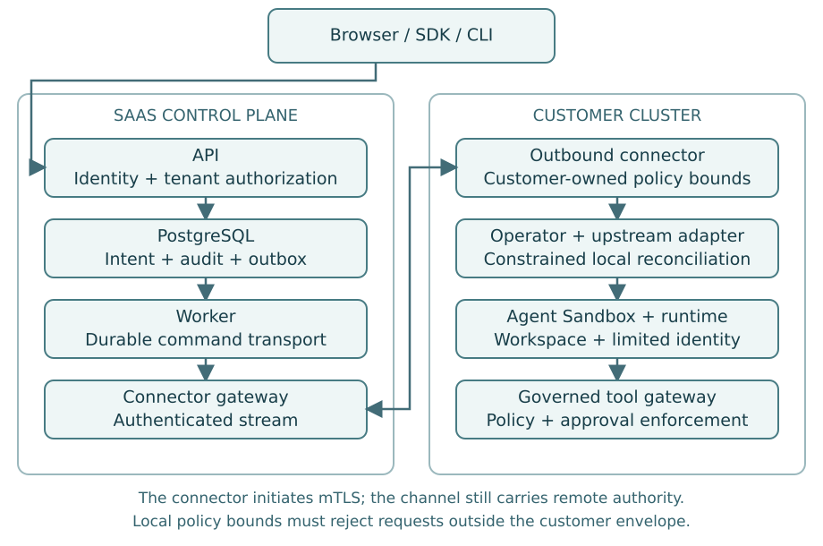

# 02. Separate the Control Plane from the Execution Plane

**Part I — Foundations**

A control plane stores intent: who owns a session, which template it should use,
which policy applies and whether the desired state is running or terminated. An
execution plane realizes that intent in a cluster. Separating the two makes
ownership clearer, but the connection between them remains a powerful management
channel.

The browser and SDK contact the public API. The API authenticates the caller,
checks organization and project permissions, writes durable state and enqueues
work. A connector in the customer cluster initiates an authenticated outbound
connection to the connector gateway. The connector interprets a constrained
command vocabulary and calls a local adapter or Kubernetes controller. It does
not accept arbitrary manifests supplied by the SaaS.

## Logical components, not a microservice quota

The domain needs an API, an asynchronous worker, a connection gateway, a cluster
connector, a policy operator and a web interface. These are logical boundaries.
They do not imply that every module needs an independent deployment on day one.
Separating the connection gateway from the HTTP API becomes useful when long-lived
streams have different scaling and drain behavior. Combining a small API and
worker can be acceptable while their responsibilities remain explicit.

PostgreSQL is the authority for customer-visible operation records, desired state
and authorization configuration. Kubernetes is the authority for observed
cluster resources. Neither copy is always current. The reconciler compares them
without pretending that a distributed transaction spans both systems.

## Build a data classification table

| Data | Normal location | Can it cross the SaaS boundary? |
|---|---|---|
| Membership and entitlements | Control database | Yes, to authorized interfaces |
| Connector private key | Customer cluster | Never in enrollment or telemetry |
| Customer secret value | Customer secret provider/workload | Not in normal control-plane APIs |
| Workspace files | Customer volumes | Only through an explicitly enabled transfer path |
| Execution output | Runtime and active client stream | Yes in relay mode; document this exposure |
| Tool arguments | Gateway and target tool | Only approved processing and narrowly controlled retention |
| Audit metadata | Control database and exports | Yes, with tenant authorization |

A secret can appear inside arbitrary process output. Therefore “we never fetch
secrets from Vault” does not prove “the SaaS never receives secrets.” Define output
handling, default retention and redaction separately. Redaction is best effort,
not a guarantee that arbitrary sensitive content will be recognized.

## Why outbound connectivity helps—and what it does not do

Outbound enrollment removes the need for the SaaS to connect directly to the
customer's Kubernetes API. It does not remove remote command authority. An
attacker controlling the SaaS may still send commands over an established
connector stream. Protect against that with cluster-local policy bounds, typed
commands, constrained references, resource-side identity checks and a customer
kill switch.

The connector must reject a command that requests a privileged pod even if the
command is authenticated. Authentication establishes the speaker; local policy
limits what that speaker may ask the customer environment to do.

## Desired state and observed state

An API response such as `202 Accepted` means an operation was recorded, not that
a sandbox exists. The session model should expose desired state, observed state,
observation time, operation ID and a safe reason code. For a disconnected cluster,
show the last observation and its age. Do not repaint an old observation as live
simply because the database remains reachable.

Termination illustrates the distinction. The API can record a terminal intent
while the cluster is offline. The workload may continue until a local deadline or
until the connector receives that intent. A local lease and maximum lifetime
bound this exposure. Calling the session “terminated” before resource confirmation
would conceal it.

## Local policy as a customer-owned boundary

Allow customers to install a policy envelope that the SaaS cannot widen: approved
registries, namespace scope, maximum lifetime, permitted runtime classes and
allowed credential providers. Product policy can become more restrictive inside
that envelope. Relaxing it requires a separate customer-controlled administrative
operation. This is a design choice with an operational cost: a SaaS administrator
cannot repair every policy problem remotely.

Kubernetes multi-tenancy guidance explains why namespaces, network controls,
resource controls and stronger isolation choices must be considered together.
A namespace is an organizational boundary, not a complete hostile-workload
containment mechanism. [S03](../references.md#s03)

## Exercise

Draw every path that can carry command output from a sandbox to an operator's
screen. Mark where TLS terminates and where plaintext exists. Then describe the
additional implementation needed to offer a direct customer-data-plane mode.
Do not label a path “private” without defining who can read it.

## Primary sources

[Kubernetes multi-tenancy](../references.md#s03)
