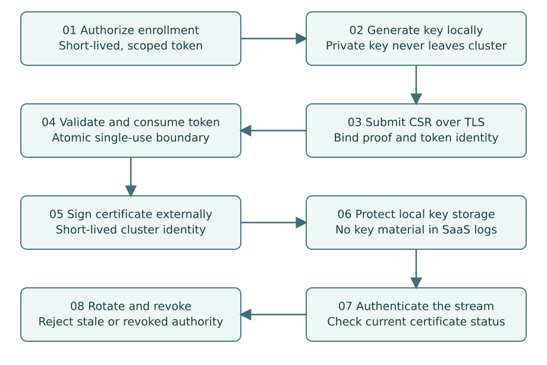

# 08. Enroll Clusters Without Exporting Their Authority

**Part II — Control Plane**

Cluster enrollment binds a locally generated key to a narrowly scoped customer
cluster identity. The enrollment token is not a permanent credential. It is a
short-lived invitation to establish one identity under explicit organization and
project ownership.

## The enrollment sequence

An authorized administrator creates a cluster record. The API generates a
high-entropy token, stores only its verifier and reveals it once. The connector
generates a private key locally and constructs a certificate signing request.
It submits the CSR and token over a server-authenticated TLS connection. The
service validates the token, reserves or consumes it transactionally, and issues
a certificate whose identity is selected by the service—not by untrusted CSR
subject fields.

The issuer must not copy arbitrary requested SANs or certificate usages. Bind the
certificate to the cluster ID, use the intended client-auth purpose and record
serial, fingerprint, validity and issuer. A URI identity is a useful convention,
but it is a proposed naming scheme unless a full identity standard is adopted.
Do not call an arbitrary URI “SPIFFE compliant” without meeting that standard.

## Handle enrollment failure without leaking keys

Issuance and token consumption span a database and a signer. Define an idempotent
enrollment operation so a lost response does not create an uncontrolled sequence
of valid certificates. Retain the approved public-key fingerprint and issuance
result for the enrollment operation. A retry with a different key must not silently
reuse the consumed invitation.

Private keys never leave the cluster. Store them with minimum practical access.
The connector may need access to its own credential Secret, but it should not
have blanket read access to all Secrets. Separate a small bootstrap permission
set from normal runtime permissions where this materially reduces exposure.

## Authentication includes live status

A valid certificate chain is necessary but not sufficient. The gateway verifies
issuer trust, time validity, intended usage, identity binding and cluster status.
A disabled cluster or revoked certificate must be rejected even when its
cryptographic signature is valid. Define how gateways learn revocation and how
quickly established streams are closed.

An authentication cache introduces a revocation delay. Bound it and expose it as
an operational property. When the status authority is unavailable, deny new
privileged sessions according to the stated fail-closed policy. Existing sessions
need an explicit bounded lease; otherwise a database outage accidentally extends
a stolen credential's useful lifetime.

## Rotation and recovery

Rotate before expiry with a small overlap. Establish the new identity, confirm the
new stream and retire the old serial. Do not delete the only working credential
before the replacement is durable. Rotation needs clock-skew handling, but a large
skew allowance weakens expiry. Report observed skew as a degraded condition.

A connector offline past certificate expiry may be unable to use ordinary
rotation. Provide an administrator-controlled reenrollment workflow. This is not
a reason to keep a hidden permanent token in the cluster. Emergency recovery
must establish authority again, not bypass it.

Use an external production signer or a managed CA integration with a documented
trust and backup model. A development CA stored next to the application database
is not made production-ready by adding an environment variable named `secure`.
The book does not implement a production certificate authority.

## Customer revocation must work locally

SaaS revocation cannot reach a disconnected cluster immediately. Give the customer
a local procedure to stop the connector, remove its authority and terminate or
quarantine workloads according to policy. Local maximum lifetimes and command
leases bound how long workloads can continue without fresh authorization.

Certificates also do not establish that a report is truthful. A customer
administrator holding cluster authority can modify the connector or its runtime.
Treat cluster-reported inventory as authenticated information from that cluster,
not independently attested proof of isolation.

## Exercise

Model a lost enrollment response, a stolen token before use, a certificate revoked
during an open stream and a connector returning after expiry. For each case, write
the durable record, expected user-visible state and safe recovery action. Never
include private key material in the resulting support bundle.
