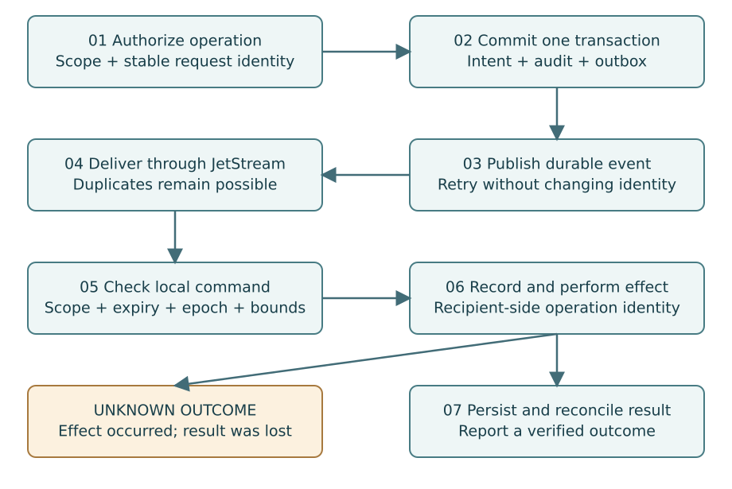

# 09. Make Delivery Durable Without Promising Exactly-Once Effects

**Part II — Control Plane**

The messaging contract must survive duplication, reconnects and uncertain results.
NATS JetStream provides persistence and delivery mechanisms, but an acknowledged
message is not proof that an external business operation happened exactly once.
The application still owns effect identity and reconciliation.
[S09](../references.md#s09)

## Commit intent and an outbox event together

The API transaction writes the operation record, quota reservation, audit metadata
and an outbox event. A worker later publishes the event. If publication succeeds
and the worker crashes before marking the outbox row delivered, publication may
repeat. Consumers therefore need deduplication. This is the intended behavior,
not an exceptional corner case.

Keep the outbox immutable enough to replay deterministically. Track attempts and
lease ownership separately from the event body. Bound batch size and lock
duration. Use `FOR UPDATE SKIP LOCKED` or a carefully designed equivalent for
worker claiming, then release database transactions before slow network work.
A lease expiration permits recovery but does not prove the previous worker stopped.

## Use distinct identifiers

An operation ID identifies the user-visible intent. A command ID identifies a
particular dispatchable instruction. A message ID identifies a transport event.
An execution ID identifies a runtime action. A trace ID connects observability.
These IDs are related but not interchangeable.

For example, the same command can be delivered in multiple transport messages.
An operation can contain a create command and a later cleanup command. A trace
can be sampled away without erasing execution identity. Keeping these concepts
separate avoids accidental coupling between billing, tracing and correctness.

## Model command state durably

A connector may observe accepted, started and finished states. A durable journal
can return the original result for a repeated completed command. However, a
journal entry marked started does not prove whether the process ran before a
crash. Use a runtime execution service with durable operation identity when
available. Otherwise expose an unknown state and reconcile; do not automatically
start a second copy.

Resource creation is often easier to reconcile than arbitrary execution. A
stable Kubernetes resource name and ownership metadata let a repeated create
observe the existing resource. For an arbitrary script calling a third-party
API, a local annotation cannot make the third-party effect idempotent. That API
must support its own idempotency or the workflow must handle uncertainty.

## Coordinate connections, then fence effects

Only one logical connector connection should own a cluster stream. Maintain a
monotonic connection epoch and reject stale command ownership. Kubernetes Leases
are useful for leadership coordination, but they do not by themselves make every
external action exclusive. [S21](../references.md#s21)

A stale worker may continue after losing a lease. The component performing the
side effect must validate fencing or operation ownership in an atomic mechanism
appropriate to that effect. A check followed by an unrelated action can still race.
For Kubernetes updates, resource versions help with concurrent state changes;
for process starts, use a durable execution claim enforced by the runtime service.
Document any effect for which strict fencing cannot be established.

## Bound the transport

Set maximum message size, pending commands, per-cluster concurrency and output
buffer size. Separate long output streams from the durable control journal.
Storing megabytes of terminal output in every JetStream command result can turn a
small execution into a fleet-wide memory and storage problem.

Set command deadlines and reject stale work on both sides. An old create request
must not suddenly provision a session after a lengthy outage if its intent has
expired. Dead-letter handling should preserve safe diagnostics and require a
reviewed replay action; it must not be an automatic infinite retry loop.

## Reconcile after interruption

When a connector reconnects, exchange its epoch, capabilities and a bounded set
of operation summaries. Compare observed resources with current desired state.
Do not replay every historical event as a new command. Use the database and
resource identities to decide what is missing, stale, complete or unknown.

## Exercise

Create a failure table for crashes before publish, after publish, after command
receipt, after process start and after process completion. State which cases can
be retried automatically and which need runtime reconciliation. The Go teaching
examples illustrate local identity and state guards, not a distributed exactly-once
execution engine.

## Primary sources

[NATS JetStream concepts](../references.md#s09) · [Kubernetes Leases](../references.md#s21)
