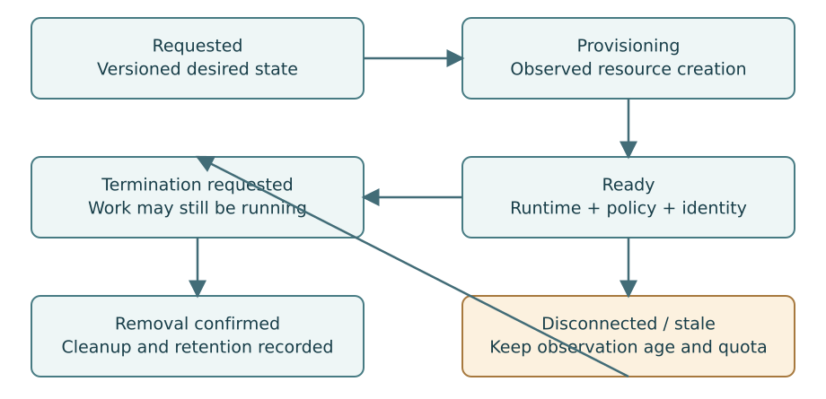

# 13. Model Sessions, Executions and Uncertainty Separately

**Part IV — Safe Execution**

A session is a governed workspace and runtime identity. An execution is one action
inside that session. An operation is the platform's attempt to change or use a
resource. Combining all three into one status field produces contradictions:
a session can remain healthy while one execution fails, and a termination
operation can be pending while the last observed runtime is still running.

## Start with a small state machine

Use a small explicit core: requested, provisioning, ready, terminating,
terminated and failed. Add suspended and resuming only when the corresponding
runtime semantics are verified. Record lost observation as a condition rather
than pretending it proves termination. More states are useful only when they
lead to different behavior or user action.

The Go example in [examples/go-core](../../examples/go-core/README.md) implements
an educational transition guard with stale-version rejection. It does not
implement distributed reconciliation or Kubernetes execution. Its value is that
terminal-state and version invariants can be tested without a cluster.

## Desired termination dominates stale activity

Suppose a session is ready at intent version 7. The user requests termination,
creating intent version 8. A delayed “resume” command from version 6 arrives after
that. Both the connector and the resource manager should reject it as stale.
A database state transition alone is not enough if the cluster still accepts old
commands independently.

Use a stable resource identity and versioned intent. Every command includes the
relevant intent version, deadline and scope. Terminal intent is durable; a
reconnect cannot turn an expired or terminated session back into a running one
merely because an older event said ready.

## Readiness is a conjunction

A scheduled Pod is not automatically ready for execution. Readiness should include
runtime health, required policy application, identity binding and the required
workspace state. If a policy update is still pending, the platform must not
expose a privileged execution endpoint under the assumption that the update will
finish soon.

Keep provisioning failure reasons specific: scheduling, image policy, image pull,
storage, runtime health, credential reference or unsupported capability. A generic
“failed to start” message forces operators to obtain unnecessary raw cluster logs.
Safe, structured reasons improve both support and privacy.

## Termination is a workflow

Stop accepting new executions. Request cancellation of active work according to
policy. Prevent new credential issuance. Revoke what the provider can revoke.
Remove runtime resources, then apply workspace retention policy. Confirm cleanup
before declaring resource removal complete.

A terminated process can leave completed external effects behind. A terminated
session may retain a snapshot intentionally. A failed cleanup may leave a PVC.
Represent these outcomes explicitly instead of treating termination as universal
rollback and erasure.

## Disconnection requires a local contract

A disconnected connector cannot receive new central policy. The cluster needs a
local maximum lifetime, a command lease policy and a rule for continuing existing
work. Depending on the customer risk model, existing sessions may continue for a
bounded interval or stop promptly. Both approaches have availability and safety
costs; neither should be an accidental consequence of network failure.

Do not release concurrency quota just because the control plane has lost contact.
The workload may still be consuming resources. Mark capacity uncertain, retain a
conservative reservation and reconcile when observations return. An administrative
override may be necessary, but it should be visible and auditable.

## Garbage collection must respect ownership

Identify orphans by stable labels, owner references and product IDs. Do not delete
all resources with a common display-name prefix. Check that the candidate belongs
to AgentPlane and that its retention policy allows deletion. Include a dry-run
inventory and an approval step for destructive bulk cleanup.

A missing database row does not always imply a disposable resource: it may result
from an incomplete restore. Recovery mode should quarantine or report ambiguous
resources before deleting them. This matters during disaster recovery, when the
control database may be older than the running cluster state.

## Exercise

Implement tests for duplicate termination, stale resume, runtime disappearance,
connector disconnect and restoration from an older database snapshot. For every
case, specify the session state, operation state, quota reservation and cleanup
obligation. A single state string should not be expected to carry all four.
