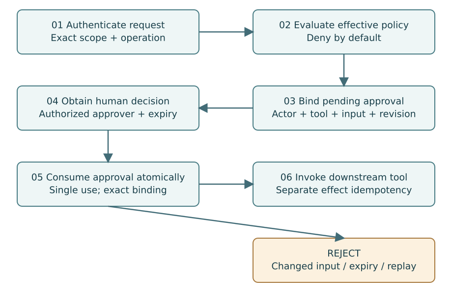

# 18. Bind Authorization and Approval to the Exact Action

**Part V — Tool Governance**

A policy decision answers whether a particular actor may perform a particular
action on a particular resource under current conditions. “This agent is trusted”
is too broad to be a useful decision. Tool permissions should include server,
tool, actor, scope, input constraints, policy version and time bounds.

## Define deterministic policy precedence

Start with deny by default. An explicit organization-level denial cannot be
weakened by a project rule. Distinguish allow from require approval: an approval
requirement is not a temporary allow. Invalid policy and unavailable evaluation
must produce a defined failure, generally fail closed for privileged actions.

Use a constrained, reviewed policy language or typed rules. Do not evaluate
arbitrary user-provided code in the authorization service. Bound expression
complexity and input size. A policy engine can become a denial-of-service surface
if one decision can consume unbounded CPU or memory.

## Construct a decision identity

The decision should bind actor, organization, project, sandbox, tool server,
tool name, tool schema version, normalized input digest, policy version and
expiration. Canonicalize inputs according to a documented format. Do not hash
whatever JSON serialization a client happens to send and assume semantic
identity is stable.

A digest can also reveal low-entropy sensitive inputs through guessing. Keep
approval metadata minimal, use a keyed digest where appropriate to the threat
model and avoid exposing unnecessary input hashes to unrelated users. Human
approvers still need enough safe context to make an informed decision.

## Model approval as a durable state machine

A request can be pending, approved, rejected, expired, canceled, reserved for an
execution or consumed. Define allowed transitions and use conditional updates
under concurrency. If two approvers decide simultaneously, one authoritative
result wins and the other receives a conflict.

A policy requiring four eyes must prevent requester self-approval and verify the
approver's current authority. Consider organizational ownership: two accounts
controlled by one person may satisfy a technical two-account check without
providing genuine independent review. Communicate the exact implemented rule.

## Consumption does not mean exactly-once side effects

Reserve an approved action for a stable execution ID before dispatch. A retry for
the same execution can observe that reservation. A request for a different
execution or changed input is rejected. If the tool effect happens and the result
is lost, the system still needs downstream idempotency or reconciliation.
One-time approval prevents reuse of authority; it does not magically make every
external tool effect exactly once.

Do not keep an HTTP request open for hours while waiting for a person. Return an
approval-required result, expose the pending request and let the agent resume or
retry with the same operation identity after a decision. Bound approval lifetime
and revalidate relevant policy changes before execution.

## Prevent bypass

Authorization must be applied where the request cannot route around it. If the
sandbox can directly call the tool with a powerful credential, an approval UI is
only advisory. Combine gateway enforcement, downstream identity checks and
network restrictions. The server should reject credentials for the wrong audience
or scope. [S10](../references.md#s10)

A gateway timeout must not default to allow. For non-privileged read operations,
a carefully designed cached decision may be acceptable, but its scope, version
and maximum age must be explicit. Security-sensitive policy changes should
invalidate or constrain cached decisions.

## Audit decisions without collecting everything

Record the decision ID, safe action description, policy version, approver,
outcome, reservation identity and timestamps. Raw tool arguments often contain
customer data. Use approved summaries and protect detailed evidence separately
when retention is genuinely necessary.

## Exercise

Test changed input, changed tool schema, expired approval, revoked approver,
concurrent consumption and a lost result after dispatch. Explain which failures
return denied, conflict, expired or unknown. Then verify that no rejected case
reaches the mock tool server at all.

## Primary sources

[MCP security best practices](../references.md#s10)
