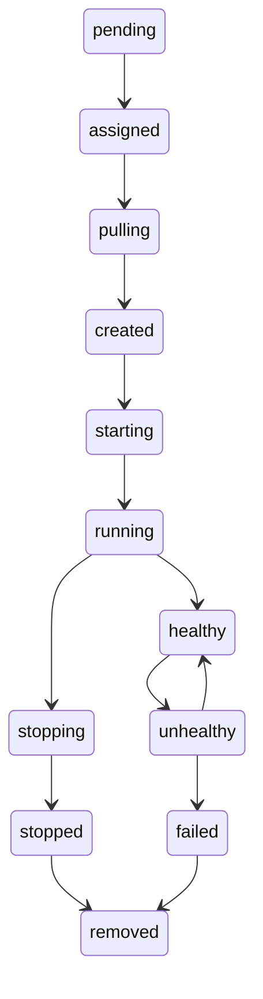

# Atlas: one progressive case study

Locked source `cbfc94ade5b57e449d6b73bf1485b1c5b1647022`. This design covers the eight required labs066–073. **All observations below are expected until matched to actual run evidence.** No completed experiment, container deployment, database reset or measured performance is claimed by this manifest.

Atlas API is a stateless nginx HTTP service with stable name `atlas-api`, copied from upstream `deployments/examples/http-api.yaml` and extended only with supported healthcheck fields. It serves a fixed response so the infrastructure, not application business logic, is the experiment. `atlas-count` is a finite JobSpec with an explicit command; upstream `worker.yaml` is a long-running redis service, not a finite job. Agent ensureTask copies Task.Command into ContainerSpec.Command; a parser pass still does not establish successful finite execution. Namespaces are request metadata, never invented YAML fields.

## Identity, images and evidence continuity

Use a unique run namespace and record every service/task/node/deployment/container ID together with source SHA and image digest. The image tags in fixtures are operator inputs, not claims of immutable network resolution; record the pulled image ID/RepoDigests during an actual Docker run. Do not assume an earlier run survives. Each stage consumes the previous evidence record and recreates missing state under the new run ID. Primary service identity stays atlas-api even when deployment version and container IDs change. Storage experiments use separate owned local fixtures, never nginx content or user directories.

## Stage01 — Initialize and observe process restart

**Chapters:** 03, 06, 13. **Execution contexts:** default server process; disposable Docker agent.

**Desired change:** Deploy atlas-api, scale1→2→1; save service/task/node/container IDs, restart a new server process.

**Source-checked command forms:** `orch validate labs/specs/atlas-api.yaml`; `orch deploy labs/specs/atlas-api.yaml`; `orch scale atlas-api --replicas 2`; `orch service ls`. Angle-bracket values are run-owned identities to replace before execution, not literal commands.

**Expected transitions/observation:** Services/node registration maps disappear after a fresh process; surviving Docker identity is separate.

**Failure injection:** Terminate only recorded server PID; leave recorded service container for comparison, then stop agent and remove exact IDs.

**Telemetry/evidence:** API JSON before/after restart; Docker inspect for recorded container IDs; process PID/start timestamps. Record UTC commands/exits plus identity mapping.

**Cleanup:** Restore fresh disposable server/agent; do not reuse pre-restart API IDs as live truth.

## Stage02 — Deterministic placement and concurrent claims

**Chapters:** 05, 09, 10, 26. **Execution contexts:** standalone scheduler package; default MemoryService comparative fixture; throwaway PostgreSQL store.

**Desired change:** Present500m CPU/128Mi node and service600m/256Mi requests; then attempt two assignments of one pending task.

**Source-checked command forms:** `go test ./internal/scheduler -run Test -count=1`; `guarded store Integration suite`. Angle-bracket values are run-owned identities to replace before execution, not literal commands.

**Expected transitions/observation:** Pure planner rejects capacity; normal MemoryService placement can differ. Only one guarded assignment succeeds at a version.

**Failure injection:** Inject identical resource intent into both paths, not a large physical machine; race stale writers in a package fixture.

**Telemetry/evidence:** planner assignment/unplaced reason; active service/task trace; both assignment errors and final owner. Record UTC commands/exits plus identity mapping.

**Cleanup:** Discard fake objects and throwaway schema; stop/delete only owned database container after later tests.

## Stage03 — Reconciliation and Docker drift ownership

**Chapters:** 11, 12, 18, 19. **Execution contexts:** default agent/Docker in isolated daemon; FakeRuntime controller fixtures.

**Desired change:** Keep atlas-api identity; remove one exact recorded container to simulate drift; restart agent, then stop heartbeat.

**Source-checked command forms:** `orch service ls`; `orch node ls`; `orch events --help`. Angle-bracket values are run-owned identities to replace before execution, not literal commands.

**Expected transitions/observation:** Reconciliation observes missing runtime identity; adoption should not duplicate the same task. Offline replacement is not physical fencing.

**Failure injection:** Remove only the selected owned container; suspend only recorded agent PID, not host networking.

**Telemetry/evidence:** old/new task/container IDs; heartbeat/offline events; direct old endpoint where safe. Record UTC commands/exits plus identity mapping.

**Cleanup:** Resume/stop exact recorded agent; remove all and only run-owned containers. No broad orch.managed cleanup.

## Stage04 — Rollout, rollback and availability

**Chapters:** 14, 17, 18. **Execution contexts:** default rollout path; standalone rollout arithmetic fixtures.

**Desired change:** Roll atlas-api to nginx1.28-alpine, then rollback while tracking immutable deployment versions.

**Source-checked command forms:** `orch rollout atlas-api --image nginx:1.28-alpine --max-unavailable 1 --max-surge 1`; `orch rollout status atlas-api`; `orch rollback atlas-api`. Angle-bracket values are run-owned identities to replace before execution, not literal commands.

**Expected transitions/observation:** Old/new available counts control actions. A failed pull or unhealthy new task must be distinguished from rollback completion.

**Failure injection:** Use a deliberately nonexistent image in a separate failing rollout; never replace a real user service.

**Telemetry/evidence:** deployment JSON; version/task counts each iteration; failure event and final version. Record UTC commands/exits plus identity mapping.

**Cleanup:** Restore known image or delete atlas-api; remove exact residual task containers.

## Stage05 — Secrets, authorization and health trust

**Chapters:** 14, 23, 24, 25, 26. **Execution contexts:** default API/auth/agent where integrated; health package redirect fixture.

**Desired change:** Apply atlas-api-unhealthy manifest in its lab namespace and attempt untrusted reports; trace encrypted secret storage separately.

**Source-checked command forms:** `orch validate labs/specs/atlas-api-unhealthy.yaml`; `orch deploy labs/specs/atlas-api-unhealthy.yaml`. Angle-bracket values are run-owned identities to replace before execution, not literal commands.

**Expected transitions/observation:** Missing path produces unhealthy observations; cross-origin redirect fixture must fail; plaintext delivery differs from stored ciphertext.

**Failure injection:** Use localhost test HTTP handlers and disposable credentials; no external metadata endpoint probing.

**Telemetry/evidence:** redacted authorization error; healthy/unhealthy conditions; redirect fixture assertion. Record UTC commands/exits plus identity mapping.

**Cleanup:** Restore healthy Atlas manifest; stop owned local handler, delete disposable secret references and namespace when empty.

## Stage06 — Namespaces and atomic quota admission

**Chapters:** 27, 28. **Execution contexts:** default MemoryService/API namespace scoping; PostgreSQL atomic quota package fixture.

**Desired change:** Create same service name in isolated second namespace; bound intended replicas/resources and attempt exceeding mutation.

**Source-checked command forms:** `orch namespace create atlas-second`; `orch quota set --max-replicas 2 --max-cpu-millicores 200`; `orch quota get`. Angle-bracket values are run-owned identities to replace before execution, not literal commands.

**Expected transitions/observation:** Names are scoped; accepted desired intent affects accounting. This does not establish Docker CPU/memory enforcement.

**Failure injection:** Race scale/create under a quota in fixture; keep primary and second service IDs distinct.

**Telemetry/evidence:** namespace-specific service JSON; quota usage before/after rejected change; both concurrent mutation results. Record UTC commands/exits plus identity mapping.

**Cleanup:** Delete namespace-specific service IDs first; delete only empty namespaces and restore lab quotas.

## Stage07 — GitOps drift, finite jobs and cron

**Chapters:** 30, 31. **Execution contexts:** default GitOps controller; default job command propagation plus package/FakeRuntime cron assertions; actual finite execution measured separately.

**Desired change:** Commit atlas-api manifest to dedicated local repo; modify first valid file and second invalid file; create atlas-count finite JobSpec.

**Source-checked command forms:** `orch gitops add --repo <owned-local-repo> --branch main --path manifests --drift-policy warn`; `orch gitops sync <recorded-source-id>`; `orch job run labs/specs/atlas-count.yaml`; `orch job ls`. Angle-bracket values are run-owned identities to replace before execution, not literal commands.

**Expected transitions/observation:** First file may change service before second fails. Agent copies the command into ContainerSpec; job exit reporting and identity/adoption still need an executed check.

**Failure injection:** No remote Git push. Inject clock for cron rather than change system time; invalid second manifest exercises partial application.

**Telemetry/evidence:** Git source commit IDs; source LastError/LastRevision and actual service spec; job attempts/task IDs/exit report; cron injected timestamps. Record UTC commands/exits plus identity mapping.

**Cleanup:** Delete exact GitOps source before service; stop package fixture; remove owned temp repository after evidence copy.

## Stage08 — Backup, migration, load and recovery boundaries

**Chapters:** 32, 34, 35, 36, 37, 38, 39, 40. **Execution contexts:** throwaway PostgreSQL sessions/store; bounded source-only benchmark; default process restart observation.

**Desired change:** Test DB migration subset/all migrations explicitly, two-session cancellation, bounded load; compare SQL backup with current memory state.

**Source-checked command forms:** `go test ./internal/scheduler -run ^$ -bench Benchmark -benchtime 100x`. Angle-bracket values are run-owned identities to replace before execution, not literal commands.

**Expected transitions/observation:** Database restore recovers only persisted database content. Fresh default process remains new MemoryService; benchmark scope is not Docker cluster capacity.

**Failure injection:** Cancel leadership owner session; bound workload/time; never stress user daemon or restore into real database.

**Telemetry/evidence:** migration list and actual up/down results; two session lock ownership; benchmark config/result; restart before/after state. Record UTC commands/exits plus identity mapping.

**Cleanup:** Stop exact PIDs; remove exact owned DB/volume/containers; report leftovers explicitly and keep canonical logs.

## Source-backed state graph

The following is a deliberately small valid subset of `pkg/types/lifecycle.go`136–189, not every legal transition. Actual task states and desired control-plane state are separate; healthy is not a service/job completion guarantee.

`failed`, `stopped` and `removed` are terminal for ordinary advancement; removal remains allowed from other terminal states. Direct shortcuts such as assigned→running exist in the real validator and are intentionally omitted here. A separate Job status model uses pending/running/succeeded/failed; task status does not invent a succeeded constant.

## Parser and run gates

The service fixtures are fed to the actual pinned CLI `validate` parser; the invalid-unknown-field fixture must fail. `atlas-count.yaml` uses the job CLI's distinct YAML envelope; it cannot be validated as a service. Its domain JobSpec must be validated via a book-side fixture compiled within the disposable source module. Parser acceptance proves supported fields, not remote admission or container behavior. Validation logs belong in `validation/intake/case-study-parse.json`; later actual lab output remains separately versioned under `validation/labs/`.

The constrained manifest intentionally cannot fit a500m/128Mi advertised node and requests duplicate fixed host port31080 for two replicas. Compare a standalone planner with MemoryService in a fake/isolated fixture, never create host overload. Runtime/package/teaching-extension contexts may be compared but cannot be quietly substituted for each other. See [Environment contract](ENVIRONMENT.md) before any privileged or destructive step.
