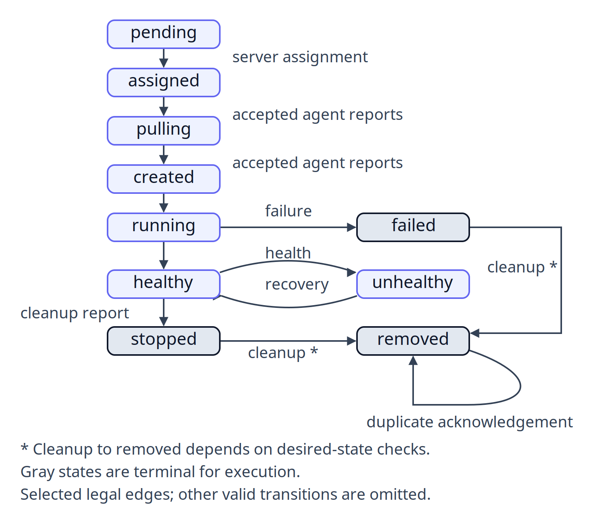

# Chapter 4 - Domain Models and State Machines

Atlas API has a service identifier, one assigned task, and a running container. Those are three different objects. If an operator scales the service down while an agent is reporting a successful health check, which statement wins? Reading status as a single mutable string cannot answer that question. The domain model separates what the server wants from what the worker has observed, and its transition helpers constrain how their disagreement can resolve.

Our objective is to explain one replica completely enough to reject an impossible report. We will use the active `pkg/types` definitions, the actual memory control plane, and the lifecycle tests. The presence of a `Deployment` or `Event` struct tells us what data can be represented; it does not establish a durable transaction, delivery guarantee, or production deployment topology. Those need separate implementation evidence.

By the end, you should be able to distinguish intent from observation, trace a replica through valid states, and explain why deployment versions and transition owners matter when rejecting stale reports.

## Service Intent and Per-Replica Tasks

A `Service` contains identity, namespace, a specification, lifecycle status, and deployment version. Its specification carries replica count and image along with ports, environment, resources, and policy. A `Task` has its own identity, service reference, optional node/container references, image, version, and execution fields. See the [service contract in pinned types](https://github.com/alekpopovic/orch/blob/cbfc94ade5b57e449d6b73bf1485b1c5b1647022/pkg/types/types.go#L189-L234) and [task contract in pinned types](https://github.com/alekpopovic/orch/blob/cbfc94ade5b57e449d6b73bf1485b1c5b1647022/pkg/types/types.go#L771-L800). The links are immutable snapshots, rather than statements about another revision.

For Atlas, `replicas: 2` is service intent. It does not create a two-process task. The control plane represents two separate units of work, each with its own assigned node and actual status. A task's version connects it to a service specification at a particular deployment version. Comparing only `service_id` loses that distinction during an update: old and new replicas can belong to the same service while intentionally running different images.

Service versions are recorded by the memory implementation when creation, update, or scale changes occur. The [version store implementation](https://github.com/alekpopovic/orch/blob/cbfc94ade5b57e449d6b73bf1485b1c5b1647022/internal/controlplane/controlplane.go#L2727-L2732) keeps specifications indexed by version. This is implemented history within a process, not evidence of PostgreSQL recovery. The helper assigns a Go struct into the version map; it is not a general deep-copy or immutability mechanism for nested maps and slices. Treat version identity as a domain contract without inventing stronger alias protection. A new process cannot reconstruct maps merely because the map values have stable identifiers. Preserve that distinction whenever a diagram labels something a version store.

The service lifecycle is deliberately narrower than task execution. `active` means the service is eligible for desired-state reconciliation; it does not mean all replicas are healthy. `deleting` records an intention to remove work. `deleted` is terminal for that service identity. The [service transition validator permits](https://github.com/alekpopovic/orch/blob/cbfc94ade5b57e449d6b73bf1485b1c5b1647022/pkg/types/lifecycle.go#L115-L133) active to deleting, then deleting to deleted. It rejects an immediate active-to-deleted transition, which would erase the explicit convergence phase.

This also explains why a deleted Atlas service should be replaced by a newly created service rather than revived by overwriting its status. Identity carries history. Reusing an old identity can confuse delayed reports, task ownership, and operator interpretation even if its display name looks convenient. The validator's contract is stronger than that convenience: deleted-to-active is invalid.

## Desired Status Versus Actual Status

The following observations can all be legitimate moments in one replica's life. They describe a trace through permitted states, not a promise that every polling client will see every intermediate row.

| Moment | Server-owned desired status | Actual status | Meaning |
| --- | --- | --- | --- |
| Work waiting for placement | running | pending | The requested execution lacks an assignment |
| Node chosen | running | assigned | A server assignment exists; no process is implied |
| Worker creates container | running | created | A runtime object exists without a running guarantee |
| Process observed | running | running | Runtime execution was reported |
| Health succeeds | running | healthy | A health report accepted at this point |
| Scale-down requested | removed | healthy | Last observation lags the new intention |
| Cleanup acknowledged | removed | removed | Task cleanup reached a terminal state |

The literal JSON fields are `desired_status` and `actual_status`; neither is interchangeable with service `status`. The complete set of task status constants includes `pulling`, `starting`, `unhealthy`, `stopping`, `stopped`, and `failed` in addition to the table's values. `starting` and `stopping` are reserved progress states in the contract. Their presence does not mean the current agent emits them.

Agent report authorization is a second check beyond membership in the enum. The [allowed report list excludes](https://github.com/alekpopovic/orch/blob/cbfc94ade5b57e449d6b73bf1485b1c5b1647022/pkg/types/lifecycle.go#L68-L83) `pending`, `assigned`, `starting`, and `stopping`. The server owns assignment. Agents can report pulling, created, running, healthy, unhealthy, failed, stopped, and removed. This prevents an ordinary worker report from selecting a node or inventing a scheduling transition.

Here is a compact selection of legal actual-state transitions, with ownership written on the arrows. It intentionally omits many legal shortcuts. It is not a complete graph and should not be used to reject an arrow solely because that arrow is absent here.



The static diagram has a high-resolution PNG companion at examples/diagrams/task-lifecycle.png for publishing targets that require raster artwork. Gray states are terminal for execution; cleanup to removed remains conditional on desired-state checks.

All names come from [the actual-state validator and its permitted branches](https://github.com/alekpopovic/orch/blob/cbfc94ade5b57e449d6b73bf1485b1c5b1647022/pkg/types/lifecycle.go#L136-L187). `stopped`, `failed`, and `removed` are terminal for execution. The first two permit a cleanup transition to removed in the generic validator; removed has no route back to execution. A health failure is different: unhealthy can recover to healthy or running while failed cannot return to running. Replacement after failure needs a different task identity under the service's restart policy.

Desired status is even more constrained. Its normal progression is running to stopped or removed, then stopped to removed. Same-state updates are allowed. An actual task in failed does not justify changing desired status to failed: server intent and worker observation have different state machines even though their Go field types share `TaskStatus`.

## Deployment Versions and Transition Owners

A deployment records from-version, to-version, strategy, status, and rollout limits. It describes an operation over service versions. It is not an alternative container identity. Atlas can therefore have an active service, a running deployment, and both old healthy tasks and new assigned tasks simultaneously. These states answer different questions and should remain separate in dashboards and scripts.

The [deployment validator distinguishes](https://github.com/alekpopovic/orch/blob/cbfc94ade5b57e449d6b73bf1485b1c5b1647022/pkg/types/lifecycle.go#L212-L241) pending, running, paused, rolling_back, succeeded, failed, and rolled_back. Succeeded, failed, and rolled_back are terminal. A rollback creates another deployment operation rather than mutating the terminal result of an earlier deployment into success. `paused` being a valid state does not establish an operator-facing pause command; representability and exposed control are separate integration questions.

The same caution applies to node status. Ready, draining, offline, and unknown describe placement eligibility and current observation, not a consensus protocol. Ready can become draining or offline; offline can become ready. A heartbeat timeout can justify recording offline, but it cannot prove that an isolated Docker host has stopped running its containers. The node type has no magical fencing effect.

Events add another record of an occurrence. Their type includes severity, source, related-object identifiers, details, and timestamp. Correlate an Atlas task transition with its task identifier and service identifier rather than reading the event message as a unique key. An event struct does not establish an exactly-once stream. Inspect the mutation and event-emission sites before asserting that duplicate reports cannot duplicate events.

The model developed in two distinguishable steps. [The original core-model commit](https://github.com/alekpopovic/orch/commit/c756f9d7f3a46e8bfe4d7bca291d67f6a783553d) introduced richer types and validation. [The lifecycle freeze](https://github.com/alekpopovic/orch/commit/6526b47f66da88117bab80468ce6b6c711d1e118) later centralized transitions and changed API, scheduler, rollout, store, and control-plane callers. The exported patches show these were cross-cutting changes. Original prompts 02 and 29 explain intent, but their numbering is not proof of a one-prompt-one-commit execution history.

There are also older small wrappers under `internal/task` and `internal/node`. They are useful historical context, but they do not supersede `pkg/types`. In particular, using the older node wrapper as the authoritative enum would miss offline. Always trace which type the active API and agent actually serialize.

## Rejecting an Impossible Transition

The smallest useful lab requires the locked Go toolchain and disposable application copy, without Docker or PostgreSQL. Start from unchanged source and run the actual transition tests:

```bash
go test -count=1 -v ./pkg/types -run 'TestValidate.*Transition|TestAgentCanReportTaskStatus'
```

Our recorded run is `validation/labs/ch04/lifecycle-tests.json`; the exact Go binary, environment keys, UTC times, working directory, exit code, and stdout are retained. It passed. This observation covers the selected unit tests, including rejected pending-to-running and failed-to-running transitions. It does not demonstrate distributed ordering of two real agents or persistence across a process restart.

The domain error is explicit:

```go
func invalidTransition(kind string, from any, to any) error {
	return fmt.Errorf("%w: %s %q -> %q", ErrInvalidTransition, kind, from, to)
}
```

Exact source: [pkg/types/lifecycle.go:320–322](https://github.com/alekpopovic/orch/blob/cbfc94ade5b57e449d6b73bf1485b1c5b1647022/pkg/types/lifecycle.go#L320-L322).

Callers can use `errors.Is(err, types.ErrInvalidTransition)` while retaining a diagnostic that includes the object kind and attempted states. Matching the full formatted message would couple an API client to human wording. Conversely, swallowing the error and updating the task anyway would destroy the contract the helper exists to enforce.

Consider the scale-down failure window. Atlas task actual status is healthy. The server sets desired status to removed. An old healthy report arrives before the worker receives the new intent. [AgentCanReportTaskStatus rejects](https://github.com/alekpopovic/orch/blob/cbfc94ade5b57e449d6b73bf1485b1c5b1647022/pkg/types/lifecycle.go#L302-L318) this report because cleanup intent permits only stopped, removed, or failed. A dashboard that blindly takes the last message would revive the replica; the desired-state check prevents that specific inconsistency.

There is a subtle boundary worth testing mentally. The generic validator allows failed-to-removed cleanup, but an agent report also depends on desired state. With desired running and actual failed, the agent gate accepts only the duplicate failed status. With desired removed, a removed report is allowed. A generic transition diagram cannot replace the caller's additional conditions. This is why our diagram annotates terminal cleanup rather than declaring all such reports unconditionally accepted.

For a failure investigation, retain the task identity, desired status, actual status, incoming report, and which helper rejected it. Do not log environment secrets. A rejected report is successful enforcement of this contract, not automatically evidence of a broken agent. The next investigation is whether the agent was delayed, whether desired state changed, or whether a caller submitted an invalid report.

The lab modifies no baseline files, starts no daemon, and creates no containers. Cleanup consists only of optional removal of a separately created test cache; keep the evidence record. A repeated run should use another record filename rather than overwriting the first outcome. If the selected test fails on another version, stop and compare that version's helpers before treating these arrows as current.

Before moving to the API boundary, distinguish three forms of success. A transition helper returning nil proves a proposed local edge is legal. A mutation method completing proves that its own checks and updates completed in that implementation. An agent acknowledging removal proves the reported task reached cleanup, within the evidence available to that server. None alone proves an unreachable host has relinquished a volume, that a previous server transaction survived a crash, or that every observer has received an event. Atlas operators need each statement separately because each has a different failure window and a different owner.

## Exercises

1. For a newly assigned Atlas task, list identity, intent, and observation fields needed to correlate a later container report. Explain why service name alone is insufficient.
2. Decide whether unhealthy-to-healthy, failed-to-running, and failed-to-removed are allowed by the generic actual-state validator. Then evaluate the final case through the agent gate with desired running and desired removed.
3. Explain why an active service with a succeeded deployment can still have a failed task. Identify which object a restart replacement changes.
4. An operator proposes accepting healthy reports after desired status becomes removed because they are more recent than the deletion request. Explain the unsafe assumption and give the correct rejection evidence.

See the [worked answers](../solutions/ch04.md). They distinguish the helper's local rules from delivery, persistence, and host-fencing claims that require later experiments.
