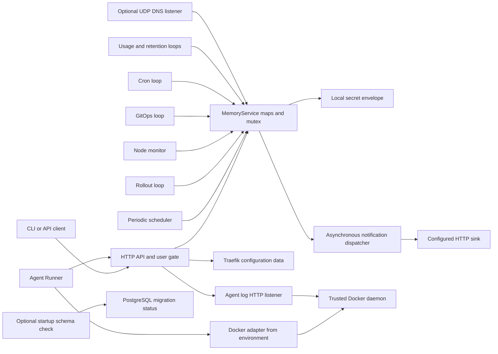
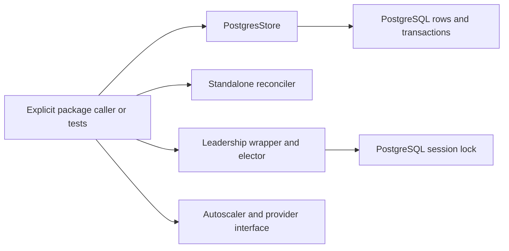
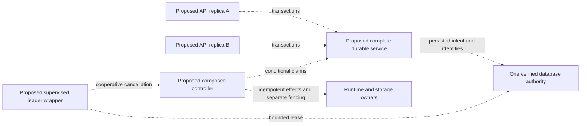

# Architecture topology and guarantee review

The inspected executable constructs one MemoryService per server process. The optional schema check opens a migration runner before that construction; it does not inject a PostgreSQL store into live handlers. Every solid arrow below denotes a constructor or current call path, rather than an intended future deployment.

## Current executable topology

The two HTTP listeners have distinct credential paths: enrolled node credentials protect reporting/polling; the agent log handler uses its configured bootstrap token. User JWT enforcement is conditional on a nonempty signing secret. DNS and profiling listeners have their own exposure controls. The Traefik node means generated provider data, not an embedded gateway.

## Implemented packages without default server composition

This separate diagram deliberately has no arrow from the current API MemoryService to PostgresStore. The standalone reconciler is not the default server's replica bookkeeping. Autoscaling has package decisions but no active default loop or real metrics provider. Leadership has an implementation and observed cancellation defect, not an activated HA deployment.

## Proposed durable composition

Every arrow here is a requirement for a teaching extension. Store-method parity, event atomicity, authentication-state recovery, explicit schema checks, session cleanup, context propagation and side-effect identity must be tested before promoting it to current topology. Adding a database pool beside MemoryService or another API process behind a balancer does not supply those missing edges.

## Guarantee matrix

The full JSON matrix identifies the active caller, state owner, atomicity/persistence boundary, source interval and matching observed record for every row. Null observation means the source was inspected without borrowing another scenario's execution.

| ID | Bounded claim | Failure window |
| --- | --- | --- |
| G-01 | Live API intent is volatile | Fresh server loses services/tasks/node credentials. |
| G-02 | Ordinary service placement can bypass Plan | Declared CPU/labels can differ from planner eligibility. |
| G-03 | A task claim can have one winner | Distinct task rows can still race shared capacity; stale worker remains live. |
| G-04 | Planner capacity/ports are invocation-local | Separate planners can each reserve different rows against same old budget. |
| G-05 | Replica recovery depends on policy and capacity | No eligible node or restart-never can leave deficit. |
| G-06 | Rollout health budget counts model work | Success and logical stop can precede acknowledged physical removal. |
| G-07 | Cleanup requires owned runtime identity | Partition delays stop/removal; no broad sweep or fencing guarantee. |
| G-08 | Node offline is suspicion, not revocation | Isolated stateless worker can continue after replacement; stateful withheld. |
| G-09 | Runtime resource limits are dropped on ordinary path | Requested limits can be accepted while actual container has zero limits. |
| G-10 | Namespace access is logical scope | Host/network/shared physical volume names remain common trust domain. |
| G-11 | Quota scale serializes projected intent locally | Jobs/restoration need separate callers; measured use and billing absent. |
| G-12 | Local writer exclusion is metadata authority | No distributed storage, stale-host fencing, or physical namespace uniqueness. |
| G-13 | Leadership library is not default HA | Done closes yet other pool remains blocked until original pool closes. |
| G-14 | Autoscaling library is not active default control | Controller reconstruction forgets cooldown; policy alone does not start scaling. |
| G-15 | Supplied digest parsing is not remote trust | No registry lookup, signature or vulnerability verdict follows. |
| G-16 | GitOps sync has per-file outcomes | Earlier files can apply before later failure; auto-revert bypasses fresh policy/quota. |
| G-17 | Cron occurrence acceptance is not exactly-once effects | Crash can revisit occurrence; Forbid inspects only prior active cohort. |
| G-18 | Database restore covers persisted package records | Dump excludes default memory intent, daemon resources and envelope key. |

## Prioritized architectural decisions

1. Preserve the current volatile-state label throughout chapter, appendix, catalog and release copy. A durable implementation requires service-layer parity and fresh-process tests; migration success is insufficient.
2. Repair and test the complete resource field path before promising Docker limits. Keep admission, reservation and enforcement as distinct acceptance gates.
3. Before any HA composition, repair PostgreSQL lease cleanup, qualify cluster identity, wire controllers and define cancellation/reacquisition. Test retained session locks and uncertain external completion.
4. Keep logical rollout success, desired-state deletion and drain completion separate from physical stop and client availability. Require runtime/traffic observations for stronger claims.
5. Treat shared workers as one trust domain. Local-volume names, node loss and metadata writer exclusion cannot supply hostile-tenant isolation or safe distributed failover.

These are application improvement recommendations, not manuscript blockers when accurately disclosed. The reviewed narrative makes these limits explicit. It does not silently repair the pinned application or advertise production fitness.
