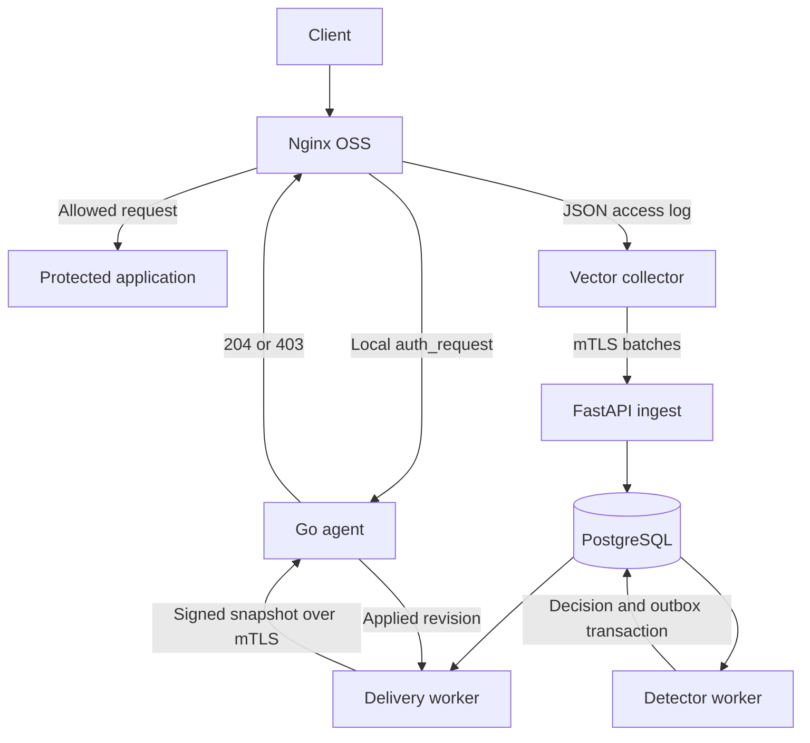

# Architecture and scope

## Machines and trust boundaries

Edge A runs the existing Nginx OSS, a Vector file collector, and a Go agent. Central B
runs a TLS ingress, FastAPI, PostgreSQL, a detector worker, and a delivery worker.
Containers are for local development and optional central deployment; the baseline edge
installation uses systemd. The central API and control listeners are private.

The agent has two separate listeners: a filesystem-permission-protected Unix socket for
Nginx checks, and a private mTLS HTTPS control listener. The auth listener never exposes
mutations; the control listener never accepts public visitor identity. Central ingestion uses
collector certificates mapped to registered nodes; untrusted payload fields cannot select
another node, site, tenant, or agent. Use a single organization boundary for the MVP with
explicit site and node scopes; SaaS tenancy is future work.

## Local request path

Nginx supplies an IP resolved by its trusted-proxy configuration and a deployment-configured
site ID to the local check endpoint. The agent reads an immutable in-memory snapshot,
checks local and central allowlists, then active exact-IP decisions, and returns 204 or 403.
There is no PostgreSQL, DNS, central HTTP call, disk read, or signature verification per request.
Decision updates validate, persist with atomic replacement and fsync, publish the new in-memory
view, then acknowledge. Serialize update publication; concurrent checks see an old or new
complete view, never a partially updated list. Expiry is enforced during checks.

The default site mode is monitor: record would-block outcomes but allow traffic. In enforce
mode, an eligible active decision denies. A local emergency bypass overrides central modes
and is visible in health/metrics. Automatic blocks are site-scoped exact IPv4/IPv6 addresses.
Manual fleet-wide blocks require explicit CLI scope; automatic CIDR bans are not in the MVP.

## Two outage cases

Central outage: the live local agent continues enforcing saved decisions until their original
expiry. No outage may silently extend a ban. Vector buffers subject to finite disk capacity.

Agent outage: the baseline is fail-closed on protected locations; Nginx typically returns 500
for an unavailable auth subrequest. An optional per-site fail-open profile may translate only
auth-backend 500/502/503/504 into a 204 inside the internal auth location. Never translate a
real 403, and never attach a broad fallback to the public application location. Runtime tests
must verify method/body preservation and error handling for the chosen Nginx build.

## Data path and durability

Log delivery is retryable and duplicate-tolerant, not exactly-once. Emit a server-generated
request ID in the log and deduplicate by authenticated node ID + request ID. A logged event
is terminal access-log data; it cannot prevent the original request. Disable subrequest
logging to avoid recursive security events. Late replay is retained but excluded from fresh
automatic bans according to the detector's event-time freshness limits.

The ingest API commits valid events and bounded invalid-event quarantine records before
returning 2xx. A retry after a lost response cannot create duplicate detections. A Postgres
worker transaction claims pending work, updates counters and detections, creates decisions
and outbox intent, and commits together. Multiple workers must serialize shared
site/IP/window state or use correct atomic SQL updates, not process-local counters.
PostgreSQL notifications may wake workers but durable rows remain the source of truth.

## Control path

Central derives a complete desired-state snapshot for each agent and stores its signed bytes
durably before delivery. HTTPS mTLS authenticates transport; Ed25519 authenticates the
snapshot. HTTP delivery receives an applied-revision acknowledgement. Periodic authenticated
pull reconciliation repairs missed push messages and supports agents behind outbound-only
networks. Use the same validation for push and pull. The control protocol is defined in
CONTRACTS.md, including ordering, replay, key rotation and recovery after database restore.

## Capacity and limits

Start with one central detector process, then scale only after shared-state correctness tests.
PostgreSQL stores a bounded short raw-log history; high-volume indefinite log analytics is out
of scope. Full snapshots are intentionally simple for the MVP: cap bytes and active decisions,
coalesce updates, and measure fleet fanout. Delta protocols and a dedicated analytics store
are later optimizations with separate contracts.

All latency and throughput figures are provisional acceptance targets, not measured claims.
