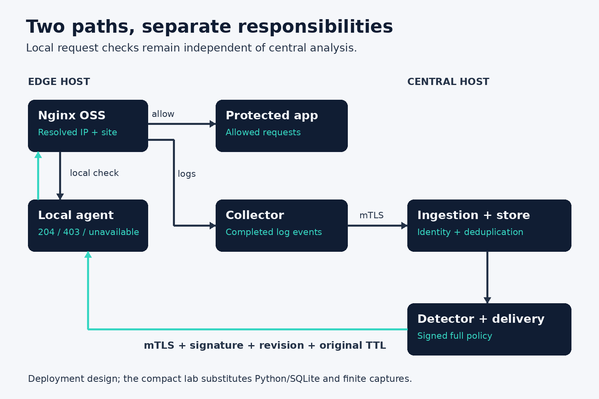

# 3. Design around failure

## Two machines, different responsibilities

Edge A runs Nginx, the collector, and an agent. Central B runs ingestion, durable storage, a detector, and delivery. The edge's request checks do not call Central B. The central side can inspect events and prepare policy without being in the path of every application request.

At a larger scale, several edges belong to one organization and serve registered sites. Each agent receives only its assigned sites. The initial design has one organization boundary. Adding customer tenancy later changes authorization, data retention, key ownership, and database constraints. Treat it as a new design task rather than adding a `tenant_id` field and declaring isolation solved.

## Central outage

An already synchronized agent has a saved policy. If Central B becomes unavailable, the agent continues evaluating that policy. Each ban ends at its original expiry. The collector accumulates events only within its configured finite capacity. Once capacity is exhausted, behavior depends on the collector's backpressure and retention configuration; there is no infinite queue.

An outage therefore affects new knowledge, delivery, and stored observations. It does not necessarily affect ordinary request availability. The important exception is a first-boot agent without verified state. That agent cannot honestly say it has synchronized an empty policy. It reports not-ready until it receives a valid snapshot, including a signed empty one.

## Agent outage

An absent local agent is a different case. The baseline protected Nginx location treats authorization errors as a failure. An allow response is 204. A deliberate deny is 403. A backend error is not an allow. Depending on configuration and build, the public result of an authorization error is generally an Nginx error response, often 500.

Some sites need a deliberate availability profile that permits requests if the local guard is down. That is a business decision about the protected application. Implement it inside the internal authorization location, where only selected backend error codes can be converted to an allow response. Never put a broad fallback on the public application location: it could transform a real application error or a real deny into success.

The production-design folder contains the optional fail-open example from the source pack. It is a candidate configuration until a real Nginx test verifies its status handling, request method, body preservation, and location routing. Do not enable it because the text looks plausible.

## Database and filesystem failures

Ingestion returns success after its transaction commits. If storage fails, the response must invite a retry instead of pretending the data was saved. Policy publication similarly acknowledges only after persistent state and the live view agree. The agent test injects a disk-write failure and verifies that the previous view remains published and survives a new agent object reading the existing state.

A crash between persistence and live publication creates a short uncertainty window. On restart, the verified saved state becomes the source of truth. The sender may retry the exact policy and receive an idempotent acknowledgement. A crash before persistence means the sender has no valid acknowledgement and must try again.

Filesystem permissions also matter. State belongs in a directory an unprivileged service can write without granting arbitrary application users access. Replacing a file in a protected directory is different from writing through a path an attacker can redirect. Configure the directory deliberately and avoid world-writable runtime paths.

## Availability is a policy

Do not label a system "fail-safe" without naming the failure. A central outage and an agent outage have different consequences. Monitor mode and emergency bypass have different purposes. Clock uncertainty and an ordinary expired ban must not be treated as the same event. Document each response in a small failure matrix and test the responses that matter to the deployment.

## Exercise

An agent is offline from central services for thirty minutes. It previously applied a fifteen-minute ban. What should happen to requests from that IP after minute fifteen? What happens if the agent process itself disappears at minute five?

## Answer

The live agent allows the address at its original expiry. A missing agent produces an authorization error under the baseline profile. These failures need separate alerts and recovery actions.
