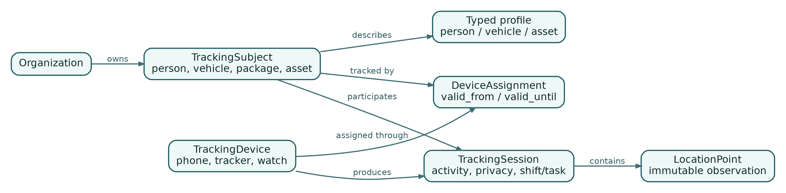

## Chapter 3 - Model Anything That Moves

The most important modeling decision is to separate the thing being tracked from the device doing the tracking. A vehicle is not a device. A courier is not a phone. A package may be associated with a courier for one task and with a vehicle for part of a route. A runner may use a phone today and a watch tomorrow.

{width=94%}

### Tracking subjects

`TrackingSubject` is the stable identity of a person, vehicle, package, container, animal, or custom asset. The base record contains fields shared by all kinds:

```text
id
organization_id
kind
name
external_reference
status
privacy_classification
created_at
updated_at
version
```

Kind-specific attributes belong in profile tables rather than a single sparse table or unvalidated JSON document:

```text
person_profiles
vehicle_profiles
asset_profiles
```

A small `metadata` JSONB column can hold low-risk extension data, but fields used for authorization, retention, routing, or important queries should be typed and constrained.

Subject kind describes what the entity is. Activity kind describes what it is doing. A person subject can participate in walking, driving, cycling, delivery, field work, or running sessions. Do not encode activity into subject type.

### Tracking devices

A `TrackingDevice` represents a source of observations. Examples include a mobile application installation, a watch, a vehicle tracker, a BLE gateway, or a partner integration.

The device record should separate public identity, secrets, capabilities, and status:

```text
tracking_devices
  id
  organization_id
  kind
  display_name
  external_identifier
  status
  last_seen_at
  capabilities JSONB

device_credentials
  id
  device_id
  credential_hash
  version
  expires_at
  revoked_at
```

Capabilities are not permissions. A device may report battery level, ignition state, odometer, temperature, or digital inputs. The capability catalog lets downstream code distinguish "not supported" from "temporarily absent."

### Time-bounded assignments

`DeviceAssignment` records which device was allowed to track which subject and for what interval. This is essential for shared phones, rental trackers, rotating vehicles, and replacements.

```text
device_assignments
  id
  organization_id
  device_id
  subject_id
  valid_from
  valid_until
  assignment_reason
  created_by
```

The database should prevent overlapping active assignments when the device is intended to track only one subject. PostgreSQL exclusion constraints can express interval overlap rules. When business rules permit multiple simultaneous relationships, use an explicit mode rather than silently allowing ambiguity.

Historical points keep both `subject_id` and `device_id`. Never resolve old history through the current assignment. The assignment is authorization and provenance; the point is a durable fact about what the platform accepted at that time.

### Explicit tracking sessions

A session represents an intentional period of tracking and carries context that a device assignment cannot provide:

```text
tracking_sessions
  id
  organization_id
  subject_id
  device_id
  activity_type
  started_at
  ended_at
  status
  privacy_context
  shift_id
  task_id
  consent_record_id
```

Sessions support product behavior:

- the mobile UI can show an unmistakable active state;
- the backend can reject points outside an authorized interval;
- analytics can calculate distance and pace per activity;
- retention can differ between work sessions and public events;
- a user can prove when tracking stopped;
- a task or shift can provide the legal and business context.

Not every dedicated hardware device needs a user-started session. Long-lived asset monitoring may use a managed session or policy. The model should allow this without weakening the rule for people.

### Relationships between subjects

Universal tracking often needs relationships that are valid for an interval:

- a driver operates a vehicle;
- a courier carries a package;
- a tractor pulls a trailer;
- a participant belongs to an event group;
- a guardian may view a dependent's location;
- a tool is assigned to a field technician.

A generic relationship table can represent these links:

```text
subject_relationships
  id
  organization_id
  source_subject_id
  target_subject_id
  relationship_type
  valid_from
  valid_until
  attributes JSONB
```

The relationship type has documented direction and cardinality. Critical behavior should not depend on arbitrary text. Use a catalog or constrained enum and validate combinations.

### Raw observations and derived facts

A `LocationPoint` is an accepted observation. It may be accurate, stale, delayed, low quality, or suspicious. Those qualities are recorded rather than hidden.

Trips, stops, routes, geofence transitions, speed violations, and activity summaries are derived facts. They must reference source time ranges and an algorithm version. When an algorithm changes, the platform can recompute a new version without rewriting the original observations.

A derived record should include fields such as:

```text
algorithm_name
algorithm_version
source_from
source_to
computed_at
supersedes_id
quality_summary
```

This separation is important in disputes. An operator may ask why a trip began at a particular time. The platform should be able to show the source points and algorithm parameters that produced the answer.

### State machines

Important aggregates need explicit transitions. For a tracking session:

```text
planned -> active -> paused -> active -> completed
                    \-> cancelled
```

For a device:

```text
pending -> active -> suspended -> active
                    \-> revoked
```

Transitions should be implemented in domain services and protected by optimistic concurrency. A status column without transition rules becomes an invitation for impossible states.

Example Go method:

```go
func (s *Session) Complete(at time.Time) error {
    if s.Status != SessionActive && s.Status != SessionPaused {
        return ErrInvalidSessionTransition
    }
    if at.Before(s.StartedAt) {
        return ErrInvalidCompletionTime
    }
    s.Status = SessionCompleted
    s.EndedAt = &at
    s.Version++
    return nil
}
```

The database still enforces basic constraints. Domain code explains intent; constraints protect against bugs and manual writes.

### Deletion semantics

Deletion is not one operation. Distinguish:

- **deactivation**: no longer usable, history retained;
- **soft deletion**: hidden from normal use, recoverable during a defined period;
- **retention deletion**: data removed according to policy;
- **privacy erasure**: personal data removed or anonymized under a validated request;
- **legal hold**: deletion suspended for a documented scope;
- **correction**: original fact preserved with a controlled superseding record when required.

Location history should not cascade-delete because a display object was removed. Foreign-key actions must reflect the data lifecycle, not convenience.

### Chapter checklist

The domain model is ready when:

- subject, device, assignment, and session are separate concepts;
- subject type is independent from activity type;
- historical points store direct provenance;
- interval overlap rules are enforced;
- person tracking has explicit context;
- derived facts carry algorithm and source metadata;
- state transitions and deletion meanings are documented and tested.
