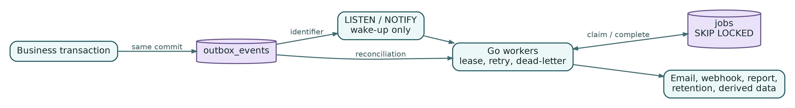

## Chapter 15 - Durable Asynchronous Work in PostgreSQL

The platform needs asynchronous work for notifications, webhooks, reports, geofence evaluation, trip reconciliation, partition maintenance, retention, and exports. Without an external broker, PostgreSQL provides three different mechanisms:

- a transactional outbox for durable facts;
- a leased jobs table for executable work;
- `LISTEN/NOTIFY` for low-latency wake-up signals.

These mechanisms are related but not interchangeable.

{width=95%}

### Transactional outbox

When a business transaction changes state, it inserts an event in the same commit:

```sql
CREATE TABLE outbox_events (
    id uuid PRIMARY KEY,
    organization_id uuid,
    aggregate_type text NOT NULL,
    aggregate_id uuid NOT NULL,
    event_type text NOT NULL,
    schema_version integer NOT NULL,
    payload jsonb NOT NULL,
    occurred_at timestamptz NOT NULL,
    available_at timestamptz NOT NULL DEFAULT now(),
    claimed_at timestamptz,
    claimed_by text,
    processed_at timestamptz,
    attempts integer NOT NULL DEFAULT 0,
    last_error text
);

CREATE INDEX outbox_pending_idx
ON outbox_events (available_at, occurred_at)
WHERE processed_at IS NULL;
```

The event describes a fact that has already happened. It is not a command such as "send an email." A worker projects facts into jobs or other views.

Example transaction:

```sql
BEGIN;

UPDATE tracking_sessions
SET status = 'completed', ended_at = $2, version = version + 1
WHERE id = $1 AND status IN ('active', 'paused');

INSERT INTO outbox_events (...)
VALUES (..., 'tracking_session.completed', 1, $payload, now());

SELECT pg_notify('outbox_ready', $event_id::text);
COMMIT;
```

The notification becomes visible only after commit. If no worker is listening, the row remains available.

### Claiming outbox rows

Workers claim bounded batches using `FOR UPDATE SKIP LOCKED`:

```sql
WITH candidates AS (
    SELECT id
    FROM outbox_events
    WHERE processed_at IS NULL
      AND available_at <= now()
      AND (claimed_at IS NULL OR claimed_at < now() - interval '1 minute')
    ORDER BY occurred_at, id
    FOR UPDATE SKIP LOCKED
    LIMIT $1
)
UPDATE outbox_events o
SET claimed_at = now(),
    claimed_by = $2,
    attempts = attempts + 1
FROM candidates c
WHERE o.id = c.id
RETURNING o.*;
```

A claim is a lease, not ownership forever. If a worker dies, another worker can reclaim after the timeout. The timeout must exceed normal processing time or be renewed.

### Job queue

Jobs represent executable work and retry policy:

```sql
CREATE TABLE jobs (
    id uuid PRIMARY KEY,
    organization_id uuid,
    queue text NOT NULL,
    job_type text NOT NULL,
    payload jsonb NOT NULL,
    idempotency_key text,
    status text NOT NULL DEFAULT 'pending',
    priority integer NOT NULL DEFAULT 0,
    run_at timestamptz NOT NULL DEFAULT now(),
    attempts integer NOT NULL DEFAULT 0,
    max_attempts integer NOT NULL DEFAULT 10,
    locked_at timestamptz,
    locked_by text,
    last_error_code text,
    last_error_summary text,
    completed_at timestamptz,
    created_at timestamptz NOT NULL DEFAULT now()
);

CREATE UNIQUE INDEX jobs_idempotency_uq
ON jobs (organization_id, job_type, idempotency_key)
WHERE idempotency_key IS NOT NULL;
```

The worker claims pending jobs similarly. Keep transactions short: claim and commit, execute external work outside the claim transaction, then mark completion in another transaction. Long database transactions around HTTP calls cause locks and vacuum problems.

### Retry policy

Classify failures:

- transient network or service failure - retry with exponential backoff and jitter;
- rate limited - use server hint or policy delay;
- invalid permanent payload - dead-letter immediately;
- authorization or revocation - cancel safely;
- process crash - lease expiry permits retry;
- unknown error - retry a small number of times, then dead-letter.

Store a bounded error summary. Full stack traces belong in structured logs correlated by job ID, not in an unbounded text column.

A backoff function can be:

```go
func nextDelay(attempt int, base, max time.Duration, jitter float64) time.Duration {
    shift := min(attempt, 10)
    delay := base * time.Duration(1<<shift)
    if delay > max {
        delay = max
    }
    return addJitter(delay, jitter)
}
```

Every handler must be idempotent because a crash can occur after the side effect but before completion is recorded.

### Scheduler coordination

Run multiple scheduler replicas for availability, but let one create each recurring job. PostgreSQL advisory locks provide coordination:

```sql
SELECT pg_try_advisory_lock($1);
```

Use a stable lock key per schedule. Hold the lock only while checking and enqueuing due work. Store a schedule cursor or unique idempotency key so duplicate scheduler runs remain harmless.

Examples of scheduled work:

- future partition creation;
- offline-device evaluation;
- retention planning;
- report generation;
- expired public-link revocation;
- outbox reconciliation;
- abandoned lease recovery;
- audit-chain verification.

### Wake-up versus truth

`LISTEN/NOTIFY` improves latency but is not a queue. Payloads are small, delivery is not durable for disconnected listeners, and a slow transaction can delay notifications. Use it to say "new work may exist." Workers still poll at a modest reconciliation interval.

A robust loop is:

```text
listen for notifications
or wait for reconciliation timer
claim durable rows
process bounded batch
repeat
```

If notifications stop, latency rises slightly but correctness remains.

### Queue isolation

Separate queues or claim filters for workloads with different resource profiles. A huge report must not starve alert delivery. At minimum use:

```text
critical_alerts
notifications
webhooks
location_derivation
reports
exports
maintenance
```

Run role-specific workers with concurrency limits and database pools. Priority helps within a queue but does not replace isolation.

### Observability

Measure:

- oldest pending age by queue;
- pending, leased, retrying, and dead-letter counts;
- claim duration;
- execution latency and outcome by job type;
- lease expirations;
- outbox high-watermark lag;
- notification wake-up failures;
- database time per batch.

Do not place organization IDs or payload values in metric labels.

### Chapter checklist

PostgreSQL-backed asynchronous work is reliable when:

- outbox events are committed with business facts;
- jobs have explicit leases, retries, and dead-letter state;
- workers execute external work outside claim transactions;
- handlers are idempotent;
- schedulers use locks plus idempotency;
- `LISTEN/NOTIFY` is only a wake-up signal;
- queues are isolated by urgency and resource profile;
- backlog age and lease recovery are monitored.
