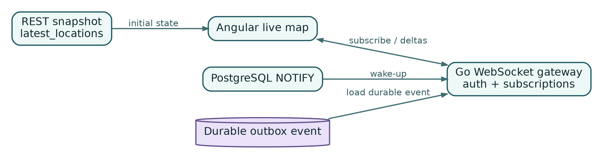

## Chapter 16 - WebSocket Realtime Without Redis

A live map needs low-latency deltas, but accepted location data must remain durable even when no client is connected. The design combines a REST snapshot, durable outbox events, PostgreSQL wake-up notifications, and in-process WebSocket hubs.

{width=95%}

### Snapshot plus delta

A client connection follows this sequence:

1. authenticate the human, API client, or public capability;
2. request a REST snapshot of authorized subjects and versions;
3. open a WebSocket connection;
4. subscribe to organization, team, subject, or public scopes;
5. provide the snapshot high-watermark;
6. receive any missing durable deltas;
7. continue with live deltas.

This avoids treating the WebSocket as the source of truth. A reconnect can always recover from a snapshot or event cursor.

### Protocol envelope

Version every message:

```json
{
  "protocol_version": 1,
  "type": "location.updated",
  "message_id": "0195...",
  "occurred_at": "2026-10-10T10:11:13.101Z",
  "channel": "subjects:0195...:live",
  "sequence": 883,
  "payload": {
    "subject_id": "0195...",
    "recorded_at": "2026-10-10T10:11:12Z",
    "latitude": 44.8123,
    "longitude": 20.4611,
    "speed_mps": 5.8,
    "heading_deg": 182,
    "movement_status": "moving",
    "connection_status": "online"
  }
}
```

Client messages include `subscribe`, `unsubscribe`, `ping`, and acknowledgement or cursor messages when the protocol requires them. Invalid messages receive a bounded error and can close the connection after repeated abuse.

### Authorization at subscription time

Do not authorize only the socket handshake. Each subscription is evaluated against current policy. A role change, team removal, public-link revocation, or session completion may require active subscriptions to be removed.

Channels are logical, not secrets:

```text
organizations:{organization_id}:live
teams:{team_id}:live
subjects:{subject_id}:live
sessions:{session_id}:live
public-links:{share_id}:live
```

Knowing a channel name does not grant access.

### Event propagation between replicas

Every API replica listens for outbox notifications. The notification contains an event ID or high-watermark. The replica loads the durable event, evaluates which local subscribers may receive it, and enqueues a compact message.

If a replica misses a notification, periodic reconciliation reads events after its last processed cursor. If an event has already fallen outside the realtime replay window, clients fall back to a new snapshot.

The event table can retain realtime events for a limited interval after all critical consumers process them. Do not delete based only on one replica's cursor.

### In-process hub

A hub manages local connections and subscriptions. It must be bounded:

```go
type Client struct {
    ID        string
    Principal Principal
    Send      chan []byte
    Closed    chan struct{}
}

type Hub struct {
    register   chan *Client
    unregister chan *Client
    subscribe  chan SubscriptionRequest
    publish    chan Event
}
```

A single goroutine can own hub maps, or sharded hubs can reduce contention. Never let publishers block indefinitely on a slow client.

### Backpressure and coalescing

A dashboard does not need every high-frequency point for every marker. Coalesce location updates per subject and send the newest state at a configurable cadence, for example 250 milliseconds to 2 seconds.

Message classes need different treatment:

- current location updates can be coalesced;
- SOS and alert transitions must not be dropped;
- role or revocation events must be delivered promptly;
- bulk history does not belong on the realtime channel.

Each connection has a bounded send queue. When it fills:

1. discard superseded coalescible updates;
2. preserve critical control messages;
3. if still overloaded, close the client with a retryable reason.

A slow browser must not consume unbounded memory.

### Heartbeats and reconnect

Use protocol-level ping/pong or application heartbeats. Close dead connections after a documented timeout. Clients reconnect with exponential backoff and jitter, not a tight loop.

The client maintains:

- connection state;
- last snapshot version;
- last processed message or subject version;
- active subscription intents;
- server time offset when useful.

After reconnect, it reauthenticates, refreshes expired access tokens, obtains a snapshot or replay, and then restores subscriptions.

### Graceful shutdown

During deployment:

1. readiness becomes false;
2. new connections stop;
3. existing clients receive an optional restart notice;
4. the process drains outbound queues for a bounded interval;
5. sockets close with a retryable code;
6. database listeners and cursors stop cleanly.

Test rolling replacement with thousands of reconnecting clients. A deployment should not create a self-inflicted reconnect storm that overwhelms authentication and snapshot queries.

### Security

Protect the WebSocket endpoint with:

- origin validation for browser clients;
- access-token expiry and refresh behavior;
- message and subscription rate limits;
- maximum frame size;
- read and write deadlines;
- compression limits or disabled compression where risky;
- authorization for every scope;
- no secrets or exact coordinates in normal logs.

### Chapter checklist

Realtime is production-ready when:

- clients use snapshot plus delta;
- messages and channels are versioned;
- every subscription is authorized;
- replicas load durable events after wake-up signals;
- missed notifications are reconciled;
- queues are bounded and locations are coalesced;
- reconnect and graceful shutdown are load-tested;
- critical events are not treated like disposable marker updates.
