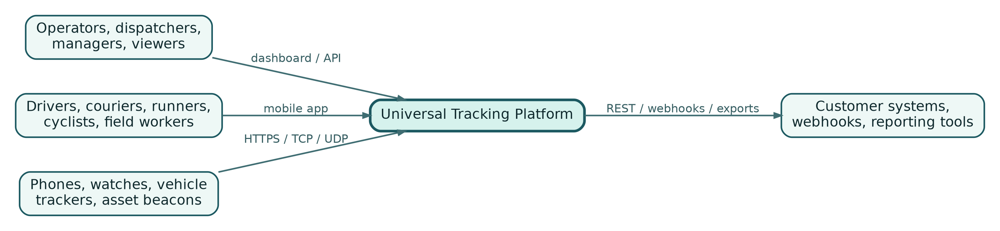
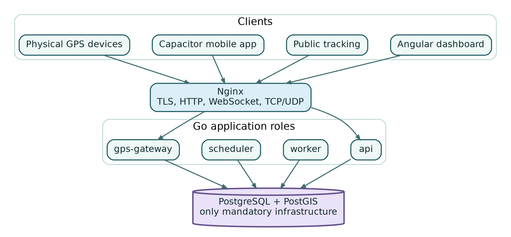
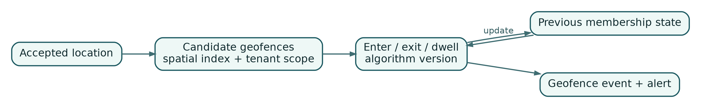
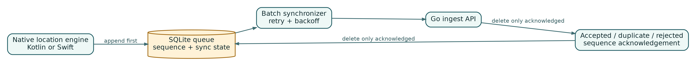
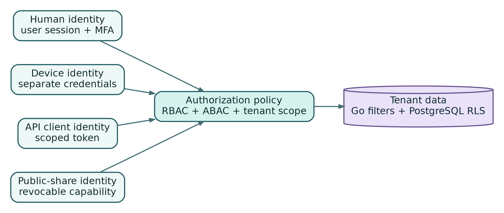
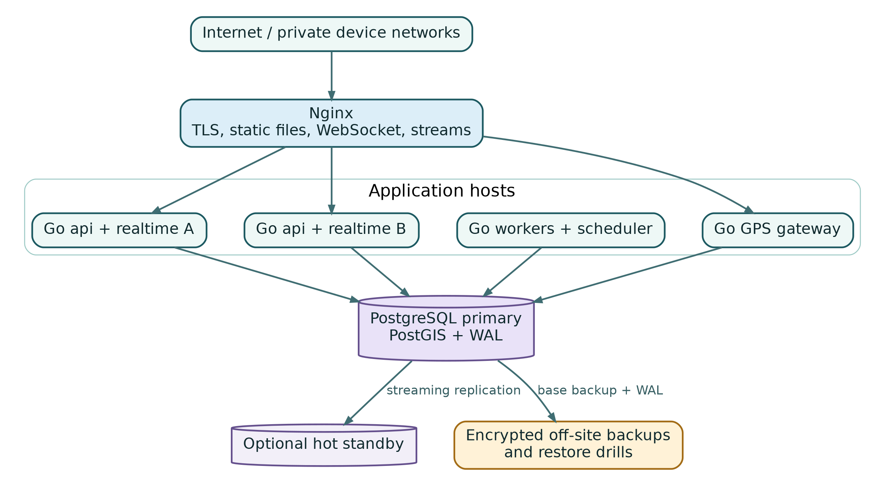
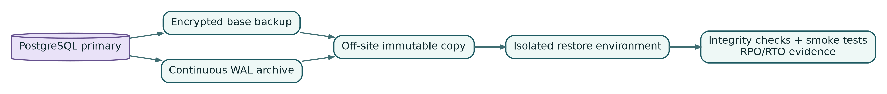

# Engineering a Universal Real-Time Tracking Platform {.unnumbered .unlisted .internal-title}

**Go, PostgreSQL, PostGIS, WebSockets, Mobile Location, and Native GPS Protocols**

**Aleksandar Popovic**

First Edition - October 2026

# Copyright and Edition {.unnumbered .unlisted}

Copyright (c) 2026 Aleksandar Popovic. All rights reserved.

This publication may contain code fragments intended for education and adaptation. The reader is responsible for validating security, privacy, licensing, regulatory, and operational requirements before production use.

Product names and trademarks remain the property of their respective owners.

# Preface {.unnumbered}

Real-time tracking is often described as a map with moving markers. That description is useful for a demo and dangerously incomplete for a production system. A real platform must accept delayed and duplicated measurements, preserve tenant boundaries, survive mobile network loss, protect people from invisible surveillance, decode devices that speak binary protocols, provide useful live updates without losing durable facts, and remain operable when the only mandatory infrastructure service is PostgreSQL.

This book presents a complete engineering approach for that problem. The target product can track people, vehicles, bicycles, packages, equipment, pets, event participants, and custom movable assets. It includes a Go API, a Go WebSocket gateway, PostgreSQL with PostGIS, an Angular operations dashboard, a public tracking experience, an Angular/Ionic/Capacitor mobile application, native Android and iOS location engines, and a native Go TCP/UDP/HTTP GPS gateway.

The architecture deliberately excludes mandatory cloud services, external message brokers, Redis, and an external GPS tracking server. That constraint is not a rejection of those technologies. It is a design exercise in building a strong, portable core with clear seams. When measured scale later justifies another component, the system can adopt it behind an interface instead of rewriting its domain.

The central claim of the book is simple:

> **PostgreSQL can be more than storage without becoming a trap, provided durable state, wake-up signals, background leases, spatial processing, and real-time delivery are assigned distinct responsibilities.**

The examples favor explicit SQL, bounded Go components, observable failure modes, and operational procedures that can be tested. Code samples are intentionally compact. They demonstrate the shape of a solution rather than replacing project-specific validation, threat modeling, or benchmarking.

## Who this book is for {.unnumbered}

This book is written for backend engineers, DevOps engineers, platform engineers, mobile engineers, technical founders, and architects who need to build or evaluate a location platform. Familiarity with Go, SQL, HTTP, Docker, and modern web development is helpful. Prior PostGIS or GPS protocol experience is not required.

## What you will build {.unnumbered}

By the end of the book, you will understand how to build a platform with the following capabilities:

- multi-tenant organizations, users, roles, permissions, and audit history;
- generic tracking subjects and time-bounded device assignments;
- explicit tracking sessions with activity and privacy context;
- batched, idempotent, sequence-aware location ingestion;
- immutable, time-partitioned history in PostgreSQL/PostGIS;
- a fast current-state projection for live maps;
- a PostgreSQL transactional outbox and leased job queue;
- WebSocket delivery that uses `LISTEN/NOTIFY` only as a wake-up signal;
- geofences, trips, stops, alerts, routes, and activity summaries;
- a resilient mobile queue with native Android and iOS location engines;
- public tracking links with expiration and precision controls;
- a bounded Go GPS protocol gateway for HTTP, TCP, and UDP devices;
- portable Docker Compose deployment, Nginx routing, backups, metrics, and disaster-recovery drills.

## Architectural constraints {.unnumbered}

The reference implementation follows these non-negotiable constraints:

1. All server-side application code is written in Go.
2. PostgreSQL with PostGIS is the only mandatory infrastructure service.
3. PostgreSQL is the durable source of truth.
4. `LISTEN/NOTIFY` carries identifiers or high-watermarks, not the only copy of an event.
5. Background work is stored in PostgreSQL and claimed with leases.
6. The web clients use Angular, strict TypeScript, Tailwind CSS, and MapLibre GL JS.
7. The mobile shell uses Angular, Ionic, and Capacitor, while background location uses native Kotlin and Swift.
8. Deployment remains provider-neutral through containers, files, standard protocols, and portable scripts.
9. Tracking people must be visible, bounded by policy, and auditable.
10. New infrastructure may be introduced only after measurements identify a real bottleneck and an accepted architectural decision records the migration.

## How to read the book {.unnumbered}

The chapters are arranged in dependency order. Parts I and II establish the domain and control plane. Part III builds the location data plane. Part IV covers clients. Part V adds business and device integrations. Part VI turns the software into an operable production system. The appendices provide schemas, contracts, and checklists that can be adapted directly.

A reader designing a new product should proceed in order. A reader reviewing an existing platform can start with the relevant chapter, but should also read Chapters 3, 6, 12, 15, 16, 28, and 31 because those chapters contain the most important cross-cutting invariants.

## Conventions {.unnumbered}

- Times are stored and exchanged in UTC unless explicitly stated otherwise.
- Database timestamps use `timestamptz`.
- Coordinates use longitude before latitude in PostGIS constructors.
- Distances are represented in meters and speeds in meters per second internally.
- Identifiers are opaque. Examples use UUID-like strings without depending on a specific library.
- HTTP examples use `/api/v1` for the public versioned surface.
- Error responses use stable machine-readable codes and separate human-readable messages.
- Shell examples assume a Unix-like environment.

## Safety and legal notice {.unnumbered}

Location data can reveal homes, workplaces, habits, health-related activity, and personal relationships. This book provides technical guidance, not legal advice. Production deployments must be reviewed against the laws, employment rules, consent requirements, and safety obligations that apply to the relevant jurisdictions and use cases.

# Acknowledgments {.unnumbered}

This book is authored by **Aleksandar Popovic**. It is informed by production patterns from distributed systems, mobile engineering, PostgreSQL operations, geospatial processing, and secure software design. The project favors boring, inspectable mechanisms over opaque convenience and treats operational evidence as part of the implementation.

# Part I - Foundations {.part}

## Chapter 1 - Define the Product Before the Architecture

A universal tracking platform is not a fleet application with extra labels. The platform must represent any subject that can move, any device that can observe movement, and any policy that determines when the observation is legitimate. This distinction changes the database, the API, the mobile user experience, and the security model.

{width=96%}

### Start with actors and outcomes

The first design artifact should not be a service diagram. It should be a list of actors and decisions they need to make.

An operations dispatcher wants to know which couriers are available, which jobs are late, and whether an apparently stationary marker is a real stop or stale data. A runner wants accurate pace and route history without being visible after the session ends. A fleet owner wants vehicle history and maintenance signals, while a driver needs proof that private movement outside a shift was not recorded. A recipient wants a short-lived page showing an approaching delivery, not access to the courier's full history. An integrator wants stable contracts, idempotency, and signed webhooks.

Those outcomes produce the major product surfaces:

- an operations dashboard for organizations and teams;
- a mobile tracker for people carrying phones;
- public tracking pages for carefully scoped sharing;
- device ingestion for dedicated hardware;
- an API and webhooks for customer systems;
- reporting and export workflows;
- privacy and audit controls that are visible to the tracked person.

### Model capabilities, not verticals

A common mistake is to split the product immediately into "fleet," "courier," "sports," and "family" applications. The result is duplicated location storage, duplicated device registration, and inconsistent privacy behavior. A better strategy is to build one location core and compose vertical capabilities around it.

The core answers questions such as:

- Who or what is being tracked?
- Which device was authorized to observe it at this time?
- Which session, task, shift, event, or consent record allowed tracking?
- Which measurements were accepted, duplicated, delayed, suspicious, or rejected?
- What is the latest trusted state?
- Which derived facts were produced from which raw observations and algorithm version?
- Who viewed or shared the data?

Vertical modules then add business meaning. A delivery module adds stops, proofs, and recipient links. A sports module adds laps, pace, and elevation. A fleet module adds vehicle metadata and maintenance. They share subjects, devices, sessions, positions, routes, and authorization.

### Establish non-functional requirements

"Real time" is not a single number. Define separate service objectives:

- **ingestion acceptance latency**: time from request arrival until the batch is durably committed;
- **location freshness**: difference between `recorded_at` on the device and the current time;
- **live propagation latency**: time from commit until an authorized client receives a delta;
- **history availability**: how soon accepted points become queryable;
- **alert latency**: time from a qualifying observation until a notification job is created or delivered;
- **recovery objectives**: maximum acceptable data loss and service restoration time.

The device-to-server path is partly outside the platform's control. A phone may be offline for twenty minutes. A dedicated tracker may buffer packets. Therefore, server latency should be measured from `received_at`, while product UX should expose both `recorded_at` and freshness.

A reasonable first production objective might be:

| Capability | Initial objective |
|---|---:|
| Ingest API availability | 99.95% |
| Control API availability | 99.9% |
| P95 accepted-batch latency | under 300 ms |
| P95 commit-to-live-map latency | under 2 s |
| Durable loss after acceptance | zero by design |
| WebSocket reconnect recovery | under 10 s |
| Restore-point objective | measured and tested, not assumed |

These are targets, not promises. They must be validated by load and recovery tests on the actual hardware and data model.

### Estimate data volume early

Location systems become large through multiplication, not through large individual records. The daily point count is approximately:

```text
active subjects * seconds per day / reporting interval
```

For 10,000 active subjects reporting every 10 seconds:

```text
10,000 * 86,400 / 10 = 86,400,000 points per day
```

If each stored row, including indexes and tuple overhead, consumes several hundred bytes, the daily footprint can be tens of gigabytes. The exact value depends on columns, index selection, fill factor, compression opportunities, and retention. This is why the architecture needs batching, partitioning, a separate latest-state table, route simplification, and explicit retention before launch.

Do not size only for average traffic. Mobile clients reconnect after outages and upload accumulated batches. A race may start thousands of sessions within a minute. A carrier network recovery can create a synchronized burst. The ingestion API and database must absorb these patterns without forcing every live viewer to receive every historical point.

### Write product invariants

Invariants are rules that remain true across services, tables, and releases. Useful starting invariants include:

1. A location point is associated with exactly one organization, subject, device, and recording time.
2. A device can report for a subject only while a valid assignment or explicitly authorized session exists.
3. A human, a tracking device, an API client, and a public-share visitor are different identity classes.
4. A public link never expands access beyond its stored scope.
5. Raw accepted observations are not silently rewritten by derived algorithms.
6. Derived trips, stops, transitions, and alerts record their algorithm version and source interval.
7. Every tenant-owned query is scoped in Go, and critical tables also enforce row-level security.
8. Tracking of a person is visible and bounded by a recorded basis.
9. Normal logs do not contain exact coordinates, raw packets, tokens, or personal route history.
10. Database changes remain compatible with rolling processes until the contract phase is complete.

Invariants prevent a feature request from quietly changing the meaning of existing data. They also give tests something stronger to assert than individual endpoint responses.

### Use a staged product boundary

A production-capable first release does not need every vertical feature. It does need the full reliability chain. The minimum meaningful scope is:

- organizations, users, roles, and audit;
- generic subjects, devices, assignments, and sessions;
- mobile location capture with offline persistence;
- batched ingestion with idempotency and sequencing;
- partitioned history and latest state;
- a live map with reconnect recovery;
- basic geofences and alerts;
- public links with expiration and precision limits;
- backup, restore, monitoring, and field validation.

A large feature list without recovery behavior is still a prototype. A narrower system that survives duplicate uploads, process restarts, database failover, and mobile outages is the beginning of a product.

### Chapter checklist

Before designing components, confirm that the project has:

- named actors and decisions rather than only screens;
- explicit data retention and privacy expectations;
- separate latency objectives for acceptance, freshness, and propagation;
- realistic point-volume estimates and burst scenarios;
- domain invariants approved by engineering and product owners;
- a first release that includes operations and recovery, not only features.

## Chapter 2 - A Modular Monolith with Multiple Runtime Roles

The system benefits from one domain model and several independently scalable process roles. This is not a contradiction. A modular monolith describes code ownership and dependency rules; runtime roles describe how the same codebase is executed.

{width=94%}

### Why not begin with microservices

Location platforms contain natural domains: identity, registry, ingestion, realtime, geofences, tasks, integrations, and reporting. Turning each domain into a network service on day one adds contract versioning, deployment coordination, distributed tracing, retry storms, and data ownership questions before the team has measured where isolation is needed.

The highest-volume path is clear - location ingestion and projection. Even so, it can begin as a distinct package and process role inside one repository. The boundary is enforced by interfaces and schemas rather than by a network hop. If the path later needs a separate deployment or language, its contract already exists.

The modular-monolith approach provides:

- one repository and one set of domain terms;
- atomic database changes where they are genuinely needed;
- simple local development;
- fewer operational components;
- consistent authorization and audit behavior;
- a controlled path to later extraction.

It does not mean one giant package, one global dependency container, or one process that performs every task.

### Runtime roles

The reference binary exposes subcommands or builds equivalent binaries:

```text
tracking-platform api
tracking-platform worker
tracking-platform scheduler
tracking-platform gps-gateway
tracking-platform migrate
tracking-platform simulator
```

The roles share configuration parsing, database access, domain packages, telemetry, and contracts, but they have separate startup graphs and resource budgets.

**`api`** serves the REST API, WebSocket endpoint, authentication, organization management, history queries, current-state snapshots, and public pages. It should be horizontally replaceable and must shut down gracefully.

**`worker`** leases durable jobs, processes outbox events, calculates derived facts, delivers webhooks, creates exports, and performs retention work. Multiple workers cooperate through database leases.

**`scheduler`** creates recurring jobs and manages future partitions. It uses PostgreSQL advisory locks so only one replica schedules a given task at a time.

**`gps-gateway`** owns long-lived TCP/UDP/HTTP device connections, bounded frame parsing, protocol acknowledgements, and normalization to the internal ingestion contract.

**`migrate`** performs explicit, versioned database migrations. Application roles never auto-migrate at startup.

**`simulator`** generates deterministic routes, device failures, reconnect bursts, and protocol traffic for tests and capacity studies.

### Package boundaries

A practical repository separates domain modules from adapters:

```text
cmd/tracking-platform/
internal/
  app/
  auth/
  authorization/
  organizations/
  registry/
  locations/
  realtime/
  outbox/
  jobs/
  scheduler/
  geofences/
  alerts/
  trips/
  tasks/
  integrations/
  privacy/
  audit/
  protocols/
pkg/
api/
migrations/
web/
mobile/
native/
deployments/
tests/
```

Packages under `internal` are not a miscellaneous bucket. Each domain owns its types, use cases, repository interfaces, validation, and tests. Cross-domain calls pass through explicit application services or events. Database row structs do not become global domain objects.

The `pkg` directory should remain small. Code belongs there only when it is genuinely reusable outside the application. Most "shared" helpers are better kept internal so their API can evolve.

### Dependency direction

A useful rule is:

```text
transport adapters -> application use cases -> domain rules -> repository interfaces
                                          <- infrastructure implementations
```

An HTTP handler may parse JSON and call `RegisterDevice`. It should not construct SQL, publish a WebSocket message, and write an audit row itself. The use case coordinates those concerns through dependencies. The database adapter implements repository interfaces. Realtime delivery reacts to durable events rather than being a hidden side effect of the handler.

A small application constructor makes the graph visible:

```go
type App struct {
    DB            *pgxpool.Pool
    Subjects      *registry.SubjectService
    Devices       *registry.DeviceService
    Locations     *locations.Service
    Authorization *authorization.Engine
    Audit         *audit.Service
}

func NewApp(cfg Config, db *pgxpool.Pool) (*App, error) {
    // Construct repositories first, then domain services, then adapters.
    // Return an error when a mandatory dependency cannot be initialized.
    return &App{/* ... */}, nil
}
```

Avoid reflection-based service locators. Explicit construction is easier to review, test, and profile.

### Contracts before transports

Public REST schemas, WebSocket messages, native mobile bridge messages, and GPS normalized envelopes are versioned contracts. Define them independently from transport implementation details.

For example, the canonical accepted location event can contain:

```json
{
  "schema_version": 1,
  "event_id": "0195...",
  "organization_id": "0195...",
  "subject_id": "0195...",
  "device_id": "0195...",
  "session_id": "0195...",
  "sequence": 9482,
  "recorded_at": "2026-10-10T12:20:51.442Z",
  "position": {
    "latitude": 44.8124,
    "longitude": 20.4612,
    "accuracy_m": 7.1,
    "speed_mps": 4.8,
    "heading_deg": 183.0
  },
  "quality": "valid"
}
```

A durable event should be understandable without importing an internal Go struct. This allows reprocessing, external tools, and future service extraction.

### One database does not mean uncontrolled coupling

A shared PostgreSQL cluster can still have strong ownership:

- tables are grouped by module and documented;
- writes occur through owning application services;
- cross-module foreign keys are deliberate;
- reporting views prevent ad hoc joins from becoming public contracts;
- outbox events communicate important changes;
- migrations use expand-migrate-contract;
- integration tests detect unauthorized table access.

The goal is not to pretend the database is physically separate. The goal is to keep business rules from leaking into every query and handler.

### Failure domains and graceful degradation

Different roles fail differently. The API should continue serving history if the worker is unavailable. Ingestion should commit points even if a WebSocket client is slow. The worker should retry webhook delivery without blocking trip calculation. The scheduler should be safely redundant. The GPS gateway should shed abusive connections without exhausting API resources.

This suggests independent process limits:

- database connection pools sized per role;
- separate CPU and memory limits;
- separate readiness checks;
- bounded internal queues;
- distinct structured log fields;
- role-specific metrics and alerts.

The platform remains one product, but an overloaded binary protocol listener should not consume every file descriptor available to the dashboard API.

### Extraction criteria

Do not extract a service because a diagram looks cleaner. Extract only when evidence shows a concrete need, such as:

- independent scaling cannot be achieved with process roles;
- a module requires a different data lifecycle or security boundary;
- deployments are blocked by unrelated release cadence;
- database contention remains after query and partition work;
- the team structure has stable ownership and operational capacity;
- a protocol boundary is already versioned and tested.

Record the decision in an ADR with current measurements, target improvement, migration strategy, rollback plan, and the new failure modes being accepted.

### Chapter checklist

A healthy modular monolith has:

- explicit runtime roles rather than one overloaded process;
- package dependency rules enforced by tests or tooling;
- public contracts independent from database structs;
- durable events for cross-module facts;
- role-specific resource budgets and health checks;
- measurable criteria for any future service extraction.

## Chapter 3 - Model Anything That Moves

The most important modeling decision is to separate the thing being tracked from the device doing the tracking. A vehicle is not a device. A courier is not a phone. A package may be associated with a courier for one task and with a vehicle for part of a route. A runner may use a phone today and a watch tomorrow.

{width=94%}

### Tracking subjects

`TrackingSubject` is the stable identity of a person, vehicle, package, container, animal, or custom asset. The base record contains fields shared by all kinds:

```text
id
organization_id
kind
name
external_reference
status
privacy_classification
created_at
updated_at
version
```

Kind-specific attributes belong in profile tables rather than a single sparse table or unvalidated JSON document:

```text
person_profiles
vehicle_profiles
asset_profiles
```

A small `metadata` JSONB column can hold low-risk extension data, but fields used for authorization, retention, routing, or important queries should be typed and constrained.

Subject kind describes what the entity is. Activity kind describes what it is doing. A person subject can participate in walking, driving, cycling, delivery, field work, or running sessions. Do not encode activity into subject type.

### Tracking devices

A `TrackingDevice` represents a source of observations. Examples include a mobile application installation, a watch, a vehicle tracker, a BLE gateway, or a partner integration.

The device record should separate public identity, secrets, capabilities, and status:

```text
tracking_devices
  id
  organization_id
  kind
  display_name
  external_identifier
  status
  last_seen_at
  capabilities JSONB

device_credentials
  id
  device_id
  credential_hash
  version
  expires_at
  revoked_at
```

Capabilities are not permissions. A device may report battery level, ignition state, odometer, temperature, or digital inputs. The capability catalog lets downstream code distinguish "not supported" from "temporarily absent."

### Time-bounded assignments

`DeviceAssignment` records which device was allowed to track which subject and for what interval. This is essential for shared phones, rental trackers, rotating vehicles, and replacements.

```text
device_assignments
  id
  organization_id
  device_id
  subject_id
  valid_from
  valid_until
  assignment_reason
  created_by
```

The database should prevent overlapping active assignments when the device is intended to track only one subject. PostgreSQL exclusion constraints can express interval overlap rules. When business rules permit multiple simultaneous relationships, use an explicit mode rather than silently allowing ambiguity.

Historical points keep both `subject_id` and `device_id`. Never resolve old history through the current assignment. The assignment is authorization and provenance; the point is a durable fact about what the platform accepted at that time.

### Explicit tracking sessions

A session represents an intentional period of tracking and carries context that a device assignment cannot provide:

```text
tracking_sessions
  id
  organization_id
  subject_id
  device_id
  activity_type
  started_at
  ended_at
  status
  privacy_context
  shift_id
  task_id
  consent_record_id
```

Sessions support product behavior:

- the mobile UI can show an unmistakable active state;
- the backend can reject points outside an authorized interval;
- analytics can calculate distance and pace per activity;
- retention can differ between work sessions and public events;
- a user can prove when tracking stopped;
- a task or shift can provide the legal and business context.

Not every dedicated hardware device needs a user-started session. Long-lived asset monitoring may use a managed session or policy. The model should allow this without weakening the rule for people.

### Relationships between subjects

Universal tracking often needs relationships that are valid for an interval:

- a driver operates a vehicle;
- a courier carries a package;
- a tractor pulls a trailer;
- a participant belongs to an event group;
- a guardian may view a dependent's location;
- a tool is assigned to a field technician.

A generic relationship table can represent these links:

```text
subject_relationships
  id
  organization_id
  source_subject_id
  target_subject_id
  relationship_type
  valid_from
  valid_until
  attributes JSONB
```

The relationship type has documented direction and cardinality. Critical behavior should not depend on arbitrary text. Use a catalog or constrained enum and validate combinations.

### Raw observations and derived facts

A `LocationPoint` is an accepted observation. It may be accurate, stale, delayed, low quality, or suspicious. Those qualities are recorded rather than hidden.

Trips, stops, routes, geofence transitions, speed violations, and activity summaries are derived facts. They must reference source time ranges and an algorithm version. When an algorithm changes, the platform can recompute a new version without rewriting the original observations.

A derived record should include fields such as:

```text
algorithm_name
algorithm_version
source_from
source_to
computed_at
supersedes_id
quality_summary
```

This separation is important in disputes. An operator may ask why a trip began at a particular time. The platform should be able to show the source points and algorithm parameters that produced the answer.

### State machines

Important aggregates need explicit transitions. For a tracking session:

```text
planned -> active -> paused -> active -> completed
                    \-> cancelled
```

For a device:

```text
pending -> active -> suspended -> active
                    \-> revoked
```

Transitions should be implemented in domain services and protected by optimistic concurrency. A status column without transition rules becomes an invitation for impossible states.

Example Go method:

```go
func (s *Session) Complete(at time.Time) error {
    if s.Status != SessionActive && s.Status != SessionPaused {
        return ErrInvalidSessionTransition
    }
    if at.Before(s.StartedAt) {
        return ErrInvalidCompletionTime
    }
    s.Status = SessionCompleted
    s.EndedAt = &at
    s.Version++
    return nil
}
```

The database still enforces basic constraints. Domain code explains intent; constraints protect against bugs and manual writes.

### Deletion semantics

Deletion is not one operation. Distinguish:

- **deactivation**: no longer usable, history retained;
- **soft deletion**: hidden from normal use, recoverable during a defined period;
- **retention deletion**: data removed according to policy;
- **privacy erasure**: personal data removed or anonymized under a validated request;
- **legal hold**: deletion suspended for a documented scope;
- **correction**: original fact preserved with a controlled superseding record when required.

Location history should not cascade-delete because a display object was removed. Foreign-key actions must reflect the data lifecycle, not convenience.

### Chapter checklist

The domain model is ready when:

- subject, device, assignment, and session are separate concepts;
- subject type is independent from activity type;
- historical points store direct provenance;
- interval overlap rules are enforced;
- person tracking has explicit context;
- derived facts carry algorithm and source metadata;
- state transitions and deletion meanings are documented and tested.

## Chapter 4 - Repository Design and Engineering Workflow

A tracking platform spans Go, SQL, Angular, Capacitor, Kotlin, Swift, Docker, and operational scripts. The repository must make cross-language contracts visible without turning every change into a full rebuild of unrelated components.

### Repository layout

A practical monorepo is:

```text
tracking-platform/
  cmd/tracking-platform/
  internal/
  pkg/
  api/
    openapi/
    websocket/
    schemas/
  migrations/
  web/
    dashboard/
    public-tracking/
    shared/
  mobile/tracker-app/
  native/android/
  native/ios/
  deployments/
    docker/
    compose/
    nginx/
  scripts/
  tests/
    integration/
    e2e/
    load/
    fixtures/
  docs/
    adr/
    runbooks/
    progress/
```

The Go module is at the repository root unless there is a strong reason to use multiple modules. Angular applications can use a pnpm workspace. Generated clients and schemas live in predictable locations and are verified in CI.

### Architecture decision records

An ADR records a decision that would otherwise be rediscovered through code archaeology. Good early ADRs cover:

- modular monolith and runtime roles;
- PostgreSQL/PostGIS as the only mandatory infrastructure;
- transactional outbox and database job queue;
- `LISTEN/NOTIFY` as a wake-up signal only;
- UUID and timestamp standards;
- public API and WebSocket versioning;
- tenant isolation with Go filters plus RLS;
- native mobile location engines;
- provider-neutral file storage;
- criteria for adding a broker or cache later.

An ADR should state context, decision, alternatives, consequences, migration conditions, and status. It should not read like marketing copy.

### Configuration

Configuration is parsed once at startup into typed structures. Required values fail fast. Secrets can come from mounted files or environment variables, but secret values are never printed.

```go
type DatabaseConfig struct {
    URL             string
    MaxConnections  int32
    MinConnections  int32
    ConnectTimeout  time.Duration
    StatementTimeout time.Duration
}

type HTTPConfig struct {
    Address            string
    ReadHeaderTimeout  time.Duration
    IdleTimeout        time.Duration
    ShutdownTimeout    time.Duration
}
```

Provide a command that prints a redacted effective configuration and build metadata. This is valuable during incidents and prevents ambiguity about which defaults are active.

### API conventions

Define conventions before endpoints multiply:

- version prefix and deprecation policy;
- request and response media types;
- error envelope and stable codes;
- cursor pagination;
- idempotency key behavior;
- optimistic concurrency through versions or entity tags;
- correlation IDs;
- maximum body sizes;
- timestamp and unit conventions;
- partial update semantics;
- filtering and sorting grammar.

A stable error response can look like:

```json
{
  "error": {
    "code": "device_assignment_inactive",
    "message": "The device is not assigned to this subject at the recorded time.",
    "request_id": "0195...",
    "details": {
      "point_index": 17
    }
  }
}
```

Do not expose SQL errors, token parsing details, or internal stack traces.

### Testing layers

The platform needs more than unit tests:

- **unit tests** for state machines, validation, route math, and policy decisions;
- **SQL tests** for constraints, RLS, partition routing, and query plans;
- **integration tests** with a real PostGIS database;
- **contract tests** for OpenAPI, WebSocket, native bridge, and protocol schemas;
- **end-to-end tests** spanning mobile batch upload to dashboard delta;
- **fuzz tests** for parsers, public JSON, and binary protocols;
- **benchmarks** for ingestion, history queries, and fan-out;
- **restore tests** for backups;
- **field tests** on real phones and trackers.

Mocks are useful at process boundaries, but a mocked PostgreSQL transaction cannot prove RLS or `SKIP LOCKED` behavior. Use disposable real databases in CI.

### Determinism

Location tests are easily made flaky by wall clocks, random IDs, and floating-point tolerances. Inject clocks and ID generators. Seed route simulations. Store expected distance ranges instead of comparing unrounded floating-point results for exact equality.

```go
type Clock interface {
    Now() time.Time
}

type IDGenerator interface {
    New() uuid.UUID
}
```

A deterministic simulator should produce the same points, network failures, and battery values for a given seed. This makes performance regressions reproducible.

### Generated artifacts

Generated code is acceptable when the source of truth is clear. Examples include:

- OpenAPI clients;
- `sqlc` query code;
- protocol field tables;
- build metadata;
- TypeScript event types.

CI should regenerate and fail if the working tree changes. A generated file must identify its source and generation command. Never hand-edit it.

### Change workflow

A safe change sequence is:

1. Read project constraints and relevant ADRs.
2. Inspect the current repository and database migration state.
3. Write or update the contract first when public behavior changes.
4. Add the migration using expand-migrate-contract.
5. Implement the smallest coherent application change.
6. Run focused tests, then affected broader suites.
7. Update runbooks, diagrams, and examples.
8. Record exact test commands and honest outcomes.
9. Commit one reviewable intent.

Database migrations are especially important. Do not combine a destructive contract step with the application code that stops using the old field. First expand, then deploy compatible code, then migrate data, and only later contract.

### CI quality gates

A baseline pipeline should verify:

```text
go fmt / vet / test / race where practical
static analysis and dependency policy
SQL migration bootstrap and rollback policy
sqlc generation
OpenAPI and schema generation
Angular format, lint, test, and production build
native unit tests where supported
container build and vulnerability scan
license and SBOM generation
secret scanning
generated-file cleanliness
```

Critical tests should not be silently skipped when an environment variable is missing. Either provision the dependency or fail with a clear reason.

### Chapter checklist

A production repository has:

- visible module boundaries and runtime entry points;
- ADRs for cross-cutting choices;
- typed and redacted configuration;
- consistent API conventions;
- deterministic clocks, IDs, fixtures, and simulators;
- real PostGIS integration tests;
- generated-artifact verification;
- expand-migrate-contract as a normal workflow.

## Chapter 5 - PostgreSQL and PostGIS as the Platform Core

PostgreSQL is the only mandatory infrastructure service in the reference architecture. This makes database design an application architecture concern, not an implementation detail. The database stores business state, raw observations, current projections, durable events, background jobs, audit history, and spatial shapes. Each workload needs deliberate tables, indexes, connection budgets, and lifecycle rules.

### Bootstrap extensions and roles

A minimal bootstrap enables required extensions and separates privileges:

```sql
CREATE EXTENSION IF NOT EXISTS postgis;
CREATE EXTENSION IF NOT EXISTS pgcrypto;

CREATE ROLE tracking_owner NOLOGIN;
CREATE ROLE tracking_app LOGIN;
CREATE ROLE tracking_migrator LOGIN;
CREATE ROLE tracking_readonly LOGIN;
```

The migration role owns schema changes. The application role receives only runtime privileges. A read-only role can support controlled reporting. Production secrets are injected rather than embedded in SQL files.

Use a schema convention consistently. A single application schema is simpler than many schemas for a modular monolith, but either can work when object ownership and search paths are explicit.

### Types and units

Recommended defaults include:

- `uuid` for identifiers;
- `timestamptz` for moments in time;
- `date` only for calendar concepts;
- `bigint` for device sequence numbers;
- `double precision` for sensor measurements;
- constrained `text` or lookup tables for evolving categories;
- `jsonb` for bounded extension data, not core fields;
- `geography(Point, 4326)` for Earth-distance calculations;
- `geometry` for shapes and map operations where a chosen projection is appropriate.

Store canonical units. Convert at presentation boundaries. A database column named `speed` is ambiguous; `speed_mps` is not.

### Spatial types

PostGIS distinguishes `geometry` and `geography`. Geography treats coordinates on an ellipsoidal Earth and is convenient for meter-based distance between latitude/longitude points. Geometry operates in a planar coordinate reference system and supports a broader set of operations with projection-dependent units.

For raw global location points:

```sql
position geography(Point, 4326) NOT NULL
```

Construct a point with longitude first:

```sql
ST_SetSRID(ST_MakePoint($1, $2), 4326)::geography
```

For a geofence polygon, storing a validated geometry can make containment queries efficient. Large or cross-dateline shapes require more care. Document the accepted geometry rules and reject invalid shapes at creation time.

### Connection pools

Every process role has its own pool. The sum of maximum pool sizes must remain below the database connection budget after reserving connections for migrations, monitoring, maintenance, replication, and emergencies.

Example budget:

```text
PostgreSQL max_connections: 200
reserved operations/admin:   20
api replicas: 4 * 20 =       80
workers: 4 * 15 =            60
scheduler: 2 * 3 =            6
gateway: 2 * 8 =             16
headroom:                     18
```

More connections do not automatically increase throughput. They can increase lock contention, memory use, and context switching. Measure queueing time and database CPU before changing pool sizes.

Set timeouts deliberately:

```sql
SET statement_timeout = '5s';
SET lock_timeout = '1s';
SET idle_in_transaction_session_timeout = '10s';
```

Values differ by role and query. Long report jobs should not inherit the same timeout as a live-map snapshot.

### Transactions

Application services own transaction boundaries. Repositories accept a transaction-capable interface rather than starting hidden transactions.

```go
type DBTX interface {
    Exec(context.Context, string, ...any) (pgconn.CommandTag, error)
    Query(context.Context, string, ...any) (pgx.Rows, error)
    QueryRow(context.Context, string, ...any) pgx.Row
}
```

A use case can then atomically update domain state, append an audit record, and write an outbox event.

Retry only transactions that are safe to repeat and only for recognized transient failures. An idempotency key is not a substitute for understanding transaction side effects.

### Constraints before application checks

The database should reject impossible data even if application validation is bypassed. Examples include:

```sql
CHECK (battery_percent BETWEEN 0 AND 100),
CHECK (accuracy_m IS NULL OR accuracy_m >= 0),
CHECK (heading_deg IS NULL OR
       (heading_deg >= 0 AND heading_deg < 360)),
CHECK (valid_until IS NULL OR valid_until > valid_from)
```

Use unique constraints for natural idempotency keys and exclusion constraints for interval overlap. Application code converts constraint violations into stable domain errors.

### Indexes from queries

Index every foreign key that participates in deletes or common joins, but do not index every column. The location workload usually needs:

- B-tree on `(organization_id, subject_id, recorded_at DESC)`;
- GiST on `position` for spatial predicates;
- BRIN on `recorded_at` for large, naturally ordered partitions;
- targeted partial indexes for active devices, pending jobs, and unprocessed events.

Validate with `EXPLAIN (ANALYZE, BUFFERS)` using realistic distributions. A query that is fast with one organization and one thousand rows may fail with skewed tenants and billions of points.

### Migrations

Migrations are immutable after release. A migration tool applies numbered SQL files and records their state. Every deployment validates that the expected migration set is present before serving traffic.

A safe column rename is not an immediate `ALTER COLUMN RENAME` when old and new processes overlap. Instead:

1. add the new column;
2. write both fields;
3. backfill in bounded batches;
4. read the new field with fallback;
5. stop writing the old field;
6. verify no old processes remain;
7. remove the old field in a later release.

This pattern is slower than a single migration and far safer.

### Chapter checklist

The database foundation is ready when:

- roles and privileges are separated;
- types encode units and time semantics;
- geography and geometry choices are documented;
- pool budgets are calculated across all roles;
- transaction ownership is explicit;
- constraints enforce important invariants;
- indexes are justified by measured queries;
- migrations support rolling compatibility.

# Part II - Identity and the Control Plane {.part}

## Chapter 6 - Tenant Isolation and Row-Level Security

A multi-tenant location platform stores unusually sensitive data. A missing organization filter is not a cosmetic defect; it can expose a person's historical movements. Tenant isolation therefore needs independent layers.

### Organization scope in every owned row

Every tenant-owned table contains `organization_id`, including child tables whose parent already has it. The duplication is intentional. It enables direct policies, partition-friendly indexes, and queries that prove scope without trusting a join.

```sql
CREATE TABLE tracking_subjects (
    id uuid PRIMARY KEY,
    organization_id uuid NOT NULL
        REFERENCES organizations(id),
    kind text NOT NULL,
    name text NOT NULL,
    status text NOT NULL,
    version bigint NOT NULL DEFAULT 1,
    created_at timestamptz NOT NULL DEFAULT now(),
    updated_at timestamptz NOT NULL DEFAULT now(),
    UNIQUE (organization_id, id)
);
```

Composite foreign keys can ensure a child and parent belong to the same organization:

```sql
FOREIGN KEY (organization_id, subject_id)
REFERENCES tracking_subjects (organization_id, id)
```

### Request-scoped tenant context

The authenticated principal selects an organization through an explicit request context, not a client-controlled filter. The authorization layer verifies membership before opening a tenant transaction.

Within the transaction, set a local parameter:

```sql
SELECT set_config('app.organization_id', $1, true);
SELECT set_config('app.user_id', $2, true);
```

The third argument makes the setting transaction-local. This matters with connection pools: a tenant value must never leak into a later request using the same connection.

A Go transaction helper can enforce the sequence:

```go
func WithTenantTx(
    ctx context.Context,
    pool *pgxpool.Pool,
    tenantID uuid.UUID,
    userID uuid.UUID,
    fn func(pgx.Tx) error,
) error {
    tx, err := pool.Begin(ctx)
    if err != nil {
        return err
    }
    defer tx.Rollback(ctx)

    if _, err = tx.Exec(ctx,
        `select set_config('app.organization_id', $1, true)`,
        tenantID.String(),
    ); err != nil {
        return err
    }
    if _, err = tx.Exec(ctx,
        `select set_config('app.user_id', $1, true)`,
        userID.String(),
    ); err != nil {
        return err
    }
    if err = fn(tx); err != nil {
        return err
    }
    return tx.Commit(ctx)
}
```

Production code should also set timeouts, record transaction metrics, and classify retryable errors.

### Row-level security as defense in depth

Enable RLS on sensitive tables and create policies that compare the row's organization with the request context:

```sql
ALTER TABLE tracking_subjects ENABLE ROW LEVEL SECURITY;
ALTER TABLE tracking_subjects FORCE ROW LEVEL SECURITY;

CREATE POLICY subjects_tenant_policy
ON tracking_subjects
USING (
    organization_id =
    nullif(current_setting('app.organization_id', true), '')::uuid
)
WITH CHECK (
    organization_id =
    nullif(current_setting('app.organization_id', true), '')::uuid
);
```

`USING` controls visible rows; `WITH CHECK` controls inserted and updated rows. `FORCE ROW LEVEL SECURITY` also applies policies to the table owner unless bypass privileges are used. The runtime role should not have `BYPASSRLS`.

RLS is not a reason to omit organization predicates in SQL. Explicit predicates improve query clarity and index use, while RLS protects against mistakes.

### Background workers

Workers process many organizations. They should claim a job in a system transaction, then execute tenant work in a new transaction with the job's organization context. Avoid a broad worker role that bypasses all policies for convenience.

Some truly global tables, such as migration metadata or a public permission catalog, do not need tenant scope. Document the exception. Do not let "global" become a default category.

### Public links and API clients

A public-share request does not become a user session. It resolves a hashed token to a capability record containing:

```text
organization_id
subject or session scope
allowed time window
precision policy
fields allowed
expires_at
revoked_at
```

The capability still establishes tenant context before reading data. API clients similarly carry organization and permission scopes. Separate identity classes reduce accidental privilege reuse.

### Cross-tenant tests

Every repository and endpoint that reads tenant data should have a negative isolation test. A reusable suite can create two organizations with similar objects and assert that principals cannot:

- fetch by a foreign ID;
- infer existence from different errors;
- update or delete a foreign object;
- reference a foreign subject in a child record;
- subscribe to a foreign WebSocket channel;
- export a foreign route;
- exploit pagination cursors across tenants.

Run direct SQL tests with the runtime role and missing context. The expected result is no rows or a policy error, not global visibility.

### Avoid side channels

Isolation includes more than rows. Review:

- cache keys, even for in-process caches;
- metrics labels;
- file paths and download handlers;
- error messages and timing differences;
- sequential external identifiers;
- WebSocket channel names;
- audit and search indexes;
- background job payloads;
- exported filenames and temporary directories.

Do not put raw organization names, user email addresses, or precise coordinates in metric labels. Labels create long-lived high-cardinality data and may be visible to broader operations roles.

### Chapter checklist

Tenant isolation requires:

- `organization_id` on every tenant-owned row;
- explicit organization predicates in repositories;
- transaction-local database context;
- RLS policies with `USING` and `WITH CHECK`;
- runtime roles without RLS bypass;
- tenant-scoped worker execution;
- separate public and API-client capabilities;
- automated cross-tenant penetration tests.

## Chapter 7 - Human Authentication and Session Security

The reference platform implements provider-neutral authentication in Go and PostgreSQL. This avoids a mandatory managed identity service, but it also means the application owns password handling, token rotation, session revocation, MFA, rate limits, and account recovery.

### Separate identity classes

At minimum, define distinct authentication paths for:

- human users;
- tracking devices;
- API clients;
- public-share links;
- internal process roles.

A human access token must not authenticate a GPS device. A device credential must not open the dashboard. Reusing one token model across identity classes makes scope mistakes likely.

### Password registration

Normalize email addresses according to a documented policy. Do not attempt provider-specific rewriting such as removing dots unless the product explicitly owns that behavior. Store the original display value separately if needed.

Passwords should be hashed with a memory-hard algorithm such as Argon2id. Store algorithm parameters with the hash so they can be upgraded.

```text
$argon2id$v=19$m=65536,t=3,p=2$...salt...$...hash...
```

On successful login, compare in constant time and opportunistically rehash when the configured policy becomes stronger. Put an upper bound on accepted password length before hashing to avoid resource-exhaustion attacks while still allowing password managers.

### Access and refresh tokens

Use short-lived signed access tokens and rotating opaque refresh tokens. Access tokens carry only necessary claims:

```json
{
  "iss": "tracking-platform",
  "sub": "user-id",
  "sid": "session-id",
  "org": "selected-organization-id",
  "aud": "control-api",
  "iat": 1791630000,
  "exp": 1791630900
}
```

Permissions can be loaded from the database rather than embedded in long-lived tokens. This makes revocation and role changes effective quickly.

Refresh tokens are random opaque values. Store only a cryptographic hash:

```text
refresh_tokens
  id
  user_id
  session_id
  family_id
  token_hash
  issued_at
  expires_at
  rotated_at
  revoked_at
  replaced_by_id
```

Every use rotates the token. Reuse of an already rotated token indicates theft or a client race. Revoke the family, record a security event, and require reauthentication.

### Session inventory

Users should see active sessions with approximate device, browser, IP region, creation time, and last use. They can revoke one session or all others. Do not store more network metadata than the security purpose requires.

The server checks session status during refresh and for sensitive step-up operations. For very short access-token lifetimes, per-request database checks may not be necessary, but high-risk endpoints can require a fresh session verification.

### Email verification and password reset

Verification and reset tokens are random, single-use, short-lived, and hashed at rest. Responses should not reveal whether an email address exists.

A safe reset workflow:

1. accept an email address and return a generic response;
2. create a hashed token only for an eligible account;
3. enqueue a delivery job;
4. validate token hash, purpose, expiry, and unused status;
5. set the new password and invalidate the token;
6. revoke existing refresh families according to policy;
7. write an audit and security event.

Links should not include user identifiers that create unnecessary enumeration opportunities.

### MFA and step-up authentication

Time-based one-time passwords are a portable second factor. Encrypt the TOTP secret with an application key stored outside the database. Generate one-time recovery codes and store their hashes.

Enabling MFA is itself a state machine:

```text
not_configured -> pending_verification -> enabled -> disabled
```

Do not mark it enabled until a valid code proves the authenticator was configured.

Step-up authentication can be required for:

- changing credentials;
- viewing recovery codes;
- exporting precise location history;
- creating long-lived API clients;
- changing retention or privacy settings;
- disabling MFA;
- accessing emergency or guardian features.

Record `auth_time` or a server-side step-up grant and require it to be recent.

### Login defenses

Defend against both account targeting and distributed credential stuffing:

- per-account and per-network rate limits;
- exponential delays after repeated failures;
- generic errors;
- suspicious-login events;
- breached-password checks where operationally acceptable;
- device and session history;
- optional temporary challenges;
- no secrets in logs.

Rate limits should have bounded database cost. A dedicated table with expiring counters can work at moderate scale, but benchmark contention. In-process token buckets may supplement, not replace, durable account lock policy.

### Signing-key rotation

Access-token signing keys need identifiers and a rotation procedure. Verifiers accept current and previous public keys during an overlap period. New tokens use the new key. Retire old keys only after all tokens they signed have expired.

Store private key material in mounted secret files with strict permissions. Do not bake it into images or write it to database migrations.

### Chapter checklist

The human authentication system should provide:

- memory-hard password hashing with upgrade capability;
- short access tokens and rotating opaque refresh tokens;
- refresh-family reuse detection;
- user-visible session inventory and revocation;
- single-use hashed verification and reset tokens;
- MFA enrollment, recovery codes, and step-up rules;
- layered rate limits and security events;
- tested signing-key rotation.

## Chapter 8 - Authorization with RBAC, ABAC, and Resource Policies

Authentication answers who a principal is. Authorization answers whether that principal may perform a specific action on a specific resource under the current conditions. In a tracking platform, the answer may depend on organization role, team membership, subject relationship, session status, time window, data precision, and purpose.

### A permission catalog

Start with stable action names instead of role-specific checks spread through handlers:

```text
subjects.read
subjects.manage
devices.read
devices.manage
locations.live.read
locations.history.read
locations.export
geofences.manage
alerts.manage
tasks.dispatch
public_links.create
privacy.manage
audit.read
```

Roles group permissions. Built-in roles can include owner, administrator, dispatcher, manager, viewer, driver, courier, and athlete. Organizations may define custom roles using the same catalog.

Handlers ask for an action, not a role:

```go
if err := authorizer.Require(ctx, principal, authorization.Request{
    Action:   "locations.history.read",
    Resource: subject,
}); err != nil {
    return writeAuthorizationError(w, err)
}
```

This prevents code such as `if user.Role == "admin"` from becoming an undocumented privilege system.

### Resource attributes

Role-based access control is necessary but insufficient. A dispatcher may view only assigned teams. A courier may view their own current task but not another courier's history. A public link may show only rounded positions from the last hour.

Attribute-based rules can evaluate:

- principal organization and team memberships;
- subject ownership and team assignment;
- relationship type, such as guardian or operator;
- requested time range;
- tracking session and shift boundaries;
- location precision classification;
- public-link scope and expiry;
- step-up authentication age;
- emergency-access policy.

Keep the policy engine explicit. A policy decision should return a result and optional constraints:

```go
type Decision struct {
    Allowed            bool
    ReasonCode         string
    MaxPrecisionMeters *float64
    EarliestTime       *time.Time
    LatestTime         *time.Time
    AllowedFields      []string
}
```

A public share may be allowed with reduced precision. Authorization is not always a Boolean gate; it can shape the safe response.

### Deny by default

The engine should deny when:

- an action is unknown;
- the principal type is unsupported;
- tenant context is missing;
- a resource belongs to another organization;
- required attributes cannot be loaded;
- a policy evaluation fails;
- a public capability is expired or revoked.

An internal error must not become an allow decision. Log the policy failure without sensitive route data and return a generic error.

### Centralize resource loading

Avoid authorization checks on partial objects supplied by the client. Load the canonical resource in tenant scope, then evaluate. For list endpoints, incorporate policy predicates into the query rather than loading all rows and filtering in memory.

For example, a team-scoped viewer query may include:

```sql
SELECT s.*
FROM tracking_subjects s
JOIN team_subjects ts
  ON ts.organization_id = s.organization_id
 AND ts.subject_id = s.id
JOIN team_memberships tm
  ON tm.organization_id = ts.organization_id
 AND tm.team_id = ts.team_id
WHERE s.organization_id = $1
  AND tm.user_id = $2
  AND s.status = 'active';
```

RLS still applies. The query expresses the narrower business policy.

### Emergency access

Some products require a break-glass path for safety incidents. Emergency access must be exceptional, time-limited, and noisy:

- require a dedicated permission and recent step-up authentication;
- require a reason and incident reference;
- limit duration and subject scope;
- notify privacy or security owners;
- record every viewed object;
- expose the access in the subject's history when appropriate;
- review usage after the event.

Do not implement break-glass as a hidden administrator bypass.

### Prevent indirect privilege escalation

Authorization must cover references as well as top-level resources. Creating a task with a foreign team, assigning a device to a subject, or attaching a webhook to an organization can cross boundaries even if the create endpoint itself is protected.

For every command, validate:

1. the caller may perform the action;
2. every referenced resource is visible in the same tenant;
3. the caller may establish the requested relationship;
4. resulting scopes do not exceed the caller's own grant.

A user who can create roles must not grant permissions they do not possess unless the product deliberately allows delegated administration.

### Policy tests

Use table-driven tests to cover principal type, action, resource, and context:

```go
func TestLocationHistoryPolicy(t *testing.T) {
    tests := []struct {
        name      string
        principal Principal
        subject   Subject
        context   RequestContext
        allowed   bool
    }{
        {"dispatcher in assigned team", dispatcherA, subjectA, onShift, true},
        {"viewer in another team", viewerA, subjectB, onShift, false},
        {"courier reads own active session", courierA, courierSubjectA, onShift, true},
        {"courier reads own off-shift history", courierA, courierSubjectA, offShift, false},
    }
    // Execute each case and assert reason codes as well as Allow/Deny.
}
```

Add integration tests that verify list queries and WebSocket subscriptions apply the same policy. Policy drift between REST and realtime paths is a common security defect.

### Chapter checklist

A robust authorization layer has:

- stable permission names and role composition;
- resource-aware policy evaluation;
- response constraints such as precision and time range;
- deny-by-default behavior;
- query-level filtering for lists;
- controlled break-glass access;
- reference validation against privilege escalation;
- shared policy tests across REST, WebSocket, exports, and workers.

## Chapter 9 - The Tracking Registry

The registry is the control-plane source of truth for subjects, devices, assignments, sessions, teams, and relationships. It changes more slowly than location history but determines whether each incoming observation is legitimate.

### Subject lifecycle

A subject lifecycle can include:

```text
pending -> active -> suspended -> archived
```

Archiving prevents new tracking while preserving history and audit records. A person subject may also have employment or participation dates that are distinct from the platform lifecycle.

Create commands validate kind-specific profiles. A vehicle profile may require a registration identifier only in products that need it; a package profile may require a customer reference; a person profile must minimize personal attributes.

Keep display names separate from immutable external references. Names change. External references may map to an ERP, HR, race, or warehouse system and should be unique within a documented namespace.

### Device registration

Mobile registration begins after human authentication. The mobile app creates a device record and exchanges an enrollment grant for a device credential. The credential belongs to the installation, not to the human session.

A dedicated tracker may be provisioned through an administrator or imported in bulk. Store vendor identifiers separately from internal IDs. Normalize case and separators according to the protocol's rules.

Device status should distinguish:

- pending enrollment;
- active;
- suspended;
- compromised;
- retired.

A device can be suspended without deleting historical provenance.

### Credential rotation

Device credentials are hashed at rest and versioned. The server can issue a new credential while briefly accepting the old one during a controlled overlap. A compromised credential is revoked immediately.

For devices that support asymmetric keys, the registry can store public keys and challenge signatures. Simpler trackers may require pre-shared secrets. The protocol adapter translates their authentication into the canonical device identity.

### Assignment rules

Assignments are temporal. The platform checks the point's `recorded_at`, not only request receipt time, because an offline device can upload older observations.

The acceptance rule can be expressed as:

```sql
SELECT id
FROM device_assignments
WHERE organization_id = $1
  AND device_id = $2
  AND subject_id = $3
  AND valid_from <= $4
  AND (valid_until IS NULL OR valid_until > $4)
LIMIT 1;
```

For sessions that explicitly bind the device and subject, the session can provide an additional authorization path. The exact precedence must be documented.

Changing an assignment does not rewrite points. If an administrator made a mistake, use a controlled correction workflow that records who changed the association, why, which interval was affected, and whether derived facts were recomputed.

### Teams and groups

Teams support operational views and authorization. A subject may belong to multiple teams, and membership may be time-bounded. Examples include a delivery zone, race wave, construction crew, or maintenance group.

Do not use teams as a substitute for organizations. Organizations are tenant and billing boundaries. Teams are internal grouping and policy units.

A team model often includes:

```text
teams
team_memberships          -- human users
team_subject_memberships  -- tracked subjects
team_device_memberships   -- optional operational grouping
```

The dashboard can subscribe to a team channel and receive only subjects that currently belong to that team.

### Session creation

A session starts only when:

- the subject and device are active;
- the device is assigned or explicitly authorized;
- the activity type is permitted;
- a person-tracking basis is present where required;
- no conflicting exclusive session exists;
- the caller or device has permission to start it.

The server returns a session ID and policy snapshot:

```json
{
  "session_id": "0195...",
  "status": "active",
  "started_at": "2026-10-10T07:00:00Z",
  "location_policy": {
    "moving_interval_seconds": 5,
    "stationary_interval_seconds": 30,
    "minimum_accuracy_m": 50,
    "batch_size": 50,
    "maximum_offline_age_hours": 24
  }
}
```

The mobile app treats the policy as guidance constrained by OS behavior and safety. The server remains authoritative about what it accepts.

### Clock and interval issues

Devices have imperfect clocks. A session boundary based on server time can conflict with points recorded by a clock that is several minutes wrong. The ingestion pipeline should calculate clock skew and classify points near boundaries rather than silently accepting arbitrary times.

Possible policy:

- accept small skew and record it;
- quarantine points with large future timestamps;
- accept delayed historical points within a retention window;
- reject points outside any valid assignment or session after a documented tolerance;
- never move a point's `recorded_at` silently to server time.

### Registry events

Important changes create outbox events:

```text
subject.created
subject.suspended
device.enrolled
device.credential_rotated
device.compromised
assignment.started
assignment.ended
tracking_session.started
tracking_session.completed
team.membership_changed
```

These events support audit, realtime UI updates, notifications, and downstream recomputation without making the HTTP handler responsible for every side effect.

### Chapter checklist

The registry should provide:

- explicit subject and device lifecycles;
- separate mobile enrollment and device credentials;
- temporal assignment validation against `recorded_at`;
- time-bounded teams and relationships;
- policy-aware tracking session creation;
- documented clock-skew behavior;
- durable events for important registry changes.

## Chapter 10 - Audit, Classification, and Data Governance

A location platform must explain not only where data came from, but also who viewed it, who changed access, why data was retained, and which transformations produced a result. Audit is a first-class subsystem, not a log file.

### Audit events and application logs are different

Application logs help operators diagnose software. Audit records provide a durable history of security and business actions. Logs may be sampled or rotated; audit records follow a retention and access policy.

A useful audit schema includes:

```text
audit_events
  id
  organization_id
  occurred_at
  actor_type
  actor_id
  action
  resource_type
  resource_id
  outcome
  reason_code
  request_id
  source_ip_prefix
  user_agent_summary
  metadata JSONB
  previous_hash
  event_hash
```

Do not copy entire request bodies or location payloads into audit metadata. Record identifiers, field names, scopes, and policy decisions.

### What to audit

At minimum, record:

- authentication success, failure, MFA changes, and session revocation;
- organization membership and role changes;
- subject, device, assignment, and session lifecycle changes;
- credential issuance, rotation, compromise, and revocation;
- precise history views and exports;
- public-link creation, use, revocation, and scope changes;
- privacy-policy and retention changes;
- emergency access;
- legal holds and deletion workflows;
- webhook and API-client credential changes;
- administrative corrections to tracking provenance.

High-volume location ingestion is not copied into the audit table one point at a time. It already has durable provenance. Audit batch acceptance summaries and exceptional actions.

### Tamper evidence

A database administrator can ultimately change database content, so "tamper-proof" is an overstatement. Tamper evidence is achievable. One approach chains event hashes within a scope:

```text
event_hash = H(previous_hash || canonical_event_bytes)
```

Periodically export signed checkpoints to an off-site store or a separate security system. Verify the chain in a scheduled job and during audits. The mechanism must define canonical serialization and recovery from operational corrections.

### Data classification

Classify fields and datasets, not only tables. Example classes:

| Class | Examples | Controls |
|---|---|---|
| Public | product documentation | normal integrity controls |
| Internal | aggregate capacity metrics | staff access |
| Confidential | organization configuration, task details | tenant authorization and encryption |
| Sensitive location | exact current and historical coordinates | strict purpose, audit, precision controls |
| Secret | tokens, password hashes, private keys | no normal logs, restricted processes |

Classification drives export behavior, metric labels, support access, backup handling, and retention.

### Purpose and lawful basis records

For people, store the reason tracking is permitted. The exact legal terminology varies, but the engineering model can record:

```text
purpose
basis_type
policy_version
accepted_at
valid_from
valid_until
source
revoked_at
related_shift_or_event
```

The ingestion authorization path should be able to prove which active record or operational policy allowed tracking at `recorded_at`.

### Access history

A tracked person may need to see who accessed precise history. A separate access ledger can summarize:

- viewer identity and organization role;
- subject and time range;
- purpose or support ticket;
- export or screen view;
- precision returned;
- emergency-access indicator.

Avoid recording every map tile or marker refresh. Audit meaningful access sessions and sensitive operations at a useful granularity.

### Retention policy hierarchy

Retention may be defined at platform, plan, organization, subject type, and use-case levels. Resolve policies deterministically and store the effective policy ID with data when necessary.

Example:

```text
raw high-frequency points: 90 days
simplified routes:          1 year
trip summaries:             3 years
security audit:             2 years
public-link access logs:    180 days
quarantined raw packets:    7 days
```

These are examples, not universal defaults. A sports user may want long personal history; an employer may need much shorter retention for workers.

### Support access

Support engineers should not receive broad production access by default. Build controlled support tooling with:

- explicit customer approval where appropriate;
- time-limited scoped grants;
- reason and ticket reference;
- masking and reduced precision;
- complete audit;
- no secret or raw credential access;
- post-access review for sensitive cases.

### Chapter checklist

Data governance is credible when:

- audit and application logging are separate;
- sensitive access and policy changes are recorded;
- audit integrity has a verification procedure;
- fields and datasets are classified;
- person tracking carries a recorded purpose or basis;
- access history is meaningful and not noisy;
- retention resolves through documented rules;
- support access is scoped, visible, and temporary.

# Part III - The Location Data Plane {.part}

## Chapter 11 - Design the Location Ingestion Contract

The ingestion API is the highest-volume public contract in the platform. It must accept offline batches, distinguish duplicates from rejections, authenticate devices independently, and return enough information for a client to safely delete acknowledged data.

{width=95%}

### Batch instead of one request per point

Mobile devices should persist points locally and upload batches. Batching reduces radio use, TLS overhead, server request volume, and transaction overhead. A batch still has limits:

- maximum body size;
- maximum point count;
- maximum time span;
- supported schema version;
- maximum metadata size;
- maximum accepted age;
- compression policy.

A representative request is:

```http
POST /api/v1/location-batches HTTP/1.1
Authorization: Device eyJ...
Idempotency-Key: 0195f8c0-...
Content-Type: application/json
```

```json
{
  "schema_version": 1,
  "batch_id": "0195f8c0-...",
  "device_id": "0195d001-...",
  "subject_id": "0195a901-...",
  "session_id": "0195e442-...",
  "first_sequence": 4100,
  "points": [
    {
      "sequence": 4100,
      "recorded_at": "2026-10-10T10:00:01.125Z",
      "latitude": 44.81233,
      "longitude": 20.46112,
      "accuracy_m": 6.4,
      "altitude_m": 117.2,
      "speed_mps": 5.8,
      "heading_deg": 182.0,
      "battery_percent": 74,
      "activity": "cycling"
    }
  ]
}
```

The `device_id`, `subject_id`, and `session_id` are repeated in the authenticated context and validated. A client cannot select an arbitrary subject merely by changing JSON.

### Device authentication

A device token has a narrow audience and scope. Validation includes:

- token signature or opaque-token hash;
- credential version and revocation status;
- device status;
- organization binding;
- allowed ingestion schema;
- optional certificate or key confirmation;
- request size and rate policy.

The handler converts the credential into a `DevicePrincipal`. It does not reuse a human user principal.

### Validation order

Validate cheap, global conditions before database work:

1. method and content type;
2. body-size limit;
3. JSON syntax and schema version;
4. point-count limit;
5. finite numeric values and coordinate ranges;
6. timestamp parse and gross future limit;
7. sequence syntax and monotonic shape.

Then validate authenticated relationships and state:

8. active device and credential;
9. subject and organization binding;
10. assignment or session authorization at each relevant time;
11. activity compatibility;
12. batch and point idempotency.

Do not reject an entire useful batch because one point is malformed unless the contract explicitly uses all-or-nothing behavior. A partial result is often better for offline clients, but its semantics must be exact.

### Response semantics

A successful acceptance response can return ranges to remain compact:

```json
{
  "batch_id": "0195f8c0-...",
  "status": "accepted_with_rejections",
  "accepted": [[4100, 4147], [4149, 4152]],
  "duplicates": [[4148, 4148]],
  "rejected": [
    {
      "sequence": 4153,
      "code": "timestamp_too_far_in_future"
    }
  ],
  "next_expected_sequence": 4154,
  "server_received_at": "2026-10-10T10:03:12.031Z"
}
```

The client deletes only accepted and duplicate points. Rejected points move to a visible diagnostics state or are corrected according to a defined rule. They must not retry forever without explanation.

Return `202 Accepted` only when the durable contract supports later processing and the batch itself is safely stored. Return `201` or `200` for synchronous durable insertion. The status code is less important than documented durability.

### Transaction boundary

Within one transaction, the ingestion service should:

1. reserve or load the batch idempotency record;
2. validate assignment/session state consistently;
3. insert accepted location facts;
4. update sequence state;
5. update the latest-location projection conditionally;
6. append durable outbox events;
7. append a compact ingestion audit summary;
8. commit.

A `NOTIFY` executed in the transaction is delivered after commit. It is a wake-up, not the event itself.

### Backpressure

When the database is saturated, the API should fail safely rather than accept data into an unbounded memory queue. Use:

- strict body limits;
- request concurrency limits;
- database acquisition timeouts;
- bounded per-request work;
- clear retryable error codes;
- randomized client retry backoff;
- server hints such as `Retry-After` where appropriate.

The mobile queue is the durable buffer before server acceptance. The server's responsibility begins only after it confirms a durable commit.

### Go handler shape

A handler should be thin:

```go
func (h *Handler) IngestBatch(w http.ResponseWriter, r *http.Request) {
    principal, err := deviceauth.FromContext(r.Context())
    if err != nil {
        writeError(w, ErrUnauthorized)
        return
    }

    req, err := decodeLimitedJSON[IngestBatchRequest](w, r, h.maxBody)
    if err != nil {
        writeError(w, err)
        return
    }

    result, err := h.service.AcceptBatch(r.Context(), principal, req)
    if err != nil {
        writeError(w, err)
        return
    }
    writeJSON(w, http.StatusOK, result)
}
```

The service owns validation and transaction behavior. The handler owns HTTP parsing and rendering.

### Chapter checklist

A production ingestion contract has:

- independent device authentication;
- bounded batch size and schema versioning;
- cheap validation before database work;
- explicit accepted, duplicate, and rejected results;
- safe client deletion semantics;
- one durable transaction for facts and events;
- bounded concurrency and retryable overload behavior;
- no unbounded in-memory acceptance queue.

## Chapter 12 - Offline Delivery, Idempotency, Sequencing, and Data Quality

Mobile networks duplicate requests, reorder uploads, delay points, and fail after the server commits but before the client receives a response. The ingestion model must treat these as ordinary conditions.

### Three identifiers with different jobs

Use distinct identifiers for:

- **batch ID**: idempotency of a request payload;
- **sequence number**: ordered device observations within an epoch or stream;
- **point ID**: stable identity of an individual locally persisted point.

A batch may be retried with the same batch ID. A point may later appear in a different batch after a partial response. Sequence numbers detect gaps and order. Point IDs protect against cases where a device restarts its sequence.

A durable batch table can store:

```text
location_batches
  organization_id
  device_id
  batch_id
  payload_hash
  received_at
  status
  result JSONB
```

If the same batch ID arrives with a different payload hash, reject it as an idempotency conflict.

### Sequence epochs

Some devices reset counters after reinstall, firmware reset, or rollover. Represent an epoch or credential generation:

```text
(device_id, sequence_epoch, sequence_number)
```

The server creates a new epoch through enrollment or an explicit reset handshake. Do not guess that a lower sequence always means a reset; it may be a replay attack.

### Out-of-order points

A late point is not necessarily invalid. Store by `recorded_at` and keep `received_at`. Derived algorithms can reconcile a bounded lateness window.

Policies should distinguish:

- in-order current point;
- duplicate;
- late but accepted point;
- stale point outside normal analytics window;
- future point within clock-skew tolerance;
- impossible future point;
- point outside assignment or session;
- replay from an old credential epoch.

The latest-location projection updates only when the incoming observation is newer according to a deterministic comparison. A delayed upload must not move the live marker backward.

### Quality classification

Do not reduce quality to valid or invalid. Suggested statuses include:

```text
valid
low_accuracy
stale
future_timestamp
impossible_speed
teleport_jump
mocked_location
out_of_order
missing_sensor_context
quarantined
```

A point can carry multiple flags. The raw accepted values remain available for controlled analysis. Product views decide which qualities to show or exclude.

### Plausibility checks

A speed plausibility calculation uses geodesic distance and elapsed recording time:

```text
implied_speed = distance(previous_point, current_point) / delta_time
```

Do not apply one threshold to all subjects. A pedestrian, racing bicycle, aircraft, and cargo ship have different expected ranges. Accuracy also matters: two noisy low-accuracy points can imply a large false jump.

A robust classifier considers:

- subject and activity profile;
- reported speed versus implied speed;
- reported accuracy;
- elapsed time;
- known indoor or tunnel context;
- device source and capability;
- clock skew;
- whether the location is OS-marked as mocked.

A suspicious point should usually be stored with a flag, not discarded silently. Safety applications may prefer availability over aggressive filtering.

### Clock normalization

Keep the device-provided `recorded_at`. Also store `received_at` and derived skew:

```text
clock_skew_ms = received_at - recorded_at
```

For protocols that provide GPS time and device time, record their provenance. A protocol adapter can normalize the representation but should not hide which clock was used.

Large skew can affect session authorization. Use an explicit tolerance and quarantine path. Administrators should be able to diagnose a misconfigured tracker.

### Idempotent database insertion

A unique constraint can protect point identity:

```sql
CREATE UNIQUE INDEX location_point_identity_uq
ON location_points (
    recorded_at,
    organization_id,
    device_id,
    sequence_epoch,
    sequence_number
);
```

Because a partitioned unique index must include the partition key, `recorded_at` appears in the identity. A separate compact deduplication table may be preferable when sequence identity must remain unique across time partitions. The trade-off is an additional write and lifecycle process.

For mobile points with a stable UUID, store it and enforce uniqueness in a dedicated device-point registry or in partitions where the constraint is valid. Benchmark both designs.

### Partial acceptance and retries

Suppose a batch contains 100 points and three fail authorization. The server can accept 97 and return exact rejection codes. The client removes accepted points and retains rejected diagnostics. If the response is lost, a retry returns the stored result or re-evaluates idempotently.

Never let a client infer success from a network disconnect. It retains data until explicit acknowledgement.

### Quarantine

Some data should be preserved without entering normal history:

- malformed but parseable vendor packets;
- points with impossible timestamps;
- unknown external device identifiers;
- valid protocol frames from a revoked device;
- payloads that exceed metadata rules.

Quarantine storage has strict retention, restricted access, redaction, and size limits. It exists for diagnostics, not as an unlimited raw-packet archive.

### Chapter checklist

Resilient ingestion requires:

- separate batch, point, and sequence identities;
- explicit sequence epochs;
- safe acceptance of bounded out-of-order data;
- quality flags rather than silent rewriting;
- activity-aware plausibility checks;
- preserved device and server timestamps;
- idempotent partial acceptance;
- bounded, access-controlled quarantine.

## Chapter 13 - Partitioned Location Storage and Query Design

Location history is append-heavy, time-oriented, tenant-scoped, and frequently queried by subject and interval. A single unpartitioned table can work for a prototype and become painful precisely when retention and maintenance matter most.

### Canonical table

A simplified parent table is:

```sql
CREATE TABLE location_points (
    id uuid NOT NULL,
    organization_id uuid NOT NULL,
    subject_id uuid NOT NULL,
    device_id uuid NOT NULL,
    session_id uuid,
    sequence_epoch integer NOT NULL,
    sequence_number bigint NOT NULL,
    recorded_at timestamptz NOT NULL,
    received_at timestamptz NOT NULL DEFAULT now(),
    position geography(Point, 4326) NOT NULL,
    altitude_m double precision,
    accuracy_m double precision,
    speed_mps double precision,
    heading_deg double precision,
    battery_percent smallint,
    activity_type text,
    quality_flags text[] NOT NULL DEFAULT '{}',
    source text NOT NULL,
    attributes jsonb NOT NULL DEFAULT '{}',
    PRIMARY KEY (recorded_at, id),
    CHECK (battery_percent IS NULL OR
           battery_percent BETWEEN 0 AND 100)
) PARTITION BY RANGE (recorded_at);
```

A parent primary key includes the partition key. Additional identity enforcement may use a separate table as described in Chapter 12.

### Partition interval

Choose daily or monthly partitions based on point volume and operational behavior. The target is not an arbitrary row count; it is manageable index size, vacuum work, backup granularity, and retention drops.

Monthly partitions are simple for moderate workloads. Daily partitions reduce per-partition size at high volume. Hourly partitions usually create too many objects unless traffic is extreme and retention is short.

Create partitions ahead of time:

```sql
CREATE TABLE location_points_2026_10
PARTITION OF location_points
FOR VALUES FROM ('2026-10-01T00:00:00Z')
         TO   ('2026-11-01T00:00:00Z');
```

The scheduler maintains future partitions and alerts if a default partition receives rows. A missing future partition must not become a surprise outage.

### Partition indexes

Create consistent indexes on every partition through migration or automation:

```sql
CREATE INDEX ON location_points_2026_10
    (organization_id, subject_id, recorded_at DESC);

CREATE INDEX ON location_points_2026_10
    USING gist (position);

CREATE INDEX ON location_points_2026_10
    USING brin (recorded_at);
```

A GiST index on every large partition has a write and storage cost. Keep it only if spatial history queries need it. Geofence processing can often use current points against a separate indexed geofence table rather than searching all historical points spatially.

### Batch insertion

Use `pgx.CopyFrom` or bounded multi-row inserts inside the ingestion transaction. Copying directly into the partitioned parent allows PostgreSQL to route rows.

```go
rows := make([][]any, 0, len(points))
for _, p := range points {
    rows = append(rows, []any{
        p.ID,
        p.OrganizationID,
        p.SubjectID,
        p.DeviceID,
        p.SessionID,
        p.SequenceEpoch,
        p.Sequence,
        p.RecordedAt,
        p.ReceivedAt,
        p.Longitude,
        p.Latitude,
        p.AccuracyM,
        p.SpeedMPS,
    })
}
```

When using `COPY`, spatial values may be created in a staging table or through typed values. Benchmark the simplest correct method before adding a complex ingest pipeline.

### History query

A common query is:

```sql
SELECT
    id,
    recorded_at,
    ST_Y(position::geometry) AS latitude,
    ST_X(position::geometry) AS longitude,
    accuracy_m,
    speed_mps,
    heading_deg,
    quality_flags
FROM location_points
WHERE organization_id = $1
  AND subject_id = $2
  AND recorded_at >= $3
  AND recorded_at < $4
ORDER BY recorded_at, id
LIMIT $5;
```

Always require a bounded time range. Protect endpoints from year-long high-frequency downloads unless they use an export job.

Cursor pagination should include `(recorded_at, id)` so equal timestamps remain deterministic.

### Simplified routes

A map rarely needs every point at every zoom level. Build route representations at different tolerances or use server-side simplification on bounded intervals. Preserve source points separately.

Possible layers:

- raw points for forensic detail;
- one-second or distance-filtered points for close playback;
- simplified polylines for day overview;
- trip summary lines for long-term history.

Do not simplify geographic coordinates with an arbitrary planar tolerance without understanding projection and distance. For display, project appropriately or use algorithms designed for geodesic data.

### Retention by partition

Partitioning makes retention predictable. Instead of deleting millions of rows, detach and drop an expired partition after checking legal holds and policy exceptions.

A safe lifecycle is:

1. determine that every row in a partition is eligible;
2. verify no legal hold or longer tenant policy applies;
3. export or aggregate required summaries;
4. detach the partition;
5. wait through a safety interval;
6. drop or archive it;
7. record the action in audit.

Mixed retention within one partition complicates this. Large tenants or special policies may require separate partitions, tables, or a move-to-retention-bucket process.

### Vacuum and statistics

Append-only partitions still need autovacuum for visibility maps, dead rows from corrections, and index maintenance. Tune per table based on churn. Analyze new partitions after significant load so the planner has useful statistics.

Monitor:

- partition size and growth;
- dead tuples;
- autovacuum lag and duration;
- index size and unused indexes;
- query buffer reads;
- checkpoint and WAL volume;
- insert latency during maintenance.

### Chapter checklist

Production history storage has:

- range partitions created ahead of time;
- indexes matched to measured queries;
- batch insertion;
- bounded time-range APIs;
- deterministic cursors;
- derived simplified routes;
- policy-aware partition lifecycle;
- vacuum, statistics, and growth monitoring.

## Chapter 14 - Latest State, Presence, and Movement

The live dashboard should not search billions of history rows to find one marker per subject. Maintain a compact `latest_locations` projection and update it conditionally.

### Latest-location table

```sql
CREATE TABLE latest_locations (
    organization_id uuid NOT NULL,
    subject_id uuid NOT NULL,
    device_id uuid NOT NULL,
    session_id uuid,
    location_id uuid NOT NULL,
    recorded_at timestamptz NOT NULL,
    received_at timestamptz NOT NULL,
    position geography(Point, 4326) NOT NULL,
    accuracy_m double precision,
    speed_mps double precision,
    heading_deg double precision,
    battery_percent smallint,
    activity_type text,
    movement_status text NOT NULL,
    connection_status text NOT NULL,
    quality_flags text[] NOT NULL DEFAULT '{}',
    version bigint NOT NULL,
    updated_at timestamptz NOT NULL DEFAULT now(),
    PRIMARY KEY (organization_id, subject_id)
);
```

Update only when the new observation wins a deterministic comparison:

```sql
INSERT INTO latest_locations (...)
VALUES (...)
ON CONFLICT (organization_id, subject_id)
DO UPDATE SET
    device_id = EXCLUDED.device_id,
    location_id = EXCLUDED.location_id,
    recorded_at = EXCLUDED.recorded_at,
    position = EXCLUDED.position,
    version = latest_locations.version + 1,
    updated_at = now()
WHERE (EXCLUDED.recorded_at, EXCLUDED.location_id)
    > (latest_locations.recorded_at,
       latest_locations.location_id);
```

The tie-breaker ensures deterministic behavior when timestamps are equal.

### Current truth versus last observation

"Latest" does not mean "currently online." Store or calculate separate dimensions:

- last observed location;
- age of that observation;
- last server contact;
- active session status;
- connection status;
- movement status;
- data quality.

A marker can be last seen moving but currently offline. The UI should not display it as live movement.

### Presence

For phones using batched HTTP, presence is inferred from recent successful contact. For connected TCP trackers or WebSockets, the gateway may know connection state, but network connection is not proof of current GPS quality.

Define thresholds by device and use case:

```text
online: last contact <= expected interval * tolerance
stale:  older than online threshold but within display window
offline: older than offline threshold
unknown: never contacted or policy cannot evaluate
```

The scheduler or worker transitions devices to offline and emits an event. The calculation must be idempotent because multiple workers may evaluate the same row.

### Movement state

Reported speed alone is noisy. A movement detector can use hysteresis:

- moving begins after speed or displacement exceeds a start threshold for a minimum duration;
- stopped begins after speed remains below a lower threshold for a dwell period;
- low-accuracy points do not cause rapid toggling;
- activity type influences thresholds.

Store the algorithm version and transition time. A simple first implementation can be deterministic and explainable.

```go
type MovementConfig struct {
    StartSpeedMPS float64
    StopSpeedMPS  float64
    StartDuration time.Duration
    StopDuration  time.Duration
    MaxAccuracyM  float64
}
```

### Distance accumulation

Do not blindly sum every consecutive point. GPS jitter while stationary can create significant false distance. Consider:

- minimum accuracy;
- minimum displacement relative to accuracy radius;
- maximum plausible speed;
- activity-specific sampling;
- gap boundaries;
- map matching only when justified.

Keep raw points and calculate distance as a versioned derived metric. The latest state may contain a session distance estimate for immediate UI, later reconciled by a worker.

### Snapshot query

The dashboard initial snapshot can retrieve authorized subjects and latest state in one bounded query. It should return freshness fields and policy-reduced coordinates when necessary.

```json
{
  "subject_id": "0195...",
  "recorded_at": "2026-10-10T10:11:12Z",
  "received_at": "2026-10-10T10:11:13Z",
  "freshness_seconds": 3,
  "movement_status": "moving",
  "connection_status": "online",
  "position": {
    "latitude": 44.8123,
    "longitude": 20.4611
  },
  "quality": ["valid"],
  "version": 883
}
```

The `version` supports snapshot-plus-delta recovery.

### Rebuilding projections

`latest_locations` is a projection, not the only source of truth. Provide a command that rebuilds it from accepted history and registry state. Rebuilds can target one subject, organization, partition interval, or all data.

A rebuild should write to a shadow table or use careful upserts so the live system remains available. Compare counts and sampled rows before switching.

### Chapter checklist

A live-state projection should:

- be separate from raw history;
- update only for deterministically newer observations;
- separate freshness, connection, movement, and quality;
- use hysteresis for movement;
- avoid summing GPS jitter as distance;
- return a version for realtime recovery;
- be rebuildable from durable facts.

## Chapter 15 - Durable Asynchronous Work in PostgreSQL

The platform needs asynchronous work for notifications, webhooks, reports, geofence evaluation, trip reconciliation, partition maintenance, retention, and exports. Without an external broker, PostgreSQL provides three different mechanisms:

- a transactional outbox for durable facts;
- a leased jobs table for executable work;
- `LISTEN/NOTIFY` for low-latency wake-up signals.

These mechanisms are related but not interchangeable.

{width=95%}

### Transactional outbox

When a business transaction changes state, it inserts an event in the same commit:

```sql
CREATE TABLE outbox_events (
    id uuid PRIMARY KEY,
    organization_id uuid,
    aggregate_type text NOT NULL,
    aggregate_id uuid NOT NULL,
    event_type text NOT NULL,
    schema_version integer NOT NULL,
    payload jsonb NOT NULL,
    occurred_at timestamptz NOT NULL,
    available_at timestamptz NOT NULL DEFAULT now(),
    claimed_at timestamptz,
    claimed_by text,
    processed_at timestamptz,
    attempts integer NOT NULL DEFAULT 0,
    last_error text
);

CREATE INDEX outbox_pending_idx
ON outbox_events (available_at, occurred_at)
WHERE processed_at IS NULL;
```

The event describes a fact that has already happened. It is not a command such as "send an email." A worker projects facts into jobs or other views.

Example transaction:

```sql
BEGIN;

UPDATE tracking_sessions
SET status = 'completed', ended_at = $2, version = version + 1
WHERE id = $1 AND status IN ('active', 'paused');

INSERT INTO outbox_events (...)
VALUES (..., 'tracking_session.completed', 1, $payload, now());

SELECT pg_notify('outbox_ready', $event_id::text);
COMMIT;
```

The notification becomes visible only after commit. If no worker is listening, the row remains available.

### Claiming outbox rows

Workers claim bounded batches using `FOR UPDATE SKIP LOCKED`:

```sql
WITH candidates AS (
    SELECT id
    FROM outbox_events
    WHERE processed_at IS NULL
      AND available_at <= now()
      AND (claimed_at IS NULL OR claimed_at < now() - interval '1 minute')
    ORDER BY occurred_at, id
    FOR UPDATE SKIP LOCKED
    LIMIT $1
)
UPDATE outbox_events o
SET claimed_at = now(),
    claimed_by = $2,
    attempts = attempts + 1
FROM candidates c
WHERE o.id = c.id
RETURNING o.*;
```

A claim is a lease, not ownership forever. If a worker dies, another worker can reclaim after the timeout. The timeout must exceed normal processing time or be renewed.

### Job queue

Jobs represent executable work and retry policy:

```sql
CREATE TABLE jobs (
    id uuid PRIMARY KEY,
    organization_id uuid,
    queue text NOT NULL,
    job_type text NOT NULL,
    payload jsonb NOT NULL,
    idempotency_key text,
    status text NOT NULL DEFAULT 'pending',
    priority integer NOT NULL DEFAULT 0,
    run_at timestamptz NOT NULL DEFAULT now(),
    attempts integer NOT NULL DEFAULT 0,
    max_attempts integer NOT NULL DEFAULT 10,
    locked_at timestamptz,
    locked_by text,
    last_error_code text,
    last_error_summary text,
    completed_at timestamptz,
    created_at timestamptz NOT NULL DEFAULT now()
);

CREATE UNIQUE INDEX jobs_idempotency_uq
ON jobs (organization_id, job_type, idempotency_key)
WHERE idempotency_key IS NOT NULL;
```

The worker claims pending jobs similarly. Keep transactions short: claim and commit, execute external work outside the claim transaction, then mark completion in another transaction. Long database transactions around HTTP calls cause locks and vacuum problems.

### Retry policy

Classify failures:

- transient network or service failure - retry with exponential backoff and jitter;
- rate limited - use server hint or policy delay;
- invalid permanent payload - dead-letter immediately;
- authorization or revocation - cancel safely;
- process crash - lease expiry permits retry;
- unknown error - retry a small number of times, then dead-letter.

Store a bounded error summary. Full stack traces belong in structured logs correlated by job ID, not in an unbounded text column.

A backoff function can be:

```go
func nextDelay(attempt int, base, max time.Duration, jitter float64) time.Duration {
    shift := min(attempt, 10)
    delay := base * time.Duration(1<<shift)
    if delay > max {
        delay = max
    }
    return addJitter(delay, jitter)
}
```

Every handler must be idempotent because a crash can occur after the side effect but before completion is recorded.

### Scheduler coordination

Run multiple scheduler replicas for availability, but let one create each recurring job. PostgreSQL advisory locks provide coordination:

```sql
SELECT pg_try_advisory_lock($1);
```

Use a stable lock key per schedule. Hold the lock only while checking and enqueuing due work. Store a schedule cursor or unique idempotency key so duplicate scheduler runs remain harmless.

Examples of scheduled work:

- future partition creation;
- offline-device evaluation;
- retention planning;
- report generation;
- expired public-link revocation;
- outbox reconciliation;
- abandoned lease recovery;
- audit-chain verification.

### Wake-up versus truth

`LISTEN/NOTIFY` improves latency but is not a queue. Payloads are small, delivery is not durable for disconnected listeners, and a slow transaction can delay notifications. Use it to say "new work may exist." Workers still poll at a modest reconciliation interval.

A robust loop is:

```text
listen for notifications
or wait for reconciliation timer
claim durable rows
process bounded batch
repeat
```

If notifications stop, latency rises slightly but correctness remains.

### Queue isolation

Separate queues or claim filters for workloads with different resource profiles. A huge report must not starve alert delivery. At minimum use:

```text
critical_alerts
notifications
webhooks
location_derivation
reports
exports
maintenance
```

Run role-specific workers with concurrency limits and database pools. Priority helps within a queue but does not replace isolation.

### Observability

Measure:

- oldest pending age by queue;
- pending, leased, retrying, and dead-letter counts;
- claim duration;
- execution latency and outcome by job type;
- lease expirations;
- outbox high-watermark lag;
- notification wake-up failures;
- database time per batch.

Do not place organization IDs or payload values in metric labels.

### Chapter checklist

PostgreSQL-backed asynchronous work is reliable when:

- outbox events are committed with business facts;
- jobs have explicit leases, retries, and dead-letter state;
- workers execute external work outside claim transactions;
- handlers are idempotent;
- schedulers use locks plus idempotency;
- `LISTEN/NOTIFY` is only a wake-up signal;
- queues are isolated by urgency and resource profile;
- backlog age and lease recovery are monitored.

## Chapter 16 - WebSocket Realtime Without Redis

A live map needs low-latency deltas, but accepted location data must remain durable even when no client is connected. The design combines a REST snapshot, durable outbox events, PostgreSQL wake-up notifications, and in-process WebSocket hubs.

{width=95%}

### Snapshot plus delta

A client connection follows this sequence:

1. authenticate the human, API client, or public capability;
2. request a REST snapshot of authorized subjects and versions;
3. open a WebSocket connection;
4. subscribe to organization, team, subject, or public scopes;
5. provide the snapshot high-watermark;
6. receive any missing durable deltas;
7. continue with live deltas.

This avoids treating the WebSocket as the source of truth. A reconnect can always recover from a snapshot or event cursor.

### Protocol envelope

Version every message:

```json
{
  "protocol_version": 1,
  "type": "location.updated",
  "message_id": "0195...",
  "occurred_at": "2026-10-10T10:11:13.101Z",
  "channel": "subjects:0195...:live",
  "sequence": 883,
  "payload": {
    "subject_id": "0195...",
    "recorded_at": "2026-10-10T10:11:12Z",
    "latitude": 44.8123,
    "longitude": 20.4611,
    "speed_mps": 5.8,
    "heading_deg": 182,
    "movement_status": "moving",
    "connection_status": "online"
  }
}
```

Client messages include `subscribe`, `unsubscribe`, `ping`, and acknowledgement or cursor messages when the protocol requires them. Invalid messages receive a bounded error and can close the connection after repeated abuse.

### Authorization at subscription time

Do not authorize only the socket handshake. Each subscription is evaluated against current policy. A role change, team removal, public-link revocation, or session completion may require active subscriptions to be removed.

Channels are logical, not secrets:

```text
organizations:{organization_id}:live
teams:{team_id}:live
subjects:{subject_id}:live
sessions:{session_id}:live
public-links:{share_id}:live
```

Knowing a channel name does not grant access.

### Event propagation between replicas

Every API replica listens for outbox notifications. The notification contains an event ID or high-watermark. The replica loads the durable event, evaluates which local subscribers may receive it, and enqueues a compact message.

If a replica misses a notification, periodic reconciliation reads events after its last processed cursor. If an event has already fallen outside the realtime replay window, clients fall back to a new snapshot.

The event table can retain realtime events for a limited interval after all critical consumers process them. Do not delete based only on one replica's cursor.

### In-process hub

A hub manages local connections and subscriptions. It must be bounded:

```go
type Client struct {
    ID        string
    Principal Principal
    Send      chan []byte
    Closed    chan struct{}
}

type Hub struct {
    register   chan *Client
    unregister chan *Client
    subscribe  chan SubscriptionRequest
    publish    chan Event
}
```

A single goroutine can own hub maps, or sharded hubs can reduce contention. Never let publishers block indefinitely on a slow client.

### Backpressure and coalescing

A dashboard does not need every high-frequency point for every marker. Coalesce location updates per subject and send the newest state at a configurable cadence, for example 250 milliseconds to 2 seconds.

Message classes need different treatment:

- current location updates can be coalesced;
- SOS and alert transitions must not be dropped;
- role or revocation events must be delivered promptly;
- bulk history does not belong on the realtime channel.

Each connection has a bounded send queue. When it fills:

1. discard superseded coalescible updates;
2. preserve critical control messages;
3. if still overloaded, close the client with a retryable reason.

A slow browser must not consume unbounded memory.

### Heartbeats and reconnect

Use protocol-level ping/pong or application heartbeats. Close dead connections after a documented timeout. Clients reconnect with exponential backoff and jitter, not a tight loop.

The client maintains:

- connection state;
- last snapshot version;
- last processed message or subject version;
- active subscription intents;
- server time offset when useful.

After reconnect, it reauthenticates, refreshes expired access tokens, obtains a snapshot or replay, and then restores subscriptions.

### Graceful shutdown

During deployment:

1. readiness becomes false;
2. new connections stop;
3. existing clients receive an optional restart notice;
4. the process drains outbound queues for a bounded interval;
5. sockets close with a retryable code;
6. database listeners and cursors stop cleanly.

Test rolling replacement with thousands of reconnecting clients. A deployment should not create a self-inflicted reconnect storm that overwhelms authentication and snapshot queries.

### Security

Protect the WebSocket endpoint with:

- origin validation for browser clients;
- access-token expiry and refresh behavior;
- message and subscription rate limits;
- maximum frame size;
- read and write deadlines;
- compression limits or disabled compression where risky;
- authorization for every scope;
- no secrets or exact coordinates in normal logs.

### Chapter checklist

Realtime is production-ready when:

- clients use snapshot plus delta;
- messages and channels are versioned;
- every subscription is authorized;
- replicas load durable events after wake-up signals;
- missed notifications are reconciled;
- queues are bounded and locations are coalesced;
- reconnect and graceful shutdown are load-tested;
- critical events are not treated like disposable marker updates.

## Chapter 17 - Geofences and Alert Processing

A geofence converts a spatial relationship into a state transition: outside to inside, inside to outside, or remaining inside for a duration. The hard part is not drawing a polygon. It is producing stable transitions from noisy, delayed observations.

{width=94%}

### Geofence model

A geofence record contains:

```text
id
organization_id
name
shape geometry
shape_type
buffer_m
active_from
active_until
altitude_min_m
altitude_max_m
policy
version
```

Supported shapes may include circle, polygon, multipolygon, and route corridor. Normalize all shapes into documented geometry types and reject invalid or excessively complex input.

For circles, storing center plus radius can be clearer than approximating a polygon. Candidate queries can use `ST_DWithin`.

### Candidate selection

Never test every point against every geofence. First filter by tenant, active time, subject/team applicability, and a spatial index.

A polygon containment query can use:

```sql
SELECT id, version
FROM geofences
WHERE organization_id = $1
  AND enabled
  AND (active_from IS NULL OR active_from <= $2)
  AND (active_until IS NULL OR active_until > $2)
  AND ST_Covers(shape, $3::geometry);
```

Boundary semantics matter. `ST_Contains` excludes some boundary cases; `ST_Covers` often matches user expectations for "inside." Choose and document the rule.

### Accuracy-aware transitions

A point with 80-meter accuracy near a 20-meter boundary should not trigger rapid enter/exit alerts. Strategies include:

- require confidence that the accuracy circle lies inside or outside;
- add separate enter and exit buffers;
- require consecutive qualifying points;
- require a dwell duration;
- delay a transition until uncertainty resolves;
- mark low-confidence transitions for review.

Hysteresis is essential. The enter boundary can be tighter than the exit boundary, or vice versa depending on the use case.

### State table

Maintain state per subject and geofence:

```text
geofence_memberships
  organization_id
  subject_id
  geofence_id
  state
  entered_at
  last_evaluated_at
  last_location_id
  algorithm_version
  confidence
```

The worker processes accepted points in recorded-time order within a bounded lateness window. A late point may require reconciliation. Do not emit duplicate transitions when reprocessing.

### Event identity

A transition event should have a deterministic or idempotent identity derived from subject, geofence, transition type, source point, and algorithm version. This prevents duplicate alerts after retries.

```text
geofence.entered
geofence.exited
geofence.dwell_started
geofence.dwell_threshold_reached
```

Store source location ID, previous state, new state, confidence, and algorithm version.

### Alert rules

Geofence events feed a general alert engine. Other alert inputs include:

- speed threshold;
- offline duration;
- battery level;
- SOS;
- route deviation;
- task lateness;
- unexpected movement;
- sensor input from a dedicated tracker.

An alert rule defines scope, condition, schedule, suppression, severity, and delivery channels. Separate alert occurrence from delivery attempts:

```text
alerts
alert_notifications
notification_deliveries
```

The alert is a durable fact. Email, push, SMS, webhook, or in-app delivery may succeed or fail independently.

### Deduplication and suppression

Without suppression, a speeding subject can generate an alert every five seconds. Define an incident lifecycle:

```text
open -> acknowledged -> resolved
```

A rule may open an incident when the threshold is crossed, update its latest observation while still active, and resolve it after a clear period. Delivery policy can notify on open, escalation, and resolution.

Suppression examples:

- no more than one low-battery notification per six hours;
- group repeated offline subjects into an organization incident;
- suppress expected geofence entry during an approved task;
- respect quiet hours except critical safety alerts.

### Deterministic reprocessing

Algorithm upgrades and late data require reprocessing. A reconciliation job reads raw points for a bounded subject interval, calculates transitions with a named version, compares them with existing derived records, and writes a new generation.

Never silently mutate the history that was previously used for compliance or customer decisions. Mark superseded results and preserve explanation.

### Chapter checklist

Geofence and alert processing should include:

- validated, indexed shapes;
- tenant and applicability filtering before spatial tests;
- documented boundary semantics;
- accuracy-aware hysteresis;
- durable membership state;
- idempotent transition events;
- incident-level suppression and resolution;
- versioned, explainable reprocessing.

## Chapter 18 - Trips, Stops, Routes, and Activity Analytics

Trips and stops are interpretations of observations. A delivery vehicle, runner, pedestrian, and asset beacon require different thresholds. The platform should provide configurable profiles and preserve the raw evidence behind each derived result.

### Segmentation

A basic segmentation pipeline considers:

- session boundaries;
- assignment changes;
- long reporting gaps;
- movement-state transitions;
- ignition or activity signals when available;
- maximum plausible distance jumps;
- explicit task start and completion.

A trip may begin after sustained movement and end after a dwell threshold. A stop is not simply a point with speed zero; GPS jitter and missing updates make that unreliable.

### Profile-specific thresholds

Example profiles:

| Profile | Start speed | Stop speed | Stop dwell | Gap split |
|---|---:|---:|---:|---:|
| Walking | 0.8 m/s | 0.3 m/s | 2 min | 10 min |
| Running | 1.8 m/s | 0.6 m/s | 1 min | 5 min |
| Cycling | 2.0 m/s | 0.8 m/s | 2 min | 10 min |
| Vehicle | 3.0 m/s | 0.5 m/s | 3 min | 15 min |
| Asset | policy based | policy based | 10 min | 1 h |

These values are illustrative. Field data and product expectations determine the real defaults.

### Trip model

```text
trips
  id
  organization_id
  subject_id
  session_id
  started_at
  ended_at
  start_location_id
  end_location_id
  distance_m
  moving_duration_s
  elapsed_duration_s
  max_speed_mps
  average_speed_mps
  algorithm_name
  algorithm_version
  generation
  quality_summary
```

Stops record center, radius, arrival, departure, dwell, and confidence. Use a robust centroid or representative point rather than averaging latitude and longitude blindly over large areas.

### Distance

Distance calculation should ignore obviously invalid segments and account for accuracy. For each segment:

1. ensure timestamps increase;
2. compute geodesic distance;
3. estimate implied speed;
4. apply activity and accuracy policy;
5. classify accepted or excluded distance;
6. accumulate both totals for diagnostics.

Store the algorithm and thresholds used. Map matching to a road network can improve vehicle distance and route display, but it adds external data, computational cost, and failure modes. It should be optional and never overwrite raw measurements.

### Elevation and pace

For sport activities, altitude from phones can be noisy. Elevation gain should use smoothing and thresholds. Document whether altitude comes from GPS, barometer, or a later terrain model.

Pace is inverse speed over meaningful intervals. Avoid presenting instantaneous pace from one noisy sample. Use a rolling window and show data quality.

### Route representation

A route can have several representations:

- ordered raw point IDs;
- a detailed polyline for close playback;
- simplified polylines for zoom levels;
- bounding box and start/end points;
- aggregate statistics.

Generate representations asynchronously after a trip is stable. A live route can be incremental and later reconciled.

### Playback

The playback API returns points or a polyline with timestamps in bounded chunks. The client interpolates between observations but indicates gaps. Do not animate smoothly across a twenty-minute network outage as if the exact path were known.

Provide controls for:

- speed multiplier;
- pause and seek;
- event markers;
- quality flags;
- task stops;
- geofence transitions;
- battery and network timeline.

### Late data and generations

A late batch can change a completed trip. Use a reconciliation window, such as several hours or a day, depending on device behavior. Recompute affected intervals into a new generation. The current generation is selected for normal views; older generations remain available for audit when required.

After the reconciliation window closes, very late points may be stored but not automatically change business reports without an explicit correction job.

### Activity summaries

Daily and session summaries reduce expensive repeated scans:

```text
activity_summaries
  subject_id
  period_start
  period_end
  activity_type
  distance_m
  moving_duration_s
  elapsed_duration_s
  trip_count
  stop_count
  max_speed_mps
  elevation_gain_m
  algorithm_version
```

Use jobs to update summaries idempotently. Reports read summaries for long periods and raw history only for drill-down.

### Chapter checklist

Derived mobility analytics should:

- use profile-specific, versioned thresholds;
- split on sessions, gaps, and provenance changes;
- account for accuracy and implausible segments;
- preserve raw observations;
- provide multiple route representations;
- expose gaps honestly in playback;
- reconcile bounded late data through generations;
- use summaries for long-range reporting.

# Part IV - Web and Mobile Clients {.part}

## Chapter 19 - Build the Angular Operations Dashboard

The operations dashboard is a decision surface, not a database browser. Its architecture should separate domain state, map rendering, realtime transport, and user workflows.

### Workspace structure

A shared Angular workspace can contain:

```text
web/
  dashboard/
  public-tracking/
  shared/
    api-client/
    auth/
    ui/
    maps/
    realtime/
    models/
```

Use strict TypeScript and standalone components. Generated API types come from OpenAPI, while handwritten domain facades protect components from transport details.

Feature areas may include:

```text
shell
auth
organization
live-map
subjects
devices
sessions
history
geofences
alerts
tasks
reports
settings
audit
```

Lazy-load major areas. Keep map-heavy code out of routes that do not need it.

### State model

Avoid a single global mutable store containing every point. Distinguish:

- authenticated principal and selected organization;
- registry entities and list filters;
- current live state keyed by subject;
- ephemeral map viewport and selection;
- bounded history playback data;
- realtime connection and subscription intents;
- form drafts and server errors.

Signals or a disciplined state library can manage this. The choice matters less than explicit ownership and immutable updates.

### Snapshot and delta integration

A live-map facade performs:

1. fetch authorized snapshot;
2. normalize subjects and latest states;
3. open WebSocket;
4. subscribe with snapshot high-watermark;
5. apply deltas only when their version is newer;
6. resynchronize on a gap or protocol error;
7. expose freshness and connection state to the UI.

Do not let map components parse WebSocket frames directly. A protocol adapter validates messages and converts them into typed domain updates.

### Authentication

The web client uses short access tokens and secure refresh behavior. Prefer refresh tokens in secure, same-site HTTP-only cookies when the deployment model supports it. Keep access tokens in memory. Protect state-changing requests against cross-site request forgery when cookies are used.

The router applies authentication and permission guards for UX, but the server remains authoritative. A hidden button is not authorization.

### Operational list design

Dispatchers need dense, scannable information. A subject list can show:

- name and kind;
- movement and connection state;
- freshness;
- current task;
- team;
- battery and GPS quality;
- alert severity;
- last meaningful place.

Virtualize large lists. Filters should be reflected in URL state so a view can be shared or restored. The server handles large dataset filtering; the browser should not download every subject to search locally.

### Forms and concurrency

Administrative forms use optimistic concurrency. Include the resource version in updates. If another user changed the object, present a conflict with field-level context rather than silently overwriting.

Validate in the client for usability and again on the server for correctness. Map server error codes to stable form messages.

### Accessibility

A map cannot be the only representation. Provide:

- keyboard-accessible lists;
- meaningful status text;
- focus management for dialogs and panels;
- sufficient contrast;
- non-color alert indicators;
- reduced-motion support;
- table or textual alternatives to visual route data where practical.

Live updates should not constantly steal screen-reader focus. Announce only important changes through controlled live regions.

### Performance

Optimize measured bottlenecks:

- lazy-load maps and heavy charts;
- cluster or aggregate markers;
- update only changed features;
- avoid recreating map sources for every point;
- use web workers for expensive client transformations when justified;
- limit history windows;
- cache immutable reference data;
- cancel obsolete HTTP requests.

A live dashboard should remain responsive during a reconnect burst and while thousands of markers update.

### Error and degraded states

The UI distinguishes:

- authentication expired;
- realtime disconnected but REST available;
- stale snapshot;
- partial subject data;
- history unavailable;
- permission revoked;
- rate limited;
- server maintenance.

A visible "last updated" indicator is more honest than a map that silently freezes.

### Chapter checklist

The dashboard should have:

- feature-based Angular boundaries;
- typed API and WebSocket adapters;
- normalized live state separate from history;
- snapshot and delta recovery;
- server-driven filtering and virtualized lists;
- optimistic concurrency;
- accessible non-map representations;
- explicit degraded and stale states.

## Chapter 20 - Map Rendering and Route Playback with MapLibre

MapLibre GL JS renders vector maps and dynamic layers in the browser. The tracking platform should treat the basemap provider, geocoding provider, and routing provider as adapters so the core product remains portable.

### Layer architecture

A live map can use separate sources and layers for:

- current subject points;
- selected subject highlight;
- movement heading symbols;
- subject clusters;
- geofence fills and outlines;
- active route lines;
- task stops;
- alerts and SOS markers;
- privacy masks;
- playback cursor.

Update GeoJSON source data incrementally or in bounded batches. Do not create one DOM marker per subject at high scale. Symbol and circle layers are more efficient.

### Marker semantics

A marker should communicate more than category color. Encode:

- shape or icon for subject kind;
- border or badge for alert state;
- opacity for freshness;
- heading only when speed and quality support it;
- motion animation sparingly;
- explicit stale and offline labels in details.

Avoid implying precision the data does not have. An accuracy circle can be shown for selected points. Public views may display a larger privacy radius.

### Clustering

Cluster when the viewport contains more points than can be usefully distinguished. Clusters show count and optionally aggregate status, such as the number of active alerts. Clicking a cluster zooms or opens a bounded list.

Server-side aggregation may be necessary for extremely large fleets or historical heatmaps. The client should not download millions of points and rely on browser clustering.

### Route history

A route query is bounded by subject and time. The server can return:

```json
{
  "route_id": "0195...",
  "from": "2026-10-10T08:00:00Z",
  "to": "2026-10-10T10:00:00Z",
  "segments": [
    {
      "quality": "observed",
      "coordinates": [[20.4611, 44.8123], [20.4614, 44.8126]],
      "timestamps": ["...", "..."]
    },
    {
      "quality": "gap",
      "from": "...",
      "to": "..."
    }
  ]
}
```

Longitude precedes latitude in GeoJSON. Keep the distinction visible in shared types.

### Playback engine

A playback engine maps virtual time to route segments. It can interpolate position between consecutive observations for animation, but should not fabricate path across gaps or implausible jumps.

```ts
interface PlaybackState {
  status: 'idle' | 'playing' | 'paused' | 'ended';
  currentTime: number;
  speed: number;
  selectedEventId?: string;
}
```

Use `requestAnimationFrame` for visual updates. Keep domain time independent from frame rate. The route timeline can mark stops, geofence transitions, alerts, task events, and periods of low accuracy.

### Geofence editor

A geofence editor must validate more than drawing:

- minimum and maximum vertices;
- self-intersection;
- maximum area and complexity;
- unsupported dateline crossing;
- circle radius limits;
- team and subject applicability;
- active schedule;
- enter, exit, and dwell policy.

Display the effective buffer and uncertainty behavior so an operator understands when alerts occur.

### Basemap portability

MapLibre is the rendering engine, not the tile license. Configure style URLs and attribution. Cache policy must follow provider terms. For self-hosted maps, plan separate storage, tile generation, and update operations rather than hiding them inside the tracking database.

Geocoding and routing are optional integrations. Store their results with provider, version, time, and confidence. Do not make the ingestion pipeline depend on reverse geocoding.

### Privacy rendering

Precision reduction can happen server-side before coordinates reach the browser. Options include:

- rounding to a grid;
- replacing with a geofence or neighborhood centroid;
- delaying by a time interval;
- hiding points inside private zones;
- showing only ETA and status.

Client-side hiding alone is not a security boundary because the precise data has already been delivered.

### Chapter checklist

A useful tracking map:

- uses efficient vector layers rather than many DOM markers;
- communicates freshness, quality, and alerts;
- clusters at appropriate zoom levels;
- represents route gaps honestly;
- validates geofence geometry and policy;
- treats tiles, routing, and geocoding as adapters;
- applies privacy reduction before data reaches unauthorized clients.

## Chapter 21 - Mobile Architecture with Angular, Ionic, and Capacitor

The mobile application is both a user interface and a sensor system. Web technology is effective for forms, tasks, session controls, and shared product code. Reliable background location requires native Android and iOS components.

{width=95%}

### Responsibility split

The Angular/Ionic layer owns:

- authentication and organization selection;
- device enrollment;
- shift and session workflows;
- task lists and proof-of-delivery screens;
- diagnostics and settings;
- secure display of tracking state;
- synchronization status;
- user-visible errors.

The native layer owns:

- OS location APIs;
- foreground/background execution;
- permission state;
- sampling and activity hints;
- battery-aware policy;
- local point persistence;
- wake-up and retry integration;
- platform diagnostics.

The bridge passes versioned commands and events. It does not stream raw positions through JavaScript before persistence.

### Local SQLite queue

The native engine writes every accepted local observation to SQLite before considering network delivery:

```text
mobile_location_points
  point_id
  sequence_epoch
  sequence_number
  session_id
  recorded_at
  latitude
  longitude
  accuracy_m
  altitude_m
  speed_mps
  heading_deg
  battery_percent
  activity
  sync_state
  attempt_count
  last_error_code
  created_at
```

Use transactions and migrations. Encrypt sensitive values when the threat model and platform capabilities justify it, but do not claim that application-level encryption protects a fully compromised device.

### Synchronizer

The synchronizer selects a bounded ordered batch, marks it as in-flight through a lease, sends it, and applies the server response transactionally.

State transitions can be:

```text
pending -> in_flight -> acknowledged -> deleted
                    \-> pending after retryable failure
                    \-> rejected after permanent failure
```

On app or process restart, expired in-flight leases return to pending. The client keeps rejected points for diagnostics until policy deletes them or the user submits a support report.

### Enrollment

A human user signs in and receives a short-lived enrollment grant. The native module generates installation identity and secure key material where possible. The app exchanges the grant for a device credential stored in OS-backed secure storage.

Reinstall and device replacement create a new installation. Do not silently reuse an old device record based only on a mutable hardware identifier.

### Session UX

When tracking a person, the active state must be unmistakable. The app shows:

- tracking active or inactive;
- session activity and purpose;
- start time and elapsed time;
- GPS and network status;
- unsent point count;
- battery impact information;
- stop or pause control when policy permits;
- support and privacy information.

Background tracking must not be disguised as a normal notification or hidden from platform privacy indicators.

### Policy adaptation

The server provides a requested sampling profile, but the native engine combines it with OS constraints and local conditions:

- moving versus stationary;
- battery level and charging state;
- accuracy availability;
- network availability;
- task urgency;
- session type;
- thermal or low-power mode;
- significant-location or activity events.

The app records the effective policy and changes so field diagnostics can explain battery use and gaps.

### Diagnostics

A support bundle can include redacted, bounded information:

- app and native module versions;
- permission state;
- background execution status;
- device clock skew estimate;
- queue counts and oldest pending age;
- last successful upload time;
- recent error codes;
- effective sampling policy;
- battery and network summaries.

It should not include access tokens, exact full route history, or raw personal data unless the user explicitly approves a controlled export.

### Bridge contract

Example commands:

```ts
interface StartTrackingCommand {
  contractVersion: 1;
  sessionId: string;
  deviceId: string;
  activity: 'driving' | 'delivery' | 'cycling' | 'running' | 'walking';
  policy: TrackingPolicy;
}
```

Example events:

```ts
interface TrackingStatusEvent {
  contractVersion: 1;
  state: 'starting' | 'active' | 'paused' | 'stopping' | 'stopped' | 'error';
  queuedPoints: number;
  lastRecordedAt?: string;
  lastSyncedAt?: string;
  errorCode?: string;
}
```

Generate or validate both Kotlin/Swift and TypeScript definitions from a shared schema where practical.

### Chapter checklist

A reliable mobile architecture:

- separates web UI from native location execution;
- persists before network delivery;
- uses leased queue states and explicit acknowledgements;
- enrolls each installation independently;
- makes tracking visible and controllable;
- adapts policy without hiding effective behavior;
- provides redacted field diagnostics;
- versions the native bridge contract.

## Chapter 22 - Android Native Location Engine

Android background execution is policy-driven by the operating system. A production tracker uses a foreground service during active continuous tracking, requests permissions in context, persists locally, and treats process death as normal.

### Service lifecycle

A foreground tracking service can expose actions such as:

```text
START_SESSION
UPDATE_POLICY
PAUSE_SESSION
RESUME_SESSION
STOP_SESSION
SYNC_NOW
```

The service creates its notification channel before starting and calls `startForeground` promptly. The persistent notification explains that location tracking is active and opens the tracking screen.

The native plugin must make start and stop idempotent. If the web layer asks to start the already active session, return current state rather than creating duplicate listeners.

### Permission flow

Request foreground location first and explain the use. Background permission, where required by the OS version and product behavior, is a separate step. The UI must handle:

- precise granted;
- approximate granted;
- foreground only;
- background denied;
- permanently denied;
- location services disabled;
- notification permission denied;
- battery optimization restrictions.

Do not trap the user in repeated system prompts. Provide a settings path and a clear explanation of degraded behavior.

### Location requests

Use the platform location provider with explicit priorities and intervals. A policy can map to a request:

```kotlin
data class NativeTrackingPolicy(
    val movingIntervalMs: Long,
    val stationaryIntervalMs: Long,
    val fastestIntervalMs: Long,
    val minDistanceM: Float,
    val desiredAccuracyM: Float,
    val maxBatchDelayMs: Long
)
```

The effective interval may differ from the request. Record actual observation gaps and provider status.

Avoid holding wake locks continuously. Use bounded work and OS-supported callbacks. A dedicated tracker is better than a phone for requirements that demand second-by-second, twenty-four-hour operation under every power state.

### Persistence transaction

The callback performs minimum work:

1. validate finite values and timestamp;
2. assign point ID and sequence;
3. read lightweight battery/activity context;
4. insert into SQLite in one transaction;
5. schedule synchronization;
6. update status notification if needed.

Network requests do not run in the location callback. If persistence fails, surface a critical diagnostic because the device cannot honestly claim tracking is safe.

### Process death and reboot

The operating system may kill the process. Persist active session state, effective policy, and sequence epoch. On restart, reconcile with the server before resuming when policy allows.

After device reboot, automatically resuming person tracking may have legal and product implications. The rule must be explicit. For a managed vehicle tracker mode it may be allowed; for a personal session it may require user action and visible notification.

### Work scheduling

A background work scheduler can perform deferred sync when continuous service is not active. During an active foreground service, the synchronizer may run directly with network constraints and backoff. Prevent concurrent sync loops using a local lease.

The HTTP client enforces:

- TLS validation;
- request and response size limits;
- connect and read timeouts;
- access and device credential separation;
- idempotency headers;
- no sensitive body logging.

### Activity and sensors

Activity recognition can improve sampling but should be treated as a hint. Sensor availability and permissions vary. Record confidence and avoid changing privacy state solely because a classifier thinks the user is in a vehicle.

Optional signals include:

- motion activity;
- step counter;
- charging state;
- Bluetooth connection to a vehicle or beacon;
- ignition data from external hardware.

Each signal needs a documented battery and privacy purpose.

### Kotlin interface example

```kotlin
interface LocationRecorder {
    suspend fun append(point: LocalLocationPoint)
    suspend fun leaseBatch(limit: Int): LeasedBatch?
    suspend fun applyAcknowledgement(result: BatchResult)
    suspend fun releaseExpiredLeases(now: Instant)
}
```

Repository methods are tested against the actual SQLite implementation, including process-restart scenarios and schema migrations.

### Field validation

Test on multiple vendors and OS versions. Include:

- screen on and off;
- stationary and moving;
- Wi-Fi to mobile-network changes;
- airplane mode and recovery;
- low-power mode;
- app swipe-away;
- process kill;
- reboot;
- approximate location;
- permission revocation during a session;
- multi-hour battery study.

Emulators cannot prove real background behavior.

### Chapter checklist

The Android engine should:

- use a visible foreground service for active tracking;
- handle every permission state explicitly;
- persist before synchronization;
- recover from process death and expired leases;
- define reboot behavior by use case;
- treat activity recognition as a hint;
- expose honest diagnostics;
- pass real-device battery and reliability tests.

## Chapter 23 - iOS Native Location Engine

iOS grants background execution according to declared capabilities, permission state, application behavior, and system policy. The design should use Core Location modes appropriate to the active product scenario and make limitations visible.

### Authorization states

The native module handles:

- not determined;
- restricted;
- denied;
- authorized while in use;
- authorized always;
- reduced accuracy;
- precise accuracy.

Ask for permissions incrementally and explain the benefit at the moment it is needed. A user who starts a live delivery shift understands the request better than a user prompted on first launch without context.

### Location modes

Core Location provides several strategies:

- standard location updates for active sessions;
- significant-change service for lower-frequency background awareness;
- visits for coarse arrival/departure behavior;
- region monitoring for limited geofence cases;
- deferred updates where supported.

The application chooses based on session policy. Standard updates with background capability are appropriate for active real-time tracking, but they consume more power. Significant-change updates are not a substitute for a live running route.

### CLLocationManager configuration

A native policy maps to properties such as desired accuracy, distance filter, activity type, pause behavior, and background update settings.

```swift
struct NativeTrackingPolicy: Codable {
    let desiredAccuracyMeters: Double
    let distanceFilterMeters: Double
    let allowsAutomaticPause: Bool
    let showsBackgroundIndicator: Bool
    let activity: TrackingActivity
    let batchSize: Int
}
```

The manager delegate validates each `CLLocation`. Discard invalid negative horizontal accuracy values. Record timestamp, altitude accuracy where relevant, speed accuracy, and reduced-accuracy state when available.

### Persistence and concurrency

Use a dedicated actor or serial queue for sequence allocation and SQLite writes. The delegate must not start overlapping network uploads.

```swift
actor LocationStore {
    func append(_ point: LocalLocationPoint) throws {
        // Begin transaction, allocate sequence, insert, commit.
    }

    func leaseBatch(limit: Int, now: Date) throws -> LeasedBatch? {
        // Select pending rows, mark lease, return immutable batch.
    }
}
```

The web bridge observes status events on the main thread, but durable writes stay native.

### Background relaunch

Certain location events can relaunch the application. Restore only the minimum state required to persist and synchronize. Do not assume the Angular web view is running.

The native module stores:

- active session identifier;
- device identifier and credential reference;
- sequence epoch and next sequence;
- effective policy;
- last successful sync;
- privacy and stop conditions.

When server state is uncertain, continue local persistence within policy and reconcile safely.

### Accuracy authorization

Reduced-accuracy locations may be sufficient for asset presence or city-level sharing but inadequate for route playback. The app should show the effective accuracy mode and let the server classify data accordingly.

Temporary full-accuracy requests require a declared purpose. Use them only for a clear user action, not as a silent recurring workaround.

### User visibility

Use system indicators and in-app status. A person should be able to see that tracking is active, why it is active, and how to stop or contact an administrator. For managed devices where stopping is restricted, the product must still communicate the policy honestly.

### Network and retry

The synchronizer uses background-capable URL sessions where appropriate, but it still relies on SQLite for durability. It applies server acknowledgements transactionally and respects retry limits and token rotation.

Avoid uploading tiny requests continuously when batching is acceptable. Radio wake-ups can dominate battery use.

### Test matrix

Field validation includes:

- foreground, background, and suspended states;
- while-in-use versus always permission;
- precise versus reduced accuracy;
- low-power mode;
- cellular loss and recovery;
- app termination and relaunch;
- device reboot;
- long stationary periods;
- navigation, fitness, and other apps using location;
- multi-hour route comparison against a reference device.

Record OS version, device model, battery health, environment, and policy. Anecdotal "it worked on one phone" is not evidence.

### Chapter checklist

The iOS engine should:

- select Core Location mode by session need;
- handle reduced and precise accuracy explicitly;
- persist in a native serial context before upload;
- restore enough state for background relaunch;
- remain useful without the web view;
- expose active tracking and policy;
- batch network work;
- pass a documented real-device test matrix.

## Chapter 24 - Public Tracking and Precision Controls

Public tracking is useful for deliveries, races, safety check-ins, and temporary sharing. It is also an easy path to accidental surveillance. Treat a share link as a scoped capability with its own identity and policy.

### Capability record

Store only a hash of the bearer token:

```text
public_share_links
  id
  organization_id
  token_hash
  subject_id
  session_id
  purpose
  valid_from
  expires_at
  revoked_at
  precision_policy
  delay_seconds
  history_window_seconds
  allowed_fields
  max_views
  view_count
  created_by
```

The URL contains a high-entropy random token. The database record contains scope. A leaked link cannot be expanded by query parameters.

### Response minimization

A public endpoint returns only allowed data. Possible modes include:

- exact live position;
- rounded position within a configured radius;
- delayed position;
- approximate area;
- route progress without marker;
- ETA and status only;
- last checkpoint only.

Precision reduction occurs on the server. Example grid snapping should use a geospatial method appropriate to latitude and desired distance; naive decimal rounding has different physical size by latitude.

### Private zones

A subject can define home or sensitive zones where sharing is hidden, delayed, or replaced with an area. Private zones must be applied before public data is serialized. They may also apply to internal roles depending on policy.

A route leaving home can begin outside a privacy radius rather than revealing the driveway. Similarly, the end of a public exercise route can be truncated.

### Expiry and revocation

Links have short default expiry and can be revoked immediately. A worker marks expired links, but request authorization must also compare the current time so correctness does not depend on the worker.

Revocation should invalidate active WebSocket subscriptions. The realtime gateway receives a durable event and closes or downgrades the connection.

### Public application

The public Angular application should be lightweight and isolated from the authenticated dashboard. It displays:

- purpose and shared subject label;
- current status and freshness;
- map or ETA according to scope;
- expiration time;
- privacy notice;
- no organization navigation or hidden API features.

Avoid third-party analytics that receive the tracking token or precise URL. Use a strict referrer policy and content security policy.

### Caching

Public responses are sensitive. Default to private or no-store caching unless a deliberate edge-caching design uses token-independent, policy-safe keys. A CDN log can itself become a location access log, so retention and access must be considered.

### Abuse controls

Protect links with:

- high-entropy tokens;
- request rate limits;
- optional PIN or recipient verification for sensitive cases;
- maximum views;
- anomaly detection for broad geographic access;
- revocation UI;
- access audit without excessive fingerprinting.

Do not use sequential share IDs as the secret.

### Public WebSocket

A public socket authenticates with the capability token and subscribes only to the share's logical channel. The server applies precision, delay, and field filters to each delta. It never publishes a precise internal event and relies on the browser to hide fields.

Delayed sharing needs a durable buffer or query of eligible events by occurrence time. Do not use an in-memory timer as the only mechanism.

### Chapter checklist

Safe public tracking uses:

- hashed high-entropy capability tokens;
- immutable server-side scope;
- short expiry and immediate revocation;
- server-side precision and private-zone controls;
- a minimal isolated public application;
- conservative caching and referrer policy;
- abuse controls and meaningful access audit;
- policy-filtered realtime messages.

# Part V - Business and Device Extensions {.part}

## Chapter 25 - Dispatch, Tasks, and Proof of Delivery

A dispatch module turns location into operational workflow. It should build on subjects, teams, sessions, and realtime events rather than creating a second tracking model.

### Task model

A general task can represent delivery, pickup, service visit, inspection, patrol, or field assignment:

```text
tasks
  id
  organization_id
  type
  status
  priority
  assigned_subject_id
  assigned_team_id
  planned_start
  planned_end
  route_policy
  external_reference
  version
```

Task stops contain ordered actions:

```text
task_stops
  id
  task_id
  sequence
  kind
  location
  geofence_radius_m
  contact_reference
  time_window_start
  time_window_end
  status
  instructions
```

Sensitive recipient details should be minimized and accessed only by assigned workers during the relevant window.

### State transitions

A delivery task might use:

```text
planned -> offered -> accepted -> in_progress -> completed
                    \-> rejected
                               \-> failed
planned -> cancelled
```

Every transition validates actor, version, and prerequisites. Completing a delivery may require all mandatory stops and proof fields. Offline mobile actions carry client event IDs and timestamps for idempotent synchronization.

### Dispatch

Dispatch can begin manually. The operator sees eligible couriers based on team, shift, capacity, current task, freshness, and distance. Automated optimization can be added later behind an interface.

Do not make a routing optimizer the source of task truth. It proposes an assignment or order; the task service records the accepted decision and reason.

### Arrival and completion

A geofence can suggest arrival, but the mobile user confirms when business rules require it. GPS uncertainty, multi-story buildings, and poor reception make automatic completion unsafe.

Store evidence separately:

```text
proofs_of_delivery
  id
  task_stop_id
  proof_type
  file_id
  captured_at
  captured_by
  latitude_coarse
  signature_metadata
  retention_policy_id
```

Files use a provider-neutral storage adapter. Metadata and authorization remain in PostgreSQL. File paths are generated by the server and never accepted directly from a client.

### Upload workflow

A safe upload process can be:

1. create an upload intent for an authorized task;
2. return size, type, and checksum rules;
3. upload to a temporary server endpoint or mounted storage;
4. scan and validate the file;
5. move it to immutable content-addressed storage;
6. attach it to the proof record;
7. delete abandoned temporary files.

Limit image dimensions and decode safely. A claimed content type is not proof of file format.

### Signatures

A drawn signature is sensitive and may have legal implications. Record consent text, signer role, time, task, and checksum. Avoid claiming stronger legal status than the workflow provides.

### ETA

ETA can begin as a simple calculation based on current distance, recent speed, stop service time, and route integration when available. Expose confidence and last update. A stale location should not produce a precise ETA.

### Offline task work

The mobile app maintains an event queue for task transitions and proofs. Each command has an idempotency key and expected resource version. Conflicts are resolved explicitly:

- a task cancelled while the phone was offline cannot simply become completed;
- duplicate completion returns the existing result;
- a proof uploaded for an unassigned task is rejected and retained locally for support review;
- server time and device time are both recorded.

### Chapter checklist

A dispatch module should:

- reuse core subjects, sessions, and teams;
- implement explicit task and stop state machines;
- treat optimization as a proposal;
- combine geofence hints with business confirmation;
- store proofs through a validated file workflow;
- handle offline commands idempotently;
- expose ETA confidence and data freshness.

## Chapter 26 - Developer API, Webhooks, Exports, and Reports

External systems need stable access without inheriting internal database structure. The developer surface includes scoped API clients, signed webhooks, asynchronous exports, and documented limits.

### API clients

An API client belongs to an organization and has explicit scopes:

```text
api_clients
  id
  organization_id
  name
  status
  scopes
  allowed_cidrs
  created_by

api_client_credentials
  id
  client_id
  secret_hash
  expires_at
  revoked_at
```

Display a new secret once. Store only its hash. Support overlap during rotation and audit every credential change.

Machine tokens use a distinct audience and principal type. They do not inherit a human owner's full permissions.

### REST design

External endpoints should be conservative:

- stable `/api/v1` contracts;
- cursor pagination;
- explicit field and time filters;
- bounded history windows;
- idempotency for commands;
- rate-limit headers;
- deprecation notices;
- deterministic error codes;
- OpenAPI examples and generated clients.

Do not expose internal numeric database tuning fields or outbox details as public contracts.

### Webhooks

A webhook subscription contains URL, event types, secret version, status, and delivery policy. Before activation, validate the endpoint and defend against server-side request forgery.

SSRF controls include:

- require HTTPS in production;
- resolve and reject loopback, link-local, private, and reserved addresses unless explicitly allowed;
- revalidate DNS on delivery to reduce rebinding risk;
- restrict redirects;
- limit ports;
- set connect and response timeouts;
- limit response bytes;
- use an egress policy at the network layer.

### Signature

Sign the exact transmitted bytes with a timestamp and event ID:

```text
X-Tracking-Event-Id: 0195...
X-Tracking-Timestamp: 1791630000
X-Tracking-Signature: v1=hex(hmac_sha256(secret, timestamp + "." + body))
```

Receivers verify timestamp tolerance, event ID deduplication, and constant-time signature comparison. During rotation, include the key version or accept two secrets for a bounded overlap.

### Delivery lifecycle

Each webhook event creates a delivery job with an idempotent event ID. Store attempts and a bounded response summary. Retry transient failures with backoff. Disable or pause subscriptions after a documented failure policy and notify an administrator.

External delivery is at least once. Receivers must deduplicate.

### Exports

Large CSV, JSON, GPX, or spreadsheet exports run asynchronously:

1. validate authorization and requested scope;
2. create an export request with policy snapshot;
3. enqueue a job;
4. stream database rows without loading all data into memory;
5. write to provider-neutral storage;
6. checksum and mark ready;
7. provide a short-lived authorized download;
8. delete after expiry.

Defend against spreadsheet formula injection by escaping cells beginning with characters such as `=`, `+`, `-`, or `@` when producing CSV/XLSX for untrusted data.

### Reports

Reports read derived summaries for long intervals and raw points only for bounded detail. Each report records:

- generation time;
- source interval;
- timezone used for calendar grouping;
- algorithm versions;
- filters;
- data-quality exclusions;
- report version.

A customer should be able to reproduce why two reports differ after an algorithm update.

### Developer sandbox

A sandbox can run the same API with synthetic organizations and a simulator. Provide examples for:

- creating a subject and device;
- enrolling a mobile installation;
- uploading a batch;
- subscribing to realtime updates;
- receiving and verifying a webhook;
- querying bounded history;
- creating a public link.

Never put production personal data in a shared sandbox.

### Chapter checklist

The integration surface should provide:

- organization-scoped API clients and rotating secrets;
- stable versioned contracts and limits;
- SSRF-resistant webhook delivery;
- signed at-least-once events;
- streaming asynchronous exports;
- reproducible versioned reports;
- a synthetic developer sandbox and working examples.

## Chapter 27 - A Native GPS Protocol Gateway in Go

Dedicated trackers often use long-lived TCP or UDP connections and vendor-specific binary protocols. The gateway's job is to authenticate or map a device, parse bounded frames, normalize observations, send required acknowledgements, and pass canonical envelopes into the shared ingestion service.

{width=95%}

### Listener architecture

Run the gateway as a separate role with configured listeners:

```text
:5001/tcp  Teltonika Codec 8/8E
:5002/tcp  GT06 family
:5003/udp  supported datagram protocol
:5055/http OsmAnd-compatible endpoint
```

Each listener has:

- connection and packet limits;
- read and idle timeouts;
- maximum frame size;
- per-IP and per-device rate limits;
- protocol-specific framing;
- graceful shutdown;
- metrics that do not expose device identifiers as labels.

Use Nginx stream proxying only when the build includes the required TCP/UDP modules and the operational team understands client address forwarding. Direct listeners behind a network load balancer are another portable option.

### Bounded frame readers

Never allocate based on an untrusted length field without a maximum. A protocol adapter first reads a fixed header, validates length and version, then reads exactly the bounded remainder.

```go
func readFrame(r io.Reader, max int) ([]byte, error) {
    var header [4]byte
    if _, err := io.ReadFull(r, header[:]); err != nil {
        return nil, err
    }
    n := int(binary.BigEndian.Uint32(header[:]))
    if n <= 0 || n > max {
        return nil, ErrFrameSize
    }
    frame := make([]byte, n)
    if _, err := io.ReadFull(r, frame); err != nil {
        return nil, err
    }
    return frame, nil
}
```

Real protocols have their own headers, checksums, and acknowledgements. The safety pattern remains the same.

### Adapter contract

A protocol adapter returns canonical messages:

```go
type LocationEnvelope struct {
    ExternalDeviceID string
    RecordedAt       time.Time
    Latitude         float64
    Longitude        float64
    AltitudeM        *float64
    AccuracyM        *float64
    SpeedMPS         *float64
    HeadingDeg       *float64
    Sequence         *int64
    Attributes       map[string]any
    RawReference     string
}

type Decoder interface {
    Identify(ctx context.Context, conn ConnectionInfo) (IdentityHint, error)
    Decode(frame []byte) ([]LocationEnvelope, Ack, error)
}
```

The adapter does not write database rows directly. It passes envelopes to an ingestion application service that applies device mapping, assignments, idempotency, quality, and transaction rules.

### Device identity mapping

Vendor identifiers such as IMEI are external identifiers, not secrets. A tracker may also use a password, shared key, or session handshake. Map the external identifier to an internal device within an organization and protocol profile.

Unknown devices are rejected or quarantined according to provisioning policy. Never auto-create an active device from an arbitrary packet on the public Internet.

### Protocol acknowledgements

Many trackers expect an acknowledgement indicating accepted record count or command state. The gateway should acknowledge only according to documented durability semantics. If the protocol allows, acknowledge after the batch is committed. If it requires earlier acknowledgement, document the risk and persist a raw frame or durable staging record first.

Commands from server to device need their own queue, expiry, capability check, and delivery receipt. A command such as immobilization is safety-critical and requires stronger policy, step-up authentication, and device-specific validation.

### OsmAnd-compatible HTTP

An HTTP protocol is a useful first adapter. It maps query or JSON fields to the canonical envelope, authenticates a device token, applies body and parameter limits, and calls the same ingestion service as mobile batches.

Compatibility should be documented precisely. Do not claim full protocol support when only a subset is implemented.

### Binary protocols

For Teltonika Codec 8/8E and GT06-family devices:

- implement framing from vendor specifications;
- validate CRC/checksum before parsing fields;
- cap record and IO-element counts;
- handle signed/unsigned conversions carefully;
- preserve unknown attributes in a bounded structure;
- normalize units explicitly;
- fuzz every parser;
- maintain binary fixtures from permitted test devices or specifications.

Protocol families contain variants. Identify supported versions and reject unknown frames safely.

### Raw packet handling

Normal logs never contain raw packets. A diagnostic quarantine may retain encrypted, redacted packets for a short period with strict access and size limits. Store a checksum and parser result. Provide deterministic replay tooling that feeds a packet fixture into a decoder without production network access.

### Abuse and load shedding

The gateway is exposed to malformed and slow clients. Defenses include:

- accept-rate limits;
- maximum concurrent connections;
- per-connection deadlines;
- bounded goroutines and buffers;
- slowloris protection;
- invalid-frame thresholds;
- temporary network and device bans;
- circuit breaking when the database is unavailable;
- graceful refusal rather than unbounded memory buffering.

### Chapter checklist

A safe GPS gateway has:

- separate bounded listeners per protocol;
- explicit framing and maximum sizes;
- canonical envelopes and shared ingestion rules;
- controlled device provisioning;
- durability-aware acknowledgements;
- versioned protocol support and fixtures;
- fuzzed decoders;
- restricted raw-packet quarantine;
- connection and abuse controls.

# Part VI - Production Engineering {.part}

## Chapter 28 - Threat Model and Security Architecture

A threat model connects assets, actors, trust boundaries, attack paths, and mitigations. It should be updated as the product adds public links, device commands, proof files, or new protocol listeners.

{width=94%}

### Assets

High-value assets include:

- exact current and historical locations;
- person-subject identity and relationships;
- device and API credentials;
- authentication signing keys;
- private-zone definitions;
- task and recipient details;
- proof-of-delivery files;
- device commands;
- audit and access history;
- backup archives.

Availability is also an asset. A safety or delivery platform can be harmed by data loss, delayed alerts, or false positions even without confidentiality loss.

### Trust boundaries

Important boundaries include:

- public Internet to Nginx;
- browser to REST and WebSocket APIs;
- mobile web layer to native bridge;
- device networks to GPS listeners;
- Go processes to PostgreSQL;
- application to filesystem storage;
- worker to external webhook or email endpoints;
- primary database to backup destination;
- operator access to production systems.

Document what is authenticated, encrypted, rate-limited, and audited at each boundary.

### Principal separation

Different identities have different blast radii:

- a human user acts through organization membership and policy;
- a tracking device can submit only for authorized subject/session scope;
- an API client has organization and action scopes;
- a public capability has a narrow view scope;
- an internal process uses a database role and system policy.

Never transform one principal into a more powerful one because it is convenient in middleware.

### Attack scenarios

Representative scenarios include:

1. **Cross-tenant object reference** - an authenticated user changes a subject ID in a URL.
2. **Stolen refresh token** - an attacker attempts reuse after legitimate rotation.
3. **Compromised device credential** - false locations are uploaded for an assigned subject.
4. **Replay of old GPS frames** - a valid packet is resent to fabricate history.
5. **Public-link leakage** - a token appears in browser history or referrer headers.
6. **WebSocket subscription escalation** - a client subscribes to another team.
7. **SSRF through webhook URL** - the worker is induced to call an internal service.
8. **Malicious proof file** - an image decoder or spreadsheet export is attacked.
9. **Slow TCP client** - a connection consumes a goroutine and buffer indefinitely.
10. **Backup theft** - encrypted or unencrypted archives expose long-term history.
11. **Insider access** - support or operations staff view precise routes without purpose.
12. **Location inference** - even rounded public points reveal a home over time.

Every scenario receives preventive, detective, and recovery controls.

### Input validation

Validation is centralized by contract but remains defense in depth:

- HTTP body and frame limits at Nginx and application layers;
- strict JSON decoding with controlled unknown-field policy;
- finite numeric checks;
- file type and decompression limits;
- geometry complexity limits;
- URL and DNS validation;
- bounded metadata;
- parser fuzzing;
- database constraints.

Do not trust generated clients as a security boundary.

### Secret management

Use mounted secret files or Docker secrets with strict permissions. Configuration references file paths. Processes read secrets at startup or through a controlled reload mechanism.

Rotate:

- access-token signing keys;
- refresh and device credential policies;
- webhook secrets;
- database passwords;
- backup encryption keys;
- TLS keys.

A rotation runbook includes overlap, verification, rollback, and secure retirement.

### Network security

Only Nginx and explicitly required GPS ports are public. PostgreSQL binds to a private network and uses TLS where traffic leaves a trusted host boundary. Host firewalls allow only required paths. Administrative access uses separate accounts, MFA, and auditable elevation.

Container networks are not a substitute for firewall policy. The production Compose topology should not publish database ports to all interfaces.

### Supply chain

The release process should:

- pin dependencies and toolchains;
- verify checksums;
- run static analysis and tests;
- generate an SBOM;
- scan containers and source;
- build minimal images;
- sign release artifacts where practical;
- record provenance;
- prevent unreviewed generated changes.

A vulnerability scan is an input to risk decisions, not a guarantee.

### Security tests

Automate:

- cross-tenant endpoint and direct-SQL tests;
- token reuse and rotation tests;
- authorization parity across REST, WebSocket, exports, and jobs;
- fuzz tests for APIs and protocols;
- SSRF fixtures;
- malicious file fixtures;
- rate-limit and resource-exhaustion tests;
- secret scanning;
- dependency and container policy checks;
- backup restoration and key availability.

### Chapter checklist

The security architecture should have:

- a maintained asset and trust-boundary model;
- separate principal types and credentials;
- scenario-based controls;
- bounded input at every exposed parser;
- executable key-rotation procedures;
- private database and administrative networks;
- release provenance and SBOMs;
- automated tenant, protocol, and abuse tests.

## Chapter 29 - Privacy, Consent, Retention, and Legal Holds

Privacy controls must change system behavior, not merely produce a policy page. A person-tracking platform needs visible sessions, recorded purpose, access limits, private zones, data minimization, retention, export, correction, and deletion workflows.

### Visible tracking

For a person subject, the system records why tracking is active and exposes that status to the person through the mobile application or another appropriate channel. A tracking session can reference:

- work shift or assigned task;
- event participation;
- explicit consent record;
- guardian relationship;
- safety check-in;
- managed asset policy where the tracked object is not a person;
- emergency policy with additional audit.

Tracking outside the permitted interval is rejected, quarantined, or handled by a documented exception. It is never silently accepted because a device continued sending.

### Consent and withdrawal

Where consent is the chosen basis, it must be specific enough to connect to purpose and data use. Store policy version, scope, time, and withdrawal. Withdrawal affects future collection and sharing; deletion of existing data follows retention and legal rules.

The product should not force consent for unnecessary tracking as a condition of an unrelated service. Engineering cannot solve the legal validity of consent, but it can preserve evidence and enforce scope.

### Private zones

Private zones protect locations such as homes, schools, shelters, or medical facilities. They can apply policies such as:

- suppress exact points from normal views;
- replace points with a zone label;
- reduce precision;
- delay visibility;
- trim the beginning and end of shared routes;
- prevent public-link updates;
- restrict support access.

The raw point may still be stored for a narrowly defined operational purpose. If so, authorization and retention must reflect the higher sensitivity.

### Precision policy

Precision can be expressed as a server-side policy:

```text
exact
rounded_25m
rounded_100m
rounded_1km
zone_only
status_only
delayed_exact
hidden
```

The policy engine selects the most restrictive rule that applies. Responses include a precision descriptor so clients do not imply exactness.

### Retention engine

Retention is a planned workflow, not a nightly `DELETE`. A policy includes:

```text
policy scope
data category
retention duration
trigger event
archive behavior
anonymization behavior
legal-hold precedence
verification requirements
```

A retention planner produces candidate partitions, rows, files, and derived records. A reviewer or automated policy verifies that no hold applies. Execution occurs in bounded jobs with audit evidence.

For partitioned history, simple partition drop is possible only when every row shares an eligible policy. Otherwise, rows may need to move to policy-specific storage before the partition is retired.

### Anonymization

Removing a name is not enough when a route identifies a home and workplace. Effective anonymization may require aggregation, spatial generalization, time generalization, removal of unique trajectories, or deletion.

Pseudonymization preserves a reversible or linkable identifier and remains sensitive. Document which outcome the workflow provides.

### Legal holds

A legal hold prevents deletion for a defined organization, subject, time range, and data category. It requires:

- authorized creator;
- reason and case reference;
- effective interval;
- scope;
- review date;
- release process;
- complete audit.

Retention jobs consult holds before acting. A hold should not automatically grant broader viewing access.

### Data subject workflows

Support requests for:

- access and export;
- correction of profile data;
- explanation of tracking purpose and access history;
- restriction of processing;
- deletion where applicable;
- withdrawal of consent.

Identity verification must be proportionate. An export job captures a policy snapshot, generates a bounded package, encrypts or protects delivery, expires the file, and records access.

Raw location corrections need care. If a point was incorrectly associated due to an assignment error, preserve a correction record and recompute derived data. Do not silently rewrite history without provenance.

### Privacy review for new features

Every feature that adds data, sharing, or inference should answer:

- What data is collected?
- Why is it necessary?
- Who can access it?
- How long is it retained?
- Can the subject see and control it?
- What can be inferred by combining it with existing data?
- What happens when the feature fails?
- How is deletion propagated to files, summaries, and backups?

### Chapter checklist

Privacy is implemented when:

- person tracking has visible, recorded context;
- consent and withdrawal are enforceable states;
- private zones and precision rules operate server-side;
- retention is planned, reviewed, executed, and audited;
- anonymization claims match technical reality;
- legal holds override deletion without granting access;
- access, correction, and deletion workflows are tested;
- new features undergo privacy review.

## Chapter 30 - Portable Deployment with Docker Compose and Nginx

The reference deployment runs on any provider that offers Linux hosts, persistent disks, networking, and an off-site backup target. Docker and Docker Compose package the application; Nginx terminates TLS and routes HTTP, WebSocket, static files, uploads, and optional device streams.

{width=95%}

### Container images

Build one minimal Go image with all runtime subcommands:

```dockerfile
FROM golang:1 AS build
WORKDIR /src
COPY go.mod go.sum ./
RUN go mod download
COPY . .
RUN CGO_ENABLED=0 go build \
    -trimpath \
    -ldflags="-s -w" \
    -o /out/tracking-platform \
    ./cmd/tracking-platform

FROM gcr.io/distroless/static-debian12:nonroot
COPY --from=build /out/tracking-platform /tracking-platform
USER nonroot:nonroot
ENTRYPOINT ["/tracking-platform"]
```

Pin real base-image digests in the implementation. A distroless image improves attack surface but complicates debugging; maintain a separate diagnostic image or host tools rather than adding a shell to production images.

Angular applications are built in CI and served by Nginx or a separate static container.

### Compose topology

A reference production Compose file can define:

```text
postgres
api-a
api-b
worker
scheduler
gps-gateway
nginx
```

PostgreSQL data, uploads, and backup staging use named volumes or explicitly mounted durable paths. The database port is not published publicly. Health checks gate startup, but application code still handles dependency loss after startup.

`depends_on` is not an availability strategy. Processes retry database connection with bounded backoff and expose readiness accurately.

### Configuration and secrets

Use environment variables for non-secret settings and mounted files for secrets:

```text
DATABASE_URL_FILE=/run/secrets/database_url
TOKEN_SIGNING_KEY_FILE=/run/secrets/token_signing_key
BACKUP_ENCRYPTION_KEY_FILE=/run/secrets/backup_key
```

Images are immutable. Configuration changes create a reviewed deployment. Never mount the entire repository or a writable Docker socket into application containers.

### Nginx HTTP routing

A simplified configuration:

```nginx
map $http_upgrade $connection_upgrade {
    default upgrade;
    ''      close;
}

upstream tracking_api {
    server api-a:8080;
    server api-b:8080;
    keepalive 64;
}

server {
    listen 443 ssl http2;
    server_name track.example.com;

    client_max_body_size 10m;

    location /api/ {
        proxy_pass http://tracking_api;
        proxy_set_header Host $host;
        proxy_set_header X-Forwarded-Proto $scheme;
        proxy_set_header X-Request-Id $request_id;
        proxy_read_timeout 60s;
    }

    location /ws {
        proxy_pass http://tracking_api;
        proxy_http_version 1.1;
        proxy_set_header Upgrade $http_upgrade;
        proxy_set_header Connection $connection_upgrade;
        proxy_read_timeout 75s;
    }

    location / {
        root /srv/dashboard;
        try_files $uri $uri/ /index.html;
    }
}
```

Set security headers, TLS policy, request limits, and timeouts appropriate to the actual deployment. Do not trust forwarded headers from arbitrary clients; define trusted proxy boundaries.

### GPS stream routing

Nginx `stream` can proxy TCP and UDP when the installed build supports it:

```nginx
stream {
    upstream teltonika_gateway {
        server gps-gateway:5001;
    }

    server {
        listen 5001;
        proxy_pass teltonika_gateway;
        proxy_timeout 10m;
        proxy_connect_timeout 5s;
    }
}
```

Preserving client address may require the PROXY protocol and gateway support. Validate device behavior through real tests; some trackers have strict connection assumptions.

### Rolling replacement

A provider-neutral rollout can:

1. run migrations in a dedicated command;
2. start new API replicas on alternate ports or hosts;
3. verify readiness and smoke tests;
4. add them to Nginx upstreams;
5. drain old replicas;
6. restart workers and gateway roles;
7. verify queues, realtime, and ingestion;
8. retain the previous image for rollback.

Schema changes must remain compatible throughout the overlap.

### Systemd integration

On hosts, systemd can manage the Compose project or individual containers, ensure startup after storage and networking, and enforce restart policy. Use bounded restart bursts so a configuration failure does not loop indefinitely.

### Filesystem storage

Uploads and generated exports use a storage interface rooted in a mounted path. Safe implementation requires:

- server-generated opaque paths;
- no client path traversal;
- atomic writes and fsync policy;
- checksum verification;
- file type and size validation;
- restricted permissions;
- antivirus or content scanning where required;
- backup and retention integration.

For multiple application hosts, use shared storage or route upload ownership deliberately. The interface allows later object-store adoption without changing domain records.

### Chapter checklist

A portable deployment has:

- immutable minimal images;
- separate application roles;
- private database networking;
- mounted secret files;
- correct HTTP and WebSocket proxy behavior;
- bounded GPS stream routing;
- migration-aware rolling replacement;
- provider-neutral durable file storage;
- a tested rollback procedure.

## Chapter 31 - PostgreSQL Operations, Backups, and Disaster Recovery

When PostgreSQL is the only mandatory infrastructure service, its reliability plan is the platform reliability plan. Backups that have never been restored are not evidence.

{width=94%}

### Sizing from workload

Estimate separately:

- accepted points per second and burst rate;
- rows and bytes per day;
- WAL generated per day;
- current-state updates per second;
- history query concurrency;
- worker write and read load;
- geospatial index size;
- backup window and restore bandwidth;
- retention and partition count.

Disk latency and sustained write throughput often matter more than nominal CPU. Reserve free space for WAL spikes, index creation, vacuum, and restore operations.

### Configuration

Tune after measuring. Areas to review include:

- `shared_buffers`;
- effective cache estimate;
- WAL size and checkpoint cadence;
- autovacuum thresholds for high-volume tables;
- work memory for controlled reporting roles;
- parallel query behavior;
- connection limit and pool budgets;
- statement and lock timeouts;
- logging of slow statements and checkpoints.

Avoid copying a generic tuning file without understanding host memory and workload.

### High availability

A portable HA design can use PostgreSQL streaming replication to a standby. Automated failover adds coordination complexity and risk of split brain. Choose manual or automated failover based on the team's operating capability and recovery objective.

The application uses a stable database endpoint or controlled configuration change. It must handle connection loss, reject unsafe writes during transition, and recover pools.

A standby is not a backup. Replication repeats accidental deletion and corruption.

### Backup components

A recoverable backup strategy includes:

- periodic consistent base backups;
- continuous WAL archiving;
- encrypted off-site copies;
- retention across daily, weekly, and monthly windows as required;
- checksums and manifest verification;
- documented key recovery;
- application files and configuration backups;
- schema and release metadata.

Use established PostgreSQL tooling such as `pg_basebackup` or a dedicated backup tool after operational review. The exact tool is less important than restore evidence.

### Point-in-time recovery

PITR restores a base backup and replays WAL to a target time or transaction. A drill should:

1. provision an isolated host or namespace;
2. retrieve backup and keys without production shortcuts;
3. restore the base backup;
4. configure WAL recovery to a target;
5. start PostgreSQL;
6. verify recovery completion;
7. run schema, count, RLS, PostGIS, and application smoke tests;
8. measure actual RPO and RTO;
9. document failures and improvements;
10. destroy sensitive drill data securely.

### Backup privacy

Backups contain location and secrets. Protect them with:

- encryption before off-site transfer;
- separate access control;
- immutable or append-only retention where possible;
- key separation;
- access audit;
- expiry and deletion procedures;
- restricted restore environments.

Do not copy production backups to developer laptops for convenience.

### Partition maintenance

Operations include:

- creating future partitions;
- checking default-partition use;
- analyzing new partitions;
- monitoring bloat and index growth;
- archiving or dropping expired partitions;
- reindexing only with measured need;
- preventing a maintenance job from saturating I/O.

Retention jobs and backup schedules should not collide with peak ingest periods without capacity evidence.

### Migration safety

Before deployment:

- estimate lock behavior;
- test on production-like data volume;
- set lock timeout;
- use concurrent index creation where appropriate;
- backfill in bounded batches;
- expose progress metrics;
- prepare abort and rollback behavior;
- verify old and new application versions.

A migration command should refuse to run against an unexpected environment and should print the exact plan without secrets.

### Failure runbooks

Maintain runbooks for:

- database unreachable;
- disk nearly full;
- replication lag;
- standby promotion;
- corrupted index;
- slow query storm;
- autovacuum backlog;
- failed WAL archive;
- failed backup;
- accidental deletion and PITR;
- leaked database credential.

Each runbook names decision authority, safe diagnostics, mitigation, recovery, and post-incident evidence.

### Chapter checklist

PostgreSQL operations are credible when:

- sizing includes WAL, indexes, bursts, and restore bandwidth;
- configuration is measured, not copied blindly;
- replication and backup are treated separately;
- base backups and WAL are encrypted off-site;
- restore drills run regularly and measure RPO/RTO;
- partition maintenance is automated and observed;
- migrations are volume-tested and lock-aware;
- common failures have executable runbooks.

## Chapter 32 - Observability and Incident Response

Observability should answer whether the platform is accepting facts, keeping them fresh, processing work, serving authorized clients, and approaching resource limits. It must do so without leaking exact locations or creating high-cardinality metric explosions.

### Structured logs

Use JSON logs with stable fields:

```json
{
  "time": "2026-10-10T10:11:13.120Z",
  "level": "INFO",
  "message": "location batch accepted",
  "service_role": "api",
  "request_id": "0195...",
  "trace_id": "a93f...",
  "organization_ref": "hash:7b12...",
  "device_ref": "hash:91cd...",
  "batch_id": "0195...",
  "accepted_count": 48,
  "duplicate_count": 2,
  "rejected_count": 0,
  "duration_ms": 37
}
```

Use hashed or internal references only when necessary. Do not log coordinates, tokens, raw protocol frames, recipient addresses, or entire payloads.

### Health endpoints

Provide separate endpoints:

- liveness: process event loop and fatal state;
- readiness: ability to serve the role safely;
- startup: optional long initialization check;
- detailed internal diagnostics protected from public access.

A database outage can make API readiness false while liveness remains true. Kubernetes is not required to benefit from these semantics; Nginx, systemd, and monitoring can use them.

### Metrics

Expose Prometheus-format metrics such as:

```text
http_requests_total
http_request_duration_seconds
location_batches_total
location_points_accepted_total
location_points_rejected_total
location_commit_duration_seconds
location_freshness_seconds
websocket_connections
websocket_send_queue_depth
outbox_oldest_pending_seconds
jobs_pending
jobs_oldest_pending_seconds
db_pool_acquire_duration_seconds
db_transactions_total
gps_connections
gps_frames_invalid_total
partition_bytes
wal_archive_last_success_timestamp
backup_last_success_timestamp
```

Labels should be low-cardinality: route template, status class, job type, service role, protocol. Organization, subject, device, task, and request IDs do not belong in metric labels.

### Traces

Optional OpenTelemetry traces are useful across HTTP, database, outbox, and worker processing. Propagate a trace or correlation context through durable jobs, but do not assume the original trace remains sampled or available days later.

A durable event stores correlation IDs for investigation. Workers create new spans linked to the originating context.

### Service-level indicators

Useful SLIs include:

- proportion of batches committed successfully;
- P95/P99 commit latency;
- live propagation latency from `received_at` or commit time;
- percentage of active sessions with fresh data;
- job backlog age by class;
- webhook delivery success within target;
- backup and WAL archive freshness;
- restore drill success;
- false transition or data-quality rate from sampled review.

Alert on symptoms and user impact, not every small metric movement.

### Alert design

Examples:

- ingest error rate exceeds threshold for several minutes;
- database pool acquisition latency rises with saturation;
- oldest critical job exceeds target;
- WebSocket reconnects spike after deployment;
- no points arrive for an organization with active sessions;
- default location partition receives rows;
- disk free space crosses projected safety window;
- WAL archive is stale;
- backup or restore verification fails;
- GPS invalid-frame rate spikes by protocol.

Every alert links to a runbook and has an owner. Avoid pages for conditions that resolve without action.

### Incident timeline

During an incident, record:

- detection time and source;
- user impact;
- recent deployments and migrations;
- metric and log evidence;
- mitigation decisions;
- data integrity checks;
- recovery time;
- follow-up actions.

Do not copy precise customer location data into a general incident channel. Use controlled references.

### Post-incident review

A useful review asks:

- Why did the system allow this failure?
- Which signal should have detected it earlier?
- Which safeguard or runbook was missing?
- Did recovery preserve data integrity and privacy?
- Could a smaller blast radius have been designed?
- Which action is automated and tested, not merely documented?

Avoid blame. The goal is better systems and decisions.

### Chapter checklist

Observability should provide:

- structured, redacted logs;
- distinct liveness and readiness;
- low-cardinality technical and business metrics;
- correlation across durable jobs;
- user-oriented SLIs;
- actionable alerts with runbooks;
- privacy-safe incident handling;
- post-incident actions verified by tests or drills.

## Chapter 33 - Simulation, Load, Fault, and Field Testing

A tracking platform is a distributed system spanning sensors, mobile operating systems, networks, processes, and a database. Unit tests cannot establish production readiness on their own.

### Deterministic simulator

Build a Go simulator that generates:

- routes from fixtures or mathematical paths;
- walking, running, cycling, and vehicle profiles;
- accuracy noise;
- clock skew;
- delayed and duplicated batches;
- sequence gaps and resets;
- network outages and reconnect bursts;
- low battery and sensor attributes;
- device protocol frames;
- WebSocket viewers.

A seed produces the same scenario. Store expected outcomes such as accepted count, trip count, and geofence transitions.

### Canonical scenarios

Maintain end-to-end scenarios:

1. courier starts a shift, accepts a task, goes offline, completes stops, reconnects, and uploads;
2. runner shares a delayed public link and enters a private zone;
3. vehicle tracker reconnects and sends buffered binary records;
4. device credential is revoked during an active session;
5. late point changes a stop within the reconciliation window;
6. organization role is removed while a WebSocket subscription is active;
7. retention expires a partition except for a legal hold;
8. backup restores to a point before an accidental deletion.

These scenarios are executable documentation.

### Ingestion benchmarks

Measure at several levels:

- request decoding and validation;
- database transaction with batch sizes such as 10, 50, 100, and 500;
- partition routing and indexes;
- latest-state upsert;
- outbox insertion;
- mixed current and delayed points;
- burst after offline recovery;
- sustained endurance over hours.

Record hardware, PostgreSQL configuration, data volume, partition count, connection pools, and exact commit. A requests-per-second number without context is not useful.

### WebSocket tests

Test:

- connection establishment and authentication;
- subscription authorization;
- normal fan-out;
- thousands of marker updates with coalescing;
- slow readers;
- send-queue overflow;
- reconnect storm during rolling deployment;
- role revocation;
- missed `NOTIFY` reconciliation;
- snapshot and delta gap recovery.

Measure memory per connection and CPU per message class.

### Database capacity tests

Populate realistic skew:

- one very large organization;
- many small organizations;
- hot current day and cold older partitions;
- different subject reporting intervals;
- route queries with varied duration;
- retention and partition detach during ingest.

Inspect `EXPLAIN (ANALYZE, BUFFERS)`, WAL volume, checkpoint behavior, autovacuum, and index growth.

### Fault injection

Inject failures deliberately:

- kill API after commit but before response;
- kill worker after external delivery but before completion update;
- terminate a WebSocket replica;
- pause database network traffic;
- exhaust a connection pool;
- fill a test disk;
- delay or fail WAL archive;
- skew device and server clocks;
- corrupt or truncate protocol frames;
- deny filesystem writes;
- restart processes during migration overlap.

The expected behavior is documented before the test. A fault exercise is not random chaos without hypotheses.

### Fuzzing

Go fuzz tests are particularly useful for:

- JSON ingestion edge cases;
- geometry input;
- cursor parsing;
- WebSocket frames;
- Teltonika and GT06 decoders;
- file metadata and CSV export;
- public-link token parsers.

Assertions include no panic, bounded allocation, bounded runtime, no invalid accepted state, and deterministic errors.

### Mobile field study

A real-device study measures:

- point completeness against a reference route;
- observed interval distribution;
- battery consumption;
- background survival;
- offline queue recovery;
- timestamp and accuracy quality;
- behavior across manufacturers and OS versions;
- user-visible indicators and stop controls.

Run multi-day soak tests. Include stationary periods because GPS jitter and power policy often behave differently than during motion.

### Release evidence

A release candidate should include:

- clean-room build results;
- schema bootstrap and upgrade tests;
- end-to-end scenario results;
- load and endurance reports;
- fault-injection outcomes;
- backup restore evidence;
- mobile field results;
- known limitations and accepted risks;
- rollback verification.

### Chapter checklist

Production evidence includes:

- deterministic simulation;
- executable cross-component scenarios;
- sustained and burst ingestion benchmarks;
- WebSocket slow-client and reconnect tests;
- realistic database skew and maintenance load;
- hypothesis-driven fault injection;
- parser and contract fuzzing;
- real-device battery and background validation.

## Chapter 34 - Capacity Planning and Evolution

The provider-neutral architecture is intentionally simple, but simplicity is not the same as unlimited scale. Capacity planning identifies which limit will be reached first and provides an evidence-based path forward.

### Point-rate model

Estimate:

```text
points_per_second = active_subjects / average_interval_seconds
```

Then account for bursts. Ten thousand devices reporting every ten seconds average one thousand points per second. If half reconnect after a one-hour outage and upload sixty points per batch, the short-term batch and point rate can be much higher.

Model separately:

- HTTP requests per second;
- points per second;
- bytes per second;
- current-state updates;
- outbox events;
- WebSocket messages after coalescing;
- spatial evaluations;
- WAL generation;
- stored bytes per retention window.

### Database bottlenecks

Potential limits include:

- write IOPS and WAL flush latency;
- CPU for indexes and spatial functions;
- lock contention on latest-state rows;
- connection saturation;
- autovacuum lag;
- checkpoint spikes;
- partition and catalog overhead;
- long history queries evicting useful cache;
- worker queues competing with ingest.

Mitigations should follow measurements:

- increase batch size within latency goals;
- remove unused indexes;
- separate report replicas;
- tune checkpoints and storage;
- isolate worker concurrency;
- improve query predicates and partition pruning;
- precompute summaries;
- scale application roles horizontally;
- upgrade database hardware.

### WebSocket limits

Memory per connection, file descriptors, TLS cost, and message fan-out determine realtime capacity. Coalescing reduces message rate dramatically. Separate API and realtime process roles when connection load interferes with request latency, even if they share the same code and database.

Multiple realtime replicas can continue using outbox reconciliation and notifications until database event reads become the bottleneck.

### When to add a cache

Add a distributed cache only when a measured access pattern cannot meet targets through:

- a compact projection table;
- proper indexes;
- local bounded caches;
- read replicas;
- query reduction;
- client coalescing.

Document consistency requirements and invalidation. A cache must not become the only copy of current state.

### When to add a broker

A broker may be justified when:

- outbox dispatch database load is a significant measured bottleneck;
- consumers require independent replay and retention at high throughput;
- cross-region event distribution is needed;
- queue isolation and database maintenance interfere;
- the organization can operate the added system reliably.

The migration path is straightforward if event schemas are already versioned: an outbox publisher writes to the broker, consumers move gradually, and PostgreSQL remains the source of business facts. Keep a rollback path until delivery and replay are proven.

### When to split the database

Database separation is a major change. Consider it when the high-volume history workload and control-plane transactions have incompatible scaling, backup, or retention needs that cannot be solved by partitions, replicas, and hardware.

A possible evolution is:

- control-plane PostgreSQL;
- location-history PostgreSQL or specialized store;
- durable event bridge between them;
- explicit consistency model;
- replay and reconciliation tooling.

This introduces distributed transaction problems. It should not be the first response to a slow query.

### Multi-region

Active-active location ingestion across regions requires globally unique identifiers, subject ordering, device routing, conflict policy, and user-session strategy. PostgreSQL replication alone does not create a safe active-active design.

A simpler first step is:

- one write region;
- warm disaster-recovery region;
- replicated encrypted backups;
- tested DNS or endpoint failover;
- documented temporary offline mobile buffering.

The mobile queue gives the platform useful tolerance while a write region recovers.

### Cost model

Track cost drivers independent of provider:

- compute hours by process role;
- database CPU, memory, and storage;
- write and backup I/O;
- network ingress and egress;
- map tiles, routing, and geocoding;
- SMS or push integrations;
- support and on-call labor;
- retention duration.

Cost per active tracked hour or per million accepted points is more informative than total infrastructure cost alone.

### Chapter checklist

Capacity planning should:

- model points, requests, events, messages, WAL, and storage separately;
- include offline reconnect bursts;
- identify the current bottleneck with measurements;
- optimize PostgreSQL before adding systems;
- define evidence thresholds for cache, broker, or database separation;
- prefer a tested single-write-region DR plan before active-active complexity;
- measure cost per product unit.

## Chapter 35 - Delivery Roadmap and Production Readiness

A tracking platform is best delivered in vertical slices that preserve architectural invariants. Building every database table first and integrating clients at the end delays the discovery of mobile, realtime, and operational failures.

### Phase 1 - Foundation

Deliver:

- repository and ADRs;
- Go runtime roles;
- PostgreSQL/PostGIS bootstrap;
- migrations and fixtures;
- typed configuration;
- logging, health, and metrics;
- CI quality gates;
- Angular workspace;
- local Compose environment.

Exit criteria: a fresh environment boots deterministically, migrations run, tests use real PostGIS, and no forbidden infrastructure is required.

### Phase 2 - Identity and registry

Deliver:

- users, authentication, sessions, and MFA;
- organizations, memberships, roles, and policies;
- audit subsystem;
- subjects, profiles, devices, credentials;
- assignments, teams, relationships, and sessions;
- tenant isolation and RLS tests.

Exit criteria: cross-tenant penetration tests pass, identity classes are separate, and session/assignment invariants are enforced.

### Phase 3 - End-to-end location slice

Deliver one complete path:

1. mobile or simulator records points;
2. SQLite persists them;
3. batch API accepts and acknowledges them;
4. PostgreSQL stores partitioned history;
5. latest state updates;
6. outbox event wakes realtime;
7. Angular map receives snapshot and delta;
8. reconnect recovers correctly.

Exit criteria: the slice survives duplicate requests, process kill after commit, network loss, and rolling API restart.

### Phase 4 - Derivation and alerts

Deliver:

- movement and presence;
- trips and stops;
- route playback;
- geofences;
- alert incidents and notification jobs;
- late-data reconciliation;
- algorithm versioning.

Exit criteria: canonical scenarios produce deterministic derived outcomes and reprocessing does not duplicate alerts.

### Phase 5 - Mobile production behavior

Deliver:

- Android foreground service;
- iOS background location;
- native SQLite migrations;
- enrollment and secure credentials;
- session UX and diagnostics;
- field study and battery report.

Exit criteria: supported devices pass multi-hour and multi-day tests with documented limitations.

### Phase 6 - Business and external surfaces

Deliver:

- public share links and privacy precision;
- tasks and delivery workflow;
- file proofs;
- API clients and webhooks;
- reports and exports;
- first dedicated GPS protocols.

Exit criteria: public and machine identities are scoped, webhook delivery is SSRF-resistant, and protocol parsers pass fuzz and conformance tests.

### Phase 7 - Production operations

Deliver:

- hardened images and Compose topology;
- Nginx routing and TLS;
- backups, WAL archive, and restore drills;
- deployment and rollback scripts;
- dashboards and alerts;
- incident runbooks;
- load, fault, and security regression suites.

Exit criteria: an independent operator can deploy, diagnose, restore, and roll back using documentation and sealed secrets.

### Go-live review

A production readiness review should require evidence for:

**Correctness**

- migrations from empty and previous supported version;
- idempotent ingestion and jobs;
- deterministic state transitions;
- tenant and policy tests;
- late-data behavior.

**Reliability**

- load and endurance targets;
- reconnect-storm results;
- fault-injection outcomes;
- backup and PITR drill;
- rollback rehearsal.

**Security and privacy**

- threat-model review;
- secret and key rotation;
- RLS verification;
- public-link privacy tests;
- person-tracking visibility;
- retention and deletion test;
- SBOM and vulnerability triage.

**Operations**

- SLO dashboards;
- actionable alerts;
- capacity headroom;
- on-call ownership;
- incident and data-integrity runbooks;
- known limitations.

### Release package

The release package includes:

```text
container image digests
source revision and provenance
SBOM
migration set and checksum
OpenAPI and WebSocket schemas
mobile build identifiers
configuration reference
backup and restore procedures
load-test report
security review
known limitations
rollback instructions
operator handover
```

### The final engineering rule

The strongest design choice in this architecture is not Go, PostgreSQL, or Angular. It is the insistence that every fast path has a durable truth, every background operation has a retry and recovery story, every person-tracking feature has visible policy, and every production claim has evidence.

A real-time map is the visible surface. The product is the system of facts, permissions, recovery mechanisms, and operational decisions underneath it.

# Appendices {.part}

## Appendix A - Canonical Schema Blueprint

This appendix is a blueprint, not a drop-in final migration. Production migrations should be split into reviewable files, include comments and privileges, and match the exact domain rules of the implementation.

### Organizations and users

```sql
CREATE TABLE organizations (
    id uuid PRIMARY KEY,
    name text NOT NULL,
    slug text NOT NULL UNIQUE,
    status text NOT NULL,
    created_at timestamptz NOT NULL DEFAULT now(),
    updated_at timestamptz NOT NULL DEFAULT now(),
    version bigint NOT NULL DEFAULT 1
);

CREATE TABLE users (
    id uuid PRIMARY KEY,
    email_normalized text NOT NULL UNIQUE,
    email_display text NOT NULL,
    password_hash text NOT NULL,
    status text NOT NULL,
    email_verified_at timestamptz,
    created_at timestamptz NOT NULL DEFAULT now(),
    updated_at timestamptz NOT NULL DEFAULT now(),
    version bigint NOT NULL DEFAULT 1
);

CREATE TABLE organization_memberships (
    organization_id uuid NOT NULL REFERENCES organizations(id),
    user_id uuid NOT NULL REFERENCES users(id),
    status text NOT NULL,
    joined_at timestamptz,
    created_at timestamptz NOT NULL DEFAULT now(),
    PRIMARY KEY (organization_id, user_id)
);
```

### Roles and permissions

```sql
CREATE TABLE roles (
    id uuid PRIMARY KEY,
    organization_id uuid,
    name text NOT NULL,
    built_in boolean NOT NULL DEFAULT false,
    created_at timestamptz NOT NULL DEFAULT now(),
    UNIQUE NULLS NOT DISTINCT (organization_id, name)
);

CREATE TABLE role_permissions (
    role_id uuid NOT NULL REFERENCES roles(id) ON DELETE CASCADE,
    permission text NOT NULL,
    PRIMARY KEY (role_id, permission)
);

CREATE TABLE membership_roles (
    organization_id uuid NOT NULL,
    user_id uuid NOT NULL,
    role_id uuid NOT NULL REFERENCES roles(id),
    PRIMARY KEY (organization_id, user_id, role_id),
    FOREIGN KEY (organization_id, user_id)
        REFERENCES organization_memberships(organization_id, user_id)
        ON DELETE CASCADE
);
```

### Subjects, devices, and assignments

```sql
CREATE TABLE tracking_subjects (
    id uuid NOT NULL,
    organization_id uuid NOT NULL REFERENCES organizations(id),
    kind text NOT NULL,
    name text NOT NULL,
    external_reference text,
    status text NOT NULL,
    privacy_classification text NOT NULL,
    metadata jsonb NOT NULL DEFAULT '{}',
    created_at timestamptz NOT NULL DEFAULT now(),
    updated_at timestamptz NOT NULL DEFAULT now(),
    version bigint NOT NULL DEFAULT 1,
    PRIMARY KEY (organization_id, id),
    UNIQUE (organization_id, external_reference)
);

CREATE TABLE tracking_devices (
    id uuid NOT NULL,
    organization_id uuid NOT NULL REFERENCES organizations(id),
    kind text NOT NULL,
    display_name text NOT NULL,
    external_identifier text,
    status text NOT NULL,
    capabilities jsonb NOT NULL DEFAULT '{}',
    last_seen_at timestamptz,
    created_at timestamptz NOT NULL DEFAULT now(),
    updated_at timestamptz NOT NULL DEFAULT now(),
    version bigint NOT NULL DEFAULT 1,
    PRIMARY KEY (organization_id, id),
    UNIQUE (organization_id, external_identifier)
);

CREATE TABLE device_assignments (
    id uuid PRIMARY KEY,
    organization_id uuid NOT NULL,
    device_id uuid NOT NULL,
    subject_id uuid NOT NULL,
    valid_from timestamptz NOT NULL,
    valid_until timestamptz,
    reason text,
    created_by uuid,
    created_at timestamptz NOT NULL DEFAULT now(),
    CHECK (valid_until IS NULL OR valid_until > valid_from),
    FOREIGN KEY (organization_id, device_id)
        REFERENCES tracking_devices(organization_id, id),
    FOREIGN KEY (organization_id, subject_id)
        REFERENCES tracking_subjects(organization_id, id)
);
```

Where exclusive assignments are required, add a GiST exclusion constraint using a time range and the `btree_gist` extension.

### Sessions

```sql
CREATE TABLE tracking_sessions (
    id uuid NOT NULL,
    organization_id uuid NOT NULL,
    subject_id uuid NOT NULL,
    device_id uuid NOT NULL,
    activity_type text NOT NULL,
    status text NOT NULL,
    started_at timestamptz NOT NULL,
    ended_at timestamptz,
    privacy_context jsonb NOT NULL DEFAULT '{}',
    shift_id uuid,
    task_id uuid,
    consent_record_id uuid,
    created_at timestamptz NOT NULL DEFAULT now(),
    updated_at timestamptz NOT NULL DEFAULT now(),
    version bigint NOT NULL DEFAULT 1,
    PRIMARY KEY (organization_id, id),
    CHECK (ended_at IS NULL OR ended_at >= started_at),
    FOREIGN KEY (organization_id, subject_id)
        REFERENCES tracking_subjects(organization_id, id),
    FOREIGN KEY (organization_id, device_id)
        REFERENCES tracking_devices(organization_id, id)
);
```

### Location batches and history

```sql
CREATE TABLE location_batches (
    organization_id uuid NOT NULL,
    device_id uuid NOT NULL,
    batch_id uuid NOT NULL,
    payload_hash bytea NOT NULL,
    received_at timestamptz NOT NULL DEFAULT now(),
    result jsonb,
    PRIMARY KEY (organization_id, device_id, batch_id)
);

CREATE TABLE location_points (
    id uuid NOT NULL,
    organization_id uuid NOT NULL,
    subject_id uuid NOT NULL,
    device_id uuid NOT NULL,
    session_id uuid,
    sequence_epoch integer NOT NULL,
    sequence_number bigint NOT NULL,
    recorded_at timestamptz NOT NULL,
    received_at timestamptz NOT NULL DEFAULT now(),
    position geography(Point, 4326) NOT NULL,
    altitude_m double precision,
    accuracy_m double precision,
    speed_mps double precision,
    heading_deg double precision,
    battery_percent smallint,
    activity_type text,
    quality_flags text[] NOT NULL DEFAULT '{}',
    source text NOT NULL,
    attributes jsonb NOT NULL DEFAULT '{}',
    PRIMARY KEY (recorded_at, id),
    CHECK (accuracy_m IS NULL OR accuracy_m >= 0),
    CHECK (heading_deg IS NULL OR
           (heading_deg >= 0 AND heading_deg < 360)),
    CHECK (battery_percent IS NULL OR
           battery_percent BETWEEN 0 AND 100)
) PARTITION BY RANGE (recorded_at);
```

### Current state

```sql
CREATE TABLE latest_locations (
    organization_id uuid NOT NULL,
    subject_id uuid NOT NULL,
    device_id uuid NOT NULL,
    session_id uuid,
    location_id uuid NOT NULL,
    recorded_at timestamptz NOT NULL,
    received_at timestamptz NOT NULL,
    position geography(Point, 4326) NOT NULL,
    accuracy_m double precision,
    speed_mps double precision,
    heading_deg double precision,
    battery_percent smallint,
    activity_type text,
    movement_status text NOT NULL,
    connection_status text NOT NULL,
    quality_flags text[] NOT NULL DEFAULT '{}',
    version bigint NOT NULL,
    updated_at timestamptz NOT NULL DEFAULT now(),
    PRIMARY KEY (organization_id, subject_id)
);
```

### Outbox and jobs

```sql
CREATE TABLE outbox_events (
    id uuid PRIMARY KEY,
    organization_id uuid,
    aggregate_type text NOT NULL,
    aggregate_id uuid NOT NULL,
    event_type text NOT NULL,
    schema_version integer NOT NULL,
    payload jsonb NOT NULL,
    occurred_at timestamptz NOT NULL,
    available_at timestamptz NOT NULL DEFAULT now(),
    claimed_at timestamptz,
    claimed_by text,
    processed_at timestamptz,
    attempts integer NOT NULL DEFAULT 0,
    last_error text
);

CREATE INDEX outbox_pending_idx
ON outbox_events (available_at, occurred_at)
WHERE processed_at IS NULL;

CREATE TABLE jobs (
    id uuid PRIMARY KEY,
    organization_id uuid,
    queue text NOT NULL,
    job_type text NOT NULL,
    payload jsonb NOT NULL,
    idempotency_key text,
    status text NOT NULL DEFAULT 'pending',
    priority integer NOT NULL DEFAULT 0,
    run_at timestamptz NOT NULL DEFAULT now(),
    attempts integer NOT NULL DEFAULT 0,
    max_attempts integer NOT NULL DEFAULT 10,
    locked_at timestamptz,
    locked_by text,
    last_error_code text,
    last_error_summary text,
    completed_at timestamptz,
    created_at timestamptz NOT NULL DEFAULT now()
);
```

### Geofences

```sql
CREATE TABLE geofences (
    id uuid NOT NULL,
    organization_id uuid NOT NULL,
    name text NOT NULL,
    shape geometry(Geometry, 4326) NOT NULL,
    shape_type text NOT NULL,
    enabled boolean NOT NULL DEFAULT true,
    buffer_m double precision NOT NULL DEFAULT 0,
    active_from timestamptz,
    active_until timestamptz,
    policy jsonb NOT NULL DEFAULT '{}',
    version bigint NOT NULL DEFAULT 1,
    PRIMARY KEY (organization_id, id),
    CHECK (ST_IsValid(shape))
);

CREATE INDEX geofences_shape_gist
ON geofences USING gist (shape);
```

### RLS template

```sql
ALTER TABLE tracking_subjects ENABLE ROW LEVEL SECURITY;
ALTER TABLE tracking_subjects FORCE ROW LEVEL SECURITY;

CREATE POLICY tenant_isolation_tracking_subjects
ON tracking_subjects
USING (
    organization_id =
    nullif(current_setting('app.organization_id', true), '')::uuid
)
WITH CHECK (
    organization_id =
    nullif(current_setting('app.organization_id', true), '')::uuid
);
```

Apply equivalent policies to tenant-owned tables and test them using the actual runtime role.

## Appendix B - REST API Blueprint

### Endpoint overview

| Method | Path | Purpose |
|---|---|---|
| `POST` | `/api/v1/auth/login` | create human session |
| `POST` | `/api/v1/auth/refresh` | rotate refresh token |
| `GET` | `/api/v1/organizations` | list memberships |
| `GET` | `/api/v1/subjects` | list authorized subjects |
| `POST` | `/api/v1/subjects` | create subject |
| `GET` | `/api/v1/devices` | list devices |
| `POST` | `/api/v1/device-enrollments` | begin mobile enrollment |
| `POST` | `/api/v1/tracking-sessions` | start session |
| `POST` | `/api/v1/location-batches` | ingest device locations |
| `GET` | `/api/v1/live/snapshot` | current-state snapshot |
| `GET` | `/api/v1/subjects/{id}/history` | bounded history |
| `GET` | `/api/v1/subjects/{id}/trips` | derived trips |
| `POST` | `/api/v1/geofences` | create geofence |
| `GET` | `/api/v1/alerts` | list alert incidents |
| `POST` | `/api/v1/public-shares` | create scoped share |
| `POST` | `/api/v1/exports` | request asynchronous export |
| `POST` | `/api/v1/webhooks` | create webhook subscription |

### Pagination

Use opaque cursors. A list response:

```json
{
  "items": [],
  "page": {
    "next_cursor": "eyJ2IjoxLCJ0Ijoi...",
    "has_more": true
  }
}
```

The cursor is signed or authenticated and includes sort position, filters, and version. Do not expose a raw offset for large changing datasets.

### Conditional updates

A resource response includes version:

```json
{
  "id": "0195...",
  "name": "Courier 42",
  "status": "active",
  "version": 7
}
```

An update carries expected version:

```http
PATCH /api/v1/subjects/0195...
If-Match: "7"
```

A conflict returns `409` or `412` according to the chosen convention with current version and stable error code.

### Error envelope

```json
{
  "error": {
    "code": "subject_version_conflict",
    "message": "The subject was changed by another operation.",
    "request_id": "0195...",
    "details": {
      "expected_version": 7,
      "current_version": 8
    }
  }
}
```

### Live snapshot

```http
GET /api/v1/live/snapshot?team_id=0195...
```

```json
{
  "snapshot_version": 990120,
  "generated_at": "2026-10-10T10:11:13Z",
  "subjects": [
    {
      "subject_id": "0195...",
      "name": "Courier 42",
      "kind": "person",
      "recorded_at": "2026-10-10T10:11:12Z",
      "freshness_seconds": 1,
      "connection_status": "online",
      "movement_status": "moving",
      "position": {
        "latitude": 44.8123,
        "longitude": 20.4611,
        "precision": "exact"
      },
      "version": 883
    }
  ]
}
```

### History

```http
GET /api/v1/subjects/0195.../history\
?from=2026-10-10T08:00:00Z\
&to=2026-10-10T10:00:00Z\
&limit=5000
```

The server enforces a maximum interval and row count. Long requests become exports.

### Public share

```json
{
  "subject_id": "0195...",
  "session_id": "0195...",
  "expires_at": "2026-10-10T18:00:00Z",
  "precision_policy": "rounded_100m",
  "delay_seconds": 300,
  "allowed_fields": ["position", "status", "eta"]
}
```

The response displays the raw token once. Only its hash is stored.

### Idempotency

Commands that may be retried accept `Idempotency-Key`. The server binds the key to principal, route, and payload hash for a defined period. Reuse with a different payload returns an idempotency conflict.

### Rate limits

Return documented headers without relying on them for security:

```text
RateLimit-Limit
RateLimit-Remaining
RateLimit-Reset
Retry-After
```

Limits may vary by principal type, endpoint, and plan. Sensitive login and public-link endpoints use additional abuse controls.

## Appendix C - WebSocket Protocol Blueprint

### Connection

```text
wss://track.example.com/ws/v1
```

Authentication can use a short-lived ticket created through REST, avoiding long access tokens in URLs. Browser origin is validated.

### Client hello

```json
{
  "protocol_version": 1,
  "type": "hello",
  "client_id": "dashboard-installation-id",
  "snapshot_version": 990120,
  "capabilities": ["location-v1", "alerts-v1"]
}
```

### Server hello

```json
{
  "protocol_version": 1,
  "type": "hello.accepted",
  "connection_id": "0195...",
  "server_time": "2026-10-10T10:11:13Z",
  "heartbeat_seconds": 25,
  "maximum_subscriptions": 100
}
```

### Subscribe

```json
{
  "protocol_version": 1,
  "type": "subscribe",
  "request_id": "client-77",
  "channel": "teams:0195...:live"
}
```

### Subscription accepted

```json
{
  "protocol_version": 1,
  "type": "subscription.accepted",
  "request_id": "client-77",
  "subscription_id": "0195...",
  "channel": "teams:0195...:live"
}
```

### Location delta

```json
{
  "protocol_version": 1,
  "type": "location.updated",
  "message_id": "0195...",
  "subscription_id": "0195...",
  "sequence": 883,
  "occurred_at": "2026-10-10T10:11:13.101Z",
  "payload": {
    "subject_id": "0195...",
    "recorded_at": "2026-10-10T10:11:12Z",
    "position": {
      "latitude": 44.8123,
      "longitude": 20.4611,
      "precision": "exact"
    },
    "speed_mps": 5.8,
    "heading_deg": 182.0,
    "movement_status": "moving",
    "connection_status": "online",
    "version": 883
  }
}
```

### Alert delta

```json
{
  "protocol_version": 1,
  "type": "alert.opened",
  "message_id": "0195...",
  "payload": {
    "alert_id": "0195...",
    "subject_id": "0195...",
    "severity": "critical",
    "rule_type": "sos",
    "opened_at": "2026-10-10T10:11:13Z"
  }
}
```

### Gap and resynchronization

When the server cannot replay from the requested cursor:

```json
{
  "protocol_version": 1,
  "type": "resync.required",
  "reason": "cursor_expired",
  "snapshot_endpoint": "/api/v1/live/snapshot"
}
```

The client pauses delta application, obtains a new snapshot, and resubscribes.

### Close behavior

Document close codes for:

```text
normal shutdown
authentication expired
permission revoked
protocol violation
message too large
rate limited
slow consumer
server restart
```

Clients reconnect only for retryable codes and use exponential backoff with jitter.

## Appendix D - Deployment Blueprint

### Compose skeleton

```yaml
services:
  postgres:
    image: postgis/postgis:pin-a-reviewed-version
    restart: unless-stopped
    environment:
      POSTGRES_DB: tracking
      POSTGRES_USER_FILE: /run/secrets/postgres_user
      POSTGRES_PASSWORD_FILE: /run/secrets/postgres_password
    volumes:
      - postgres-data:/var/lib/postgresql/data
      - ./postgres/init:/docker-entrypoint-initdb.d:ro
    secrets:
      - postgres_user
      - postgres_password
    networks: [data]

  api-a:
    image: registry.example/tracking-platform:${TRACKING_VERSION}
    command: ["api"]
    env_file: [./config/common.env, ./config/api.env]
    secrets: [database_url, token_signing_key]
    depends_on: [postgres]
    networks: [edge, data]

  api-b:
    extends: api-a

  worker:
    image: registry.example/tracking-platform:${TRACKING_VERSION}
    command: ["worker"]
    env_file: [./config/common.env, ./config/worker.env]
    secrets: [database_url]
    depends_on: [postgres]
    networks: [data]

  scheduler:
    image: registry.example/tracking-platform:${TRACKING_VERSION}
    command: ["scheduler"]
    env_file: [./config/common.env]
    secrets: [database_url]
    depends_on: [postgres]
    networks: [data]

  gps-gateway:
    image: registry.example/tracking-platform:${TRACKING_VERSION}
    command: ["gps-gateway"]
    env_file: [./config/common.env, ./config/gateway.env]
    secrets: [database_url]
    depends_on: [postgres]
    networks: [edge, data]

  nginx:
    image: nginx:pin-a-reviewed-version
    ports:
      - "443:443"
      - "5001:5001"
    volumes:
      - ./nginx:/etc/nginx:ro
      - ./tls:/etc/nginx/tls:ro
      - dashboard-static:/srv/dashboard:ro
    depends_on: [api-a, api-b, gps-gateway]
    networks: [edge]

networks:
  edge:
  data:
    internal: true

volumes:
  postgres-data:
  dashboard-static:

secrets:
  postgres_user:
    file: ./secrets/postgres_user
  postgres_password:
    file: ./secrets/postgres_password
  database_url:
    file: ./secrets/database_url
  token_signing_key:
    file: ./secrets/token_signing_key
```

The exact image tags must be pinned to reviewed versions or digests. Do not publish the database port. `extends` support and production tooling should be verified in the selected Compose implementation.

### Deployment sequence

```text
preflight configuration and disk space
verify backup and WAL archive health
pull immutable image by digest
run migration plan and compatible migrations
start new API instances
run readiness and smoke tests
switch or expand Nginx upstreams
drain old API instances
replace workers and scheduler
replace GPS gateway carefully
verify ingest, realtime, jobs, and alerts
record release evidence
```

### Rollback

Application rollback is safe only while the schema remains backward compatible. A release plan states:

- previous image digest;
- minimum compatible migration version;
- whether new writes can be read by old code;
- whether workers must be paused;
- how to drain active WebSockets;
- how to verify restored service;
- when database PITR is the only option.

## Appendix E - Operational Runbooks and Checklists

### Ingestion degradation

**Symptoms**

- increased `5xx` or retryable responses;
- rising database acquisition latency;
- old mobile queues reported by clients;
- commit latency above target.

**Immediate actions**

1. Confirm user impact and affected roles.
2. Check database CPU, I/O, WAL, locks, and pool saturation.
3. Check recent migrations or deployments.
4. Reduce non-critical worker concurrency.
5. Protect ingestion by pausing reports and exports.
6. Scale API replicas only if the database has headroom.
7. Communicate retry guidance and monitor recovery burst.

**Integrity checks**

- accepted batch count versus stored point count;
- duplicate rate;
- outbox lag;
- latest-state freshness;
- mobile acknowledgement behavior.

### WebSocket reconnect storm

1. Verify whether a deployment or proxy timeout triggered disconnects.
2. Confirm clients use jittered backoff.
3. Observe authentication and snapshot load.
4. Reduce optional realtime detail and increase coalescing.
5. Keep critical alert messages prioritized.
6. Drain or roll replicas gradually.
7. Run a post-incident reconnect benchmark.

### Disk pressure

1. Identify filesystem and growth source.
2. Protect PostgreSQL from reaching zero free space.
3. Pause non-essential exports and large reports.
4. Verify WAL archive health and replication slots.
5. Add capacity or safely remove verified expired temporary data.
6. Do not manually delete PostgreSQL data files.
7. Review retention and capacity alerts.

### Failed backup

1. Treat stale backup coverage as an incident.
2. Preserve the last known good backup and keys.
3. Diagnose storage, credentials, capacity, and WAL archive state.
4. Retry through the documented tool, not an improvised copy.
5. Run integrity verification.
6. Schedule an immediate restore drill when coverage is restored.

### Suspected credential compromise

1. Identify credential class and scope.
2. Revoke or rotate it.
3. Invalidate related sessions or token families.
4. Search security and audit events.
5. Check for false points, exports, public links, or commands.
6. Preserve evidence with access controls.
7. Notify affected parties according to policy.
8. Correct derived data through versioned workflows.

### Release readiness checklist

- [ ] All migrations tested from the supported previous release.
- [ ] Fresh database bootstrap passes.
- [ ] Cross-tenant suite passes with runtime role.
- [ ] Ingestion duplicate and partial-response tests pass.
- [ ] WebSocket reconnect and slow-client tests pass.
- [ ] Mobile field tests cover supported OS versions.
- [ ] Protocol fuzz corpus passes.
- [ ] Backup and PITR drill is within target.
- [ ] Image digests, SBOM, and signatures are recorded.
- [ ] Alerts and runbooks are enabled.
- [ ] Rollback has been rehearsed.
- [ ] Known limitations are approved and communicated.

### Daily operator checklist

- [ ] Ingest success and latency within objectives.
- [ ] Active-session freshness within objective.
- [ ] Critical job backlog age acceptable.
- [ ] Database disk and WAL archive healthy.
- [ ] Future partitions exist.
- [ ] Backup completed and verified.
- [ ] No unexpected dead-letter growth.
- [ ] No abnormal invalid GPS frame spike.

### Monthly resilience checklist

- [ ] Restore a backup into an isolated environment.
- [ ] Verify RLS and application smoke tests on the restore.
- [ ] Exercise one failure runbook.
- [ ] Review capacity forecast and retention.
- [ ] Rotate one non-emergency credential in a controlled drill.
- [ ] Review support and emergency access.
- [ ] Review public links and stale API clients.
- [ ] Re-run representative mobile battery tests after major OS updates.

## Appendix F - Glossary and Further Reading

### Glossary

**ABAC**  
Attribute-based access control. Authorization based on attributes of the principal, resource, action, and context.

**Assignment**  
A time-bounded relationship authorizing a device to track a subject.

**Current-state projection**  
A compact representation of the latest accepted state, rebuildable from durable history.

**Device principal**  
The authenticated identity of a tracking device, separate from a human user.

**Geofence**  
A spatial shape and policy used to detect enter, exit, dwell, or proximity conditions.

**Idempotency**  
The property that repeating an operation with the same identity does not create additional effects.

**Location freshness**  
The age of an observation, usually current time minus `recorded_at`.

**Outbox**  
A database table containing durable events written in the same transaction as business state.

**PostGIS**  
A PostgreSQL extension providing spatial types, indexes, and functions.

**Public capability**  
A high-entropy bearer token whose database record defines narrow, expiring access.

**RLS**  
PostgreSQL row-level security, used here as defense in depth for tenant-owned rows.

**Sequence epoch**  
A generation that distinguishes valid device sequence ranges across reinstall, reset, or rotation.

**Snapshot plus delta**  
A realtime pattern in which a client loads current state and then applies versioned changes.

**Subject**  
The person, vehicle, package, equipment, animal, or custom asset being tracked.

**Tracking session**  
An explicit period of tracking with subject, device, activity, purpose, and privacy context.

**Wake-up signal**  
A non-durable notification that prompts a process to inspect durable state.

### Further reading

Use the current official documentation for implementation details and version-specific behavior:

- The Go programming language documentation and standard library reference.
- PostgreSQL documentation for transactions, locking, partitioning, RLS, `LISTEN/NOTIFY`, advisory locks, backup, and replication.
- PostGIS reference for geography, geometry, spatial predicates, indexes, and validity.
- Angular documentation for standalone components, signals, security, and build configuration.
- MapLibre GL JS documentation for sources, layers, clustering, and performance.
- Capacitor documentation for native plugin contracts and platform integration.
- Android documentation for foreground services, location permissions, background limits, and power behavior.
- Apple Core Location documentation for authorization, background modes, accuracy, and relaunch behavior.
- Nginx documentation for HTTP proxying, WebSocket upgrade, TLS, request limits, and stream proxying.
- OWASP guidance for authentication, authorization, SSRF, file upload, logging, API security, and secure headers.

### Closing note

The exact libraries and supported platform versions will evolve. Preserve the architecture by pinning reviewed dependencies, writing contracts before transports, measuring real behavior, and keeping durable facts independent from delivery mechanisms.
